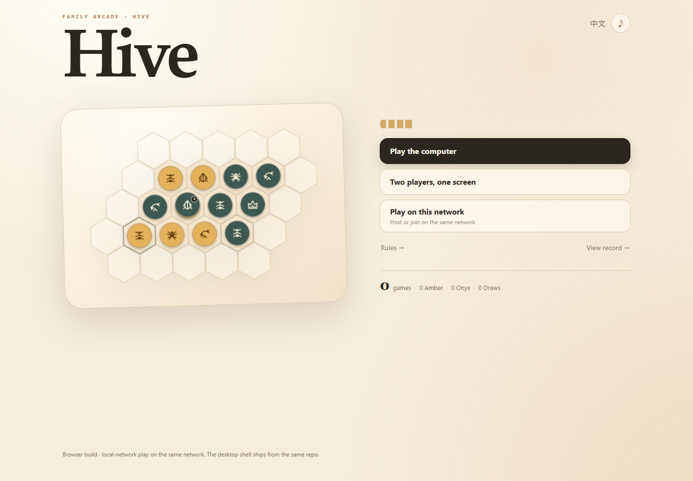
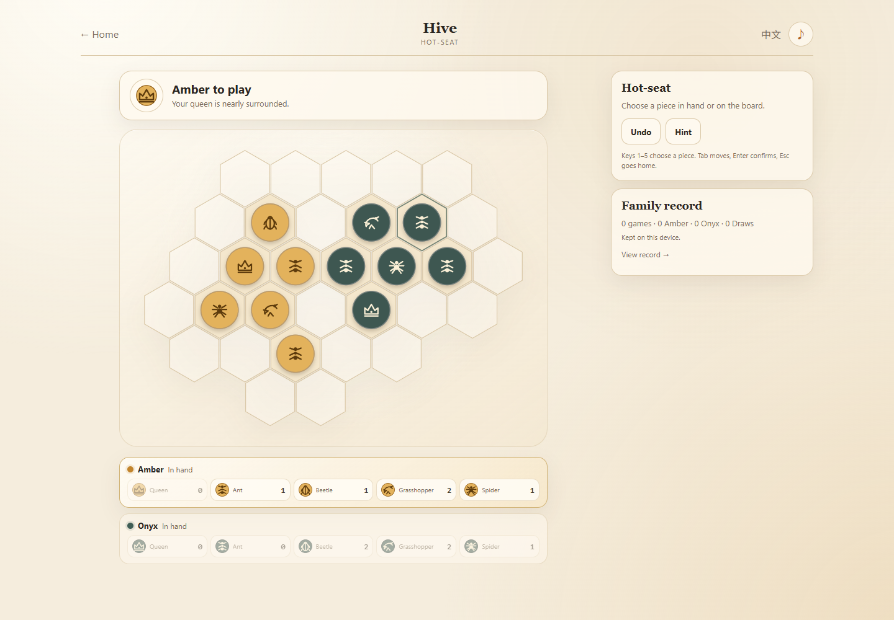
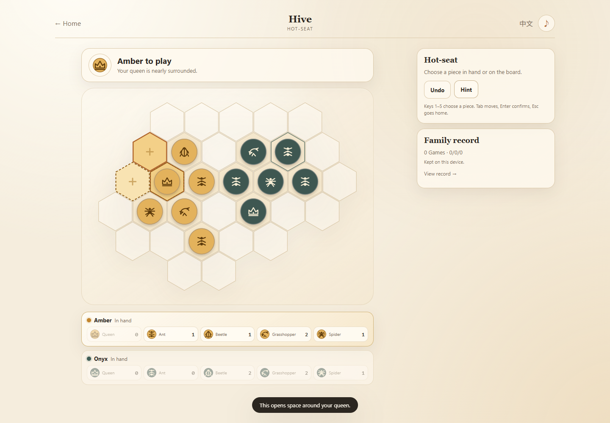
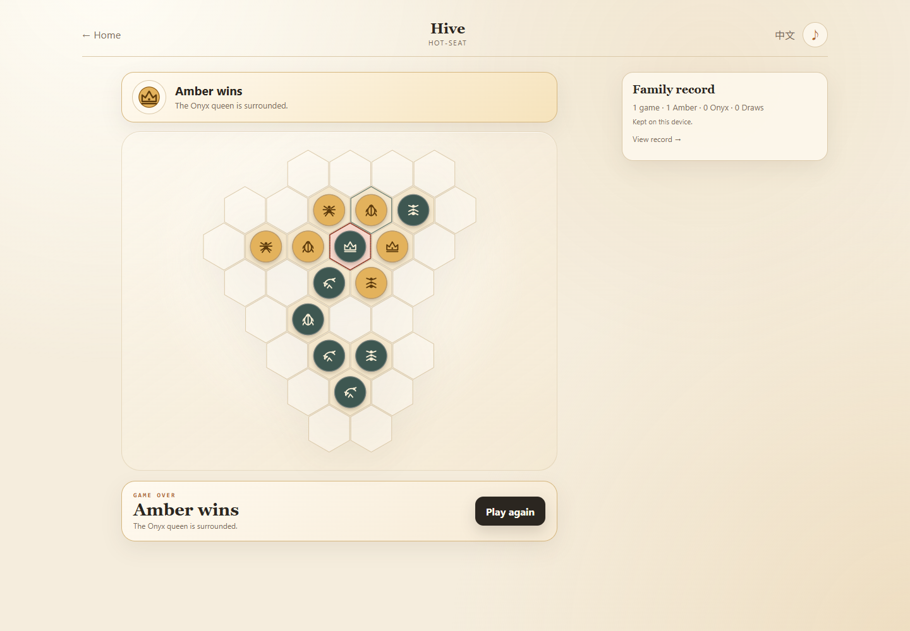
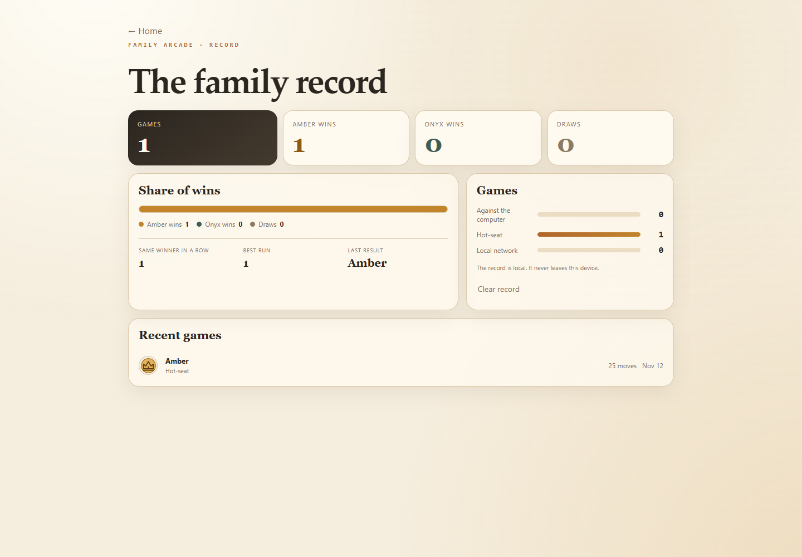
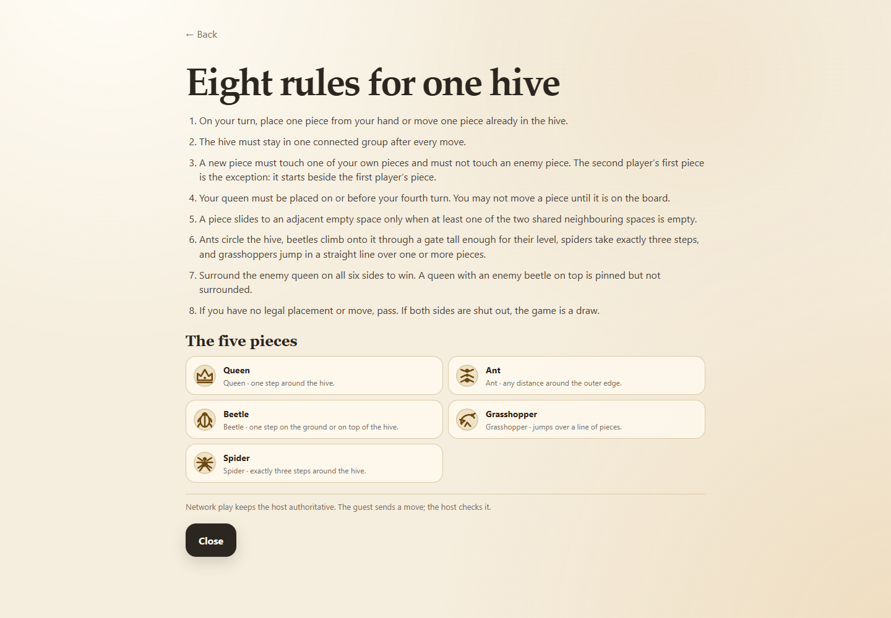
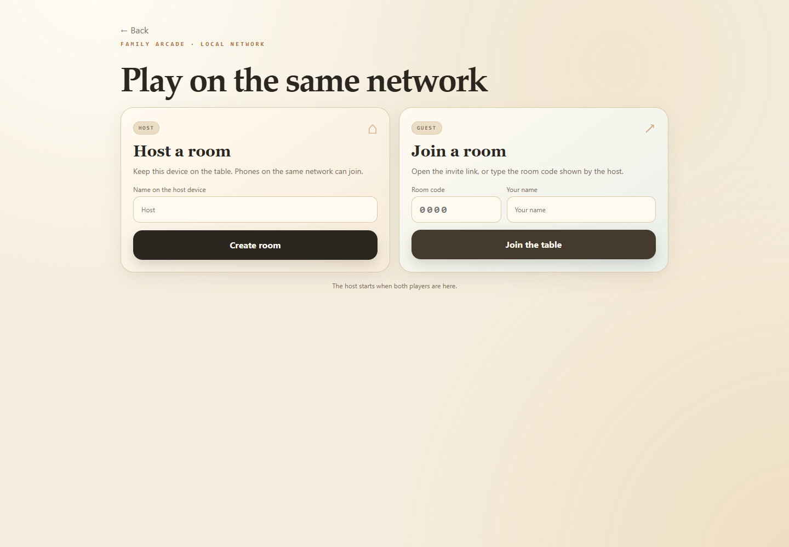
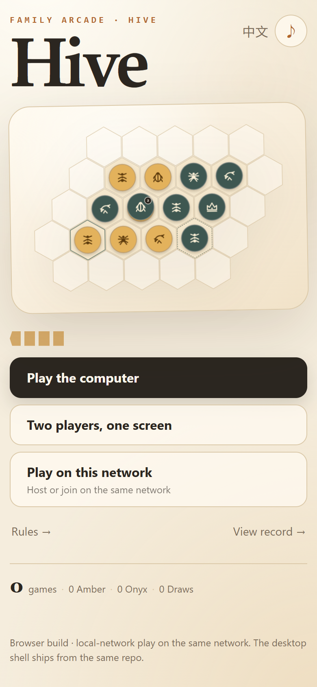
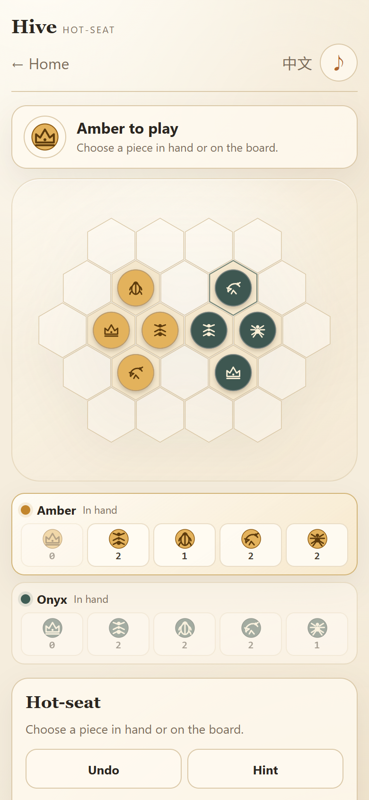

# Hive

**English** · [简体中文](README.zh-CN.md)

> **One hive. Six sides. One queen.**

A complete, offline-first base-set Hive for the family table: **2 players**, 22 pieces,
the one-hive rule, full queen/ant/beetle/grasshopper/spider movement, four AI levels,
one-screen hot-seat and LAN play from a phone. No account, no ads, no cloud.



## A turn, in five seconds

| Place or move | Keep the hive | Win |
| --- | --- | --- |
| Add a piece from your hand, or move one piece already in play once your queen is down. | Every piece must stay in one connected hive; only the top piece of a stack can move. | Surround the enemy queen on all six sides. |

The queen must be placed by your fourth turn, and no piece may move before it is on the
board. New pieces touch your own pieces and never an enemy; the second player’s first
piece starts beside the first player’s first piece. Ants circle the rim, beetles climb,
spiders take exactly three steps, and grasshoppers jump in a straight line.

## What is inside

- **A real, tested engine.** Pure TypeScript, deterministic, **37 unit tests**, no DOM,
  network, clock or randomness in the rules. See [`docs/rules.md`](docs/rules.md).
- **The full base set.** One queen, three ants, two beetles, three grasshoppers and two
  spiders per player, with stacks, the one-hive rule, freedom-to-move gates, height-aware
  beetle gates, exact spider paths and queen-surround wins.
- **Four AI levels.** Companion plays gently, Easy wanders, Normal searches two plies,
  and Hard uses a three-ply ordered search with a bounded beam. Hard is a real
  challenge, not a solved opponent.
- **Three ways to play.** Solo against the computer, two players passing one device,
  or a phone joining the host over the local network.
- **A LAN table that handles real life.** Host a room, share the four-digit code or QR,
  and join from a phone. The host is authoritative, the guest sends only a move, stale
  moves are ignored, and a reloaded guest receives the live view again.
- **Small comforts.** Undo (local and AI), a hint that explains *why*, autosave and
  resume, sound on/off, keyboard support, reduced-motion support, complete
  Chinese/English UI, and a mobile layout designed as a first-class way to play.
- **A family record.** Totals, Amber/Onyx wins, draws, mode split, current and best runs, and
  the eight most recent games. LAN results are recorded on the host device.
- **Private by default.** No accounts, no telemetry, no ads, no remote fonts or art.

## Screenshots

| A real game | Hint with a reason |
| --- | --- |
|  |  |

| Result | Family record |
| --- | --- |
|  |  |

| Rules | LAN lobby |
| --- | --- |
|  |  |

| Phone home | Phone game |
| --- | --- |
|  |  |

All screenshots come from the running app at 1440×1000 (phone 390×844 @2×).

## Play locally

```bash
npm install
npm run dev        # http://localhost:5213
npm run check      # tsc + 37 tests + production build
npm run e2e        # real Chrome, dev server required
npm run lan:e2e    # starts its own relay on :18927 after a build
npm run shots      # regenerate the ten EN/ZH screenshots
```

## LAN night

Browser/dev:

```bash
npm run build
npm run lan        # relay on :8080, serves dist/
# open http://localhost:5213, Play on this network, Create room
# guest: scan the QR, or open the invite and type the code
```

Desktop: the Tauri build starts the same relay internally and serves the built app to
phones. The host shows a four-digit room code and a QR invite. Guests open the address
on the same network; no app install is needed on their side.

The relay is a dumb message bus. The host keeps the authoritative state and sends
`view(state, 1)` to the guest. The guest sends `{type: 'hive-move', move, moveCount}`;
the host re-checks the seat, turn, move count and full move legality with `applySeat`.
The guest result banner is read-only and waits for the host to start the next game.

## Build the Windows installer

```bash
npm install
npx tauri build --bundles nsis
# src-tauri/target/release/bundle/nsis/Hive_0.1.0_x64-setup.exe
```

The installer is per-game and lightweight; WebView2 uses the standard bootstrapper.
A Windows SmartScreen warning is expected for an unsigned family build.

## Known limitations

- Browser build plus a local Tauri shell; no cloud, accounts, matchmaking or spectators.
- LAN is IPv4 on the same subnet; guest phones need the host firewall to allow the app.
- Stats are local to each device. A LAN game is recorded on the host, not duplicated on
  the guest; clearing the record only affects this browser/device.
- A browser-hosted QR may use `localhost`; for a phone on the network use the desktop
  build or open the host machine’s LAN IP.
- Hard uses a bounded three-ply beam, not a solved game or a tablebase.
- A player with no legal placement or move must pass. If both sides are shut out in
  succession the game is recorded as a draw. Repetition is not automatically adjudicated.
- In the extremely rare position where the fourth-turn queen has no legal placement,
  the engine keeps the game playable rather than deadlocking; see
  [`docs/limitations.md`](docs/limitations.md).
- No 4K/vertical promo cut. `video.json` is the manifest the root studio renders.

See [`docs/limitations.md`](docs/limitations.md) for the full list.

## License

MIT. Hive is a design by John Yianni, published by Gen42 Games; this is an independent,
non-commercial family implementation. See [`NOTICE.md`](NOTICE.md).


