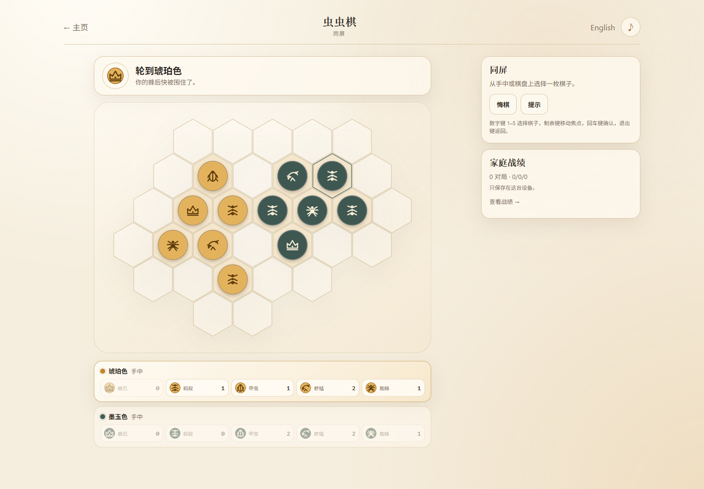
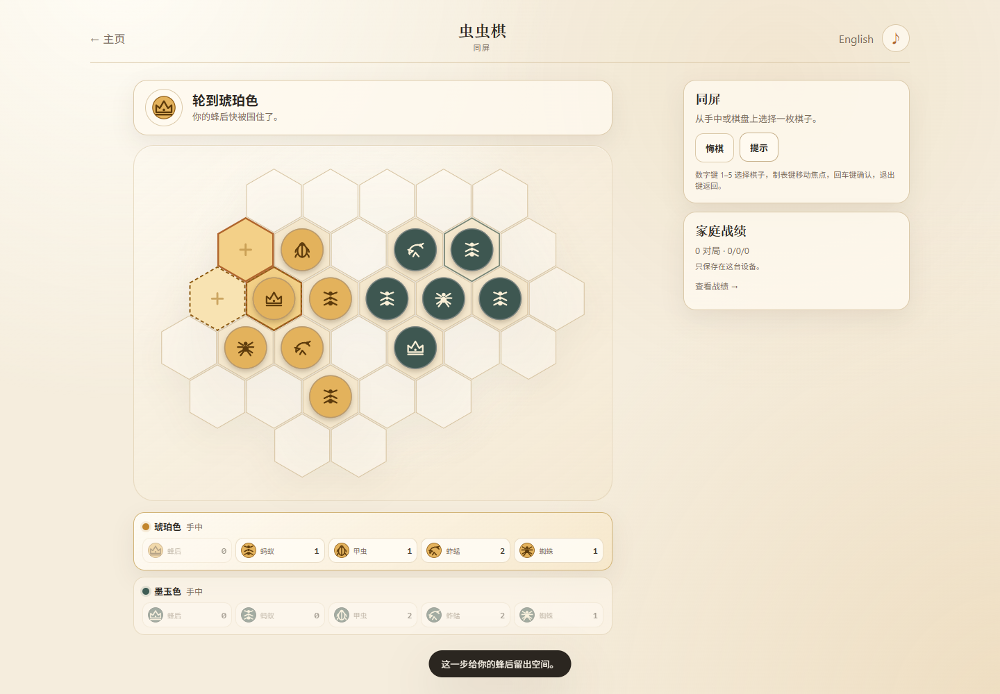
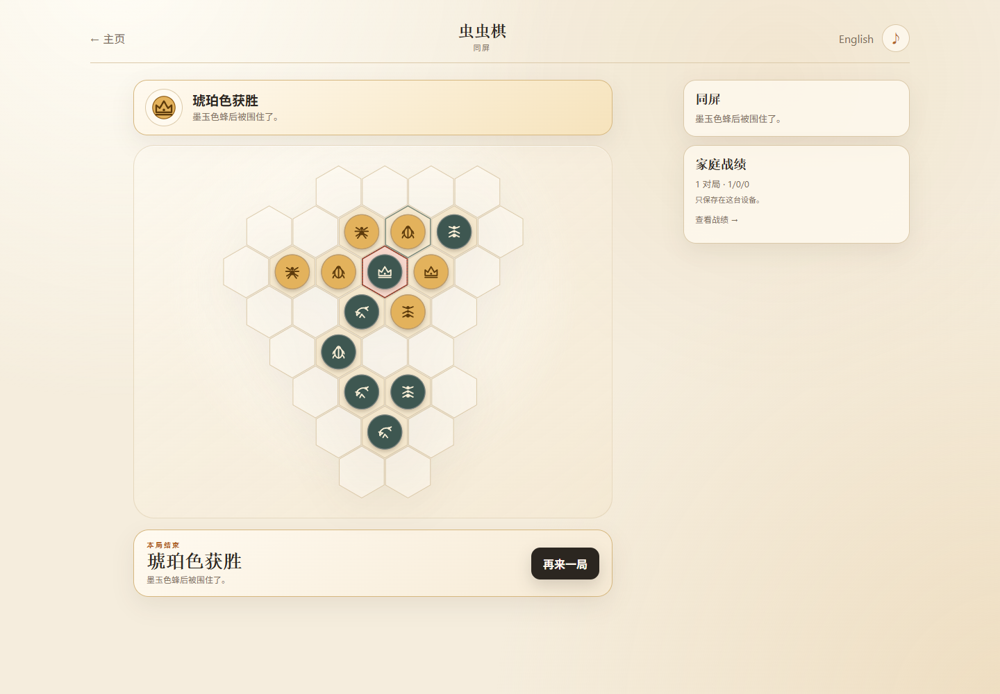
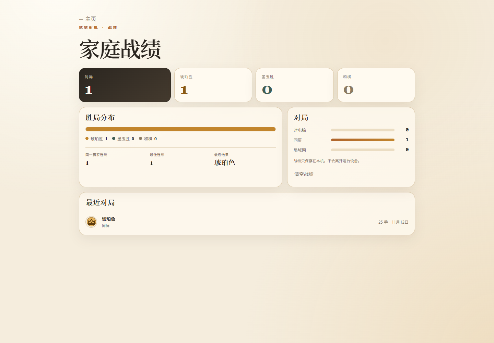
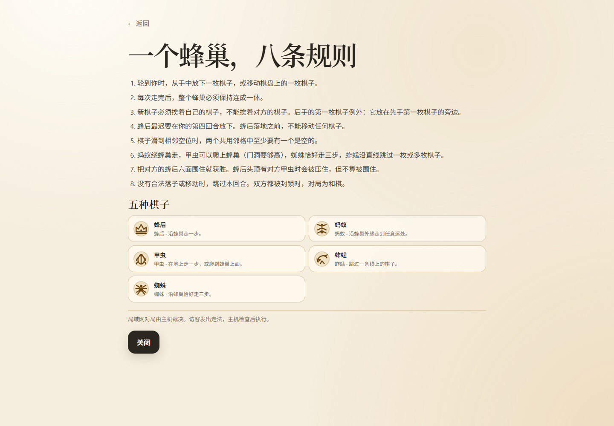
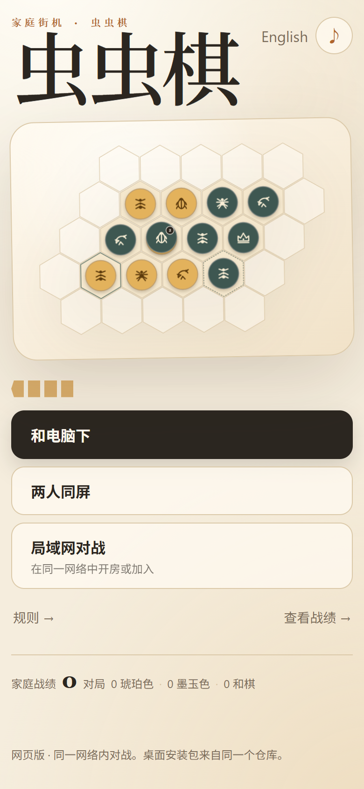
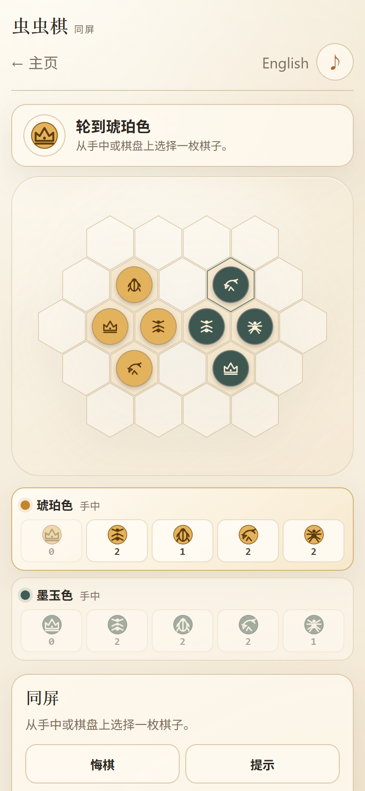

# 虫虫棋 · Hive

[English](README.md) · **简体中文**

> **一个蜂巢，六面围杀，一位蜂后。**

给家庭牌桌的完整基础版虫虫棋：**2 人**、22 枚棋子、一条蜂巢规则，以及蜂后、蚂蚁、
甲虫、蚱蜢、蜘蛛的全部走法。四档电脑对手、同屏热座，还有手机通过局域网加入。
无账号、无广告、无云端。


## 五秒看懂一回合

| 放子或移动 | 保持蜂巢 | 获胜 |
| --- | --- | --- |
| 从手中放下一枚棋子；蜂后落地后，也可以移动棋盘上的一枚棋子。 | 所有棋子必须始终连成一个蜂巢；只有棋堆最上面的一枚可以移动。 | 把对方的蜂后六面围住。 |

蜂后最迟要在你的第四回合放下，蜂后落地之前不能移动任何棋子。新棋子必须挨着自己的
棋子，不能挨着对方的棋子；后手的第一枚棋子例外，它放在先手第一枚棋子旁边。蚂蚁沿
外缘游走，甲虫可以爬上蜂巢，蜘蛛恰好走三步，蚱蜢沿直线跳过棋子。

## 内容

- **真正的规则引擎。** 纯 TypeScript、可复现，**37 项单元测试**；规则层不依赖 DOM、
  网络、时钟或随机数。详见 [`docs/rules.md`](docs/rules.md)。
- **完整基础套装。** 每位玩家一枚蜂后、三只蚂蚁、两只甲虫、三只蚱蜢、两只蜘蛛；
  支持棋堆、单蜂巢规则、移动间隙规则、考虑高度的甲虫门、蜘蛛精确三步和围后获胜。
- **四档电脑对手。** 陪玩温和，轻松会走神，标准搜索两层，挑战使用三层有序搜索和
  有限宽度。挑战很强，但不是已被穷举的对手。
- **三种玩法。** 单人对抗电脑、两人同屏，或手机通过局域网加入主机。
- **能应付真实家庭网络的局域网。** 主机开房，显示四位房间码或二维码，访客用手机
  浏览器加入。主机裁决一切，访客只发送走法；过期走法会被忽略，刷新后的访客会自动
  收到当前局面。
- **顺手的小功能。** 悔棋（本地与电脑局）、带理由的提示、自动保存与继续、声音开关、
  键盘操作、减少动画、完整中英文界面，以及为手机重新排版的布局。
- **家庭战绩。** 总对局、琥珀胜、墨玉胜、和棋、模式分布、当前与最佳连续、最近八局。
  局域网对局记在主机设备上。
- **默认私密。** 无账号、无遥测、无广告、无远程字体或素材。

## 截图

| 真实对局 | 带理由的提示 |
| --- | --- |
|  |  |

| 本局结束 | 家庭战绩 |
| --- | --- |
|  |  |

| 规则 | 局域网大厅 |
| --- | --- |
|  |  |

| 手机主页 | 手机对局 |
| --- | --- |
|  |  |

全部截图来自实际运行的应用：桌面 1440×1000，手机 390×844 @2×。

## 本地运行

```bash
npm install
npm run dev        # http://localhost:5213
npm run check      # 类型检查 + 37 项测试 + 生产构建
npm run e2e        # 需要先运行开发服务器，使用真实 Chrome
npm run lan:e2e    # 构建后自动启动 :18927 中继并测试局域网
npm run shots      # 重新生成中英文各十张截图
```

## 局域网对战

浏览器 / 开发环境：

```bash
npm run build
npm run lan        # 中继运行在 :8080，同时提供 dist/
# 主机打开 http://localhost:5213，进入局域网对战，创建房间
# 访客扫码，或打开邀请链接并输入房间码
```

桌面版：Tauri 壳会启动同一个中继，并把构建后的页面提供给手机。主机显示四位房间码
和二维码邀请；访客在同一网络中用浏览器打开地址即可，无需安装应用。

中继只负责转发消息。主机保存权威状态，并向访客发送 `view(state, 1)`。访客发送
`{type: 'hive-move', move, moveCount}`；主机用 `applySeat` 重新检查座位、回合、步数
和完整走法合法性。访客的结束界面是只读的，等待主机开始下一局。

## 构建 Windows 安装包

```bash
npm install
npx tauri build --bundles nsis
# src-tauri/target/release/bundle/nsis/Hive_0.1.0_x64-setup.exe
```

安装包按游戏单独构建，体积轻量；WebView2 使用标准引导程序。未签名的家庭版本出现
Windows SmartScreen 提示是正常的。

## 已知限制

- 浏览器版加本地 Tauri 壳；没有云端、账号、匹配或观战。
- 局域网仅支持同一子网的 IPv4；访客手机需要主机防火墙放行。
- 战绩只保存在各自设备。局域网对局记在主机，不会复制到访客；清空战绩只影响当前
  浏览器或设备。
- 浏览器版二维码可能使用 `localhost`；手机加入请使用桌面版，或打开主机的局域网 IP。
- 挑战难度使用有限宽度的三层搜索，不是已穷举的棋谱或残局库。
- 没有合法落子或移动时，必须跳过本回合。双方连续被封锁时，对局记为和棋。重复局面
  不会自动判和。
- 极罕见情况下，第四回合没有任何合法蜂后落点；引擎会继续保持对局可玩，而不是卡死，
  详见 [`docs/limitations.md`](docs/limitations.md)。
- 没有 4K 或竖版宣传片。`video.json` 是根目录工作室渲染宣传片所用的清单。

完整列表见 [`docs/limitations.md`](docs/limitations.md)。

## 许可

MIT。虫虫棋由 John Yianni 设计、Gen42 Games 出版；本作是独立的非商业家庭实现。
详见 [`NOTICE.md`](NOTICE.md)。


