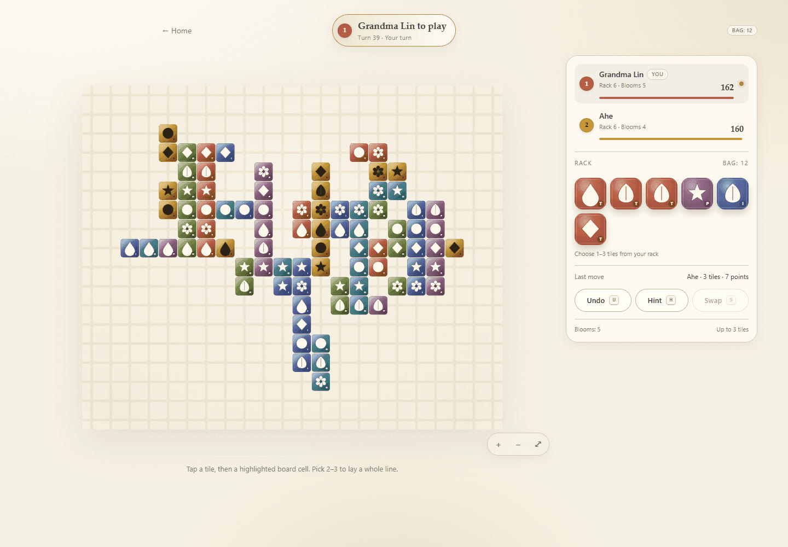
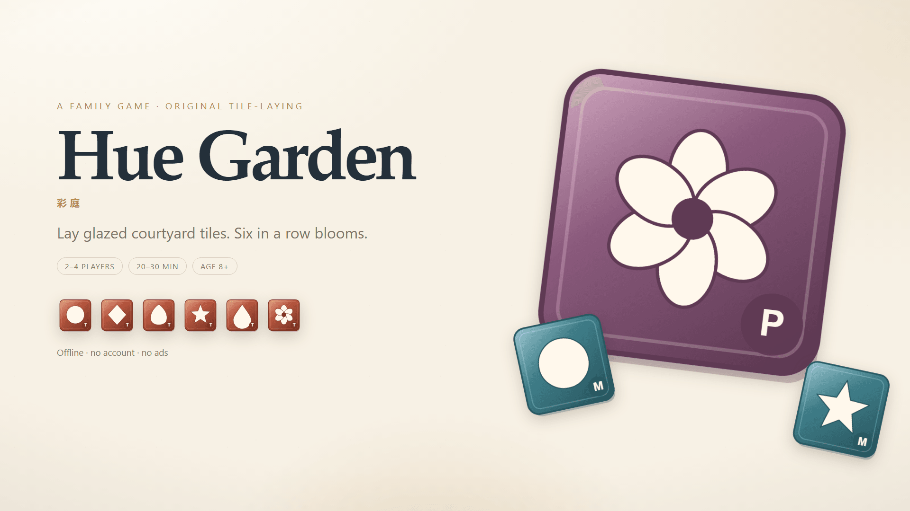
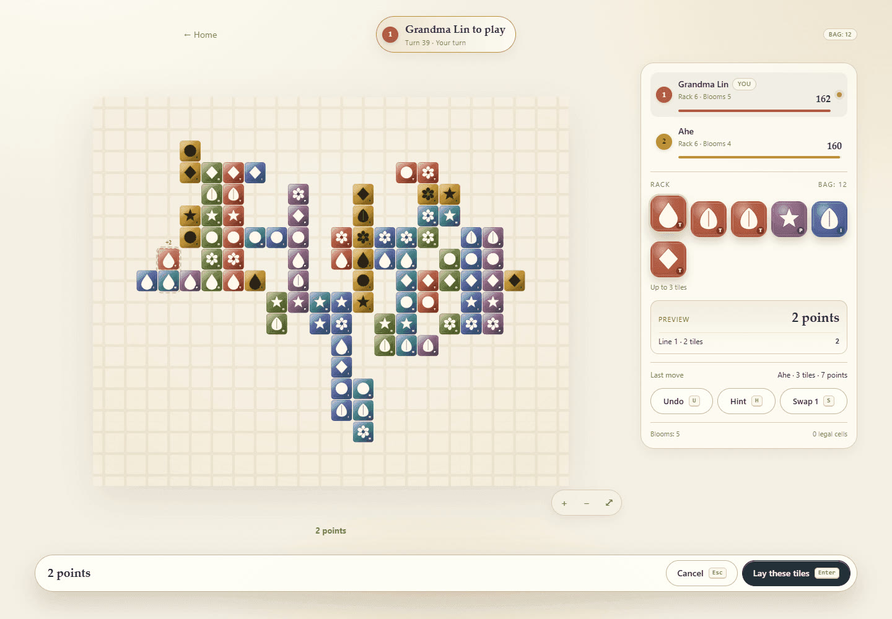
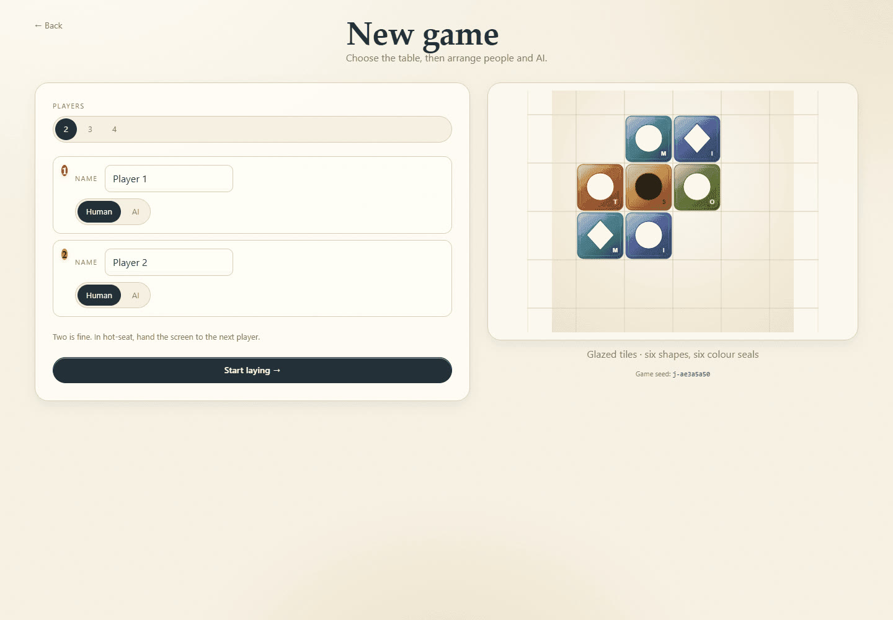
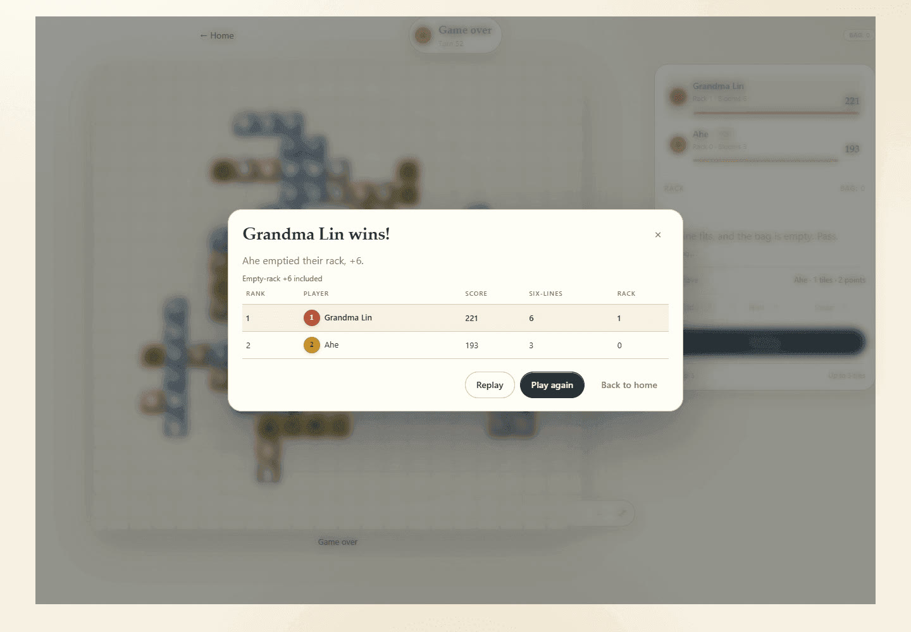
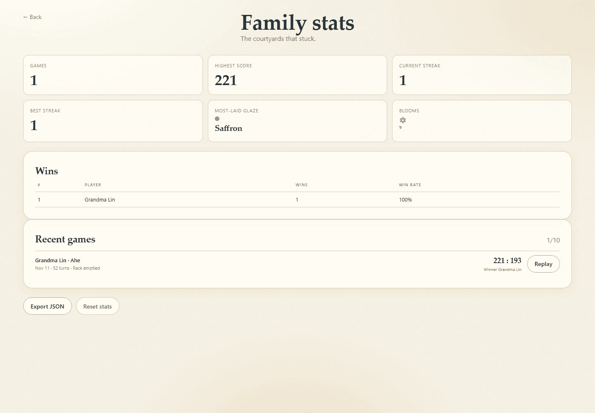
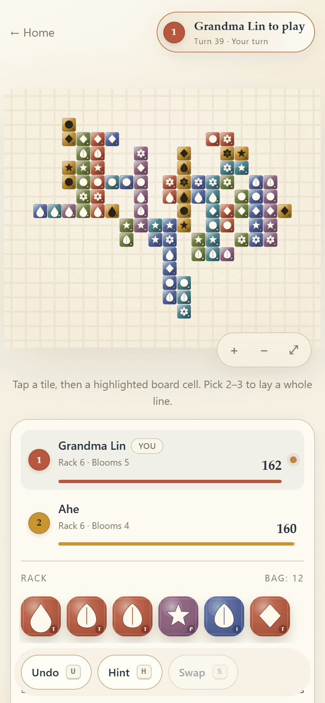
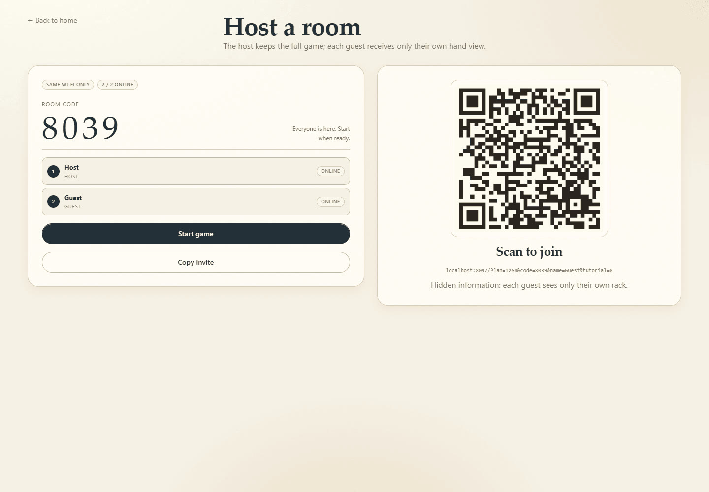
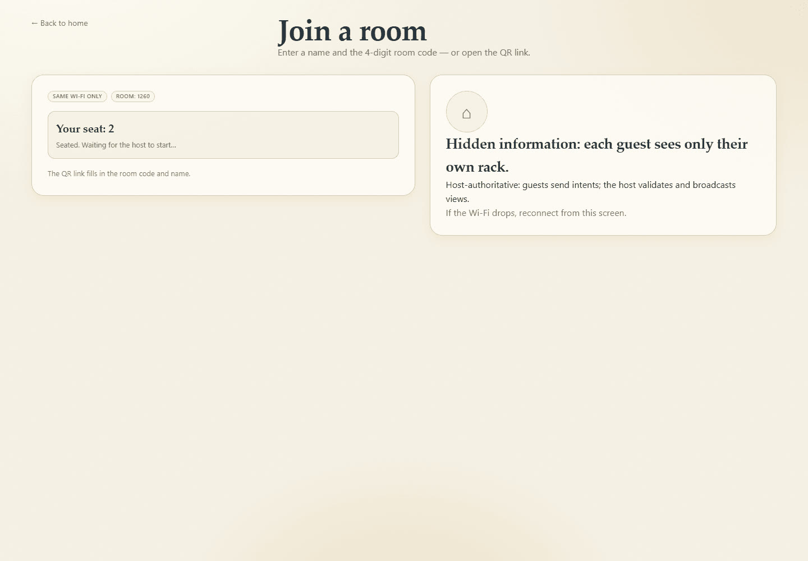

**English** · [简体中文](README.zh-CN.md)

# 彩庭 · Hue Garden

**A colour or a shape. One line at a time.**

A small, offline **tile-laying courtyard game** for family game night: 2–4 players,
20–30 minutes, age 8+, four AI levels, hot-seat, hints, undo, replay, autosave and a
complete Chinese/English UI. 108 glazed tiles, six shapes, six-in-a-row blooms.



[](docs/promo/hue-garden-promo-en.mp4)

*50 seconds · 1920×1080 · 60 fps · [中文版](docs/promo/hue-garden-promo-zh.mp4) · [English cut](docs/promo/hue-garden-promo-en.mp4) · [storyboard & checks](video/SCRIPT.md)*

**Browser + Tauri v0.1.** A static browser build, a real LAN relay, and a pre-created
Tauri shell for the Windows installer. No account, no telemetry, no network outside
your own Wi-Fi. The browser build is ~130 KB gzipped.

## A turn, in five seconds

| Lay a line | Score it | End it |
| --- | --- | --- |
| Choose 1–3 tiles: all one colour with new shapes, or one shape in new colours. | 1 point per tile in each line; six in a row blooms for +6. | Bag empty + first to empty their rack gets +6 and ends the game. Highest score wins. |

## What's inside

- **Rules, checked.** 108 tiles = 6 colours × 6 shapes × 3 copies; 18 per colour,
  18 per shape. Every rule has a test and an audit row: [`docs/rules.md`](docs/rules.md).
- **Four AI levels.** Companion / Easy / Normal / Hard, in a Web Worker, with
  Easy ≤80 ms, Normal ≤300 ms and Hard ≤900 ms. AI sees `view(state, seat)` only;
  Companion does not deliberately block kids. A 200-game per-pairing calibration
  table is in [`docs/ai-calibration.md`](docs/ai-calibration.md); it honestly reports
  that Hard vs Normal is still ~50/50 and needs tuning.
- **LAN night.** Host a room, show the 4-digit code and QR, and a phone joins from
  the browser. Host-authoritative: guests get only their own `view(state, seat)` and
  send intents; reconnecting returns to the same seat.
- **A table that reads.** Every tile has a shape plus a colour-seal letter; legal
  cells are visible, previews show the whole line and its score, and the game is
  fully playable by keyboard or with sound off. Reduced motion is respected.
- **A memory.** Autosave after every move, **Continue last game**, last-ten replay,
  local family stats and JSON export. Data stays in this browser. No account,
  telemetry or ads; LAN traffic stays on your own Wi-Fi.

## Screenshots

| A real game | Select, preview, confirm |
| --- | --- |
|  |  |

| New game | Game over |
| --- | --- |
|  |  |

| Family stats | On a phone |
| --- | --- |
|  |  |

| LAN host lobby | Guest waiting room |
| --- | --- |
|  |  |

Chinese versions live in [`docs/screenshots/zh/`](docs/screenshots/zh/). All captures
are from the real app at 1440×1000 (desktop) or 390×844@2x (phone); see
[`docs/screenshots/README.md`](docs/screenshots/README.md).

## Play it

You need Node.js 22+ for development.

```bash
npm install
npm run dev        # http://localhost:5174
```

Production build:

```bash
npm run build
npm run preview    # http://localhost:4174
```

`dist/` is a static site. The Tauri shell is included; the Windows installer is
built centrally (see below), not committed as a binary in this app folder.

## LAN night

Browser/dev:

```bash
npm run build
npm run lan        # relay + static dist on :8097
# open http://localhost:5174, choose LAN, create a room
# the QR/invite points at http://<this-host>:8097/?lan=...&code=...
```

Open the invite on a phone or another computer on the same Wi-Fi. The phone does
not install anything. The host keeps the authoritative `GameState`; each guest gets
only `view(state, seat)` (own rack, public board, counts) and sends `Move` intents.
The host validates every intent, broadcasts a fresh view to each seat, and sends the
final ranking. The room code is 4 digits; the QR carries room, code and name.

- **Reconnect:** a guest who drops can press **Reconnect** (or reload the invite
  URL); the client token returns them to the same seat and the host resends
  `start` + their view.
- **Seat status:** the lobby shows every seat online/offline; in-game the host sees
  the guest count and a disconnected guest; the guest sees its seat and a reconnect
  button when the relay closes.
- **Host is authoritative:** guests cannot apply state locally, and a stale/invalid
  intent is rejected on the host. Guest undo is disabled; hints run locally on the
  guest's own view.
- **Limits:** same Wi-Fi/IPv4; browser host needs `npm run lan`; Tauri starts the
  relay itself. Host closing/refresh ends the room (guests can reconnect only while
  the host room lives). No spectator or AI caretaker yet.

## Build the Windows installer

```bash
npm install
npx tauri build --bundles nsis
# output: src-tauri/target/release/bundle/nsis/
```

The shell is already wired to `crates/lan-host`; the Tauri command starts the same
relay when the desktop app opens. The installer is per-user (`currentUser`), uses the
WebView2 bootstrapper, and is **unsigned**: Windows SmartScreen may show “unknown
publisher” — choose *More info → Run anyway*. On first LAN use, allow the app through
the Windows firewall for **private networks**. The main Family Arcade release job builds
all installers; this repo does not run `cargo build` or `tauri build` in CI here.

## How to play

The rules, in five lines:

1. Everyone starts with 6 tiles; on your turn, lay 1–3.
2. A line is **all one colour with different shapes**, or **one shape in different
   colours**. No repeats, and at most 6 tiles.
3. Add to either end of an existing line, or start a new line touching the courtyard.
4. Score each line: 1 point per tile; six in a row is a **bloom** for +6. A tile that
   joins a row and a column scores both lines.
5. When the bag is empty, first to empty their rack gets +6 and ends the game.
   Highest score wins; ties go to most blooms, then fewest tiles left, then shared.

House rules for the family table: the opening line covers `(0,0)`; add to ends only
(no inserting between two tiles); pass only when no line fits and the bag is empty;
swapped tiles go to the bottom of the bag so replay stays deterministic.

### Controls

| Action | Mouse / touch | Keyboard |
| --- | --- | --- |
| Select tiles | Tap 1–3 tiles in the rack | `Tab` to a tile, `Enter` |
| Preview a line | Tap a highlighted board cell | `Tab` to the cell, `Enter` |
| Confirm | **Lay these tiles** | `Enter` |
| Cancel | **Cancel** / `Esc` | `Esc` |
| Hint | **Hint** | `H` |
| Undo | **Undo** | `U` |
| Swap | **Swap** | `S` |
| Sound | Home / Settings | `M` cycles on / low / off |
| Zoom / fit | **+ / − / ⤢** | buttons |

Tips: dots are legal; a dashed outline is the line that will score; a dimmed rack
tile is not selected; if a cell cannot take your tiles you get a readable reason
(“not connected”, “line would repeat”, “do not insert between two tiles”). Nothing
is timed — think as long as you like. In hot-seat, the acting seat's hand is the only
hand in the data view, but the physical screen is shared.

## After the game

Finished games are saved locally: stats (games, wins, win rate, highest score,
current/best streak, most-laid glaze, blooms), the **last ten** full replays, and
JSON export. Unfinished games autosave after every move, so **Continue last game**
appears after a refresh or crash. Replay re-applies the real moves through the engine
instead of storing a video.

## The promo

A real **Remotion** project in [`video/`](video/), 50 seconds, 1920×1080, 60 fps,
Chinese and English compositions on the same timeline. Both cuts are rendered to
[`docs/promo/hue-garden-promo-zh.mp4`](docs/promo/hue-garden-promo-zh.mp4) and
[`docs/promo/hue-garden-promo-en.mp4`](docs/promo/hue-garden-promo-en.mp4); posters
and SRTs are next to them. The 38-turn game, 84 tiles and 162:160 score come from
the real engine; every claim is checked in [`video/FACTS.md`](video/FACTS.md), and
both audio masters are limited and measured at **−14.4 / −14.1 LUFS**, true peak
**−1.8 / −1.9 dBTP** (target −14 ±1, ≤ −1 dBTP).

```bash
cd video
npm install
npm run gen      # engine data + voice + SRT
npm run facts    # accuracy gate
npm run render   # Chinese 50 s cut
npm run render:en
npm run master   # +gain, limiter, AAC master + audio-check.json
```

## Development

```bash
npm install
npm run dev            # Vite dev server on 5174
npm run check          # typecheck + data verify + vitest + build
npm run data:verify    # 108 tiles / 18 per colour / 18 per shape / 3 copies
npm run build          # tsc --noEmit + vite build
node scripts/e2e.mjs   # real Chrome: solo, hot-seat, undo, resume, win, replay, mobile
node scripts/lan-e2e.mjs # host + guest, view/intent, reconnect, offline seat
node scripts/shots.mjs # regenerate docs/screenshots/{en,zh}
node scripts/lan-shots.mjs # host/guest lobby screenshots (needs relay)
node scripts/compress-shots.mjs
npm run lan            # browser relay on :8097
npx tauri build --bundles nsis
```

### Architecture

```
src/
  game/        pure engine: data, tiles, board lines, legal plays, scoring, replay, invariants
  ai/          four levels + explainable hints + Web Worker client
  ui/          SVG board, tile art, screens, LAN lobby, dialogs; no game rules
  net.ts       Tauri relay discovery or browser relay URL
  i18n.ts      complete zh/en strings, system language + toggle
  storage.ts   autosave, stats, recent games, settings, JSON export
  sound.ts     tiny Web Audio synth (no audio files)
  src-tauri/   Tauri shell + shared family-arcade-lan-host relay
tests/         rules, scoring, endings, 120 random games, AI, data
data/          tiles.json + verify script
video/         Remotion promo, two compositions, voice/SRT/FACTS
video.json     root studio manifest (8 bilingual lines, facts, 3 screens)
docs/          rules audit, limitations, decisions, glossary, screenshots, promo
```

The engine exists once (TypeScript). It has no DOM, network, clock or bare
`Math.random`; the shuffle takes an injected RNG and `view()` crops hidden hands.
`apply()` returns stable error codes, `replay()` rebuilds a game from the same seed
and move list, and `invariants()` checks tile conservation, line legality and board
connectivity after every move. LAN adds only transport: `viewPosition()` lets a guest
enumerate its legal options without ever owning the authoritative state.

## Status, limits and licence

- **v0.1** — solo + 2–4 hot-seat, four AI levels, hints/undo, autosave/resume,
  replay, stats, bilingual UI, responsive phone layout, LAN host/guest with reconnect,
  Tauri shell, Remotion promo.
- **Next** — spectator + AI caretaker, host migration, LAN practice with 3–4 guests,
  installer signing, colour-vision simulation capture.
- No 5+ player mode, accounts, cloud sync, leaderboards, ads or telemetry. See
  [`docs/limitations.md`](docs/limitations.md) for every honest gap.

- Code: [MIT](LICENSE). Docs, screenshots and promo: CC BY 4.0 unless noted.
- **Non-official, non-commercial family project.** No Qwirkle or publisher name,
  art, card text or trade dress is included; mechanics are inspired by the public
  tile-laying tradition, expression is original. See [`NOTICE.md`](NOTICE.md).
- Rules audit: [`docs/rules.md`](docs/rules.md) · decisions:
  [`docs/decisions.md`](docs/decisions.md) · glossary:
  [`docs/glossary.md`](docs/glossary.md).
