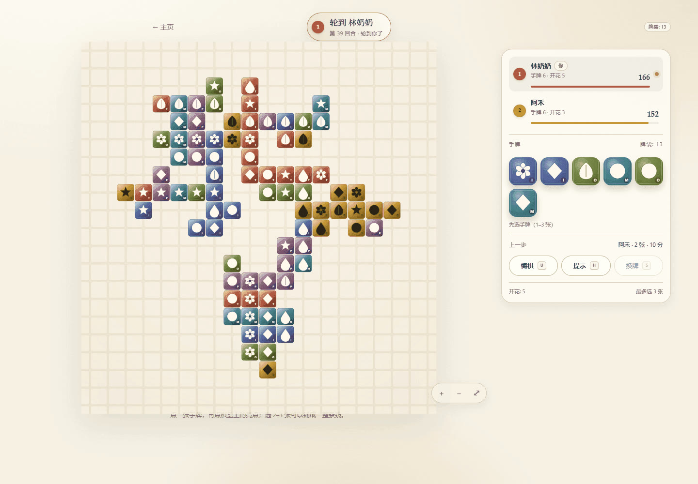
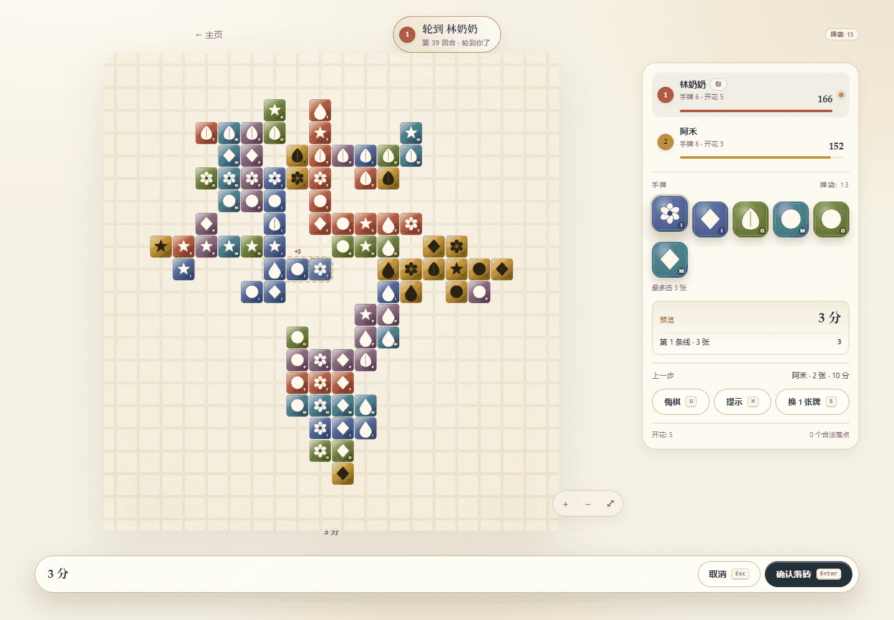
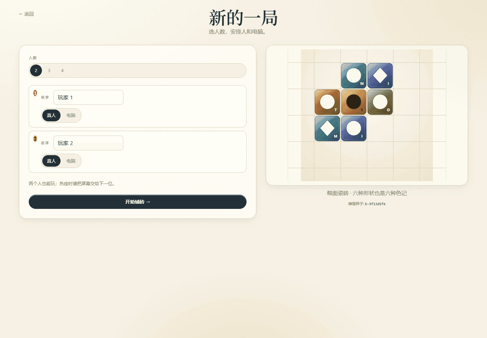
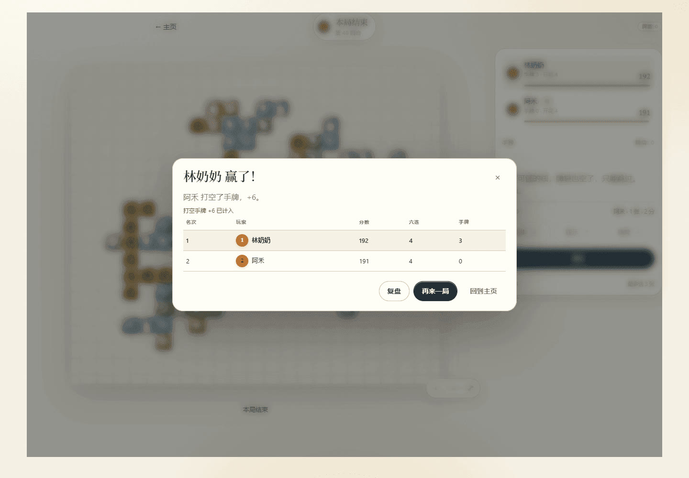
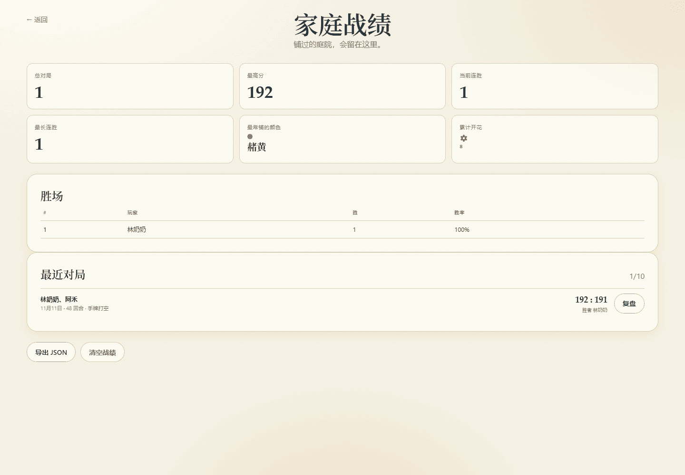
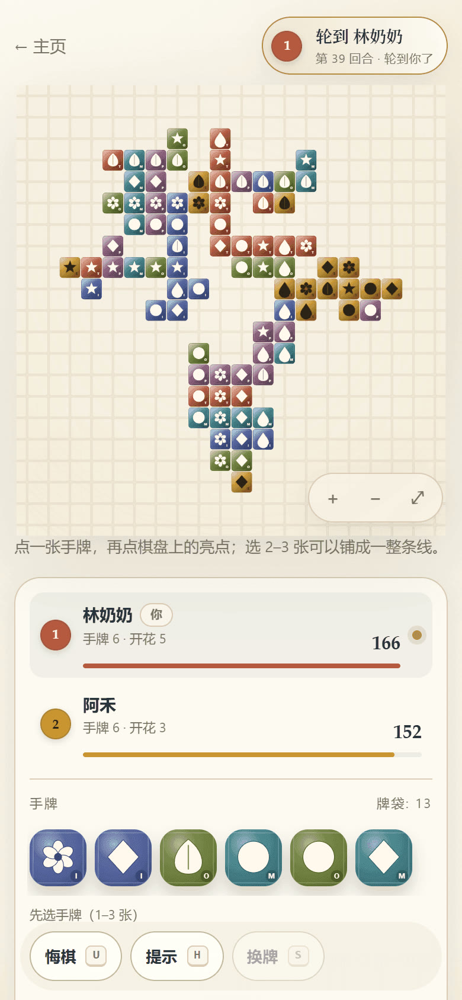

[English](README.md) · **简体中文**

# 彩庭 · Hue Garden

**颜色或形状，连成一条线。**

一个为家庭游戏夜做的小巧、离线的**瓷砖拼放庭院游戏**：2–4 人、20–30 分钟、8 岁
以上，四档 AI、同屏热座、提示、悔棋、复盘、自动保存，中英双语完整界面。108 张
釉面瓷砖，六种形状，六连开花。



[](docs/promo/hue-garden-promo-zh.mp4)

*50 秒 · 1920×1080 · 60 fps · [English cut](docs/promo/hue-garden-promo-en.mp4) · [分镜与核对](video/SCRIPT.md)*

**浏览器 + Tauri 的 v0.1。** 静态浏览器构建、真实局域网中继、预建的 Tauri 安装壳。
不需要账号、遥测，除了自家 Wi-Fi 之外不联网。浏览器构建约 130 KB（gzip）。

## 五秒规则

| 铺一条线 | 计分 | 结束 |
| --- | --- | --- |
| 选 1–3 张：同色不同形，或同形不同色。 | 每条线每张 1 分；六连开花再 +6。 | 牌袋空后先打空手牌 +6 并结束；分高者胜。 |

## 里面有什么

- **规则核对。** 108 张 = 6 色 × 6 形 × 3 张；每色 18 张、每形 18 张。每条规则都有
  测试和审计行：[`docs/rules.md`](docs/rules.md)。
- **四档 AI。** 陪玩 / 轻松 / 标准 / 挑战，在 Web Worker 里运行；轻松 ≤80ms、
  标准 ≤300ms、挑战 ≤900ms。AI 只拿到 `view(state, seat)`，陪玩档不故意堵小朋友。
  200 局/对局的校准表见 [`docs/ai-calibration.md`](docs/ai-calibration.md)；表里诚实记录
  挑战对标准仍约 50/50，需要继续调参。
- **局域网之夜。** 开房、显示 4 位房间号和二维码，手机浏览器加入。主机权威：客人
  只拿到自己的 `view(state, seat)` 并发落砖意图；重连回到原座位。
- **一张会读的桌子。** 每张砖都有形状 + 色记字母；合法点可见，预览显示整条线与得分；
  纯键盘可玩，静音可玩，尊重减少动效。
- **有记忆。** 每步自动保存、**继续上局**、最近十局复盘、本地家庭战绩、JSON 导出。
  数据只留在这台浏览器。无账号、无遥测、无广告；局域网流量只在自家 Wi-Fi。

## 截图

| 真实对局 | 选牌、预览、确认 |
| --- | --- |
|  |  |

| 新的一局 | 本局结束 |
| --- | --- |
|  |  |

| 家庭战绩 | 手机竖屏 |
| --- | --- |
|  |  |

| 局域网主机大厅 | 客人等待室 |
| --- | --- |
|  |  |

英文版在 [`docs/screenshots/en/`](docs/screenshots/en/)。全部截图来自真实应用：
桌面 1440×1000，手机 390×844@2x；见
[`docs/screenshots/README.md`](docs/screenshots/README.md)。

## 运行

开发需要 Node.js 22+。

```bash
npm install
npm run dev        # http://localhost:5174
```

生产构建：

```bash
npm run build
npm run preview    # http://localhost:4174
```

`dist/` 是静态站点。Tauri 安装壳已经包含；Windows 安装包由主发布任务统一构建，
本目录不提交二进制安装包。

## 局域网之夜

浏览器/开发：

```bash
npm run build
npm run lan        # 中继 + 静态 dist，端口 8097
# 打开 http://localhost:5174，选局域网，创建房间
# 二维码/邀请指向 http://<本机>:8097/?lan=...&code=...
```

手机或另一台电脑在同一 Wi-Fi 打开邀请即可，手机无需安装。主机保留权威
`GameState`；客人只拿到 `view(state, seat)`（自己的手牌、公共棋盘、数量），发送
`Move` 意图。主机验证后向每个座位广播新视图，结束时发送排名。房间号 4 位，二维码
自带房间、房间号和名字。

- **重连：** 客人掉线后点“重新连接”（或刷新邀请链接），客户端令牌会回到原座位，
  主机重新发送 `start` 和自己的视图。
- **座位状态：** 大厅显示每个座位在线/离线；对局中主机看到客人数和掉线状态，客人
  看到自己的座位；中继断开时出现重连按钮。
- **主机权威：** 客人不在本地应用状态；过期/非法意图由主机拒绝。客人悔棋关闭；
  提示在客人本地用同一套 AI 基于自己的视图运行。
- **限制：** 同一 Wi-Fi/IPv4；浏览器主机需要 `npm run lan`，Tauri 自动启动中继。
  主机关闭/刷新会结束房间（只有主机房间还在时客人才能重连）。暂无观战/AI 托管。

## 构建 Windows 安装包

```bash
npm install
npx tauri build --bundles nsis
# 输出：src-tauri/target/release/bundle/nsis/
```

Tauri 壳已接入 `crates/lan-host`，桌面应用启动时会运行同一中继。安装包按用户安装
（`currentUser`），使用 WebView2 bootstrapper，且**未签名**：Windows SmartScreen 可能
提示“未知发布者”，选择“更多信息 → 仍要运行”。首次局域网使用时，请允许应用通过
Windows 防火墙的**专用网络**。主 Family Arcade 发布任务统一构建所有安装包；本仓库不运行
`cargo build`/`tauri build`。

## 怎么玩

五句话：

1. 每人 6 张手牌；轮到你时铺 1–3 张。
2. 一条线要么**同色不同形**，要么**同形不同色**；不能重复，最多 6 张。
3. 可以接在现有线两端，也可以另起一条，但必须碰到庭院。
4. 每条线每张 1 分；六连**开花**再 +6。一张砖同时接上横竖两条，两条都算。
5. 牌袋空后，谁先打空手牌，谁 +6 并结束；分高者胜。平局先看六连，再看手牌剩余，
   仍相同则并列。

家庭房规：第一手覆盖 `(0,0)`；只能接两端，不能插进两条现有线之间；没有可铺线且牌袋
为空才可跳过；换出的牌放回牌袋底部，保证复盘可复现。

### 操作

| 动作 | 鼠标 / 触屏 | 键盘 |
| --- | --- | --- |
| 选牌 | 点 1–3 张手牌 | `Tab` 到手牌，`Enter` |
| 预览整条线 | 点棋盘亮点 | `Tab` 到亮点，`Enter` |
| 确认 | **确认落砖** | `Enter` |
| 取消 | **取消** / `Esc` | `Esc` |
| 提示 | **提示** | `H` |
| 悔棋 | **悔棋** | `U` |
| 换牌 | **换牌** | `S` |
| 声音 | 主页 / 设置 | `M` 循环 开 / 低 / 关 |
| 缩放 / 适应 | **+ / − / ⤢** | 按钮 |

小贴士：亮点=可落；虚线框=这条线会得分；灰掉的手牌=没选中；点到不能放的位置会给出
人话原因（“接不上”“这条线会重复”“不能插进两条线之间”）。没有强制计时，可以慢慢想。
热座时数据层只保留当前座位的手牌，但屏幕是共享的。

## 一局之后

完成的局会留在本地：战绩（总对局、胜场、胜率、最高分、当前/最长连胜、最常铺的釉色、
开花数）、**最近十局**完整复盘、JSON 导出。未完成的局每步自动保存，刷新或崩溃后主页
出现**继续上局**。复盘用引擎重新应用真实走法，不是录屏。

## 宣传片

[`video/`](video/) 是真实的 **Remotion** 工程：50 秒、1920×1080、60fps，中文和英文
两个 Composition 共用一条时间线。两版都渲染到
[`docs/promo/hue-garden-promo-zh.mp4`](docs/promo/hue-garden-promo-zh.mp4) 和
[`docs/promo/hue-garden-promo-en.mp4`](docs/promo/hue-garden-promo-en.mp4)；海报和
SRT 在旁边。38 手、84 张、162:160 的比分来自真实引擎；每条声明由
[`video/FACTS.md`](video/FACTS.md) 核对，两版音频都限幅并实测为
**−14.4 / −14.1 LUFS**、真峰值 **−1.8 / −1.9 dBTP**（目标 −14 ±1、≤ −1 dBTP）。

```bash
cd video
npm install
npm run gen      # 引擎数据 + 配音 + SRT
npm run facts    # 准确性门禁
npm run render   # 中文 50 秒版
npm run render:en
npm run master   # +增益、限幅、AAC 母带 + audio-check.json
```

## 开发

```bash
npm install
npm run dev            # Vite 开发服务器 5174
npm run check          # 类型检查 + 数据校验 + vitest + 构建
npm run data:verify    # 108 张 / 每色 18 / 每形 18 / 每组合 3 张
npm run build          # tsc --noEmit + vite build
node scripts/e2e.mjs   # 真实 Chrome：单人、热座、悔棋、刷新继续、结束、复盘、手机
node scripts/lan-e2e.mjs # 主机 + 客人、视图/意图、重连、离线座位
node scripts/shots.mjs # 重新生成 docs/screenshots/{en,zh}
node scripts/lan-shots.mjs # 局域网大厅截图（需要中继）
node scripts/compress-shots.mjs
npm run lan            # 浏览器中继 8097
npx tauri build --bundles nsis
```

### 架构

```
src/
  game/        纯引擎：数据、瓷砖、线判断、合法走法、计分、回放、不变量
  ai/          四档 AI + 可解释提示 + Web Worker 客户端
  ui/          SVG 棋盘、瓷砖、页面、局域网大厅、对话框；不实现规则
  net.ts       Tauri 中继发现 / 浏览器中继地址
  i18n.ts      完整中英文案、系统语言 + 手动切换
  storage.ts   自动保存、战绩、最近对局、设置、JSON 导出
  sound.ts     极小的 Web Audio 合成器（无音频文件）
  src-tauri/   Tauri 安装壳 + 共享 family-arcade-lan-host 中继
tests/         规则、计分、结束、120 局随机模拟、AI、数据
data/          tiles.json + 校验脚本
video/         Remotion 宣传片、两个 Composition、配音/SRT/FACTS
video.json     根视频工作站的清单（8 句中英旁白、facts、3 张截图）
docs/          规则审计、限制、决策、术语、截图、宣传物料
```

引擎只有一份（TypeScript）。它不依赖 DOM、网络、时钟或裸 `Math.random`；洗牌使用注入
的 RNG，`view()` 在数据层裁掉别人手牌。`apply()` 返回稳定错误码，`replay()` 用同一种子
和走法重建局面，`invariants()` 每步检查瓷砖守恒、线合法和棋盘连通。局域网只加传输：
`viewPosition()` 让客人在不拥有权威状态的情况下枚举自己的合法走法。

## 状态、限制与许可

- **v0.1** —— 单人 + 2–4 人同屏、四档 AI、提示/悔棋、自动保存/继续、复盘、战绩、
  中英双语、手机竖屏、局域网主机/客人 + 重连、Tauri 安装壳、Remotion 宣传片。
- **下一步** —— 观战 + AI 托管、主机动迁移、3–4 人局域网实测、安装包签名、
  色弱模拟截图。
- 没有 5+ 人、账号、云同步、排行榜、广告或遥测。所有诚实的缺口见
  [`docs/limitations.md`](docs/limitations.md)。

- 代码：[MIT](LICENSE)。文档、截图、宣传物料：除注明外 CC BY 4.0。
- **非官方、非商业家庭项目。** 不包含 Qwirkle 或任何出版商的名称、美术、卡牌文字或
  外观；机制借鉴公版瓷砖拼放传统，表达原创。见 [`NOTICE.md`](NOTICE.md)。
- 规则审计：[`docs/rules.md`](docs/rules.md) · 决策：
  [`docs/decisions.md`](docs/decisions.md) · 术语：
  [`docs/glossary.md`](docs/glossary.md)。
