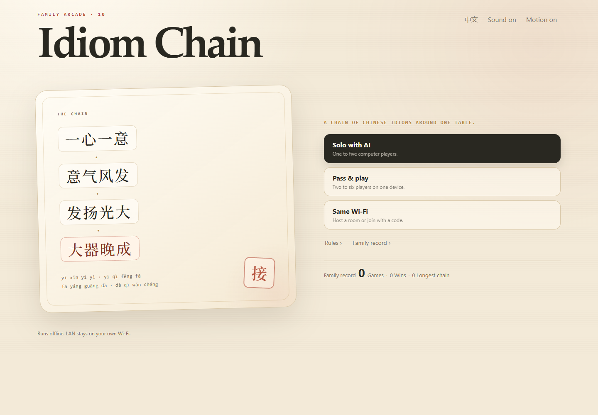
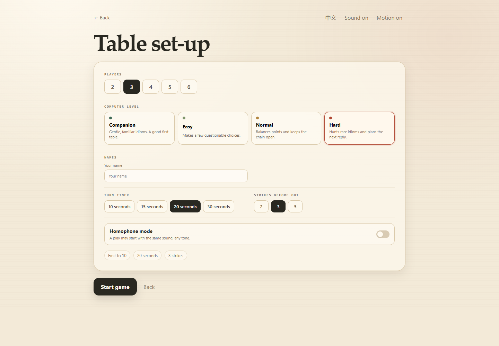
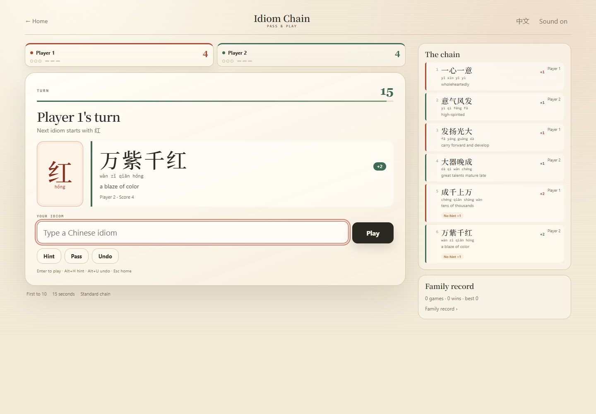
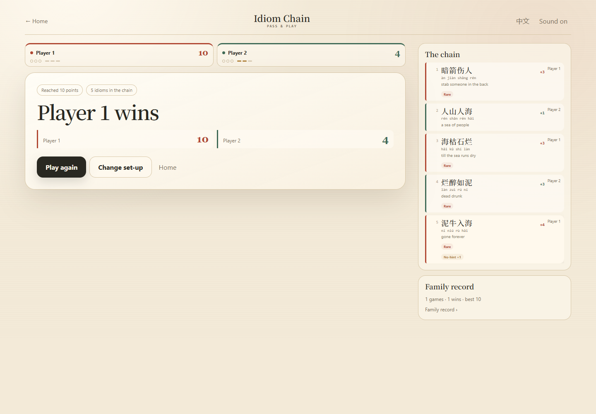
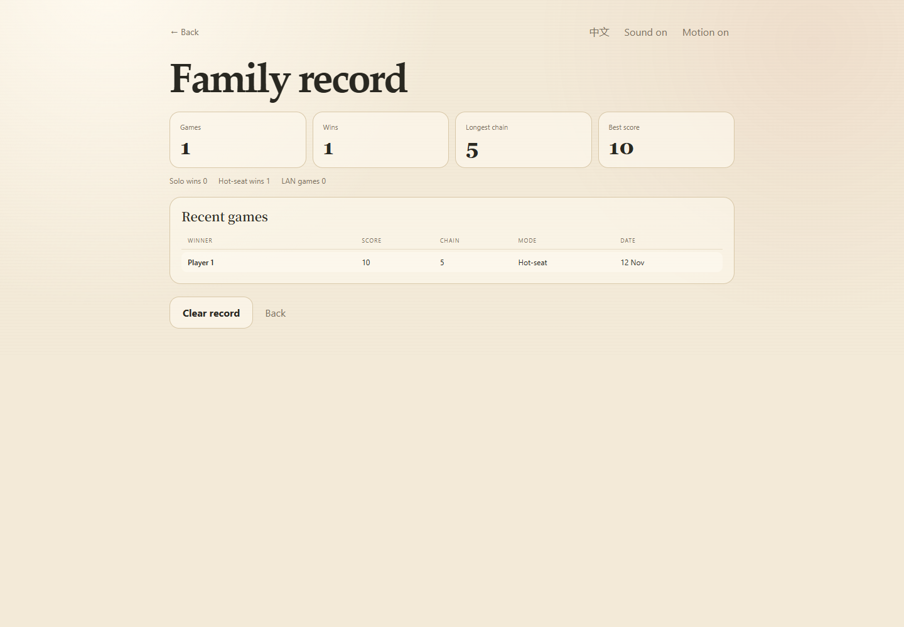
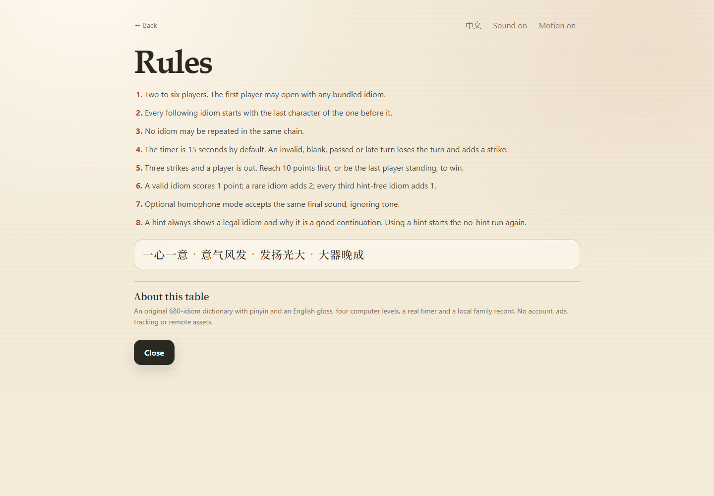
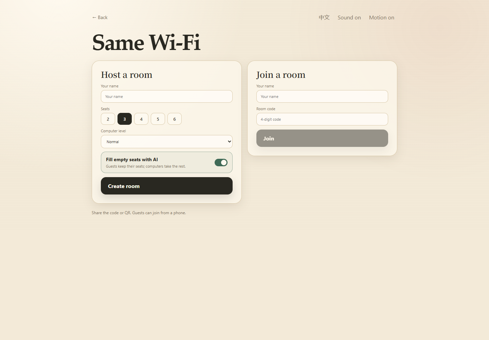
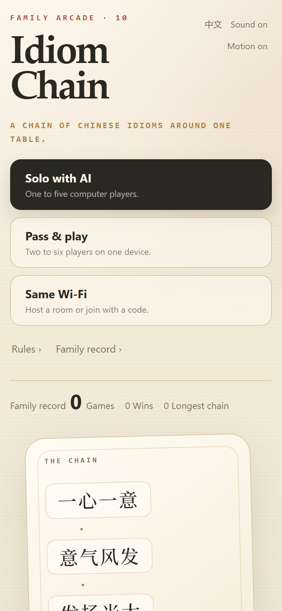
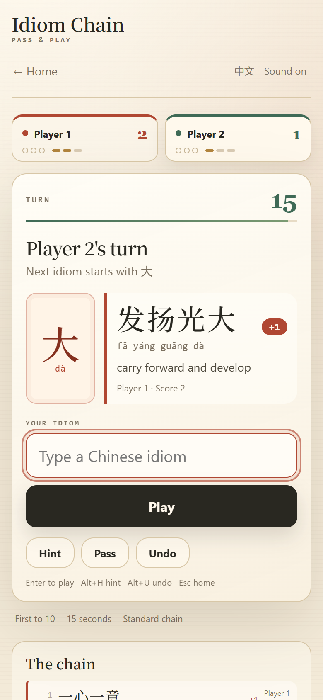

# Idiom Chain

**English** · [简体中文](README.zh-CN.md)

> **One idiom. One last character. One chain.**

A warm, offline-first Chinese idiom chain for the family table: **2–6 players**,
a bundled **680-idiom dictionary** with pinyin and English glosses, a real
15-second turn timer, four AI levels, hot-seat play and a per-seat LAN table.
No account, ads, telemetry or remote assets.



## A turn in five seconds

| Open | Continue | Score | Win |
| --- | --- | --- | --- |
| The first player may play any bundled idiom. | The next idiom starts with the last character of the one before it. No repeats. | 1 point per valid idiom, +2 for a rare idiom, +1 for every third hint-free idiom. | First to 10 points, or the last player standing, wins. |

The default timer is **15 seconds**; the table can choose 10, 15, 20 or 30. An
invalid, blank, passed or late turn loses the turn and adds a strike. Three
strikes (2 or 5 can be chosen) and that player is out. The last player standing
wins even below 10 points.

**Homophone mode** is a documented table option: it matches the final syllable
of the previous idiom ignoring tone, so `一` may follow `意`. Standard mode
matches the exact final character.

## What is inside

- **A real, tested engine.** Pure TypeScript in `src/game/idiom-chain.ts`, with
  **44 unit tests** covering set-up, turns, scoring, rare bonuses, three-play
  hint-free bonuses, invalid/late/pass turns, strikes, last standing, dead ends,
  homophone mode, hints, views, JSON round-trips and all four AI levels. The
  engine has no DOM, network, clock or `Math.random`; the starting seat uses an
  injected RNG and the UI owns the timer.
- **An original dictionary.** 680 traditional phrases with one pinyin syllable
  per character, a short English gloss and a 1–5 family-familiarity label. 274
  entries are marked rare and score +2. The selection, pinyin, glosses and
  labels were written for this project; see [`NOTICE.md`](NOTICE.md).
- **Four AI levels.** Companion chooses common, short idioms with comfortable
  continuations and avoids dead ends; Easy often jumps at a familiar idea;
  Normal balances points and the open chain; Hard hunts rare points and looks one
  reply ahead. All levels search the same first-character/first-sound dictionary
  index and are deterministic with the same injected RNG.
- **Three ways to play.** Solo with 1–5 computers, 2–6 players passing one
  device, or a LAN room with host plus guests and optional AI-filled seats.
- **Privacy where it matters.** Hot-seat starts behind a turn cover; the timer
  pauses until the incoming player reveals the table. LAN play sends each device
  only its own seat view and accepts only that seat's play/pass intent. Idiom
  chain has no hidden cards, so the chain itself is public on every device.
- **Small comforts.** Undo in solo/hot-seat, a reasoned hint, autosave/resume,
  a local family record, sound toggle, reduced-motion toggle, a complete
  keyboard path and a mobile layout.
- **Private by default.** No accounts, cloud saves, ads, tracking, remote fonts
  or downloaded art.

## Screenshots

| Home | Table set-up |
| --- | --- |
|  |  |

| A real chain | Hint with a reason |
| --- | --- |
|  |  |

| First to 10 | Family record |
| --- | --- |
|  |  |

| Rules | Same-Wi-Fi lobby |
| --- | --- |
|  |  |

| Phone home | Phone table |
| --- | --- |
|  |  |

All screenshots are real Chrome captures from played games at 1440×1000; phone
images are 390×844 @2× (780×1688 output). The Chinese set is in
`docs/screenshots/zh/`.

## Play locally

```bash
npm install
npm run dev        # http://localhost:5225
npm run check      # tsc + 44 tests + production build
npm run e2e        # real Chrome; dev server required
npm run shots      # regenerate both screenshot sets
```

Use **Solo with AI** for one human and up to five computers, or **Pass & play**
for 2–6 people around one screen. Local and solo games autosave; the home screen
offers **Continue last game** after a reload.

Keyboard: type and press **Enter** to play, **Alt+H** for a hint, **Alt+U** to
undo, **Alt+P** to pass, **Esc** for home. Every control is also reachable with
Tab.

## LAN night

Browser/dev:

```bash
npm run build      # build the guest page
npm run lan        # relay + built app on :8080
npm run dev        # in another terminal: host on :5225
```

1. Open `http://localhost:5225`, choose **Same Wi-Fi**, pick 2–6 seats and create
   a room.
2. The host shows a 4-digit code, a QR invitation and a full link.
3. Each guest opens the invitation on the same Wi-Fi, types a name and joins. A
   guest can also type the 4-digit code on the join form.
4. The host sets the timer, homophone option, computer level and AI fill, then
   starts. The host is seat 0; guests get the other connected seats.

If `:8080` is already used by another Family Arcade relay, run this app's relay
elsewhere and open the host page with `?lanPort=`:

```bash
node ../../tools/lan-server.mjs --dist dist --port 8181
# host: http://localhost:5225/?lanPort=8181
```

The relay is a dumb message bus. The host owns the authoritative chain and sends
each guest only `view(state, seat)`. Guests can send only
`{ type: 'play', text, usedHint }` or `{ type: 'pass' }`; the host re-checks the
turn, dictionary, start character/sound and used list before applying anything.
The 4-digit code is a family convenience, not a security boundary. The host's
timer is authoritative; a guest countdown is a visual forecast.

Desktop: the Tauri build starts the shared LAN relay internally and serves the
built app to phones. The host shows the code and QR invite; guests need no app
install. On the web build, the relay must be running separately.

## Verification

- **Engine:** 44 Vitest cases in `tests/dictionary.test.ts` and
  `tests/game.test.ts`.
- **Browser E2E:** `node scripts/e2e.mjs` — 54 checks: solo AI replies, a
  reasoned hint, undo across AI turns, autosave/resume, hot-seat cover, the real
  10-second timer, a complete game to 10, family record, Chinese UI, keyboard
  path and mobile play.
- **LAN E2E:** `npm run lan:e2e` with `LAN_PORT=19025` — 22 checks: room
  creation, two guests, disjoint per-seat views, host and guest turns,
  host-validated hint plays and chain broadcast. The relay is stopped afterwards.
- **Screenshots:** 20 real PNGs in `docs/screenshots/{en,zh}`.
- **Build:** `npm run check` runs `tsc --noEmit`, all 44 tests and a production
  Vite build.

## Build the Windows installer

```bash
npm install
npx tauri build --bundles nsis
# src-tauri/target/release/bundle/nsis/Idiom Chain_0.1.0_x64-setup.exe
```

The installer is per-game and lightweight; WebView2 uses the standard
bootstrapper. An unsigned family build may show a Windows SmartScreen warning.
The central Family Arcade build agent builds installers; this app does not run
Tauri/cargo builds.

## Known limitations

- The shared dictionary has 680 simplified-character idioms. A real idiom
  outside that list is rejected; traditional characters are not aliased.
- If the dictionary runs out of continuations, players pass and strikes close
  the chain; the last-standing winner may be below 10 points.
- The UI always starts seat 0. The engine supports another first seat for tests
  and demos.
- AI is a heuristic. Hard can still be trapped by a dead end; Companion is
  deliberately gentle.
- LAN is IPv4 on the same subnet, up to six devices. No online matchmaking,
  spectators, cloud record or late-seat takeover. A disconnected guest keeps
  their seat and is timed out by the host.
- LAN undo is disabled. Guest timers are forecasts of the host timer.
- Autosave and the family record are device-local; a LAN game is recorded on the
  host device only.
- The browser QR invite can say `localhost`; use the desktop build or the host
  LAN address for a phone.
- `video.json` feeds the central studio; no promo video is rendered in this app.

See [`docs/limitations.md`](docs/limitations.md) and the full rule audit in
[`docs/rules.md`](docs/rules.md).

## Credits

Original code, dictionary selection, pinyin, glosses, frequency labels, layout,
copy and synthesized sound for Family Arcade. The chain-of-idioms mechanic is a
public-domain folk game; this implementation and its visual design are original.
MIT. See [`NOTICE.md`](NOTICE.md) and [`LICENSE`](LICENSE).

## Promo manifest

[`video.json`](video.json) holds the eight bilingual narration lines, facts,
tagline, accent colour and the three screenshots per language used by the
central Family Arcade studio.
