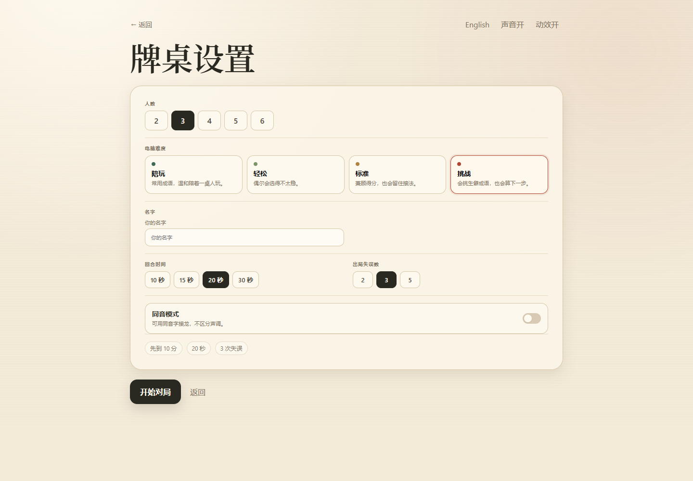
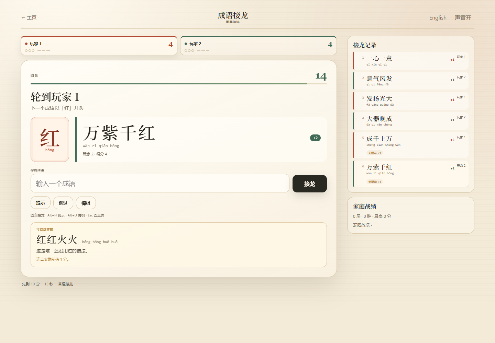
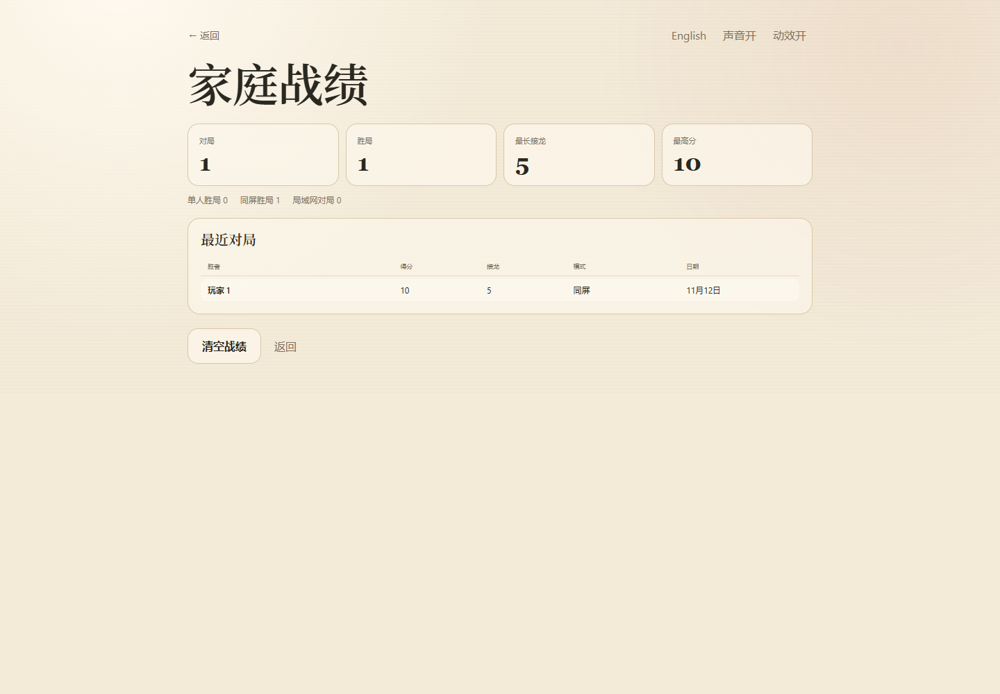
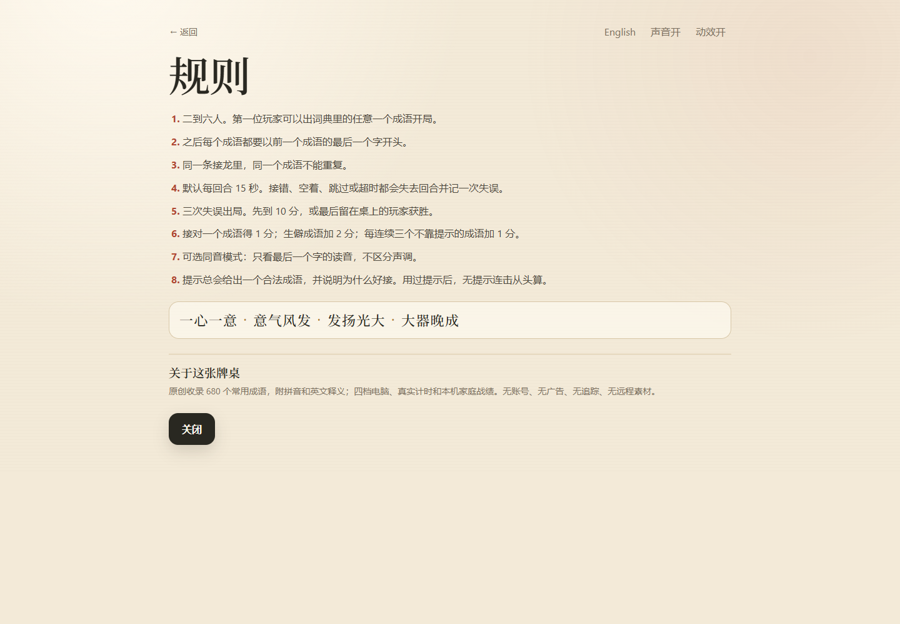
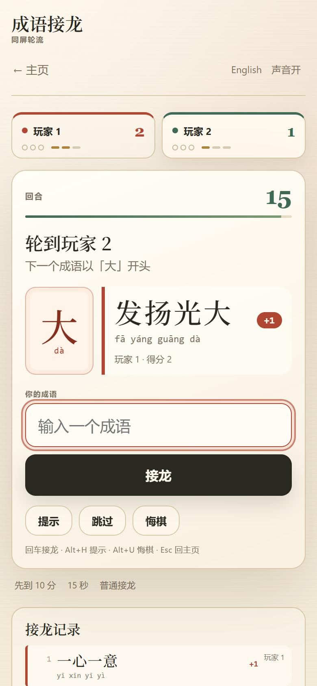

# 成语接龙

[English](README.md) · **简体中文**

> **一个成语，一个字，一条接龙。**

给一家人围桌玩的离线成语接龙：**2–6 人**、内置 **680 个成语**（附拼音和
英文释义）、真实的 15 秒回合计时、四档电脑、同屏轮流和局域网分座位牌桌。
无账号、无广告、无追踪、无远程素材。


## 五秒看懂一回合

| 开局 | 接龙 | 计分 | 获胜 |
| --- | --- | --- | --- |
| 第一位玩家可以出词典里的任意一个成语。 | 下一个成语要以前一个成语的最后一个字开头，不能重复。 | 接对一个得 1 分；生僻成语加 2 分；每连续三个不靠提示的成语加 1 分。 | 先到 10 分，或最后留在桌上的玩家获胜。 |

默认回合时间为 **15 秒**，牌桌可选 10、15、20 或 30 秒。接错、空着、跳过或
超时都会失去回合并记一次失误。默认三次失误出局（也可选 2 次或 5 次），最后
留在桌上的玩家即使不到 10 分也获胜。

**同音模式**是牌桌上的可选项：只看前一个成语最后一个字的读音，不区分声调，
所以 `一` 可以接 `意`。普通模式要求最后一个字完全相同。

## 里面有什么

- **真正可测的引擎。** `src/game/idiom-chain.ts` 是纯 TypeScript，**44 个单元
  测试**覆盖开局、轮转、计分、生僻加分、连续三个无提示加分、接错/超时/跳过、
  失误出局、最后留在桌上、死路、同音模式、提示、分座位视图、JSON 往返和四档
  电脑。引擎不读 DOM、网络、时钟或 `Math.random`；起手座位用注入的随机数，
  计时交给界面。
- **原创词典。** 680 个常用成语，每个都有逐字拼音、简短英文释义和 1–5 的家庭
  熟悉度标签。274 个标为生僻，得 +2 分。选词、拼音、释义和标签都是为本项目
  编写的；见 [`NOTICE.md`](NOTICE.md)。
- **四档电脑。** 陪玩偏好常用、短、后续接法多的成语，尽量不选死路；轻松偶尔
  会随手一接；标准兼顾得分和接龙畅通；挑战会抢生僻分，并多看一步对手的回应。
  四档都使用同一个“按首字/首音查词典”的索引，同一个随机数下结果确定。
- **三种玩法。** 单人加 1–5 位电脑、2–6 人同屏轮流，或局域网主机加客人（空位
  可由电脑补齐）。
- **该遮的时候遮。** 同屏轮换开始前有传递遮罩，计时暂停，等下一位玩家揭开；
  局域网只向每台设备发送该座位的视图，也只接受该座位的接龙/跳过意图。成语
  接龙没有暗牌，接龙内容本身是公开的。
- **小舒心。** 单人/同屏悔棋、带理由的提示、自动保存/继续、本机家庭战绩、
  声音开关、减少动效、完整键盘路径和手机布局。
- **默认私密。** 无账号、无云存档、无广告、无追踪、无远程字体或下载素材。

## 截图

| 主页 | 牌桌设置 |
| --- | --- |
|  |  |

| 真实接龙 | 带理由的提示 |
| --- | --- |
|  |  |

| 先到 10 分 | 家庭战绩 |
| --- | --- |
|  |  |

| 规则 | 同一无线网络 |
| --- | --- |
|  |  |

| 手机主页 | 手机牌桌 |
| --- | --- |
|  |  |

所有截图都是 Chrome 里真实玩出来的画面：桌面 1440×1000，手机 390×844 @2×
（输出 780×1688）。英文截图在 `docs/screenshots/en/`。

## 本地运行

```bash
npm install
npm run dev        # http://localhost:5225
npm run check      # tsc + 44 个测试 + 生产构建
npm run e2e        # 真实 Chrome；需要 dev server
npm run shots      # 重新生成中英文截图
```

**单人挑战**是一位玩家加最多五位电脑；**同屏轮流**是 2–6 人共用一台设备。
单人和同屏对局会自动保存，刷新后主页会显示**继续上一局**。

键盘：输入后按 **回车** 接龙，**Alt+H** 提示，**Alt+U** 悔棋，**Alt+P** 跳过，
**Esc** 回主页。所有按钮也都能用 Tab 到达。

## 局域网之夜

浏览器/开发版：

```bash
npm run build      # 构建客人页面
npm run lan        # 在 :8080 上同时运行中继和构建好的页面
npm run dev        # 另开终端：主机页面在 :5225
```

1. 打开 `http://localhost:5225`，选**同一无线网络**，选 2–6 个座位并开房间。
2. 主机会显示四位房间码、二维码邀请和完整链接。
3. 客人在同一无线网络下打开邀请，填名字加入；也可以直接输入四位房间码。
4. 房主选好计时、同音模式、电脑难度和空位补齐方式后开始。房主是 0 号位，
   客人依次入座。

如果 `:8080` 已被另一个 Family Arcade 中继占用，可以把本应用中继换到别的
端口，并在主机页面加 `?lanPort=`：

```bash
node ../../tools/lan-server.mjs --dist dist --port 8181
# 主机：http://localhost:5225/?lanPort=8181
```

中继只是消息总线。主机持有权威接龙状态，只给每位客人发送
`view(state, seat)`；客人只能发送 `{ type: 'play', text, usedHint }` 或
`{ type: 'pass' }`。主机在应用前重新检查轮次、词典、首字/首音和已用列表。
四位房间码是家庭便利，不是安全边界。计时以主机为准，客人看到的倒计时只是
视觉预估。

桌面版由 Tauri 启动同一个共享中继并把构建好的页面发给手机；客人不需要装
应用。网页版需要单独运行中继。

## 验证

- **引擎：** `tests/dictionary.test.ts` 和 `tests/game.test.ts` 共 **44 个
  Vitest 测试**。
- **浏览器 E2E：** `node scripts/e2e.mjs` — **54 项检查**：单人 AI 回应、
  带理由提示、跨 AI 回合悔棋、自动保存/继续、同屏遮罩、真实 10 秒计时、
  完整打到 10 分、家庭战绩、中文界面、键盘路径和手机对局。
- **局域网 E2E：** `LAN_PORT=19025 npm run lan:e2e` — **22 项检查**：建房、
  两位客人、分座位视图、房主/客人轮转、主机校验的提示接龙和接龙广播。
  测试结束后会关闭中继。
- **截图：** `docs/screenshots/{en,zh}` 共 **20 张真实 PNG**。
- **构建：** `npm run check` 会运行 `tsc --noEmit`、全部 44 个测试和生产
  Vite 构建。

## 构建 Windows 安装包

```bash
npm install
npx tauri build --bundles nsis
# src-tauri/target/release/bundle/nsis/Idiom Chain_0.1.0_x64-setup.exe
```

安装包按游戏单独打包，体积轻；WebView2 使用标准 bootstrapper。家庭内部未签名
构建可能触发 Windows SmartScreen 提示。安装包由 Family Arcade 中央构建代理
统一生成；本应用不运行 Tauri/cargo 构建。

## 已知限制

- 共享词典是 680 个简体成语。真实但不在词典里的成语会被拒绝，繁体字也不做
  别名。
- 如果词典里没有可接的成语，大家只能跳过/超时，靠失误和最后留在桌上结束；
  获胜者可能不到 10 分。
- 界面固定从 0 号位开局。引擎支持其他起手座位，但只用于测试和演示。
- 电脑是启发式，不是解题器。挑战也会被死路困住；陪玩是故意温和的。
- 局域网是同一子网的 IPv4，最多 6 台设备。没有在线匹配、观战、云战绩或
  中途换座。客人掉线会保留座位，由主机计时判失误。
- 局域网不能悔棋；客人计时是主机计时的视觉预估。
- 自动保存和家庭战绩只在本机；局域网对局只记在主机设备。
- 浏览器二维码邀请可能带 `localhost`，手机访问要用桌面版或主机的局域网地址。
- `video.json` 交给中央工作室；本应用不渲染宣传视频。

完整规则见 [`docs/rules.md`](docs/rules.md)，更诚实的限制见
[`docs/limitations.md`](docs/limitations.md)。

## 制作说明

代码、词典选词、拼音、释义、熟悉度标签、布局、文案和合成音效均为 Family
Arcade 原创。成语接龙是公共领域的民间玩法；本实现和视觉设计是原创。MIT，
见 [`NOTICE.md`](NOTICE.md) 和 [`LICENSE`](LICENSE)。

## 宣传清单

[`video.json`](video.json) 提供八句中英旁白、事实、标语、强调色和每语种三张
截图，供 Family Arcade 中央工作室使用。
