# International Draughts · 国际跳棋

**English** · [简体中文](README.zh-CN.md)

> **Ten by ten. Kings that fly.**

Full-rules 10×10 International Draughts for the family table: **2 players**,
twenty men each, mandatory maximum captures, flying kings, four computer
levels, one-screen hot-seat and LAN play from a phone. No account, no ads and no
network required except your own Wi-Fi for LAN night.

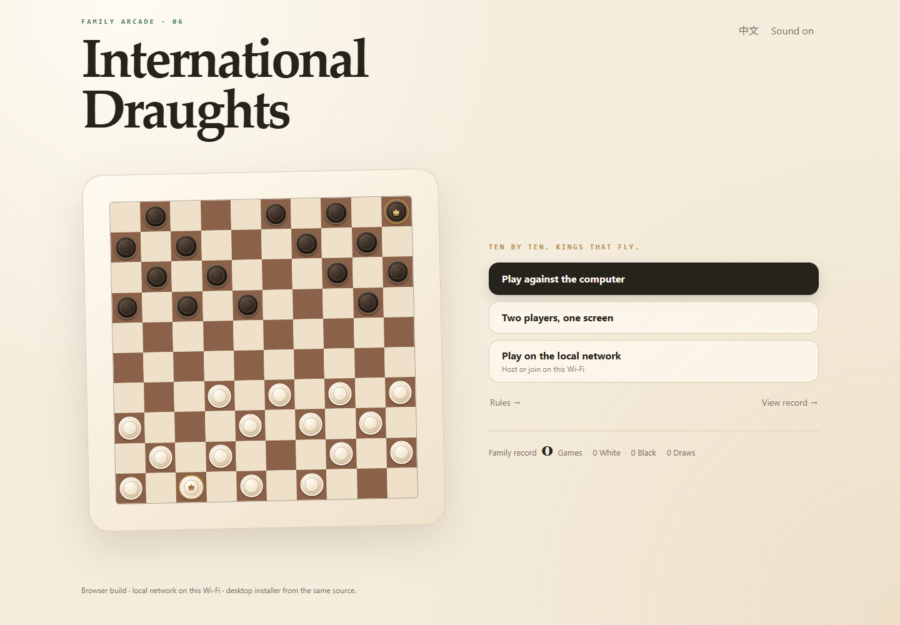

The 45-second bilingual promo is rendered from [`video.json`](video.json) by the
root Family Arcade studio.

## A turn, in five seconds

| Move | Capture | Win |
| --- | --- | --- |
| A man steps one square diagonally forward. A king flies any distance along a diagonal. | Jump an adjacent enemy into the empty square beyond. Captures are mandatory; if several exist, you must take the longest chain. Men capture backwards too. | Capture every enemy piece, or leave the opponent with no legal move. A man that ends on the far row becomes a flying king. |

## What is inside

- **A real, tested engine.** Pure TypeScript, deterministic, **34 unit tests**,
  no DOM, network, clock or `Math.random` in the rules. See
  [`docs/rules.md`](docs/rules.md).
- **Full international rules.** 20 men each, mandatory maximum capture, men
  capturing in all four directions, captured pieces blocking later jumps until
  the move ends, promotion only at the end of a move, flying kings that capture
  from a distance and turn corners, win by capture or blockade.
- **Four computer levels.** Companion plays gently, Easy makes mistakes, Normal
  searches three plies with capture quiescence, Hard searches four plies (six in
  low-material endings) and handles forced capture chains.
- **Three ways to play.** Solo against the computer, two players passing one
  device, or a phone joining the host over the local network.
- **A LAN table that handles real life.** The host owns the position, shows a
  four-digit code and QR invite, and sends the guest only its own view. A guest
  can reload and reconnect mid-game; stale or spoofed intents are re-checked and
  ignored. The guest result screen is read-only and waits for the host.
- **A proper family record.** Totals, White/Black/draw shares, mode split,
  current and best runs, and the eight most recent games. Hosted LAN results are
  recorded on the host device; the guest keeps its own local record.
- **Small comforts.** Undo, a hint that explains *why*, autosave and resume,
  sound on/off, keyboard navigation, reduced-motion support, complete
  Chinese/English UI, and a mobile layout designed as a first-class way to play.
- **Private by default.** No accounts, telemetry, ads or remote fonts. All art
  is CSS and SVG.

## Screenshots

| A real game | AI setup |
| --- | --- |
| 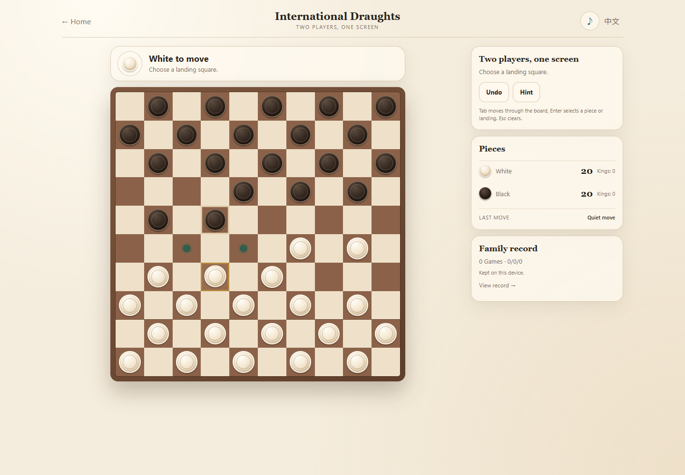 | 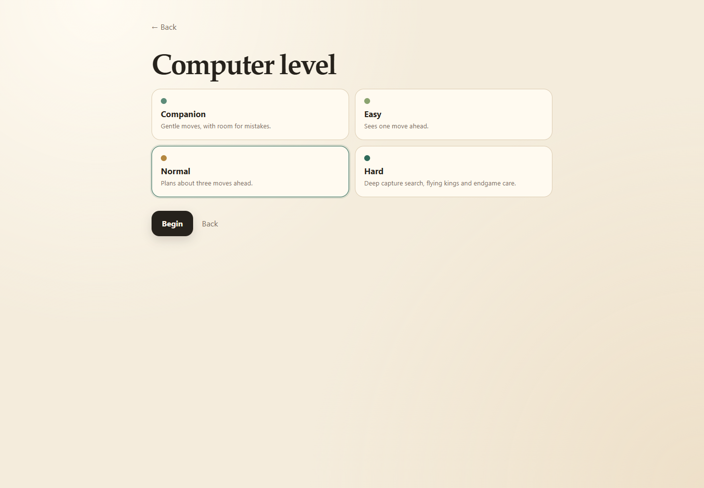 |

| Reasoned hint | Result |
| --- | --- |
| 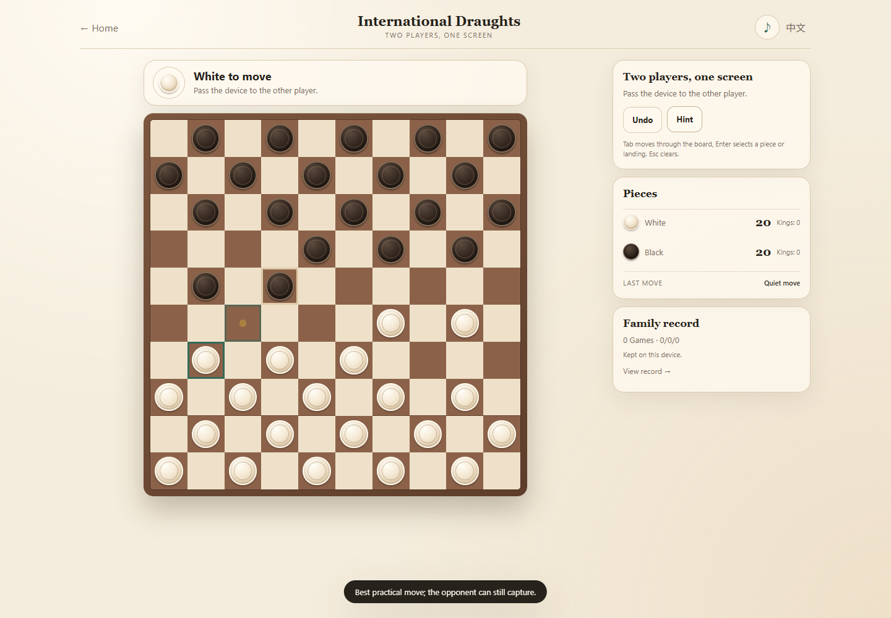 | 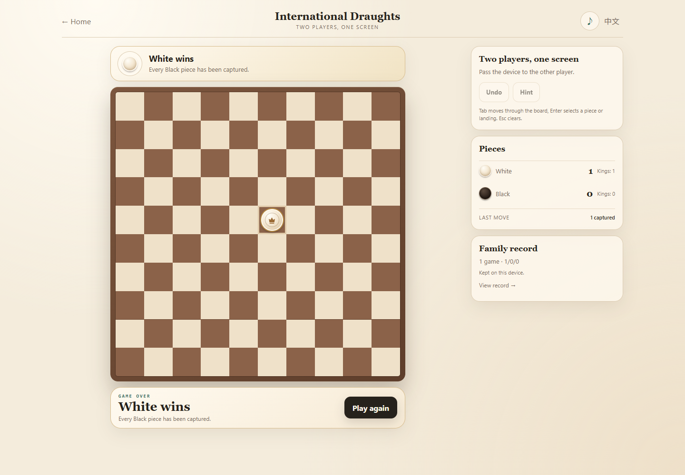 |

| Rules | Family record |
| --- | --- |
| 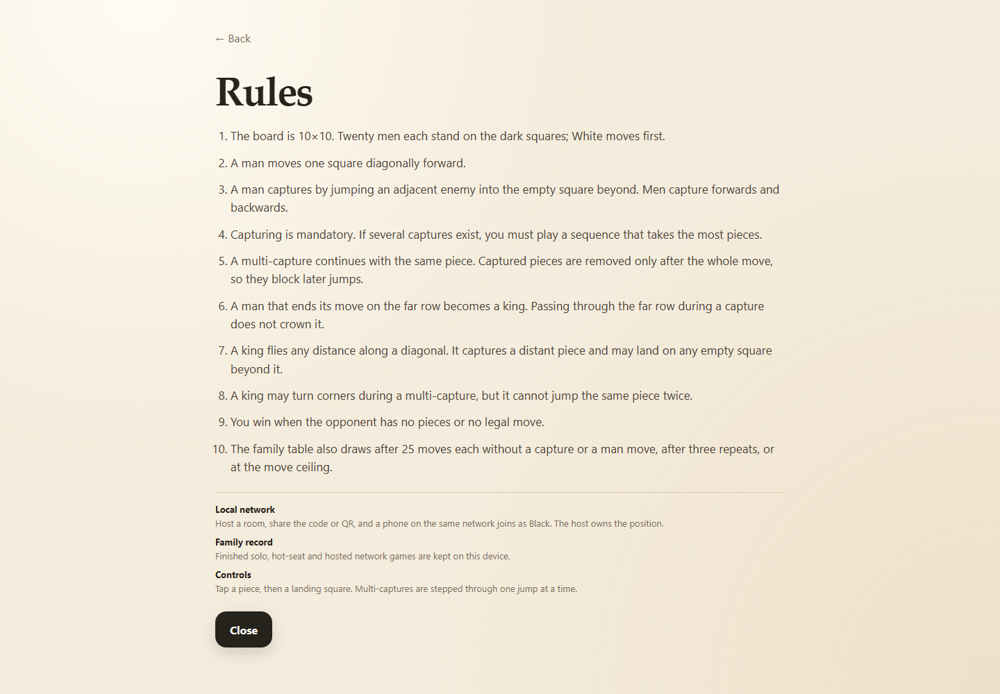 | 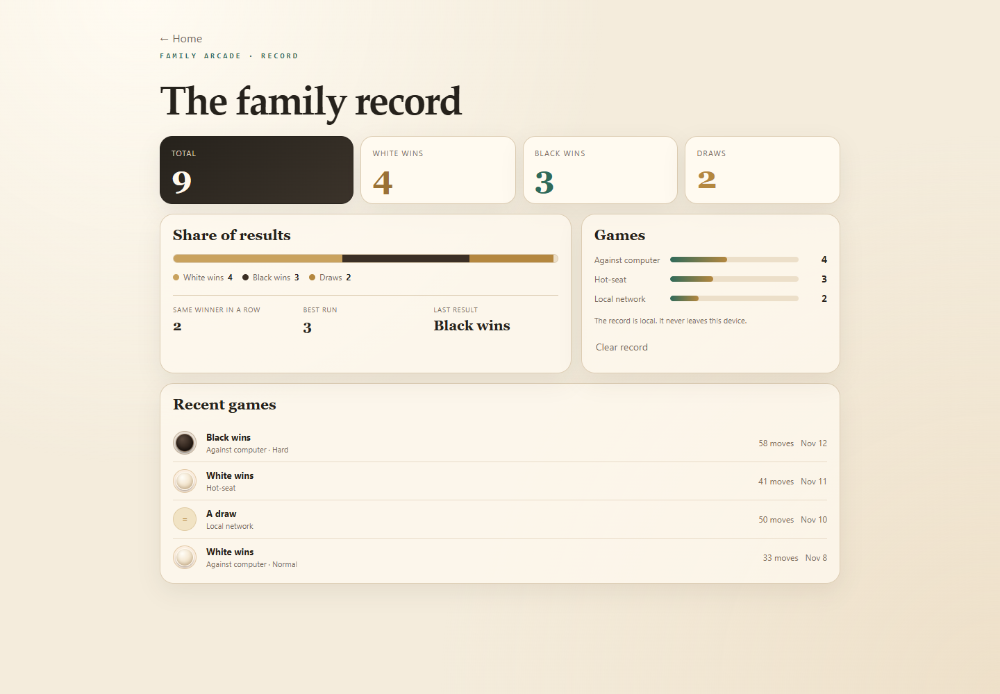 |

| LAN host | LAN guest |
| --- | --- |
| 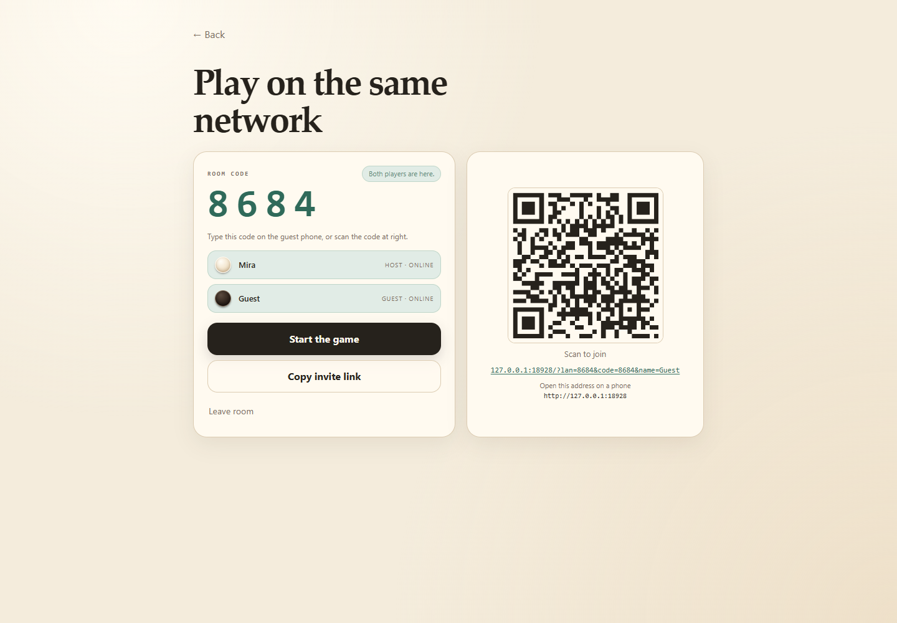 | 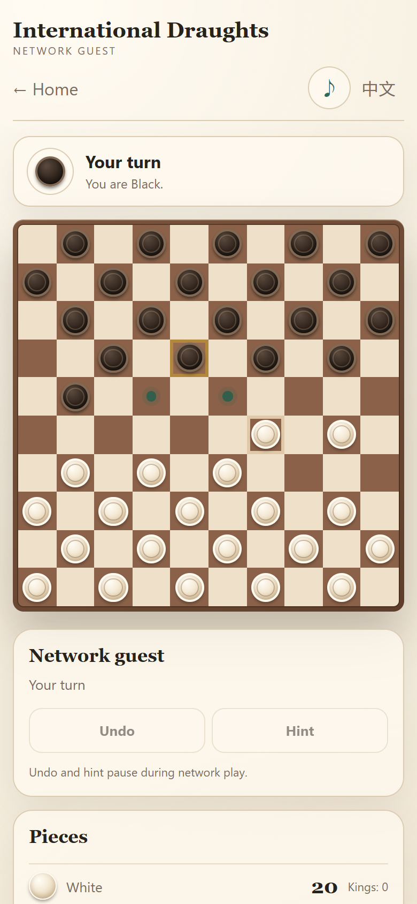 |

| Phone home | Phone game |
| --- | --- |
| 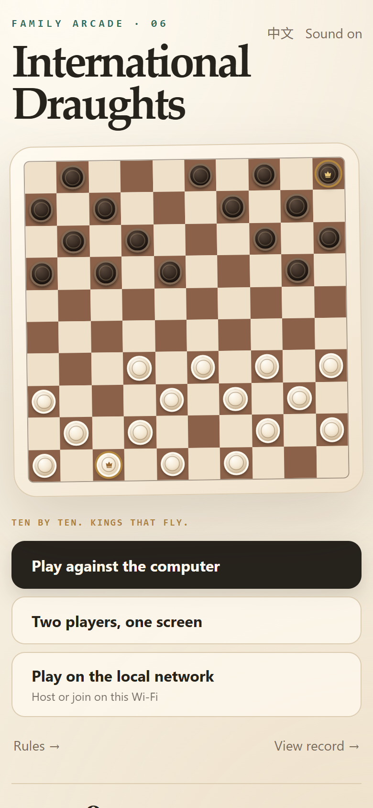 | 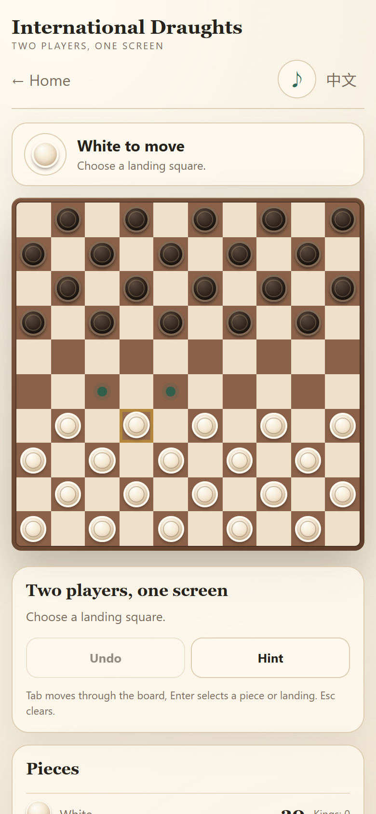 |

All screenshots come from the running app at 1440×1000 (phone 390×844 @2×).

## Play locally

```bash
npm install
npm run dev        # http://localhost:5206
npm run check      # tsc + 34 tests + production build
npm run e2e        # real Chrome; dev server required
npm run lan:e2e    # starts its own relay on :18927 after a build
npm run shots      # regenerate home/setup/game/hint/rules/result/record/LAN/mobile
npm run lan:shots  # live LAN host + guest shots after npm run build
```

## LAN night

Browser/dev:

```bash
npm run build
npm run lan        # relay on :8080, serves dist/
# open http://localhost:5206, Play on the local network, Create room
# guest: scan the QR, or open the invite and type the four-digit code
```

Desktop: the Tauri build starts the same relay internally and serves the built
app to phones. The host shows a four-digit room code and a QR invite. Guests
open the address on the same Wi-Fi; no app install is needed on their side. The
same code also works as the room ID in the browser join card.

The relay is a dumb message bus. The host keeps the authoritative state and
sends only the guest's own view. Room codes, reconnect tokens and turn checks
are enforced in TypeScript; stale intents are ignored. The guest's result screen
is read-only and waits for the host to start the next game.

## Build the Windows installer

```bash
npm install
npx tauri build --bundles nsis
# src-tauri/target/release/bundle/nsis/International Draughts_0.1.0_x64-setup.exe
```

The installer is per-game and lightweight; WebView2 uses the standard
bootstrapper. A Windows SmartScreen warning is expected for an unsigned family
build. This hand-off did not run a Tauri build; the shared main build produces
all installers centrally.

## Known limitations

- Browser build plus a local Tauri shell; no cloud, accounts, matchmaking or
  spectators.
- LAN is IPv4 on the same subnet; guest phones need the host firewall to allow
  the app. A browser-hosted QR may use `localhost`.
- Hard is a strong family opponent with a low-material search extension, not a
  retrograde tablebase. It can be beaten.
- The 25-move king-only draw follows the international convention; threefold
  repetition and the 500-ply ceiling are house additions. There is no clock.
- Stats are local to each device. A LAN game is recorded on the host, not
  duplicated on the guest; clearing the record only affects this device.
- No 4K or vertical promo cut.

See [`docs/limitations.md`](docs/limitations.md) for the honest full list.

## Credits

Original code, art, copy and interface for Family Arcade. MIT. See
[`NOTICE.md`](NOTICE.md).

