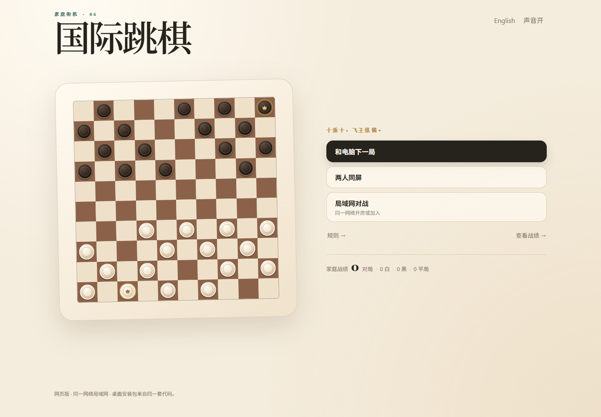
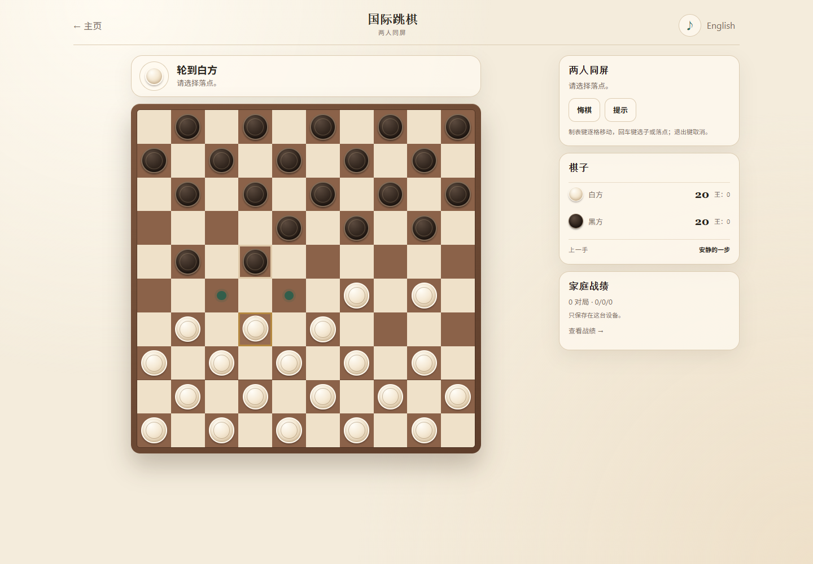
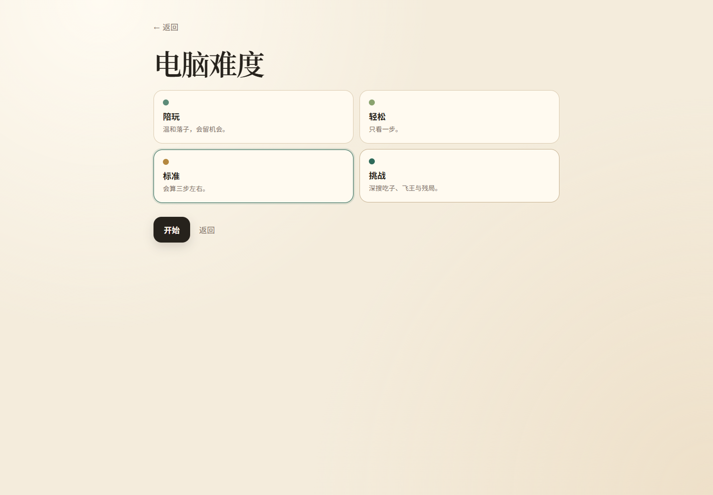
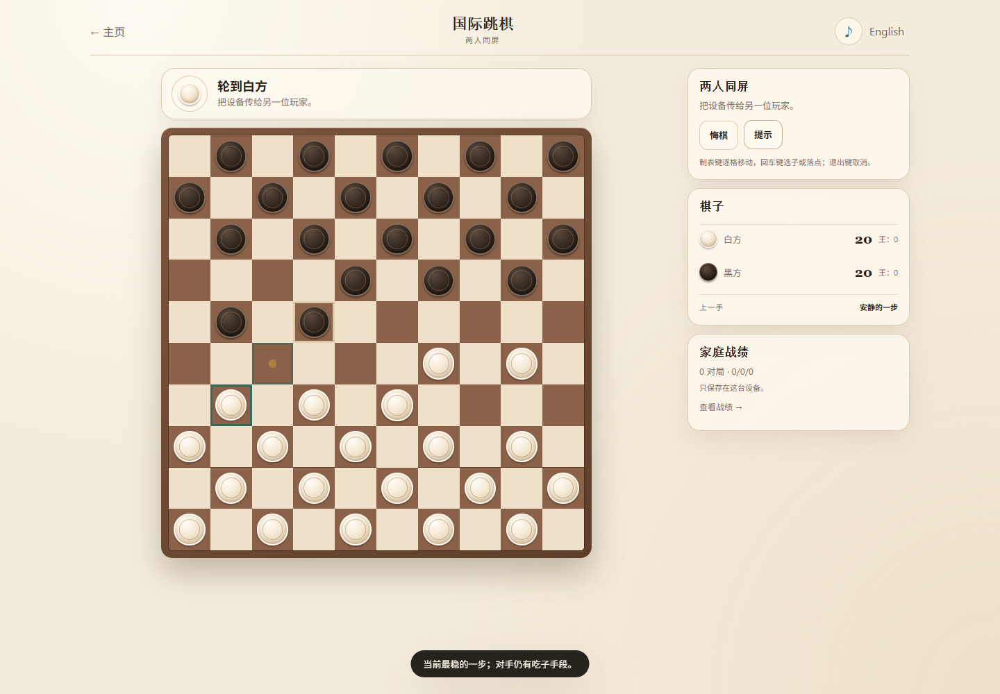
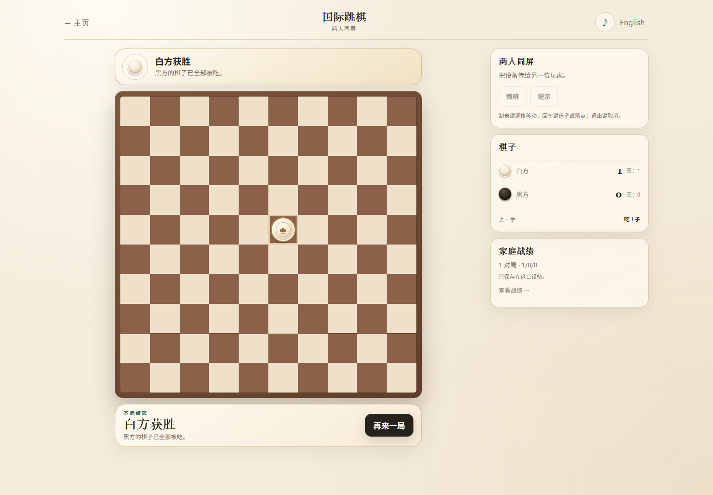
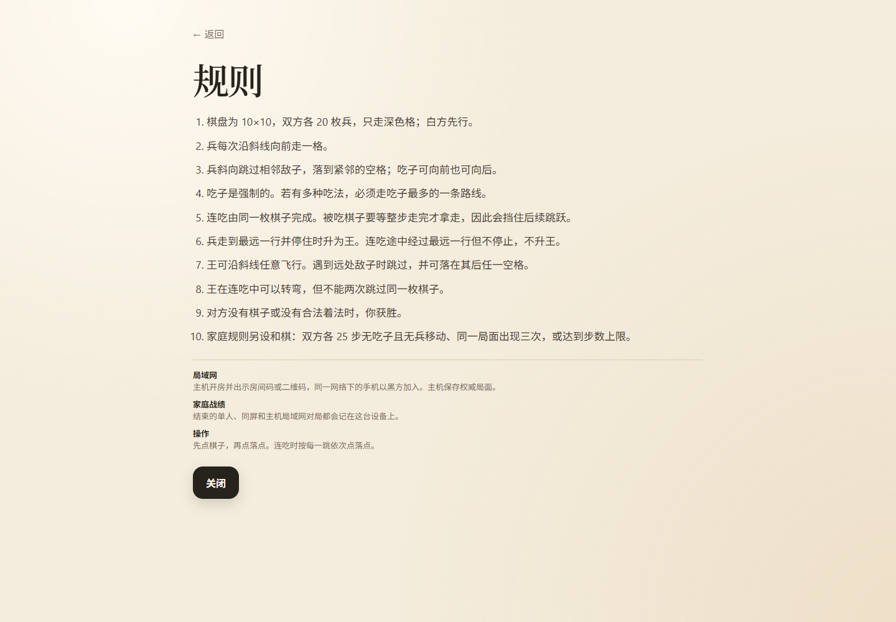
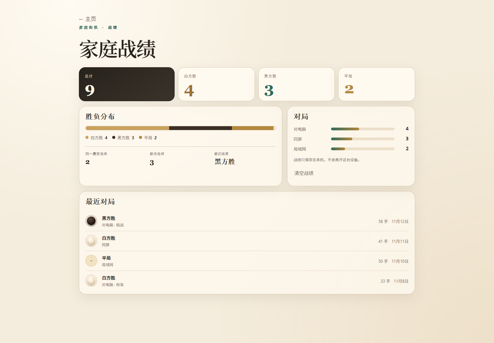
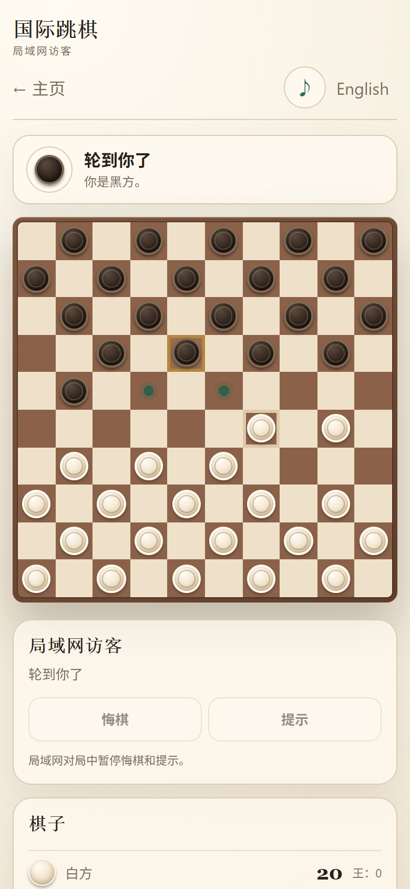
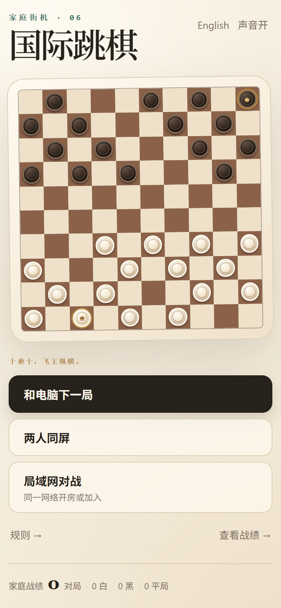
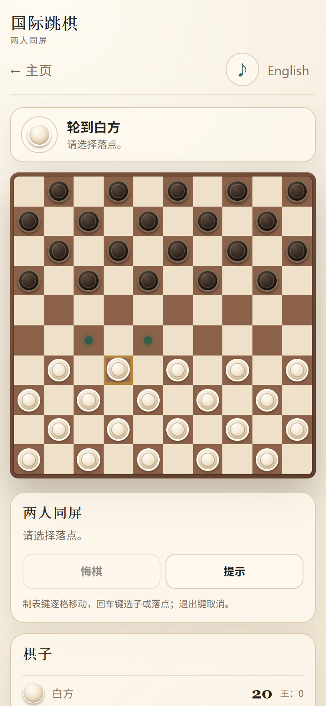

# 国际跳棋

[English](README.md) · **简体中文**

> **十乘十，飞王纵横。**

给家庭牌桌的完整 10×10 国际跳棋：**2 人**、双方各 20 枚兵、强制吃子与
“吃子最多”规则、飞王、四档电脑对手、同屏热座，以及手机浏览器加入的局域网对战。
无账号、无广告；除自家 Wi-Fi 外不需要联网。



45 秒双语宣传片由根目录工作室根据 [`video.json`](video.json) 渲染。

## 一回合，五秒看懂

| 走子 | 吃子 | 结束 |
| --- | --- | --- |
| 兵沿斜线向前走一格；王可沿斜线任意飞行。 | 跳过相邻敌子，落到其后的空格。吃子强制；有多种吃法时必须走吃子最多的一条。兵也可向后吃。 | 吃光对方棋子，或让对方无子可走即获胜。兵走到最远一行并停住，升为飞王。 |

## 里面有什么

- **真正的引擎。** 纯 TypeScript、确定性、**34 个单元测试**；规则层不碰 DOM、
  网络、时钟或随机数。见 [`docs/rules.md`](docs/rules.md)。
- **完整的国际规则。** 双方各 20 兵、强制最大吃子、兵可四向吃子、被吃棋子要等
  整步结束才拿走并阻挡后续跳跃、只在一整步结束时升王、飞王可远距离吃子并转弯、
  吃光或封锁获胜。
- **四档电脑对手。** 陪玩温和、轻松会犯错、标准三层搜索并带吃子静止搜索、挑战
  四层（残局八子以下第六层），能处理连续强制吃子。
- **三种玩法。** 单人对抗电脑、两人共用一台设备，或手机加入主机的局域网房间。
- **能应付真实牌桌的局域网。** 主机保存权威局面，展示四位房间码和二维码邀请，
  只给访客发送其自己的视图。访客中途刷新可重连；过期或伪造的意图会被重新校验并
  忽略。访客的终局界面只读，等主机开下一局。
- **完整的家庭战绩。** 总对局、白/黑/平局占比、各模式分布、当前与最佳连续、最近
  八局。主机局域网结果记在主机设备；访客设备保留自己的本地战绩。
- **小细节。** 悔棋、会解释原因的提示、自动保存/继续、声音开关、键盘操作、
  减少动效、完整中英双语，以及按手机优先设计的布局。
- **默认私密。** 无账号、无遥测、无广告、无远程字体；所有画面用 CSS 和 SVG 绘制。

## 截图

| 真实对局 | 电脑难度 |
| --- | --- |
|  |  |

| 带原因的提示 | 终局 |
| --- | --- |
|  |  |

| 规则 | 家庭战绩 |
| --- | --- |
|  |  |

| 局域网主机 | 局域网访客 |
| --- | --- |
|  |  |

| 手机主页 | 手机对局 |
| --- | --- |
|  |  |

全部来自真实运行的应用：桌面 1440×1000，手机 390×844 @2×。

## 本地运行

```bash
npm install
npm run dev        # http://localhost:5206
npm run check      # tsc + 34 个测试 + 生产构建
npm run e2e        # 真实 Chrome，需先运行 dev
npm run lan:e2e    # 构建后自动在 :18927 启动中继并跑局域网流程
npm run shots      # 重新生成主页/设置/对局/提示/规则/终局/战绩/局域网/手机截图
npm run lan:shots  # 构建后抓取真实局域网主机与访客截图
```

## 局域网

浏览器/开发版：

```bash
npm run build
npm run lan        # :8080 中继，同时托管 dist/
# 打开 http://localhost:5206，选“局域网对战”→“创建房间”
# 访客：扫码，或打开邀请链接并输入四位房间码
```

桌面版：Tauri 安装包启动同一个内置中继，并把构建产物托管给手机。主机显示四位
房间码和二维码；访客在同一 Wi-Fi 打开地址即可，无需安装。浏览器加入卡片里输入
同一个四位码也能入座。

中继只负责转发消息；主机保存权威状态，只发送访客自己的视图。房间码、重连令牌和
回合校验都在 TypeScript 中完成，过期意图会被忽略。访客的终局界面是只读的，等主机
开始下一局；只有主机能重开。

## 构建 Windows 安装包

```bash
npm install
npx tauri build --bundles nsis
# src-tauri/target/release/bundle/nsis/International Draughts_0.1.0_x64-setup.exe
```

每款游戏单独打包，安装包保持轻量；WebView2 使用标准引导程序。未签名的家庭构建会
触发 Windows SmartScreen 提示。本次交付没有运行 Tauri 构建；所有安装包由主构建
统一产出。

## 已知限制

- 浏览器版 + 本地 Tauri 壳；没有云、账号、匹配或观战。
- 局域网仅支持同一子网的 IPv4；手机访客需要主机防火墙放行。浏览器开房生成的
  二维码可能带 `localhost`。
- 挑战档是带残局加深的强家庭对手，不是回溯表库；仍然可以赢。
- 25 步王棋和棋遵循国际惯例；三次重复与 500 手上限是家庭牌桌补充规则。没有计时。
- 战绩按设备保存。局域网对局记在主机，不会在访客设备重复记录；清空战绩只影响
  当前设备。
- 暂无 4K 或竖屏宣传片。

完整说明见 [`docs/limitations.md`](docs/limitations.md)。

## 许可

Family Arcade 原创代码、美术、文案与界面，MIT。见 [`NOTICE.md`](NOTICE.md)。

