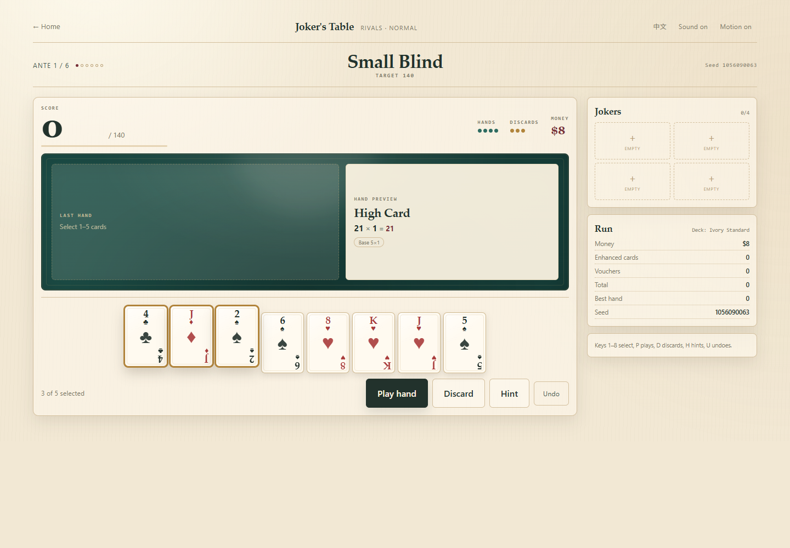
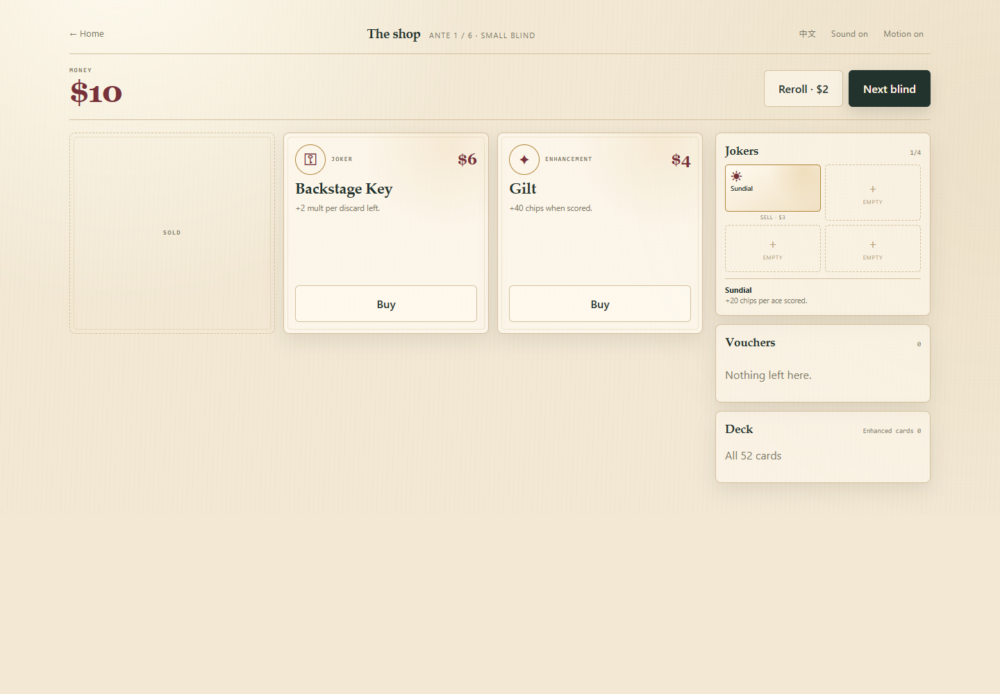
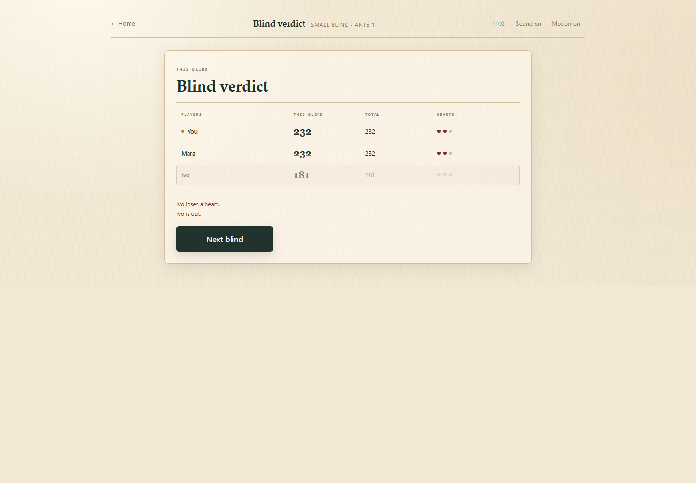
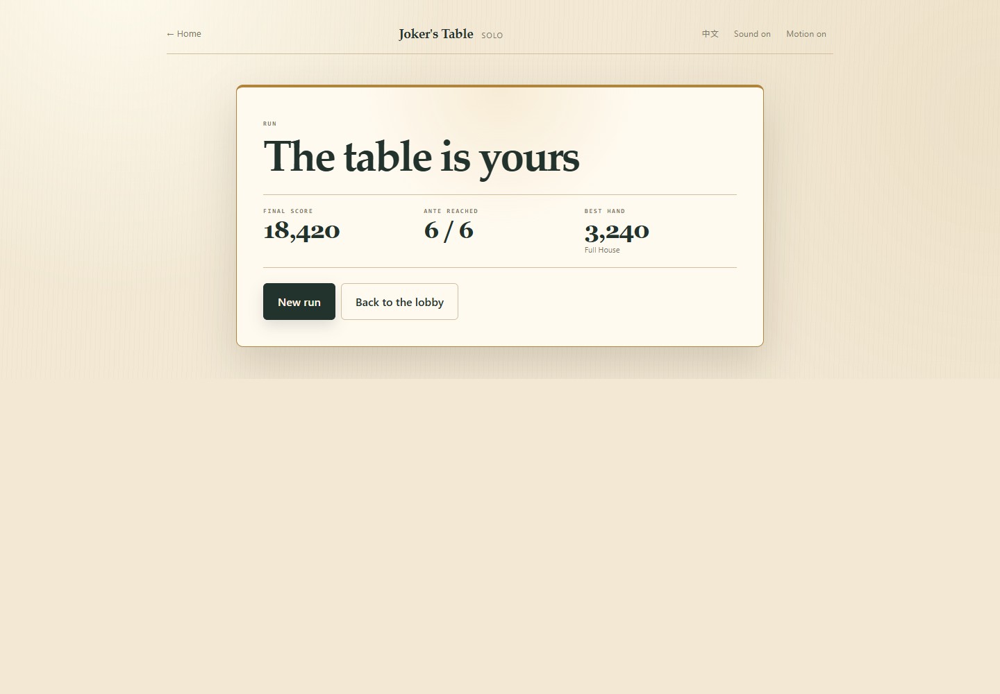
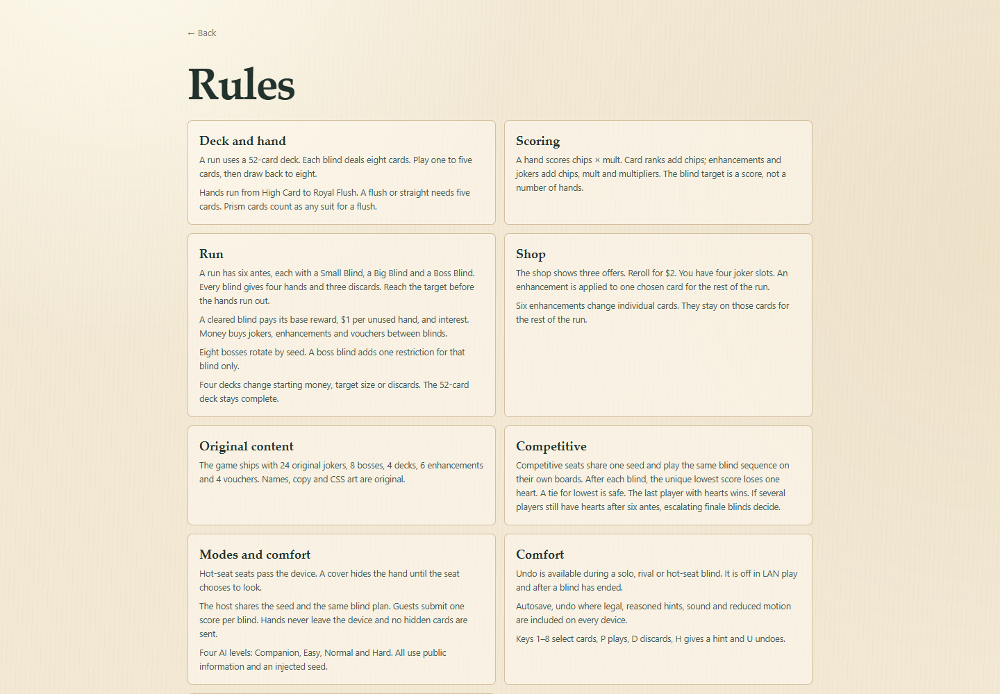

# Joker's Table

An original poker roguelike for Family Arcade. Build a hand of up to five cards from
eight, turn poker patterns into **chips × mult**, collect original jokers and carry
one deck through six antes of Small, Big and Boss blinds.

No commercial roguelike-deckbuilder assets, names, art, layout or text are used.
Every joker, boss, deck,
enhancement, voucher, glyph and line of copy in this app is original.


## Five-second rules

1. Each blind deals **8 cards**. Play **1–5** cards or discard **1–5**.
2. A poker hand scores **base + card chips + enhancements + jokers**, then **× mult**.
3. Reach the blind target before **4 hands** run out. You have **3 discards**.
4. Clear **6 antes × 3 blinds**. The shop between blinds sells jokers, enhancements
   and vouchers.
5. Competitive: same seed, same blind sequence. After each blind the unique lowest
   score loses one of three hearts. Ties are safe. Last player with hearts wins.

## What is in the box

- **52-card deck**, 8-card hand, plays of 1–5 cards, four joker slots.
- **24 original jokers**, **8 original bosses**, **4 decks**, **6 enhancements**,
  **4 vouchers**.
- Six antes with Small, Big and Boss blinds; four hands and three discards per blind.
- Shop with three offers, rerolls, joker selling, card-targeted enhancements and
  vouchers.
- **Solo run**, **rival table** (1–3 AI rivals), **hot-seat** (2–4 players with a
  hand cover) and **LAN competitive** (2–4 devices, host-shared seed, score
  submission).
- Four AI levels: Companion, Easy, Normal, Hard.
- Undo where legal, hinted best play with a reason, autosave/resume, family record,
  sound toggle, reduced motion, keyboard path and a 390 px mobile layout.
- Fully separate English and Chinese interfaces and README files.

## Screenshots

| Home | Game | Shop |
| --- | --- | --- |
|  |  |  |

| Blind verdict | Run complete | Rules |
| --- | --- | --- |
|  |  |  |

More: [setup](docs/screenshots/en/setup.png),
[hint](docs/screenshots/en/game-hint.png),
[record](docs/screenshots/en/record.png),
[LAN](docs/screenshots/en/lan.png),
[mobile home](docs/screenshots/en/home-mobile.png),
[mobile game](docs/screenshots/en/game-mobile.png).

## Modes

### Solo run

Choose a deck and an optional seed. Clear all 18 core blinds. A failed blind ends
the run.

### Rival table

One human and one to three AI rivals share a seed. Each rival plays the same blind on
its own board. The normal competitive heart rule applies. If the human loses the last
heart, the rival run ends.

### Hot-seat

Two to four people pass one device. Every seat gets a privacy cover before looking at
its hand. After each blind the table compares scores and hearts. Shops are taken in
seat order.

### LAN competitive

The host creates a room and shares a seed and blind plan. Every device plays its own
board and submits one score after each blind. The host is the score authority and
broadcasts the verdict. No cards or hidden state cross the network.

## Deals and numbers

- Starting money: Ivory $8, Crimson $12, Sapphire $6, Brass $7.
- Blind rewards: $4 / $5 / $6 for Small / Big / Boss.
- Extra money: $1 per unused hand on a clear, plus interest at $1 per $5 (cap $5).
- Shop: jokers $5–7, enhancements $4, vouchers $8; reroll $2; sell a joker for $3.
- Joker slots: 4.

The complete scoring table, target curve, boss list, joker list and edge cases are in
[docs/rules.md](docs/rules.md).

## Controls

- **Tap/click** a card to select it. Select up to five.
- **Play hand**, **Discard**, **Hint** and **Undo** are below the hand.
- Keyboard: **1–8** select, **P/Enter** play, **D** discard, **H** hint, **U** undo,
  **N/Enter** continue, **Esc** home.
- The language, sound and reduced-motion switches are in the top bar.

## Run locally

```bash
npm install
npm run dev        # http://localhost:5219
npm test           # 81 unit tests
npm run check      # type-check + tests + production build
node scripts/e2e.mjs
node scripts/shots.mjs
```

## LAN

Build the web app and serve it from the shared relay:

```bash
npm run build
npm run lan        # serves dist on :8080 and opens the relay
```

Open the host page from the relay address, choose **LAN table → Create room**, then
share the invite link or QR code. Two to four devices on the same Wi-Fi can join.
Guests submit one score per blind; the host compares and broadcasts hearts. An
assigned port can be used with `LAN_PORT=19019 npm run lan:e2e`.

For development, the Vite page on port 5219 is not the relay. Open the built page from
the relay (or use the host invite URL) so the guest WebSocket has a server.

## Tauri

The shared Tauri shell is kept in `src-tauri/` and expects the
`family_arcade_lan_host` crate. Builds are run by the central build agent:

```bash
npm run check
npm run tauri build
```

No Tauri or Cargo build is run by this workspace. The installer is unsigned.

## Project layout

- `src/game/` — pure engine: cards, scoring, content, run state, competition.
- `src/ai/ai.ts` — four AI levels, hints and shop discipline.
- `src/components/` — cards and joker UI.
- `src/App.tsx` — home, setup, game, shop, comparison, handoff, LAN, record and rules.
- `tests/game.test.ts` — 81 unit tests.
- `scripts/` — browser E2E, screenshots and LAN E2E.
- `docs/` — rule audit, limitations, screenshots.

## Known limitations

Balance is a first pass; LAN is trust-based and pauses on a disconnect; there is no
mid-run setup, online matchmaking or cloud save; the six finale blinds settle a table
that still has multiple hearts after six antes. The honest list is in
[docs/limitations.md](docs/limitations.md).

## Licence

MIT. See [LICENSE](LICENSE) and [NOTICE.md](NOTICE.md).
