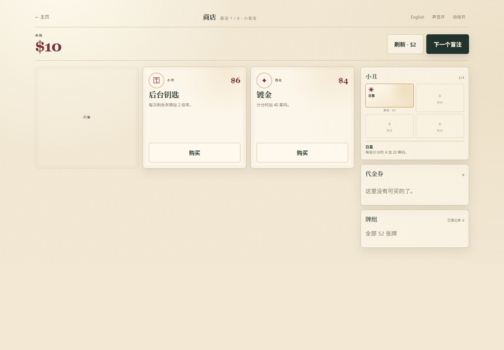
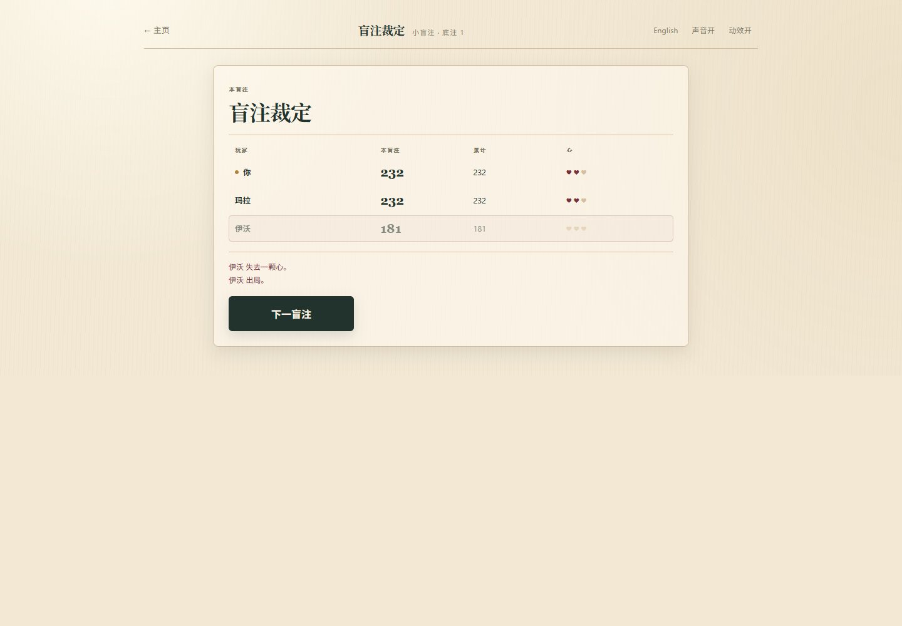
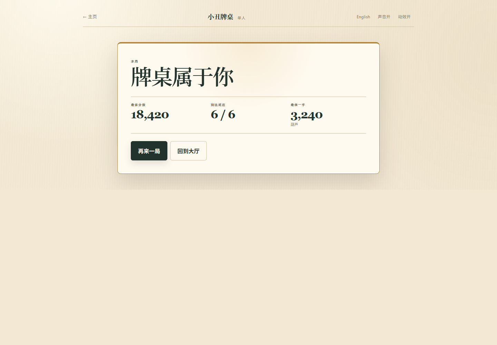
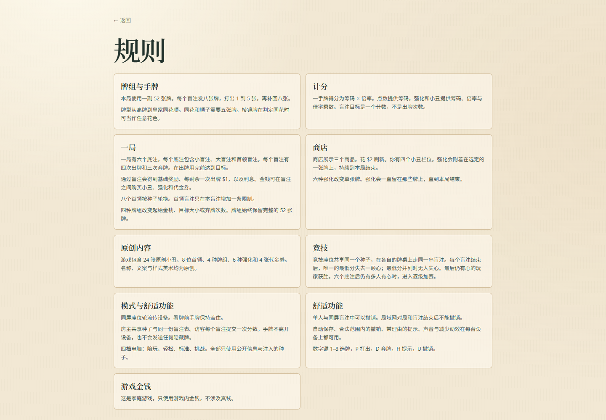

# 小丑牌桌

家庭游戏厅的原创扑克冒险。每手从八张牌中打出最多五张，把扑克牌型变成
**筹码 × 倍率**，收集原创小丑，带着一副牌走完六个底注的小盲注、大盲注和首领盲注。

所有小丑、首领、牌组、强化、代金券、图标与文案均为本作原创；没有使用任何商业
卡牌游戏的角色名称、美术、界面布局或文字。


## 五秒规则

1. 每个盲注发 **8 张牌**，打出 **1–5 张**，或弃掉 **1–5 张**。
2. 一手牌得分为 **基础 + 牌面筹码 + 强化 + 小丑**，再乘 **倍率**。
3. 在 **4 次出牌** 用完前达到盲注目标；每局有 **3 次弃牌**。
4. 通过 **6 个底注 × 3 个盲注**。盲注之间的商店出售小丑、强化和代金券。
5. 竞技模式共享同一牌序和盲注表。每个盲注结束后，唯一的最低分失去一颗心；
   最低分并列时无人失心。最后仍有心的玩家获胜。

## 内容

- **52 张牌**，8 张手牌，每次打出 1–5 张，四个小丑栏位。
- **24 张原创小丑**、**8 位原创首领**、**4 种牌组**、**6 种强化**、
  **4 张代金券**。
- 六个底注，每个底注包含小盲注、大盲注和首领盲注；每个盲注四次出牌、三次弃牌。
- 商店提供三个商品、刷新、卖出小丑、指定卡牌强化和代金券。
- **单人之旅**、**对手牌桌**（1–3 个电脑对手）、**同屏对战**（2–4 人，
  带手牌遮挡）和**局域网竞技**（2–4 台设备，房主共享牌序，提交分数）。
- 四档电脑：陪玩、轻松、标准、挑战。
- 合法范围内的撤销、带理由的提示、自动保存与续玩、家庭战绩、声音开关、
  减少动效、键盘操作和 390 像素手机布局。
- 完全独立的中文与英文界面及说明文件。

## 截图

| 主页 | 对局 | 商店 |
| --- | --- | --- |
|  |  |  |

| 盲注裁定 | 本局结束 | 规则 |
| --- | --- | --- |
|  |  |  |

更多：[设置](docs/screenshots/zh/setup.png)、
[提示](docs/screenshots/zh/game-hint.png)、
[战绩](docs/screenshots/zh/record.png)、
[局域网](docs/screenshots/zh/lan.png)、
[手机主页](docs/screenshots/zh/home-mobile.png)、
[手机对局](docs/screenshots/zh/game-mobile.png)。

## 模式

### 单人之旅

选择牌组和可选的牌序种子，通过全部 18 个核心盲注。盲注失败时本局结束。

### 对手牌桌

一名玩家和一到三名电脑对手共享一个种子。每个对手在各自的牌桌上走同一串盲注，
按竞技失心规则结算。玩家失去最后一颗心时，本局结束。

### 同屏对战

二到四人轮流使用一台设备。每个座位看牌前都会经过遮挡页。每个盲注结束后比较
分数与心数，商店按座位顺序进行。

### 局域网竞技

房主创建房间，共享牌序种子和盲注表。每台设备在本地完成自己的牌桌，每个盲注
提交一次分数。房主负责比较并广播裁定。牌面与隐藏状态不会经过网络。

## 数字

- 起始金钱：象牙 $8、绯红 $12、蓝宝石 $6、黄铜 $7。
- 盲注奖励：小盲注 $4、大盲注 $5、首领盲注 $6。
- 额外收入：通过时每剩余一次出牌 $1；利息每 $5 付 $1，上限 $5。
- 商店：小丑 $5–7、强化 $4、代金券 $8；刷新 $2；卖出小丑得 $3。
- 小丑栏位：4 个。

完整计分表、目标曲线、首领表、小丑表和边界规则见
[docs/rules.md](docs/rules.md)。

## 操作

- **点按**一张牌即可选中，最多五张。
- 手牌下方是**打出**、**弃牌**、**提示**和**撤销**。
- 键盘：**1–8** 选牌，**P/回车**打出，**D** 弃牌，**H** 提示，**U** 撤销，
  **N/回车**继续，**Esc** 回主页。
- 顶栏可切换语言、声音和减少动效。

## 本地运行

```bash
npm install
npm run dev        # http://localhost:5219
npm test           # 81 个单元测试
npm run check      # 类型检查 + 测试 + 生产构建
node scripts/e2e.mjs
node scripts/shots.mjs
```

## 局域网

构建后由共享中继提供页面：

```bash
npm run build
npm run lan        # 在 :8080 提供 dist 并启动中继
```

从中继地址打开主机页面，选择**局域网牌桌 → 创建房间**，分享邀请链接或二维码。
同一网络下的二到四台设备可以加入。访客每个盲注提交一次分数，主机负责比较
并广播心数。也可以使用指定端口运行 `LAN_PORT=19019 npm run lan:e2e`。

开发时，5219 端口的页面不是中继。请从中继打开构建后的页面，或使用房主邀请链接，
这样访客的 WebSocket 才有服务端。

## Tauri

共享的 Tauri 外壳保留在 `src-tauri/`，并使用 `family_arcade_lan_host` 包。
安装包由中央构建代理生成：

```bash
npm run check
npm run tauri build
```

本工作区不运行 Tauri 或 Cargo 构建。安装包未签名。

## 目录

- `src/game/` —— 纯引擎：牌、计分、内容、本局状态、竞技比较。
- `src/ai/ai.ts` —— 四档电脑、提示与购物纪律。
- `src/components/` —— 卡牌与小丑界面。
- `src/App.tsx` —— 主页、设置、对局、商店、裁定、传设备、局域网、战绩与规则。
- `tests/game.test.ts` —— 81 个单元测试。
- `scripts/` —— 浏览器端到端、截图与局域网端到端。
- `docs/` —— 规则审计、限制与截图。

## 已知限制

平衡仍是第一版；局域网基于家庭互信，掉线时会暂停该座位；没有中途改设置、互联网
匹配或云存档；六个底注后仍有多人有心时，用六个加赛盲注决胜。完整而诚实的清单见
[docs/limitations.md](docs/limitations.md)。

## 许可

MIT。见 [LICENSE](LICENSE) 与 [NOTICE.md](NOTICE.md)。
