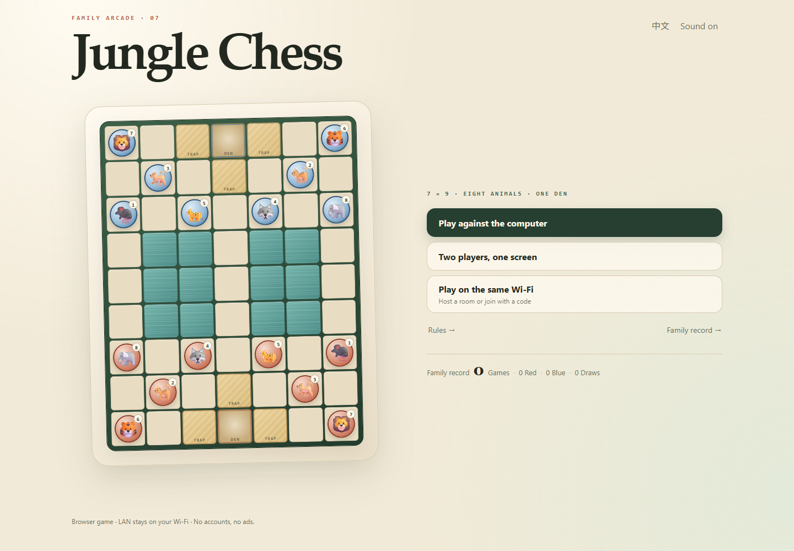
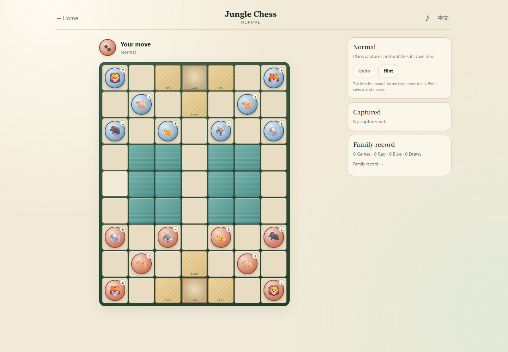
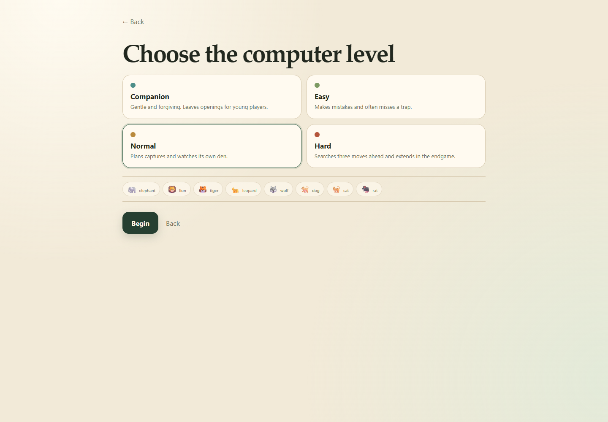
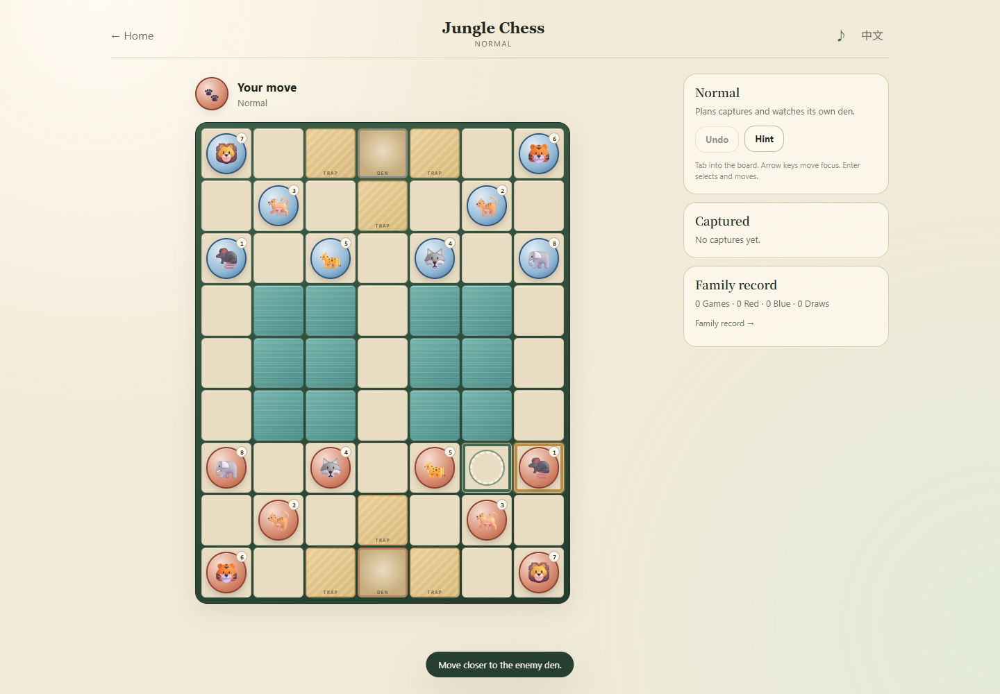
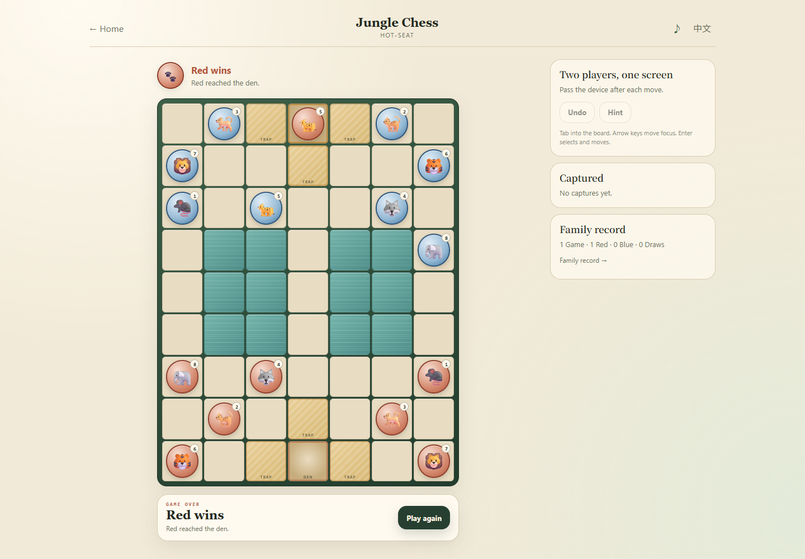
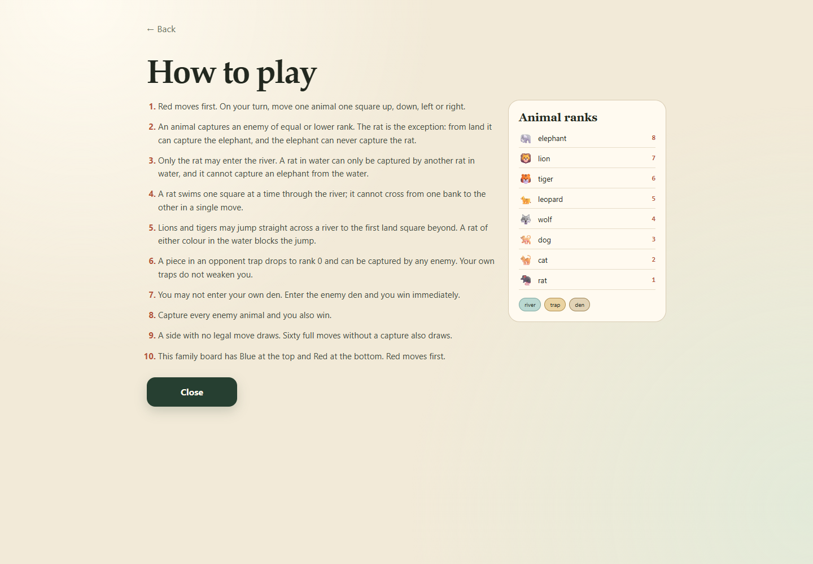
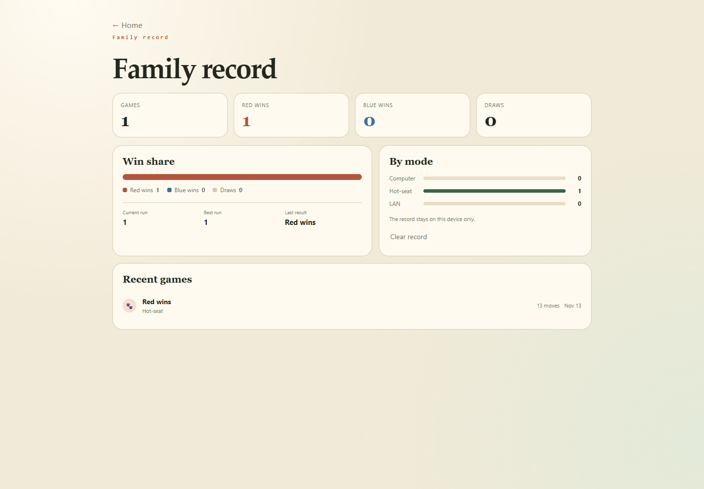
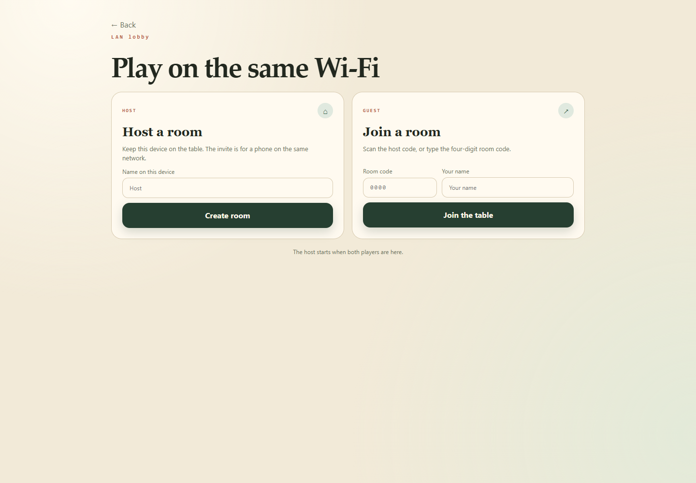
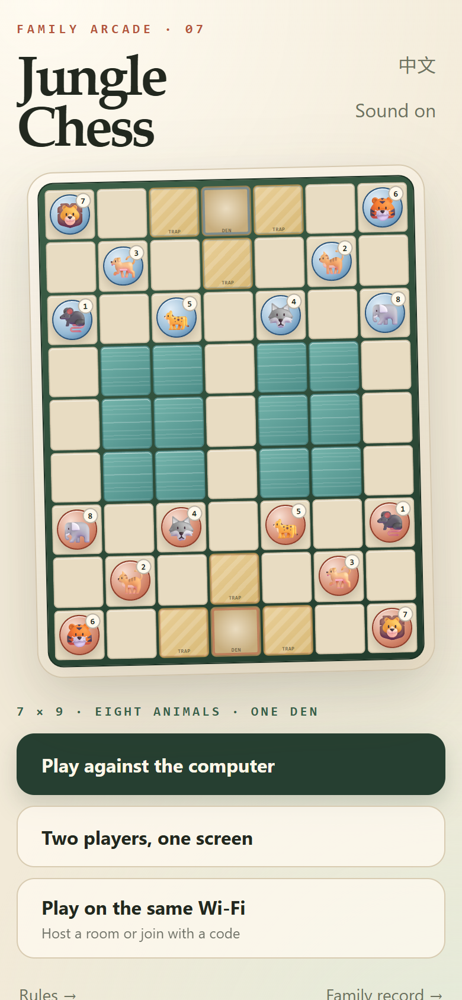
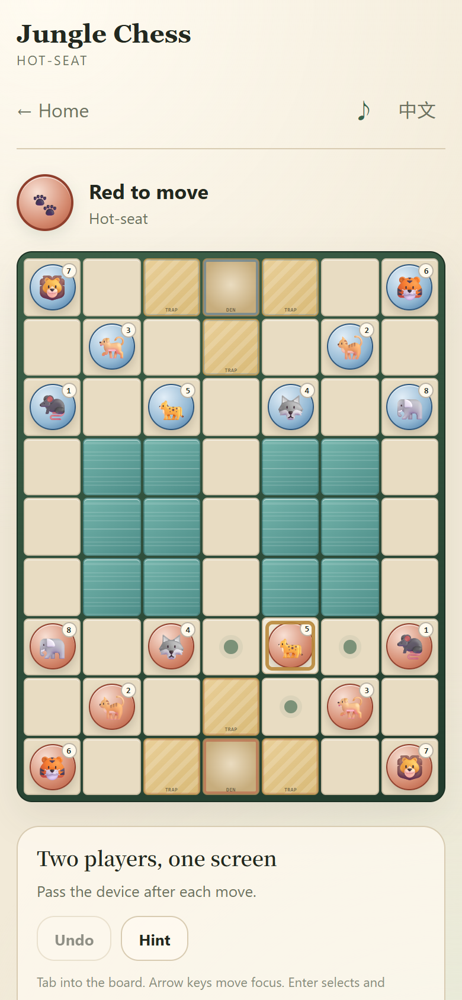

# Jungle Chess

**English** · [简体中文](README.zh-CN.md)

> **Seven columns. Nine rows. Eight animals. One den.**

The full classic **Dou Shou Qi** for the family table: animal ranks, two rivers, trap
squares, dens, swimming rats and leaping lions. Two players, four computer levels,
one-screen hot-seat and LAN play from a phone. No account, no ads, no remote assets.



## A turn in five seconds

| Move | Capture | Win |
| --- | --- | --- |
| Move one animal one square up, down, left or right. | Higher or equal rank eats lower rank. A rat on land eats an elephant; a rat in water only eats a water rat. | Enter the enemy den, or capture every enemy animal. |

The full rule audit, including traps, river jumps and every chosen variation, is in
[`docs/rules.md`](docs/rules.md).

## What is inside

- **A real, tested engine.** Pure TypeScript, **41 unit tests**, no DOM, network, clock
  or randomness in `src/game/`. The four AI levels receive their RNG by injection.
- **Full board rules.** 7 × 9 board, 16 animals, eight ranks, two 2 × 3 rivers, six
  traps, two dens, rat swimming, lion/tiger jumps, trap rank reduction, den wins and
  capture-all wins.
- **Four computer levels.** Companion is gentle and forgiving; Easy makes mistakes;
  Normal searches two plies; Hard searches three, and four in the endgame. Every level
  takes a clear game-ending move.
- **Three ways to play.** Solo against the computer, two players passing one device, or
  a phone joining the host over the local network.
- **LAN table.** Host a room, show the four-digit code or QR, and join from a phone. The
  host keeps the authoritative state and sends the guest its own seat view. Stale,
  spoofed or wrong-turn intents are rejected.
- **Family record.** Totals, Red/Blue/draw shares, mode split, current and best streaks,
  and the eight most recent games. LAN results are written on the host device.
- **Comforts.** Undo, a hint that explains *why*, autosave and resume, sound toggle,
  keyboard board navigation, reduced-motion support, complete English/Chinese UI, and a
  mobile layout built for a 7 × 9 board.
- **Private by default.** No accounts, telemetry, ads, CDN, remote fonts or downloaded
  art.

## Screenshots

| A real game | AI setup |
| --- | --- |
|  |  |

| Hint with a reason | Result |
| --- | --- |
|  |  |

| Rules and ranks | Family record |
| --- | --- |
|  |  |

| LAN lobby | Phone home |
| --- | --- |
|  |  |

| Phone game | |
| --- | --- |
|  | |

All screenshots are taken from the running app at 1440 × 1000, phone at 390 × 844 @2×.

## Play locally

```bash
npm install
npm run dev        # http://localhost:5207
npm run check      # tsc + 41 tests + production build
npm run e2e        # real Chrome; dev server required
npm run lan:e2e    # starts its own relay on :18927 after npm run build
node scripts/shots.mjs   # regenerate screenshots
```

## LAN night

Browser build with the shared relay:

```bash
npm run build
npm run lan        # relay + dist on :8080
npm run dev        # host page on :5207
# Home → Play on the same Wi-Fi → Create room
# Guest: scan the QR, or open the invite and type the four-digit code
```

The host owns the board. The guest receives only its own `SeatView` and may send only
`{type:'move', from, to, moveCount}`. The host re-checks the seat, turn, move count and
all movement rules before applying it. The guest result screen is read-only; the host
starts the next game.

Desktop: the Tauri shell starts the same LAN relay and serves the built app to phones.
The host shows a room code and QR invite. Guests need no install; they open the address
on the same network.

## Build the Windows installer

The shared Tauri shell and capabilities are kept intact. Installers are built centrally;
this app does not run Cargo or Tauri builds.

```bash
npm install
npx tauri build --bundles nsis
# src-tauri/target/release/bundle/nsis/Jungle Chess_0.1.0_x64-setup.exe
```

The installer is per-game and lightweight. WebView2 uses the standard bootstrapper. A
SmartScreen warning is expected for an unsigned family build.

## Known limitations

- Two players, no spectators, no matchmaking; LAN is local IPv4.
- Saves and the family record are local to each device.
- No threefold repetition; the app uses stalemate and a 60-full-move no-capture draw.
- Hard is a three/four-ply search, not a solved-game engine.
- A browser-hosted QR may use `localhost`; use the desktop build or the host LAN address
  for a phone.
- Tauri installers are produced centrally; no installer was built by this app agent.

See [`docs/limitations.md`](docs/limitations.md) for the honest full list.

## Credits

Original code, board, copy and CSS art for Family Arcade. Animal tokens use the
platform's standard emoji font; no art files are downloaded. MIT. See
[`NOTICE.md`](NOTICE.md) and [`LICENSE`](LICENSE).
