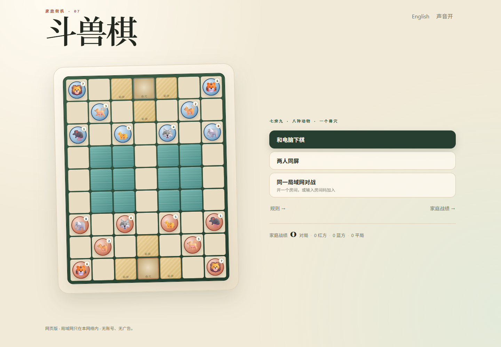
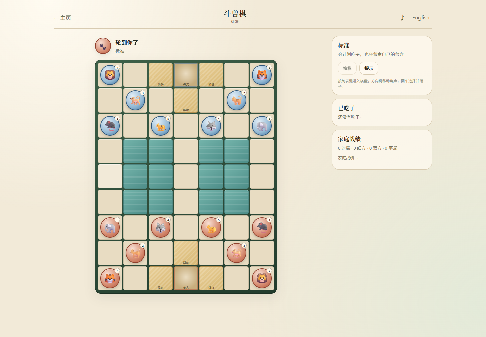
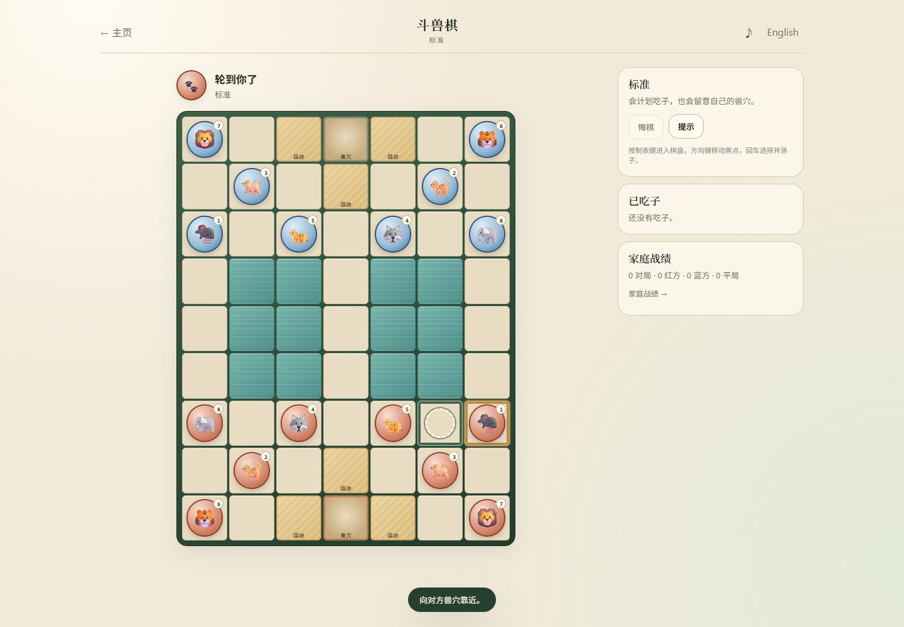
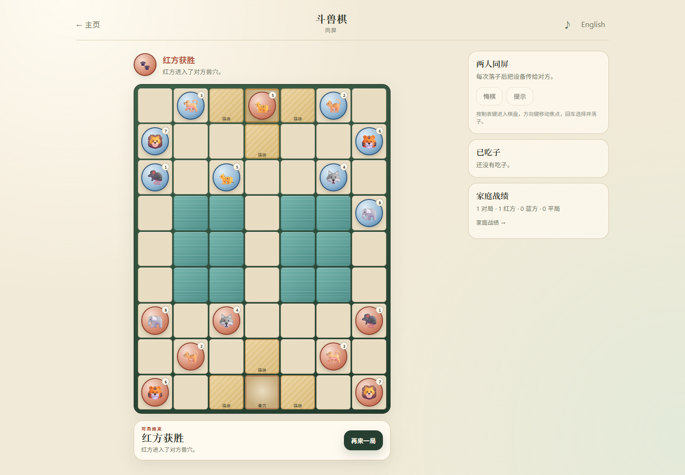
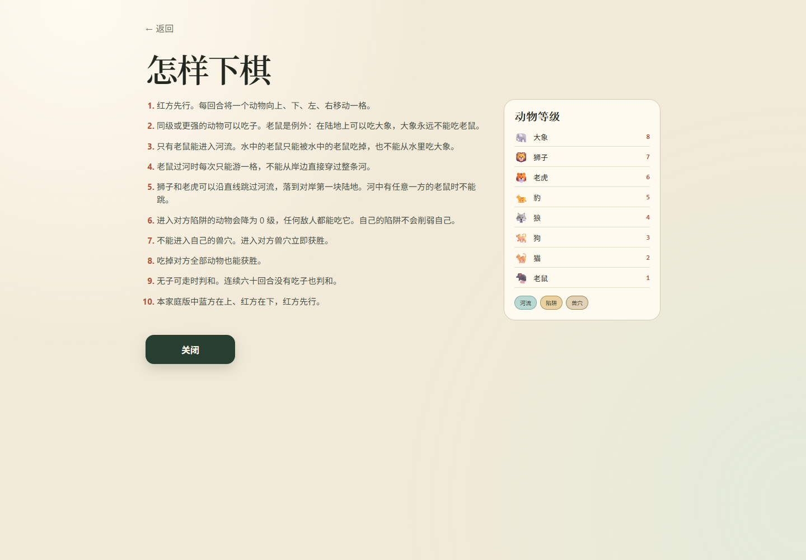
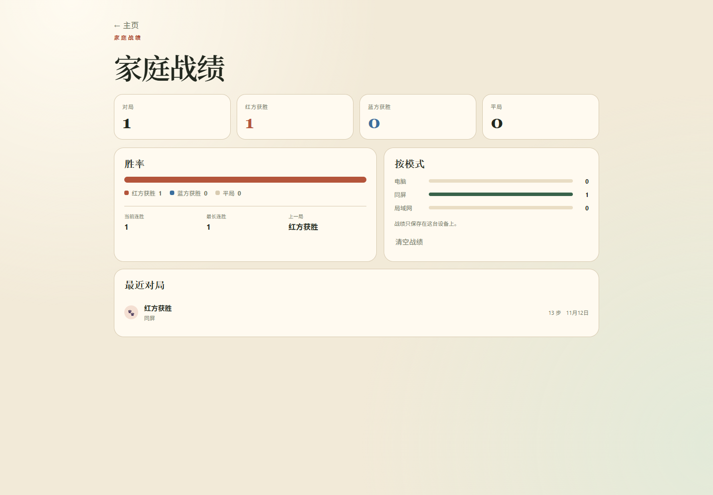
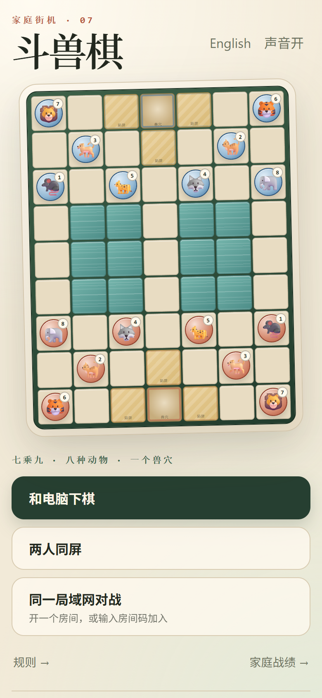
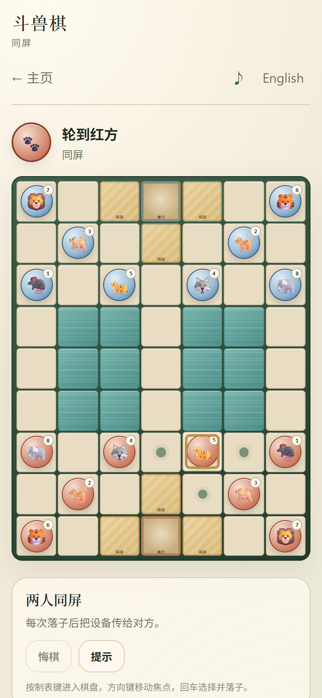

# 斗兽棋

[English](README.md) · **简体中文**

> **七列九行，八种动物，一个兽穴。**

经典 **斗兽棋** 的完整家庭版：动物等级、两条河流、陷阱、兽穴、会游泳的老鼠和会跳河的狮子老虎。两人对弈，四档电脑难度，同屏热座，也可以让手机在同一局域网加入。无账号、无广告、无外部素材。



## 五秒钟看懂一回合

| 移动 | 吃子 | 获胜 |
| --- | --- | --- |
| 每回合将一个动物向上、下、左、右移动一格。 | 同级或更强的动物可以吃子。老鼠在陆地上可以吃大象；水中的老鼠只能吃水中的老鼠。 | 进入对方兽穴，或吃掉对方全部动物。 |

完整的规则核对、陷阱、跳河规则和本版本采用的细节，见 [`docs/rules.md`](docs/rules.md)。

## 内容

- **真正的规则引擎。** 纯 TypeScript，**41 个单元测试**；`src/game/` 不依赖页面、网络、时钟或随机数。四档电脑难度都通过注入随机数保持可复现。
- **完整棋盘规则。** 七乘九棋盘、十六只动物、八个等级、两条二乘三的河流、六个陷阱、两个兽穴；老鼠游泳、狮子老虎跳河、陷阱降级、进兽穴获胜和吃光对方获胜。
- **四档电脑难度。** 陪玩温和宽容；轻松会犯错；标准向前算两步；挑战向前算三步，残局算四步。每一档都会抓住明确的制胜一步。
- **三种玩法。** 和电脑下棋、两人同屏轮流，或手机在同一局域网加入。
- **局域网牌桌。** 开房间，显示四位房间码或二维码，手机扫码加入。主机保存权威棋局，只向客人发送其座位视图；过期、伪造或轮次不符的落子会被拒绝。
- **家庭战绩。** 总局数、红方/蓝方/平局比例、按模式统计、当前和最长连胜，以及最近八局。局域网战绩记在主机上。
- **舒适功能。** 悔棋、带理由的提示、自动保存与继续、声音开关、键盘操作棋盘、减少动态效果、完整中英文界面，以及为七乘九棋盘设计的手机布局。
- **默认私密。** 无账号、无遥测、无广告、无 CDN、无远程字体、无下载美术素材。

## 截图

| 真实对局 | 电脑难度 |
| --- | --- |
|  |  |

| 带理由的提示 | 对局结束 |
| --- | --- |
|  |  |

| 规则与等级 | 家庭战绩 |
| --- | --- |
|  |  |

| 局域网大厅 | 手机主页 |
| --- | --- |
|  |  |

| 手机对局 | |
| --- | --- |
|  | |

全部截图来自真实运行页面：桌面 1440 × 1000，手机 390 × 844 @2×。

## 本地运行

```bash
npm install
npm run dev        # http://localhost:5207
npm run check      # 类型检查 + 41 个测试 + 生产构建
npm run e2e        # 真实 Chrome；需要先运行开发服务器
npm run lan:e2e    # 构建后在 :18927 启动独立中继并测试局域网
node scripts/shots.mjs   # 重新生成截图
```

## 局域网对战

浏览器加共享中继：

```bash
npm run build
npm run lan        # 中继与构建产物在 :8080
npm run dev        # 主机页面在 :5207
# 主页 → 同一局域网对战 → 创建房间
# 客人：扫码，或打开邀请并输入四位房间码
```

主机保存棋局，客人只收到自己的座位视图，只能发送 `{type:'move', from, to, moveCount}`。主机会重新检查座位、轮次、步数和全部走子规则。客人的结束界面是只读的，由主机开始下一局。

桌面版：Tauri 壳会启动同一个局域网中继，并把构建好的页面提供给手机。主机显示房间码和二维码，客人无需安装应用，只要在同一网络打开地址。

## 构建 Windows 安装包

保留共享 Tauri 壳与权限配置；安装包由主流程统一构建，本应用不运行 Cargo 或 Tauri 构建。

```bash
npm install
npx tauri build --bundles nsis
# src-tauri/target/release/bundle/nsis/Jungle Chess_0.1.0_x64-setup.exe
```

安装包按游戏独立打包，体积轻量；WebView2 使用标准引导程序。未签名的家庭版安装包出现 SmartScreen 提示是正常现象。

## 已知限制

- 仅两人；没有观战、匹配或在线大厅，局域网限于本机 IPv4 网络。
- 自动保存和家庭战绩只存在当前设备。
- 未实现三次重复局面判和；使用无子可走判和与连续六十回合无吃子判和。
- 挑战难度是三到四步搜索，不是已解算的完美引擎。
- 浏览器开房生成的二维码可能使用 `localhost`；手机加入请用桌面版或主机局域网地址。
- 安装包由主流程统一构建，本应用没有自行生成安装包。

完整说明见 [`docs/limitations.md`](docs/limitations.md)。

## 致谢

Family Arcade 原创代码、棋盘、文案和 CSS 美术。动物棋子使用系统自带表情字体，不下载任何美术文件。MIT 许可，见 [`NOTICE.md`](NOTICE.md) 和 [`LICENSE`](LICENSE)。
