# Ladder Run · 蛇梯棋

**English** · [简体中文](README.zh-CN.md)

> **Roll, climb, slide, giggle.**

A warm, offline-first snakes-and-ladders table for **2–4 players**: a 10×10 board,
9 ladders, 11 snakes, four AI companions, hot-seat, LAN night, and a family record that
stays on the device. No account, no ads, no remote fonts.

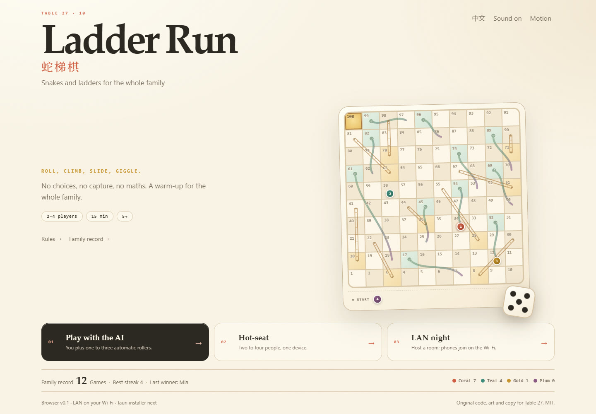

[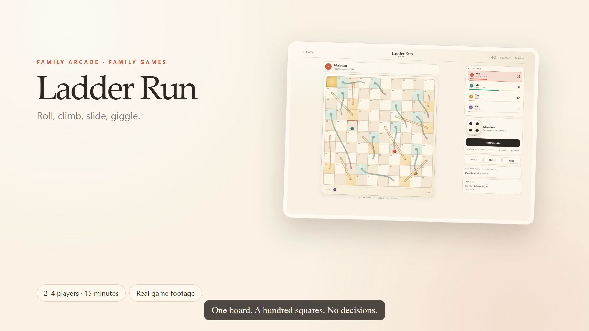](docs/promo/ladder-run-promo-en.mp4)

*45 seconds · 1920×1080 · 60 fps · [中文版](docs/promo/ladder-run-promo-zh.mp4) · [video.json](video.json)*

## A turn, in five seconds

| Roll | Climb or slide | Win |
| --- | --- | --- |
| Roll one die and move along the numbered path from 1 to 100. | A ladder takes you up. A snake takes you down. | You need the exact roll to land on 100. Overshoot and you stay put. |

There is no strategy and no capture. Players share squares. Luck does the work; the
table does the laughing.

## What is inside

- **A real, tested engine.** Pure TypeScript in `src/game/ladder-run.ts`, with an
  injected RNG, no DOM, clock, network or `Math.random`. **46 unit tests** cover the
  board, transports, exact-roll finish, turns, hints, whole-game simulations, save
  validation and the family record.
- **2–4 players, three ways.**
  - **Solo with AI:** you plus one to three automatic rollers.
  - **Hot-seat:** two to four people pass one device.
  - **LAN night:** host a room; up to three phones join on the same Wi-Fi.
- **Four AI levels, honestly labelled.** Snakes and ladders has no decisions, so the
  AI never pretends to make one. It rolls automatically. **Companion** cheers every
  player on every roll; Easy, Normal and Hard change the commentary only. Same dice,
  same RNG discipline.
- **A useful hint.** The hint does not invent a strategy. It shows all six possible
  faces from your square, marks the kindest one and explains the ladder, snake or
  exact finish it would produce.
- **Small comforts.** Undo, autosave/resume for solo and hot-seat, a local family
  record, sound on/off, reduced motion, keyboard play (`R` roll, `H` hint, `U` undo,
  `Esc` home), complete English/Chinese UI and a mobile layout.
- **Private by default.** No accounts, telemetry, cloud saves or downloaded art.
- **A real LAN relay.** The host keeps the only board state and sends each guest a
  private seat view; guests send a `roll` intent, never a result. The shared
  `@family-arcade/lan` package and Tauri shell are kept intact.

## Screenshots

All images are captured from the running app at 1440×1000; phone images are
390×844 at 2× (780×1688). The game and hint shots load a mid-game save so the board
is not empty; every pixel is the real app, not a mockup.

| Home | Set the table |
| --- | --- |
|  | 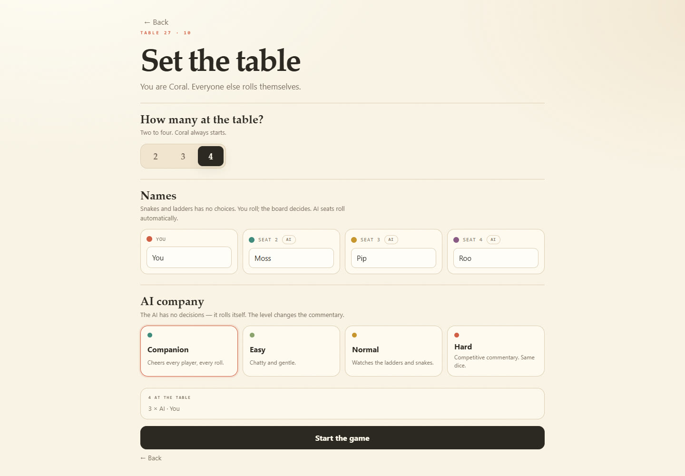 |

| A real game | Six possible rolls |
| --- | --- |
| 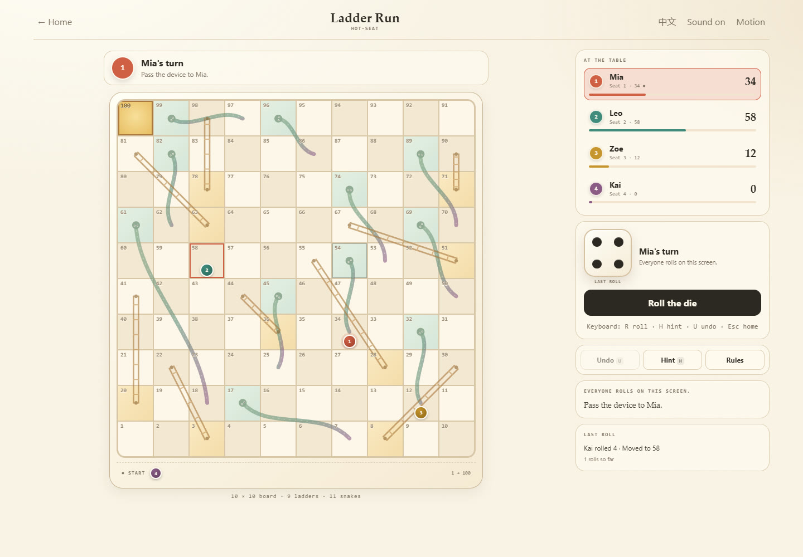 | 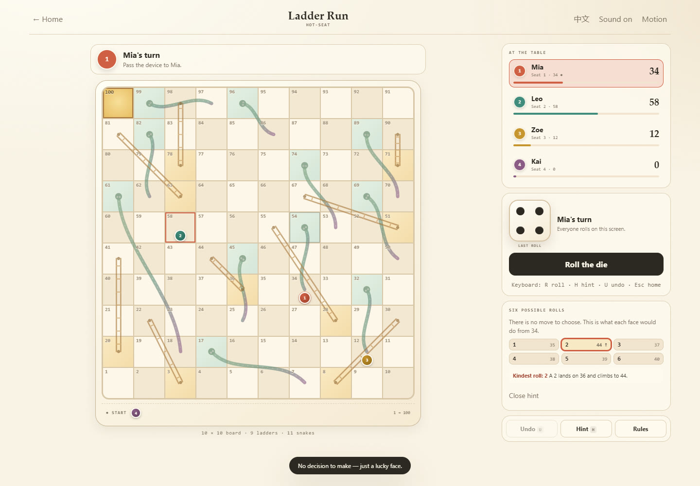 |

| Family record | Rules |
| --- | --- |
| 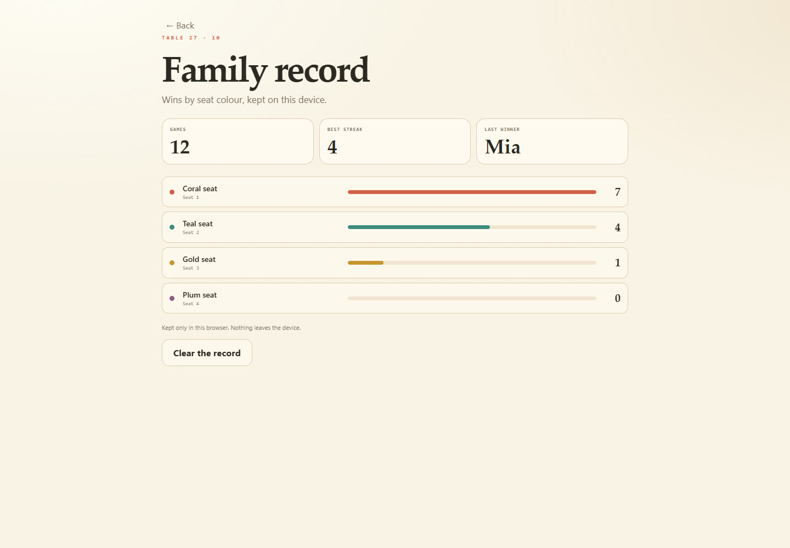 | 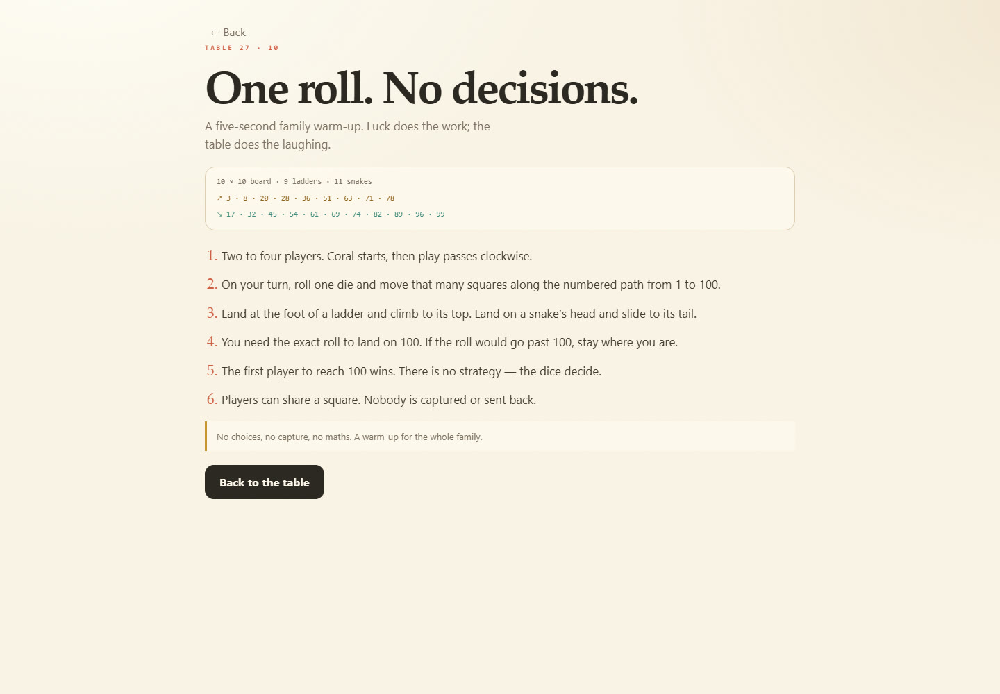 |

| LAN lobby | Home! |
| --- | --- |
| 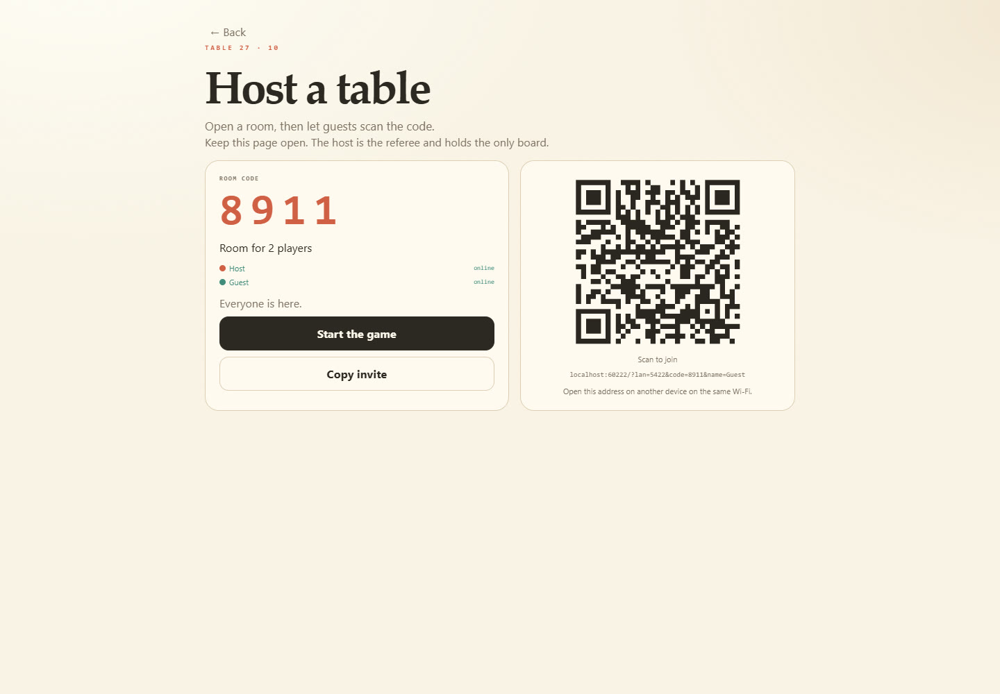 | 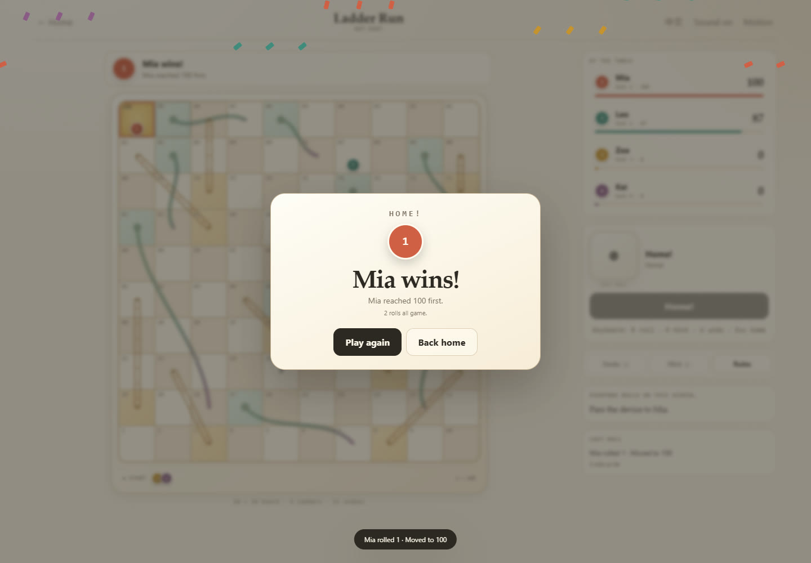 |

| Phone home | Phone game |
| --- | --- |
| 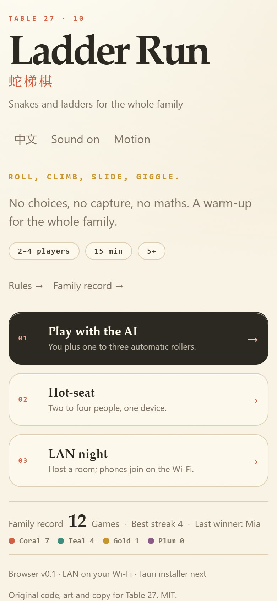 | 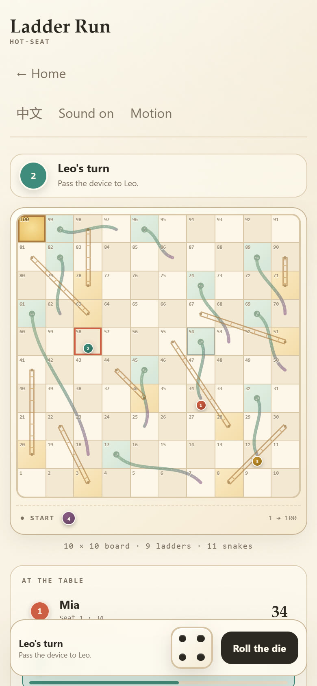 |

Ten screenshots per language live in [`docs/screenshots/en`](docs/screenshots/en) and
[`docs/screenshots/zh`](docs/screenshots/zh).

## Play locally

You need Node.js 22+ and a local Chrome for the Playwright checks.

```bash
npm install
npm run dev        # http://localhost:5189
npm run check      # tsc + 46 tests + production build
node scripts/e2e.mjs
node scripts/shots.mjs
```

The E2E script needs the dev server running. It covers the 100-square board,
3-player hot-seat, roll/undo/hint, autosave/resume, 4-seat AI auto-play, Companion
commentary, an exact-roll win, the family record, rematch, rules, mobile and Chinese.

## LAN night

Browser build:

```bash
npm run build
npm run lan        # relay + built app on http://localhost:8080
```

Open `http://localhost:8080` on the host device, choose **LAN night → Open the room**,
then let guests open the shown address or scan the QR code. A dev-server flow also
works: keep `npm run dev` on port 5189 and `npm run lan` on 8080, and open the host
page on 5189.

For phones, open the host page through the computer's LAN address (for example
`http://192.168.1.20:8080`), not `localhost`, so the invite address and QR code are
reachable. The Tauri build uses the local relay's real URLs.

The relay is a dumb message bus. The host keeps the authoritative state and sends
`view(state, seat)` to each guest. A guest intent is only a request to roll; the host
re-checks the turn and game status before rolling. If a guest drops, the host can roll
for the empty seat, and a reloaded guest can rejoin with the same browser token.

Reproducible LAN check (spawns its own relay on a free port):

```bash
npm run build
npm run lan:e2e
```

It verifies host lobby, guest join, start, host roll, guest intent and the disconnected
seat rescue.

## The AI, without theatre

Snakes and ladders is a game of luck. Instead of pretending the AI has a clever move,
Ladder Run makes that part of the design:

| Level | What changes |
| --- | --- |
| Companion | Cheers every player, every roll. |
| Easy | Chatty, gentle commentary. |
| Normal | Watches the ladders and snakes. |
| Hard | Competitive commentary. Exactly the same dice. |

All four levels use the same injected RNG and produce the same die for the same RNG
value. Tests enforce this; the UI repeats it in the setup note.

## Build the Windows installer

The Tauri shell is kept working, but this pass deliberately did not run `cargo build`
or `tauri build` (the main Family Arcade build does that centrally):

```bash
npm install
npx tauri build --bundles nsis
# src-tauri/target/release/bundle/nsis/Ladder Run_0.1.0_x64-setup.exe
```

The installer is per-game and lightweight; WebView2 uses the standard bootstrapper.
The build is unsigned, so a SmartScreen warning is expected for a family build.

## Known limitations

- LAN is local-subnet IPv4 only; no cloud, matchmaking or spectators.
- If the host tab disappears, a guest keeps the last view and should reload/rejoin.
- AI has no decisions by design; difficulty is commentary only.
- No capture, no strategy, no extra rules: the 10×10 folk game as written.
- Saves and the family record are local to this browser/device.
- The promo is a `video.json` manifest for the root studio; no separate Remotion
  project is included in this app.
- The installer was not built in this pass.

See [`docs/limitations.md`](docs/limitations.md) for the full honest list.

## Credits

Original code, art and copy for Family Arcade. The snakes-and-ladders mechanic is a
public-domain folk game; this implementation, its name, copy and visual design are
original. MIT. See [`NOTICE.md`](NOTICE.md) and [`LICENSE`](LICENSE).

## Promo

[](docs/promo/ladder-run-promo-en.mp4)

- [English cut](docs/promo/ladder-run-promo-en.mp4) · [other language](docs/promo/ladder-run-promo-zh.mp4)
- [SRT](docs/promo/ladder-run-promo-en.srt) · [video.json](video.json)
- Real app screenshots and real engine data; claims match the tests.

