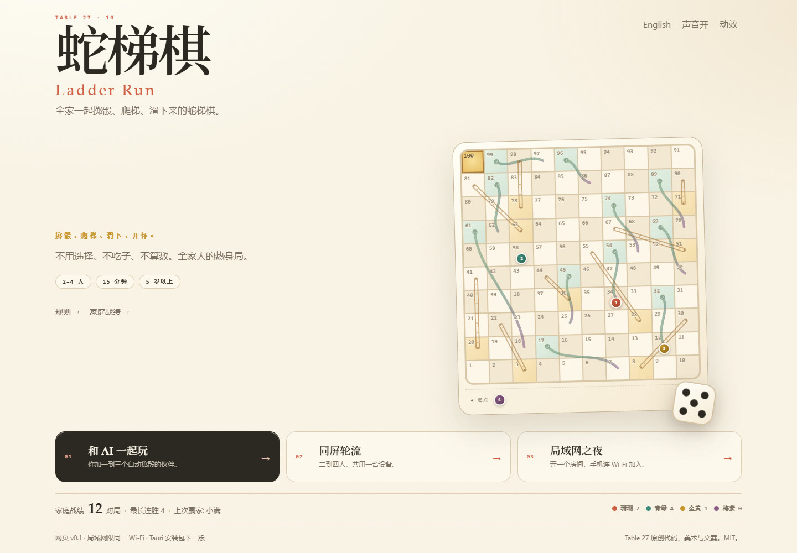
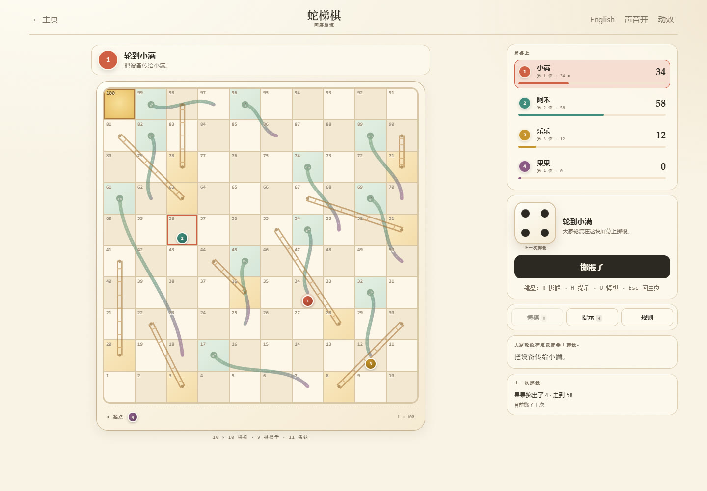
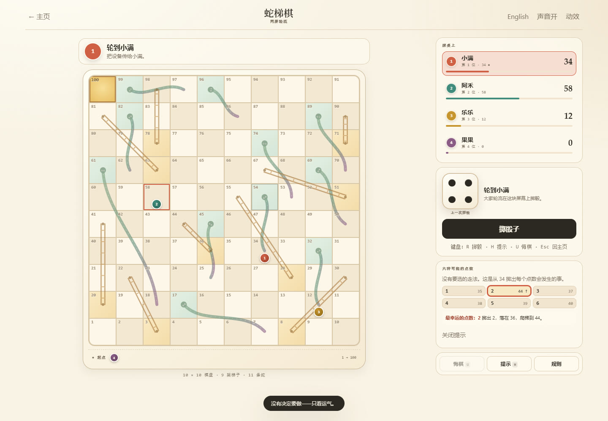
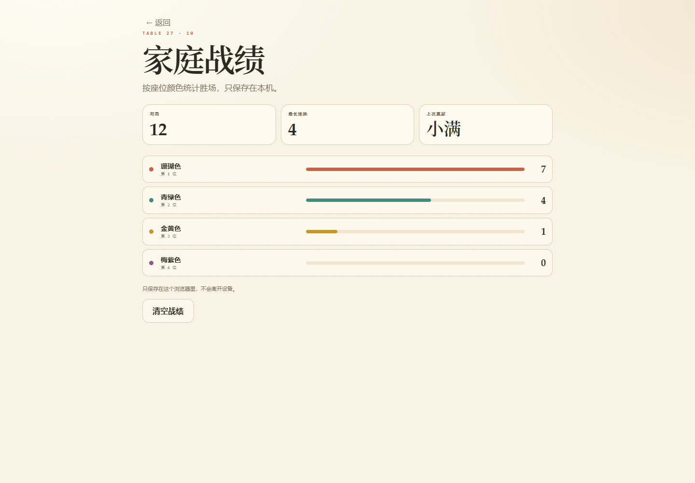
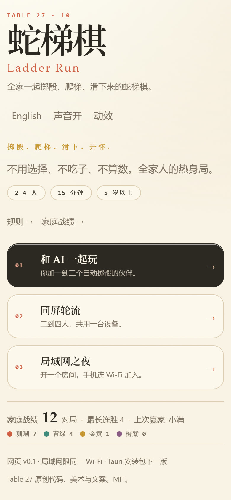
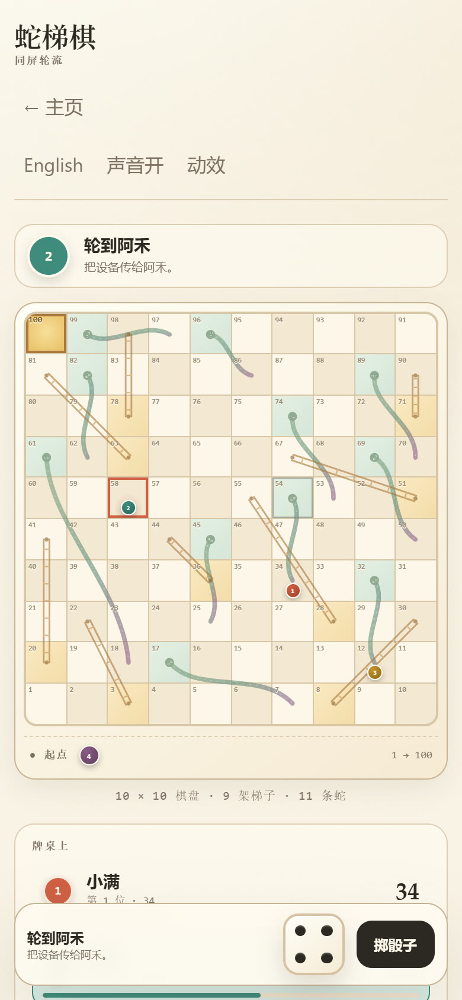

# 蛇梯棋 · Ladder Run

[English](README.md) · **简体中文**

> **掷骰、爬梯、滑下、开怀。**

给家庭牌桌的一款温暖、离线优先的**二到四人**蛇梯棋：10×10 棋盘、9 架梯子、
11 条蛇、四档 AI 陪玩、同屏热座、局域网之夜，以及只留在这台设备上的家庭战绩。
无账号、无广告、无远程字体。



[](docs/promo/ladder-run-promo-zh.mp4)

*45 秒 · 1920×1080 · 60fps · [English cut](docs/promo/ladder-run-promo-en.mp4) · [video.json](video.json)*

## 一回合，五秒看懂

| 掷骰 | 爬梯或滑下 | 获胜 |
| --- | --- | --- |
| 掷一枚骰子，沿 1 到 100 的数字路线前进。 | 梯子带你往上，蛇带你往下。 | 必须正好落在 100；超过就留在原地。 |

没有策略，也不吃子。玩家可以站在同一格。运气干活，全家负责笑。

## 里面有什么

- **真正经过测试的引擎。** `src/game/ladder-run.ts` 是纯 TypeScript，注入随机数，
  不碰 DOM、时钟、网络或 `Math.random`。**46 个单元测试**覆盖棋盘、梯子与蛇、
  正好到 100、轮转、提示、整局模拟、存档校验和家庭战绩。
- **二到四人，三种玩法。**
  - **和 AI 玩：** 你加一到三个自动掷骰的伙伴。
  - **同屏轮流：** 二到四人共用一台设备。
  - **局域网：** 开一个房间，最多三台手机在同一 Wi-Fi 下加入。
- **四档 AI，老实标注。** 蛇梯棋没有决策，所以 AI 不假装做决定，只自动掷骰。
  **陪玩** 会为每个人、每一次掷骰欢呼；轻松、标准、挑战只改变解说语气。骰子、
  随机数和规则完全相同。
- **有用的提示。** 提示不会编造策略，而是列出当前格子上六种点数分别会发生什么，
  标出“最幸运”的一个，并说明它会爬梯、遇蛇还是正好到家。
- **小细节。** 悔棋、单人/同屏自动保存与继续、本机家庭战绩、声音开关、减少动效、
  键盘操作（`R` 掷骰、`H` 提示、`U` 悔棋、`Esc` 回主页）、完整中英双语和手机布局。
- **默认私密。** 无账号、无遥测、无云存档、无下载美术。
- **真正的局域网中继。** 主机保存唯一棋盘状态，只给每位客人发送自己的座位视图；
  客人发送“掷骰”意图，不发送结果。共享的 `@family-arcade/lan` 与 Tauri 壳保持原样。

## 截图

全部来自真实运行的应用：桌面 1440×1000，手机 390×844 @2×（780×1688）。
对局和提示截图会载入一个中局存档，让棋盘不是空的；每一像素都来自真实应用，
不是模拟图。

| 主页 | 摆好牌桌 |
| --- | --- |
|  |  |

| 真实对局 | 六种可能点数 |
| --- | --- |
|  |  |

| 家庭战绩 | 规则 |
| --- | --- |
|  |  |

| 局域网大厅 | 到家啦！ |
| --- | --- |
|  |  |

| 手机主页 | 手机对局 |
| --- | --- |
|  |  |

每种语言十张截图，见 [`docs/screenshots/en`](docs/screenshots/en) 与
[`docs/screenshots/zh`](docs/screenshots/zh)。

## 本地运行

需要 Node.js 22+，E2E 还需要本机 Chrome。

```bash
npm install
npm run dev        # http://localhost:5189
npm run check      # tsc + 46 个测试 + 生产构建
node scripts/e2e.mjs
node scripts/shots.mjs
```

E2E 需要先运行开发服务器。它会检查 100 格棋盘、三人同屏、掷骰/悔棋/提示、
自动保存与继续、四人 AI 自动掷骰、陪玩解说、正好到 100 获胜、家庭战绩、再来一局、
规则、手机布局和中文界面。

## 局域网之夜

浏览器构建：

```bash
npm run build
npm run lan        # 中继 + 构建产物，http://localhost:8080
```

在主机设备打开 `http://localhost:8080`，选择 **局域网之夜 → 开房间**，让客人在同一
Wi-Fi 下打开显示的地址或扫码加入。开发模式也可以：`npm run dev` 在 5189，
`npm run lan` 在 8080，主机页面开在 5189。

手机加入时，请用电脑的局域网地址打开主机页面（例如 `http://192.168.1.20:8080`），
不要用 `localhost`，这样邀请地址和二维码才对手机可达。Tauri 构建会使用本地中继的
真实地址。

中继只负责转发消息。主机保存权威状态，给每位客人发送 `view(state, seat)`。
客人的意图只是“请求掷骰”；主机重新检查回合与游戏状态后才真正掷骰。客人掉线时，
主机可以替空座位掷骰；客人刷新后可以用同一个浏览器令牌重新加入。

可重复的局域网检查（自动在空闲端口启动中继）：

```bash
npm run build
npm run lan:e2e
```

它会验证主机大厅、客人加入、开始、主机掷骰、客人意图和掉线座位救援。

## AI，不演戏

蛇梯棋是运气游戏。Ladder Run 不假装 AI 有聪明走法，而是把这件事说清楚：

| 档位 | 改变什么 |
| --- | --- |
| 陪玩 | 每个人、每一次掷骰都欢呼。 |
| 轻松 | 话多、温柔的解说。 |
| 标准 | 会留意梯子和蛇。 |
| 挑战 | 好胜的解说。骰子完全一样。 |

四档使用同一个注入随机数；相同随机值得到相同点数，测试会强制检查。设置页也会
直接说明。

## 构建 Windows 安装包

Tauri 壳保持可用，但本次按要求没有运行 `cargo build` 或 `tauri build`
（由 Family Arcade 主构建统一处理）：

```bash
npm install
npx tauri build --bundles nsis
# src-tauri/target/release/bundle/nsis/Ladder Run_0.1.0_x64-setup.exe
```

安装包按游戏单独打包，保持轻量；WebView2 使用标准引导程序。未签名，家庭构建会
触发 Windows SmartScreen 提示。

## 已知限制

- 局域网仅支持同一子网的 IPv4；没有云、匹配或观战。
- 主机页面关闭后，客人会停留在最后一个视图，需要刷新/重新加入。
- AI 按设计没有决策；档位只改变解说。
- 不吃子、无策略、无额外规则：就是 10×10 的传统蛇梯棋。
- 存档和家庭战绩只保存在这个浏览器/设备。
- 宣传片是给根目录工作室的 `video.json` 清单；本应用没有单独的 Remotion 工程。
- 本次没有构建安装包。

完整、诚实的限制见 [`docs/limitations.md`](docs/limitations.md)。

## 许可

Family Arcade 原创代码、美术与文案。蛇梯棋机制属于公版民间游戏；本实现、名称、文案和
视觉设计均为原创。MIT。见 [`NOTICE.md`](NOTICE.md) 与 [`LICENSE`](LICENSE)。

## 宣传片

[](docs/promo/ladder-run-promo-zh.mp4)

- [中文成片](docs/promo/ladder-run-promo-zh.mp4) · [另一语言](docs/promo/ladder-run-promo-en.mp4)
- [字幕](docs/promo/ladder-run-promo-zh.srt) · [video.json](video.json)
- 画面来自真实应用与真实引擎数据；数字与测试一致。

