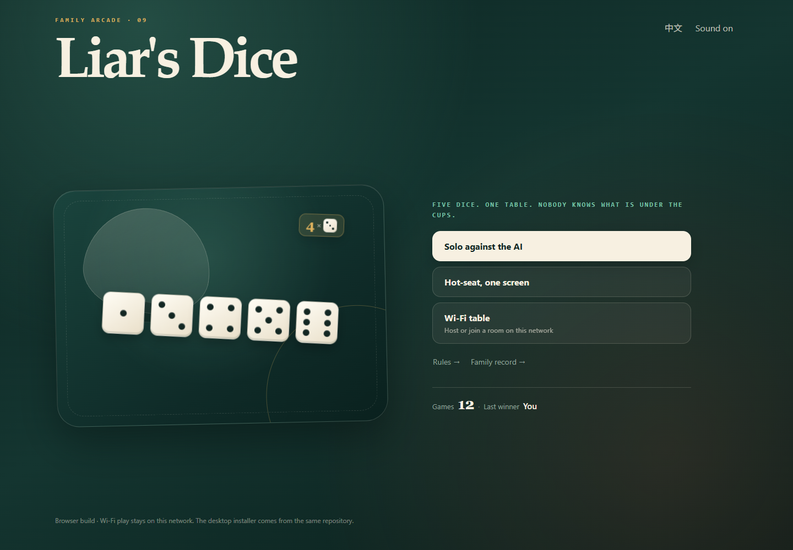
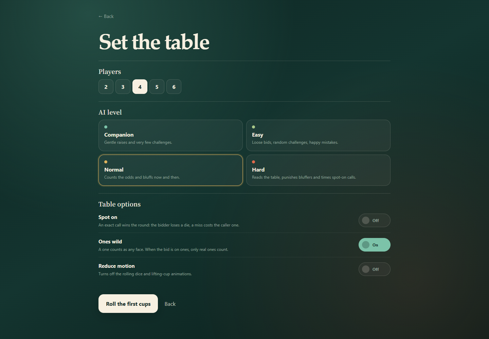
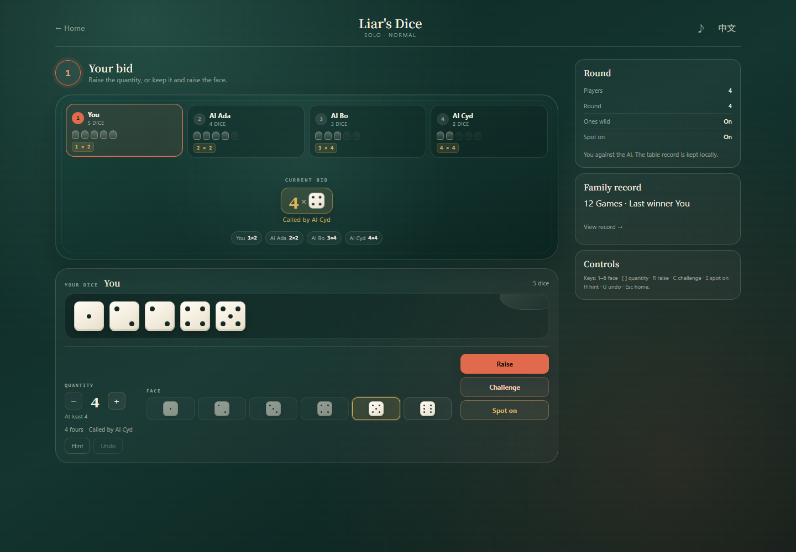
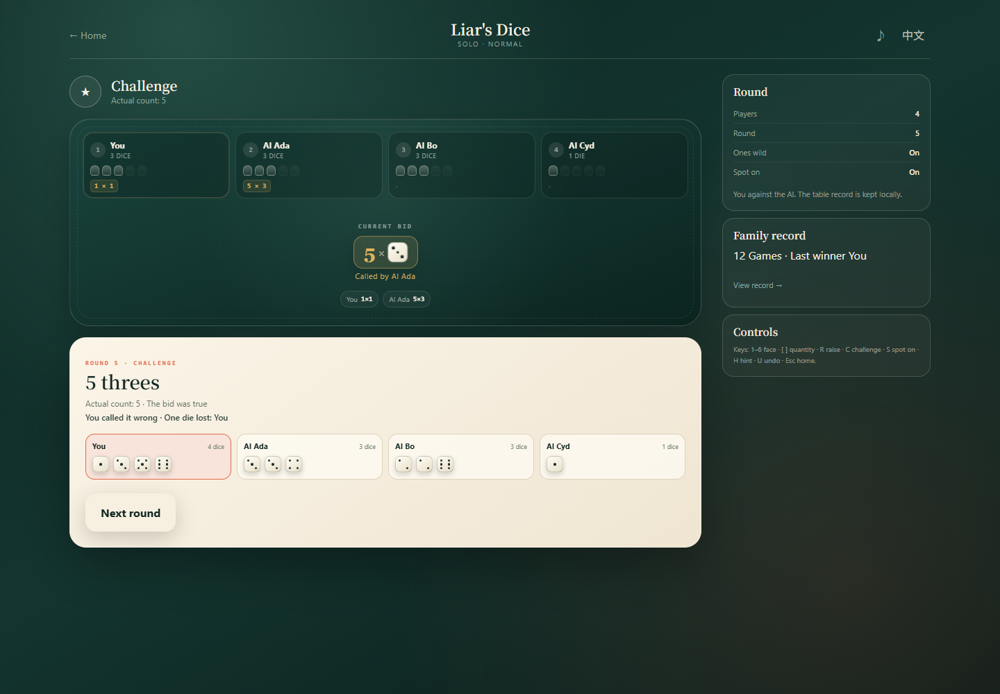
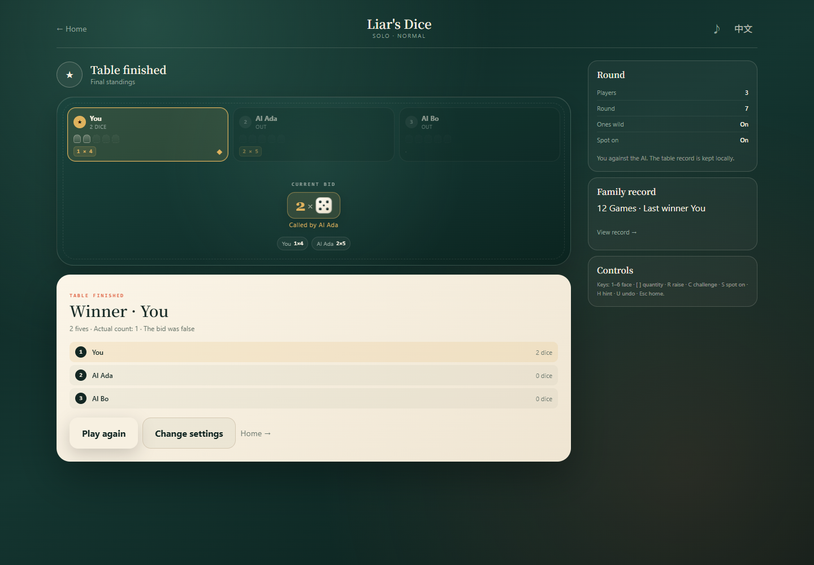
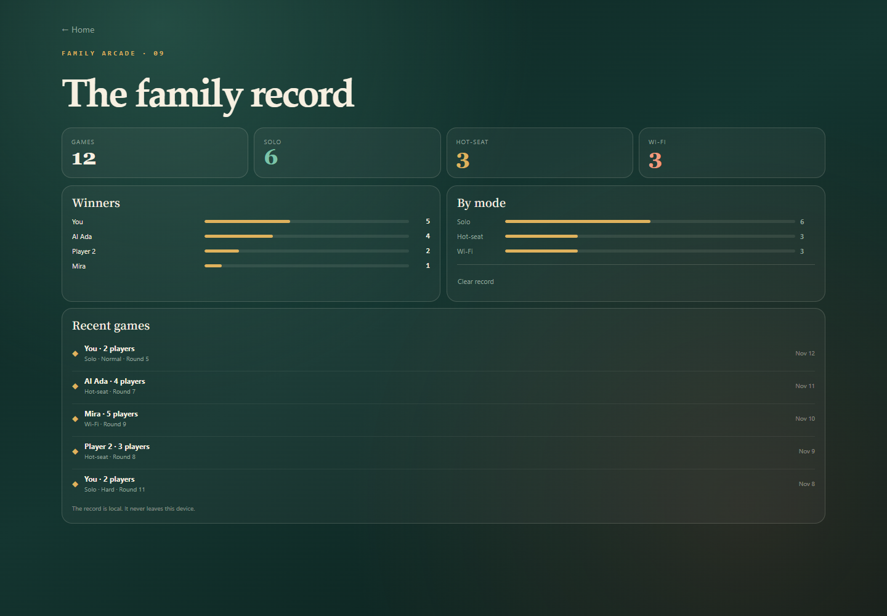
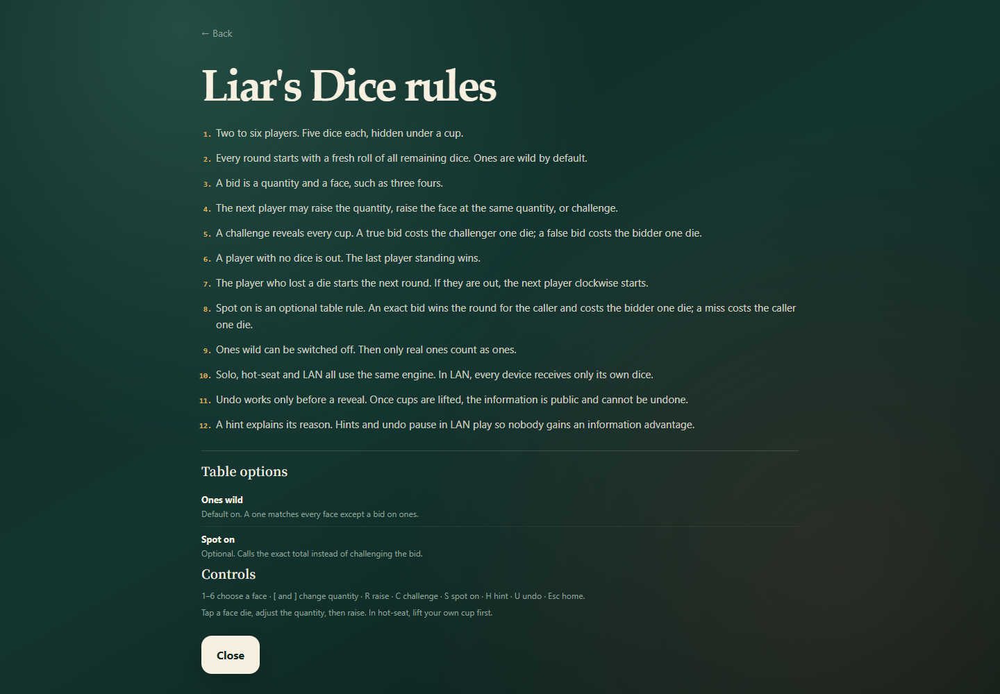
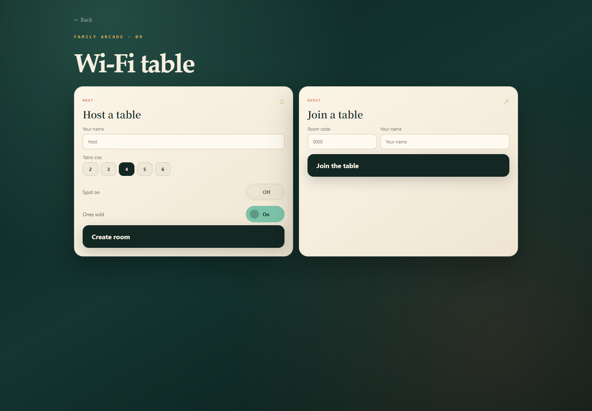
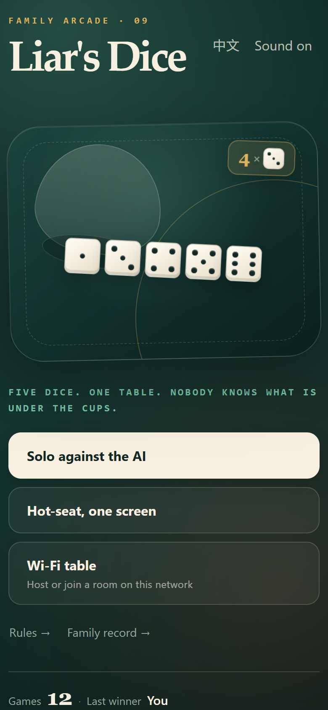
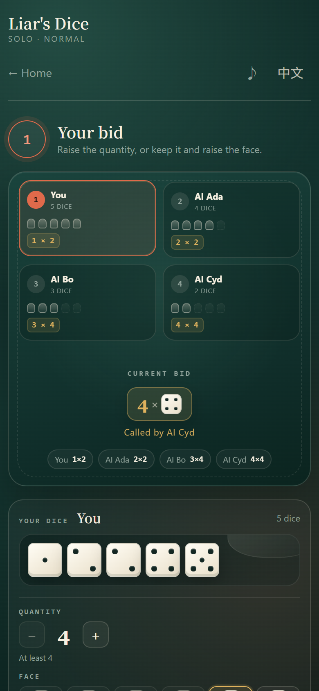

# Liar's Dice

**English** · [简体中文](README.zh-CN.md)

> **Five dice. One table. Nobody knows what is under the cups.**

A complete bluffing-dice game for the family table: a pure rules engine, four AI
levels, private hot-seat cups, a per-seat LAN table, wild ones, the optional
spot-on call, undo, a reasoned hint, autosave and a local family record. No
accounts, ads, telemetry or remote assets.



## A turn in five seconds

| Roll | Bid | Call | Lose a die | Last standing |
| --- | --- | --- | --- | --- |
| Five dice each, hidden under a cup. Ones are wild by default. | State a quantity and a face, such as three fours. | Raise the quantity, raise the face, or challenge. | A true bid costs the challenger one die; a false bid costs the bidder one die. | A player at zero dice is out. The last player with dice wins. |

## What is inside

- **A real, tested engine.** Pure TypeScript in `src/game/liars-dice.ts` with
  **57 unit tests**: dice rolls, wild-one counting, bid legality, raises,
  challenges, spot-on, elimination, round rotation, per-seat views, AI
  determinism, hidden-information safety, hints, record normalization and both
  languages. The engine has no DOM, network, clock or `Math.random`; every roll
  takes an injected RNG.
- **Four AI levels.** Companion bids gently and avoids sharp challenges; Easy is
  loose and random; Normal estimates the binomial odds and bluffs occasionally;
  Hard adds public opponent modelling, protects a short stack, punishes known
  bluffers and times exact spot-on calls. No level reads another cup.
- **Three ways to play.** Solo against the AI, 2–6 players passing one device
  with a privacy gate on every turn, or a LAN room for up to six devices. Empty
  LAN seats are filled by the AI, so two phones can start a mixed table.
- **Privacy as a rule.** A hot-seat player must lift their own cup before acting;
  the next player gets a fresh cover. In LAN play the host sends each device only
  that seat's `view`: own dice, public dice counts, bids and reveal data. There
  is no spectator view.
- **Wild ones and spot on.** Ones count as any face by default and can be
  switched off at setup. Spot on is an optional table rule: an exact call wins
  the round for the caller and costs the bidder one die; a miss costs the caller.
- **Comforts.** Undo before a reveal, a hint with a probability and a reason,
  autosave/resume, a local family record, sound toggle, reduced-motion support
  and a manual motion toggle, a full keyboard path and a mobile layout.
- **Private by default.** No cloud, accounts, ads, tracking, remote fonts or
  downloaded art.

## Screenshots

| Home | Table settings |
| --- | --- |
|  |  |

| A live bid | Hint with a reason |
| --- | --- |
|  |  |

| Challenge reveal | Table finished |
| --- | --- |
|  |  |

| Family record | Rules |
| --- | --- |
|  |  |

| LAN lobby | Phone home |
| --- | --- |
|  |  |

| Phone table |
| --- |
|  |

All screenshots come from the running app at 1440×1000 desktop and 390×844 @2×
phone. The game, hint, reveal and game-over screens are generated from valid
deterministic engine fixtures used by the screenshot script; live play is
verified by the E2E and LAN tests.

## Play locally

```bash
npm install
npm run dev        # http://localhost:5224
npm run check      # tsc + 57 tests + production build
npm run e2e        # real Chrome against the dev server
npm run lan:e2e    # relay on LAN_PORT, default 19024
npm run shots      # regenerate the EN/ZH screenshot sets
```

For the browser E2E scripts, leave `npm run dev` running in another terminal.

## LAN night

```bash
npm run build
npm run lan        # relay on :8080, serves dist/
# open the host page, then Wi-Fi table -> Create room
# guests scan the QR or open the invite URL on the same network
```

The host owns the authoritative game. Guests receive one seat view per device
and can send only `bid`, `challenge` or `spot-on` intents for their own seat. The
host re-checks the turn, the action counter, bid legality and the face/count
before applying anything. A disconnected seat is played by the AI after a short
pause; a returning guest receives the current private view again. Guests can
reload and rejoin with the same local token.

The desktop build starts the same relay internally. The browser build can use
`npm run lan`; a QR opened on `localhost` will not reach a phone, so use the host
machine's network address or the desktop app.

## Build the Windows installer

```bash
npm install
npx tauri build --bundles nsis
# src-tauri/target/release/bundle/nsis/Liars Dice_0.1.0_x64-setup.exe
```

The installer is per-game and lightweight; WebView2 uses the standard
bootstrapper. An unsigned family build may show a Windows SmartScreen warning.
This workspace did not run Tauri or cargo builds; the central build agent does.

## Known limitations

- The AI is honest but heuristic; Hard is not a tournament solver.
- There is no “palifico” or ones-only special round, and no doubling on a bid of
  ones. The table uses the straight quantity/face ladder.
- Spot-on is an optional house rule and is off by default.
- LAN is same-subnet IPv4 only: no matchmaking, spectator, chat or cloud record.
- LAN results are recorded on the host device only.
- Undo is intentionally disabled once cups have been revealed.
- The screenshots use valid deterministic engine fixtures; live play is covered
  by the E2E and LAN tests.
- The browser QR can say `localhost`; use the LAN address or the desktop build.

See [`docs/limitations.md`](docs/limitations.md) and the full rule audit in
[`docs/rules.md`](docs/rules.md).

## Credits

Original code, dice, cups, copy and sound for Family Arcade. Liar's Dice is a
public-domain folk game; this implementation and its visual design are original.
MIT. See [`NOTICE.md`](NOTICE.md).
