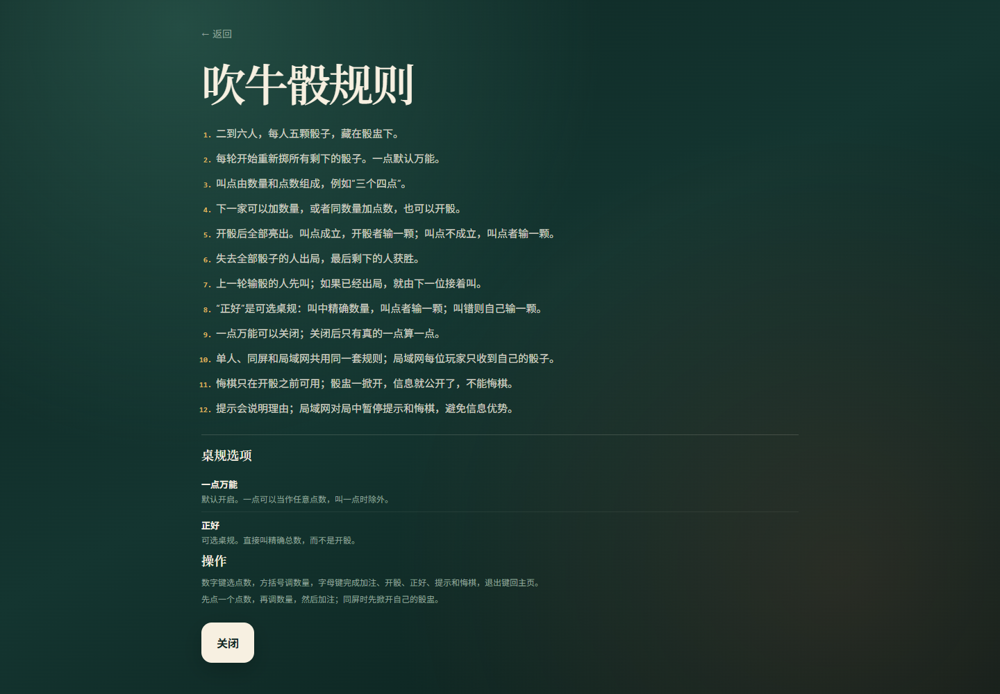
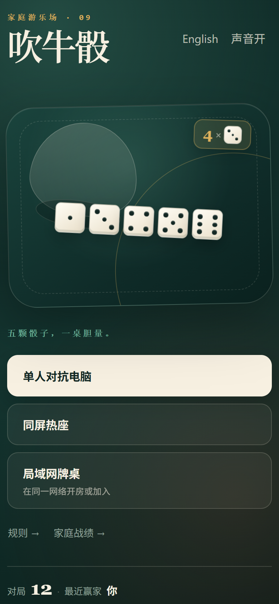
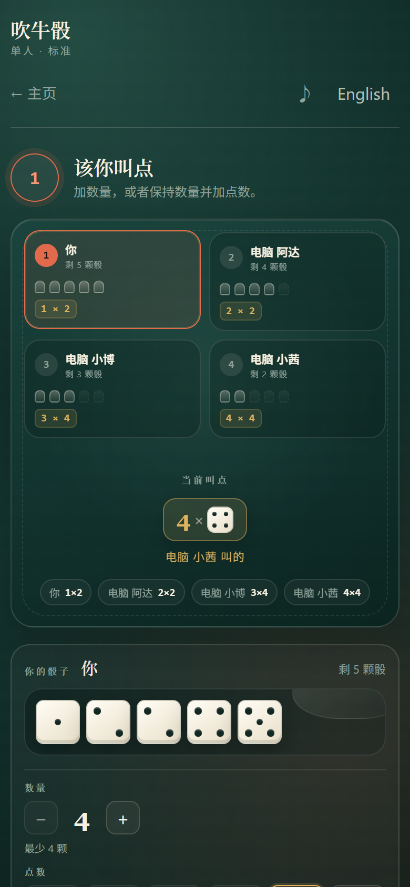

# 吹牛骰

[English](README.md) · **简体中文**

> **五颗骰子，一桌胆量。**

给家庭牌桌准备的完整吹牛骰：纯规则引擎、四档电脑、同屏私密骰盅、每人一座的局域网牌桌、一点万能、可选的“正好”、悔棋、带理由的提示、自动保存和本机家庭战绩。没有账号、广告、遥测或远程素材。


## 五秒看懂一回合

| 掷骰 | 叫点 | 开骰 | 输一颗 | 最后胜出 |
| --- | --- | --- | --- | --- |
| 每人五颗骰，藏在骰盅下。一点默认万能。 | 叫出数量和点数，例如“三个四点”。 | 加数量、同数量加点数，或者开骰。 | 叫点成立，开骰者输一颗；叫点不成立，叫点者输一颗。 | 骰子归零的人出局，最后剩下的人获胜。 |

## 里面有什么

- **真正经过测试的引擎。** `src/game/liars-dice.ts` 是纯 TypeScript，含 **57 个单元测试**：掷骰、一点万能计数、叫点合法性、加注、开骰、正好、出局、下一轮轮转、每人视图、电脑确定性、隐藏信息保护、提示、战绩清洗和中英双语。引擎不依赖页面、网络、时钟或 `Math.random`，所有掷骰都使用注入的随机源。
- **四档电脑。** 陪玩温和加注、很少硬开；轻松会乱叫乱开；标准会算二项概率、偶尔诈唬；挑战会读公开牌风、保护短筹码、抓诈唬，并找时机叫正好。任何难度都不会偷看别人的骰子。
- **三种玩法。** 单人对抗电脑、二到六人同屏热座，或者最多六台设备的局域网牌桌。局域网空位由电脑补上，两台手机也能开一桌。
- **隐私是规则。** 同屏时每位玩家要先掀开自己的骰盅才能行动，下一位会重新盖上。局域网里主机只给每台设备发送该座位的 `view`：自己的骰子、公开的骰子数量、叫点和开骰结果。没有观战视图。
- **一点万能与正好。** 一点默认可以当任意点数，也可以在设置里关闭。正好是可选桌规：叫中精确数量时，叫点者输一颗；叫错则自己输一颗。
- **舒适功能。** 开骰前可悔棋、带概率和理由的提示、自动保存/继续、本机家庭战绩、声音开关、减少动效与手动动效开关、完整键盘路径和手机布局。
- **默认私密。** 无云、无账号、无广告、无跟踪、无远程字体、无下载素材。

## 截图

| 主页 | 牌桌设置 |
| --- | --- |
|  |  |

| 叫点中 | 带理由的提示 |
| --- | --- |
|  |  |

| 开骰亮盅 | 对局结束 |
| --- | --- |
|  |  |

| 家庭战绩 | 规则 |
| --- | --- |
|  |  |

| 局域网大厅 | 手机主页 |
| --- | --- |
|  |  |

| 手机牌桌 |
| --- |
|  |

所有截图都来自正在运行的应用：桌面 1440×1000，手机 390×844 @2×。对局、提示、开骰和结束画面使用截图脚本里的确定性引擎状态；真实对局由端到端和局域网测试验证。

## 本地运行

```bash
npm install
npm run dev        # http://localhost:5224
npm run check      # 类型检查 + 57 个测试 + 生产构建
npm run e2e        # 真实 Chrome，需要开发服务器
npm run lan:e2e    # 局域网中继，端口取 LAN_PORT，默认 19024
npm run shots      # 重新生成中英两套截图
```

运行浏览器端到端脚本时，请在另一个终端保持 `npm run dev`。

## 局域网牌桌

```bash
npm run build
npm run lan        # 中继在 :8080，并提供 dist/
# 打开主机页面，进入“局域网牌桌” -> “创建房间”
# 访客在同一网络扫码，或打开邀请链接
```

主机掌握权威对局。每台访客设备只收到自己的座位视图，只能为自己的座位发送叫点、开骰或正好意图。主机会重新检查轮次、动作计数、叫点合法性和点数/数量，再决定是否执行。访客掉线后，该座位会由电脑短暂接管；访客回来后能收到当前私密视图。刷新页面会沿用本机令牌回到原座位。

桌面版会在内部启动同一个中继。网页版可以使用 `npm run lan`；在 `localhost` 上打开的二维码手机访问不到，请使用主机的局域网地址或桌面版。

## 构建 Windows 安装包

```bash
npm install
npx tauri build --bundles nsis
# src-tauri/target/release/bundle/nsis/Liars Dice_0.1.0_x64-setup.exe
```

安装包按游戏单独构建，体积轻量；WebView2 使用标准引导程序。家庭内部未签名构建可能触发 Windows SmartScreen 提示。本工作区没有运行 Tauri 或 cargo 构建，安装包由中央构建代理统一生成。

## 已知限制

- 电脑是诚实但启发式的对手，挑战难度也不是锦标赛求解器。
- 没有“一叫一”或只算一点的特殊轮，也没有叫一点翻倍；牌桌使用直接的数量/点数阶梯。
- 正好是可选桌规，默认关闭。
- 局域网仅限同一子网的第四版网络地址：没有匹配、观战、聊天或云端战绩。
- 局域网战绩只记录在主机设备。
- 骰盅一旦掀开，悔棋会被禁用。
- 截图使用确定性的合法引擎状态；真实对局由端到端和局域网测试覆盖。
- 浏览器二维码可能显示 `localhost`，请改用局域网地址或桌面版。

完整规则审计见 [`docs/rules.md`](docs/rules.md)，诚实限制见 [`docs/limitations.md`](docs/limitations.md)。

## 制作说明

代码、骰子、骰盅、文案和声音均为家庭游乐场原创。吹牛骰是公有领域的民间游戏；本实现和视觉设计为原创。MIT。见 [`NOTICE.md`](NOTICE.md)。
