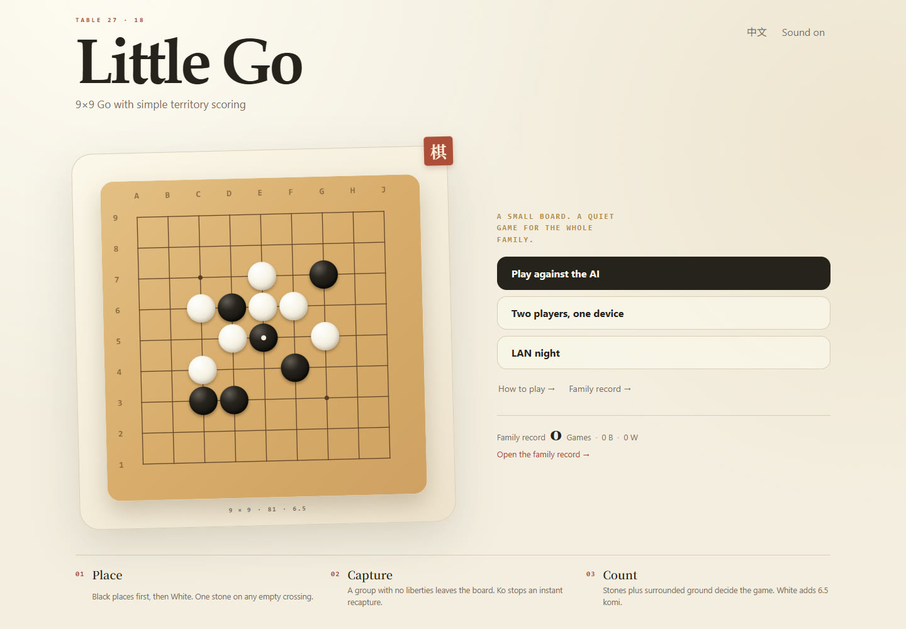
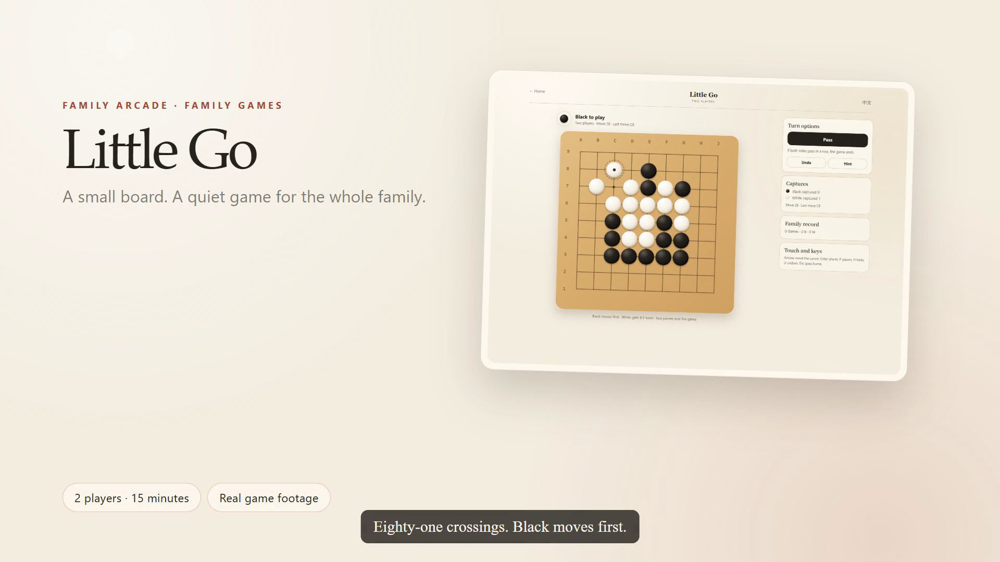
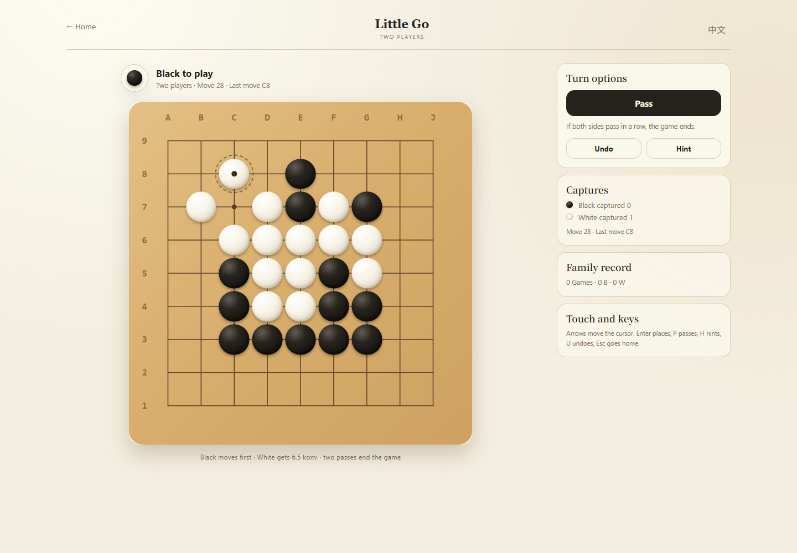
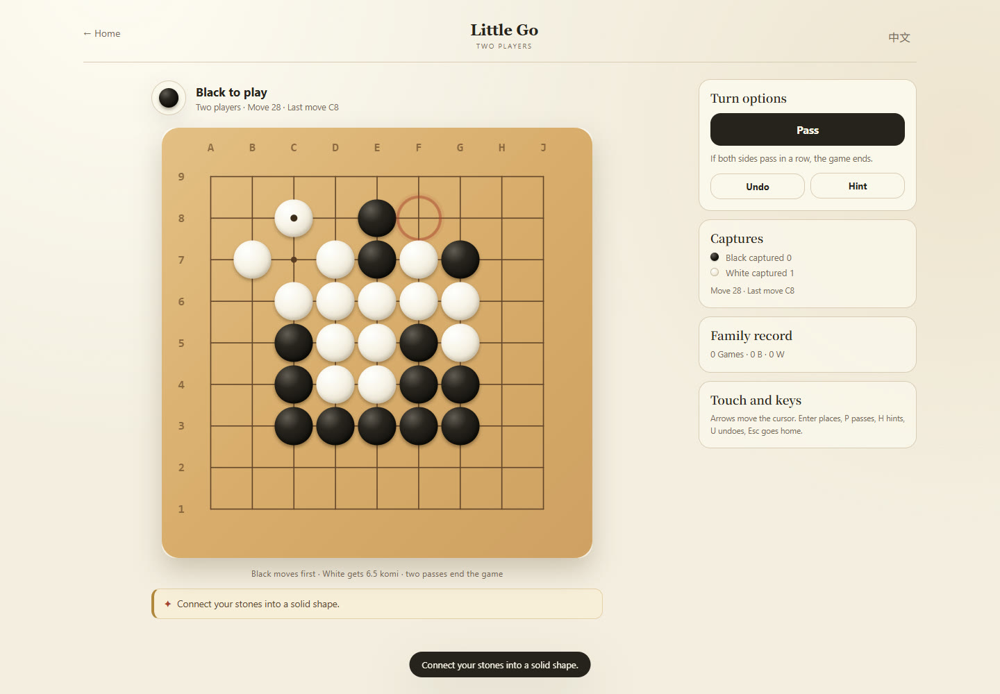
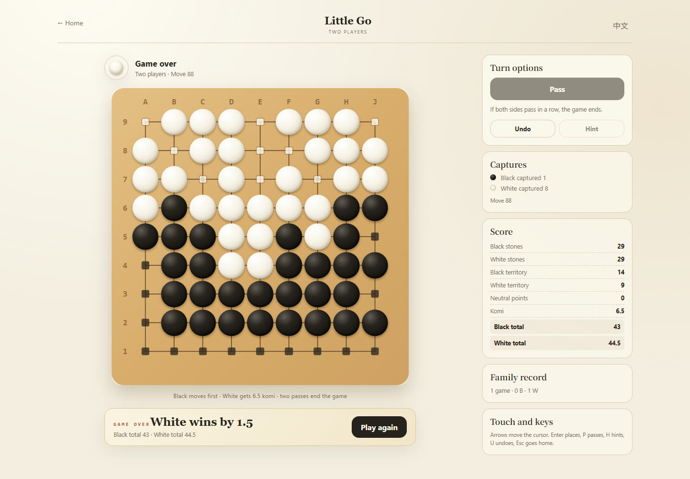
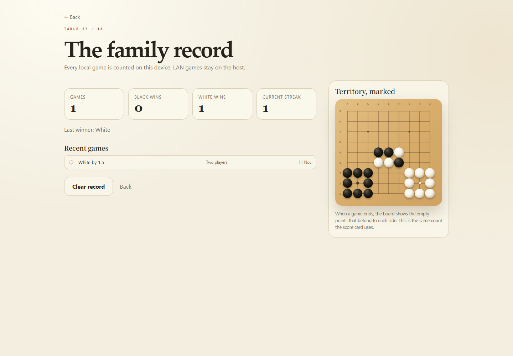
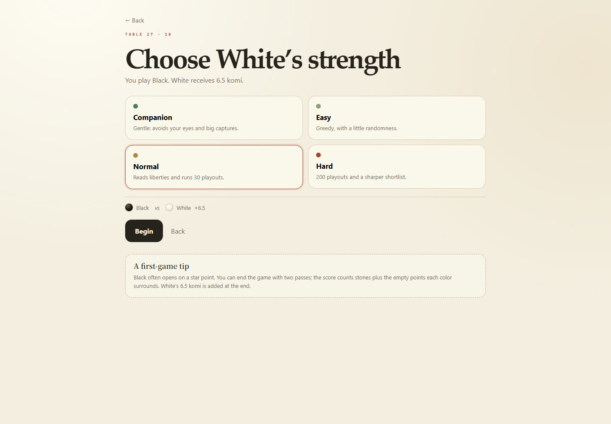
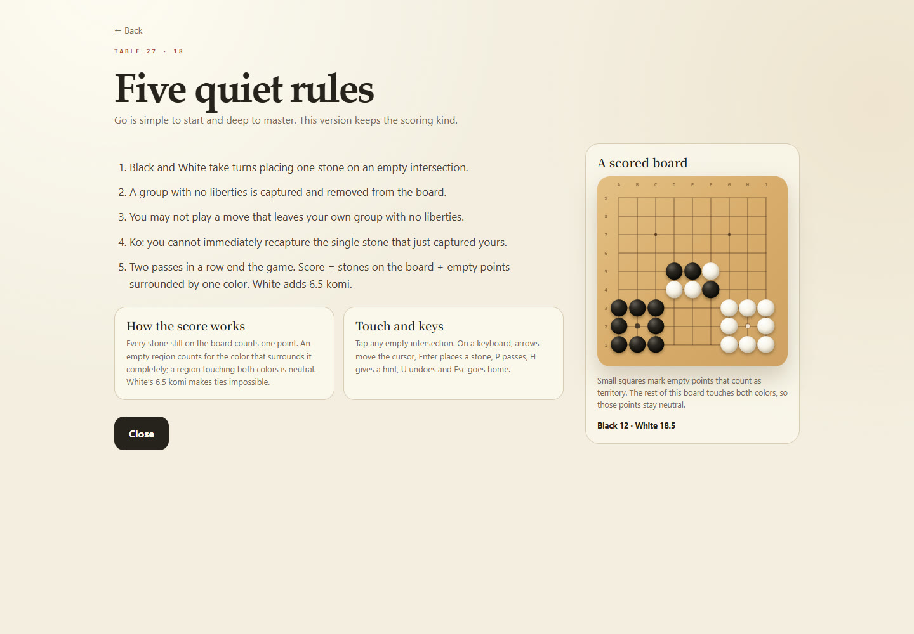
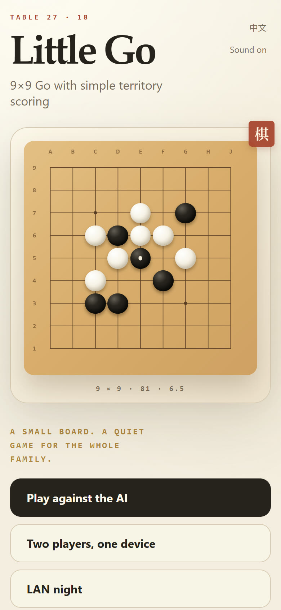
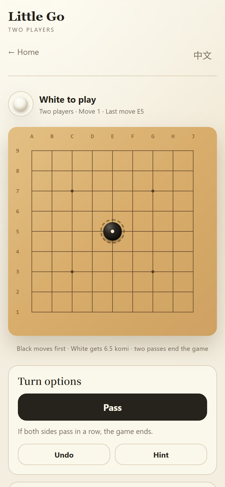

# Little Go · 小围棋

**English** · [简体中文](README.zh-CN.md)

> **9×9 Go with simple territory scoring.**

A quiet, offline-first Go table for the family: **2 players**, a 9×9 board, four AI
levels, one-screen hot-seat and LAN play from a phone. No account, no ads, no remote
fonts and no network needed except your own Wi-Fi for LAN night.



[](docs/promo/little-go-promo-en.mp4)

*45 seconds · 1920×1080 · 60 fps · [中文版](docs/promo/little-go-promo-zh.mp4) · [video.json](video.json)*

## A turn, in five seconds

| Place | Capture | Count |
| --- | --- | --- |
| Black and White alternate on empty crossings. | A group with no liberties leaves the board; ko stops an instant recapture. | Two passes end the game. Score = stones + surrounded empty points. White adds 6.5 komi. |

## What is inside

- **A real, tested Go engine.** Pure TypeScript, deterministic, **32 unit tests**, no
  DOM, clock or randomness in the rules. See [`docs/rules.md`](docs/rules.md).
- **Four AI levels.** Companion plays gently and avoids your eyes; Easy is greedy
  with a little randomness; Normal runs 30 random playouts; Hard runs 200 with a
  sharper shortlist.
- **Three ways to play.** Solo as Black against the AI, two players passing one
  device, or a phone joining the host over the local network.
- **Small comforts.** Undo (including the AI’s reply), a hint with a plain-language
  reason, autosave/resume, a local family record, sound on/off, reduced-motion
  support, keyboard navigation and a complete Chinese/English UI.
- **Territory made visible.** When the second pass lands, the board marks every
  empty point that belongs to a side and a full scorecard appears.
- **Private by default.** No accounts, telemetry, ads, CDN, remote fonts or
  downloaded art.

## Screenshots

All images come from the running app at **1440×1000**; phone images are
**780×1688** (390×844 @2×), captured by [`scripts/shots.mjs`](scripts/shots.mjs).

| A real game | A hint with a reason |
| --- | --- |
|  |  |

| Finished and scored | Family record |
| --- | --- |
|  |  |

| AI setup | Rules |
| --- | --- |
|  |  |

| Phone home | Phone game |
| --- | --- |
|  |  |

The 45-second bilingual promo is rendered by the root Family Arcade studio from
[`video.json`](video.json); this app does not ship a separate video project.

## Play locally

```bash
npm install
npm run dev        # http://localhost:5197
npm run check      # tsc + 32 tests + production build
npm run e2e        # real Chrome; run npm run dev first
npm run shots      # regenerate docs/screenshots/{en,zh}
```

Controls: tap an empty crossing, or use the keyboard. Arrow keys move the cursor,
Enter places a stone, **P** passes, **H** gives a hint, **U** undoes, Esc goes home.

## LAN night

Browser/dev:

```bash
npm run build
npm run lan        # relay on :8080, serves dist/
# host: http://localhost:5197 → LAN night → Host a room
# guest: open the displayed phone address, or scan the QR code
```

Desktop: the Tauri build starts the same relay internally and serves the built app
to phones. The host shows a four-digit room code and a QR invite. Guests only need a
browser on the same Wi-Fi.

The relay is a dumb message bus. The host keeps the authoritative board and sends
only the guest’s own view (`view(state, 1)`); the guest sends only
`{type:'place', index}` or `{type:'pass'}`. Turn order, seat ownership, ko and suicide
are re-checked on the host.

## Build the Windows installer

```bash
npm install
npx tauri build --bundles nsis
# src-tauri/target/release/bundle/nsis/Little Go_0.1.0_x64-setup.exe
```

The installer is per-game and lightweight; WebView2 uses the standard bootstrapper.
A Windows SmartScreen warning is expected for an unsigned family build. The main
Family Arcade build pipeline produces the installers centrally.

## Rules and honest limitations

The short version: place stones, capture groups with no liberties, pass twice, then
count stones plus fully surrounded empty points. White receives 6.5 komi. The engine
uses simple ko (no immediate recapture) and forbids suicide.

This is deliberately **simple territory scoring**: dead stones are not marked and
removed, dame are not filled, and there is no resignation, handicap, clock or superko.
The AI is a family opponent, not a dan-level engine. LAN is IPv4 on one subnet.
See [`docs/limitations.md`](docs/limitations.md) and the full rule audit in
[`docs/rules.md`](docs/rules.md).

## Credits

Original code, art and copy for Family Arcade. MIT. Go itself is a public-domain
traditional game. See [`NOTICE.md`](NOTICE.md) and [`LICENSE`](LICENSE).

## Promo

[](docs/promo/little-go-promo-en.mp4)

- [English cut](docs/promo/little-go-promo-en.mp4) · [other language](docs/promo/little-go-promo-zh.mp4)
- [SRT](docs/promo/little-go-promo-en.srt) · [video.json](video.json)
- Real app screenshots and real engine data; claims match the tests.

