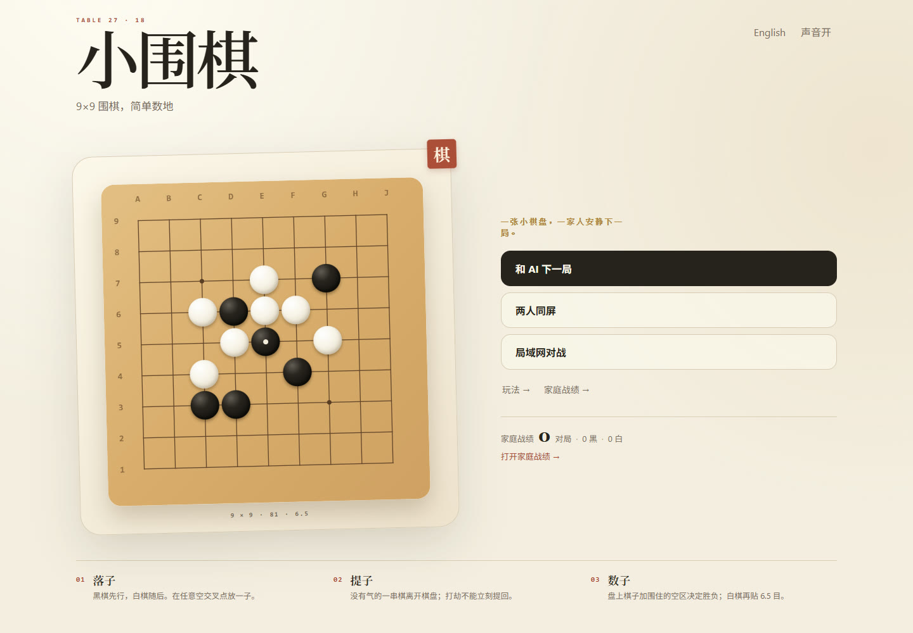
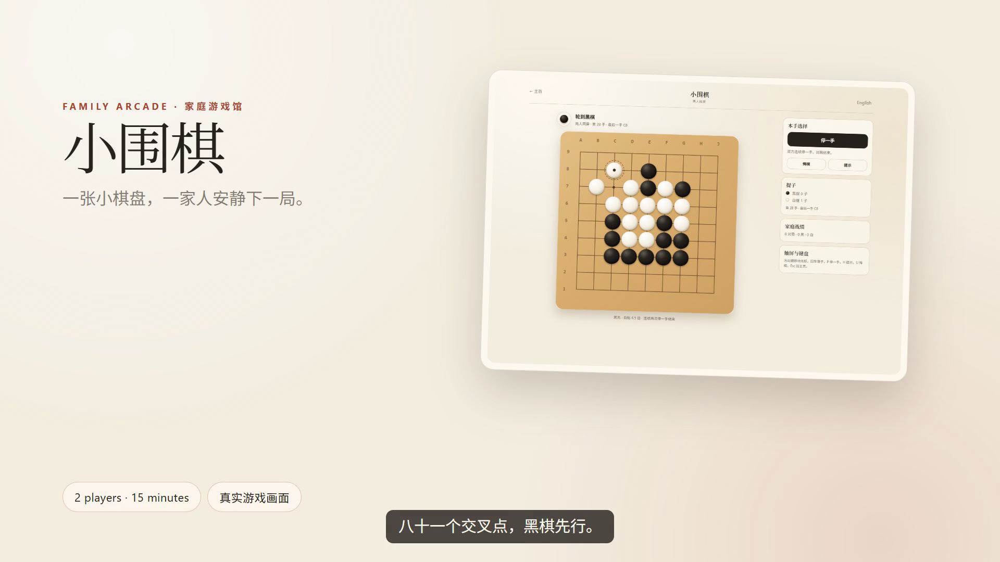
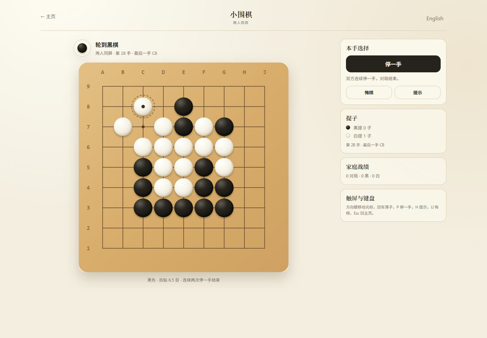
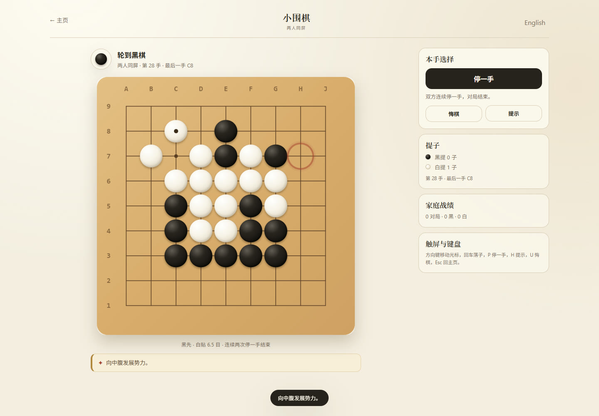
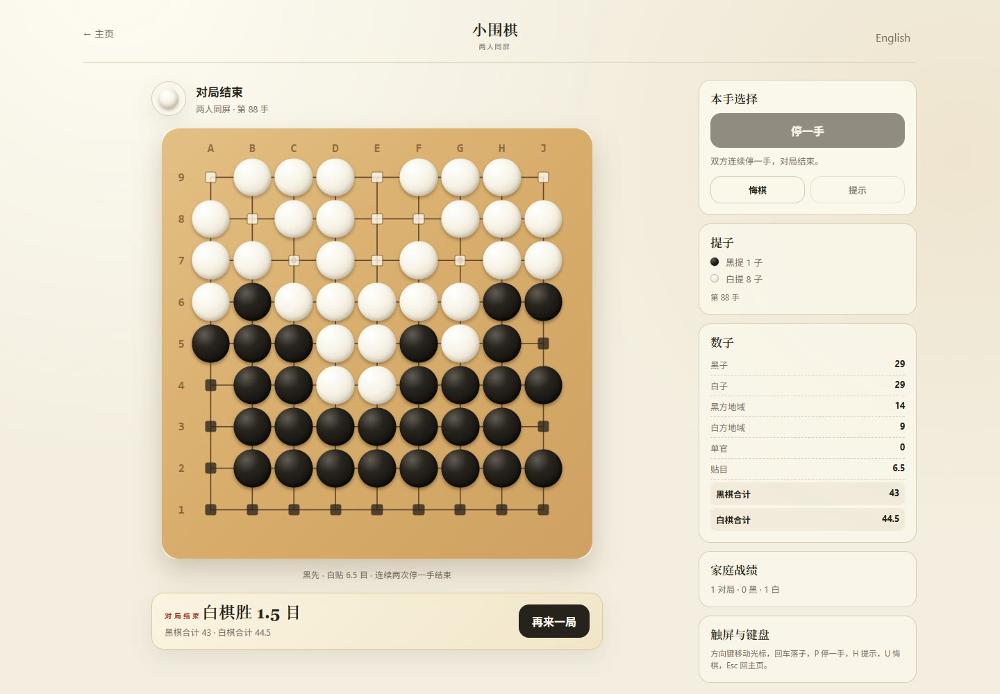
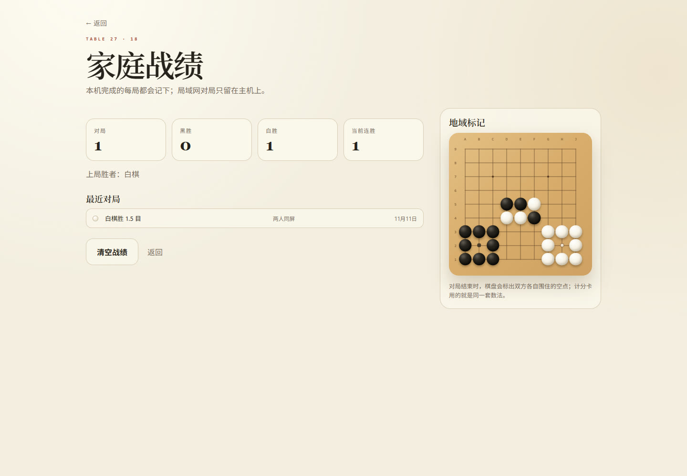
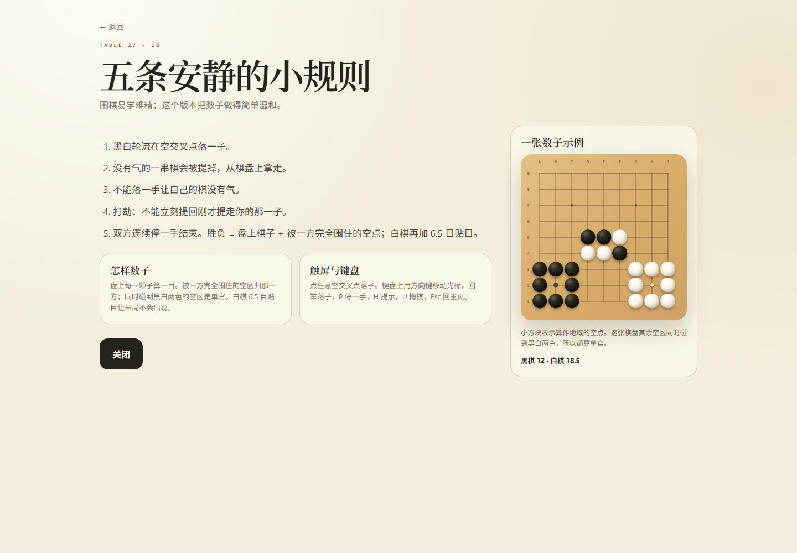
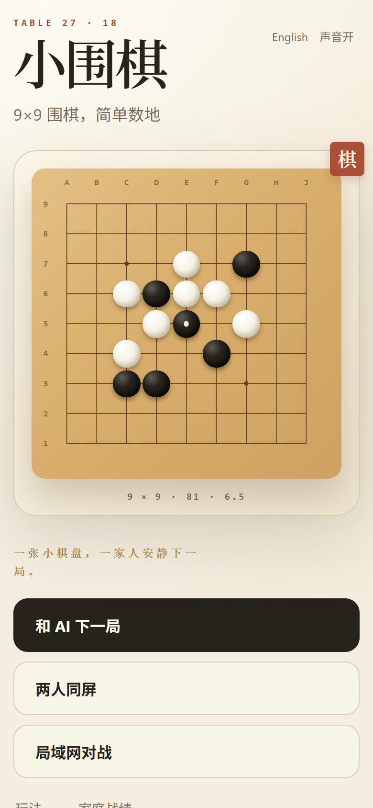
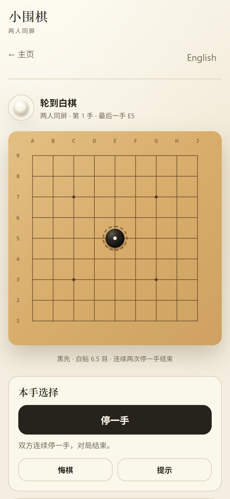

# 小围棋 · Little Go

[English](README.md) · **简体中文**

> **9×9 围棋，简单数地。**

给家庭牌桌的一局安静围棋：**2 人**、9×9 棋盘、四档 AI、同屏热座，以及手机浏览器
直接加入的局域网对战。无账号、无广告、无远程字体；除自家 Wi-Fi 外不需要联网。



[](docs/promo/little-go-promo-zh.mp4)

*45 秒 · 1920×1080 · 60fps · [English cut](docs/promo/little-go-promo-en.mp4) · [video.json](video.json)*

## 一回合，五秒看懂

| 落子 | 提子 | 数子 |
| --- | --- | --- |
| 黑白轮流在空交叉点落子。 | 没有气的一串棋离开棋盘；打劫不能立刻提回。 | 双方连续停一手结束。胜负 = 盘上棋子 + 被围住的空点；白棋再加 6.5 目贴目。 |

## 里面有什么

- **真正的围棋引擎。** 纯 TypeScript、确定性、**32 个单元测试**；规则层不碰 DOM、
  不用时钟、不用随机。见 [`docs/rules.md`](docs/rules.md)。
- **四档 AI。** 陪玩温和，不抢你的眼；轻松贪心、偶尔随手；标准跑 30 次随机推演；
  挑战跑 200 次，候选更精。
- **三种玩法。** 单人执黑对 AI、两人共用一台设备，或手机连同一 Wi-Fi 加入主机。
- **小细节。** 悔棋（连同 AI 的应手）、带理由的提示、自动保存/继续、本机家庭战绩、
  声音开关、减少动效、键盘操作，以及完整中英双语。
- **数子看得见。** 第二手停一手后，棋盘会标出双方围住的空点，并显示完整计分卡。
- **默认私密。** 无账号、无遥测、无广告、无 CDN、无远程字体、无下载素材。

## 截图

全部来自真实运行的应用：桌面 **1440×1000**，手机 **780×1688**（390×844 @2×），
由 [`scripts/shots.mjs`](scripts/shots.mjs) 生成。

| 真实对局 | 带理由的提示 |
| --- | --- |
|  |  |

| 终局数子 | 家庭战绩 |
| --- | --- |
|  |  |

| AI 设置 | 规则 |
| --- | --- |
|  |  |

| 手机主页 | 手机对局 |
| --- | --- |
|  |  |

45 秒双语宣传片由 Family Arcade 根目录工作室读取 [`video.json`](video.json) 统一渲染；
本应用不单独包含 Remotion 工程或下载视频。

## 本地运行

```bash
npm install
npm run dev        # http://localhost:5197
npm run check      # tsc + 32 个测试 + 生产构建
npm run e2e        # 真实 Chrome；先运行 npm run dev
npm run shots      # 重新生成 docs/screenshots/{en,zh}
```

操作：点任意空交叉点；或用键盘。方向键移动光标，回车落子，**P** 停一手，
**H** 提示，**U** 悔棋，Esc 回主页。

## 局域网

浏览器/开发版：

```bash
npm run build
npm run lan        # :8080 中继，同时托管 dist/
# 主机：http://localhost:5197 → 局域网对战 → 开一个房间
# 访客：打开显示的手机地址，或扫码
```

桌面版：Tauri 安装包启动同一个内置中继，并把构建产物托管给手机。主机显示四位
房间码和二维码；访客在同一 Wi-Fi 下用浏览器打开即可，无需安装。

中继只负责转发消息。主机保存权威棋盘，只发送访客自己的视图
（`view(state, 1)`）；访客只能发送 `{type:'place', index}` 或 `{type:'pass'}`。
回合、座位、打劫和自杀都在主机上重新校验。

## 构建 Windows 安装包

```bash
npm install
npx tauri build --bundles nsis
# src-tauri/target/release/bundle/nsis/Little Go_0.1.0_x64-setup.exe
```

每款游戏单独打包，安装包保持轻量；WebView2 使用标准引导程序。未签名的家庭构建会
触发 Windows SmartScreen 提示。正式安装包由 Family Arcade 主构建流程统一产出。

## 规则与诚实的限制

短版：落子、提掉没有气的棋、连续两次停一手，然后数盘上棋子 + 被一方完全围住的
空点；白棋贴 6.5 目。引擎使用简单打劫（不能立刻提回），并禁止自杀。

这里是刻意简化的**简单数地**：不标记/拿走死子，不要求收单官，也没有认输、让子、
读秒或超级劫。AI 是家庭对手，不是职业级引擎。局域网仅支持同一子网的 IPv4。
详见 [`docs/limitations.md`](docs/limitations.md) 和完整的
[`docs/rules.md`](docs/rules.md) 规则审计。

## 许可

Family Arcade 原创代码、美术与文案，MIT。围棋本身是公有领域的传统游戏。见
[`NOTICE.md`](NOTICE.md) 与 [`LICENSE`](LICENSE)。

## 宣传片

[](docs/promo/little-go-promo-zh.mp4)

- [中文成片](docs/promo/little-go-promo-zh.mp4) · [另一语言](docs/promo/little-go-promo-en.mp4)
- [字幕](docs/promo/little-go-promo-zh.srt) · [video.json](video.json)
- 画面来自真实应用与真实引擎数据；数字与测试一致。

