# Mahjong

**English** · [Chinese](README.zh-CN.md)

> **Draw. Read. Win.**

Four-player Chinese Mahjong for the family table: a real 136-tile engine, thirteen-tile
hands, chi from the left-hand neighbour, pong, all three kong types, robbing a kong,
self-draw and discard wins, four melds plus a pair, seven pairs, thirteen orphans, a
configurable minimum fan and a full fan table. Four computer levels, four-player hot-seat
with a privacy cover, and a per-seat LAN table.


## A hand in five seconds

| Deal | Draw and discard | Calls | Win |
| --- | --- | --- | --- |
| 136 tiles. 13 each; the dealer starts with 14. Dealer is East; the round wind is chosen before the deal. | Draw one, discard one. The wall has 83 tiles. The next seat draws after a discard if nobody calls. | Chi only from the player immediately before you in turn order. Pong or exposed kong from any seat. Concealed and added kongs on your own turn. | Four melds and a pair, seven pairs, or thirteen orphans. Clear the table minimum, default 1 fan. |

## What is inside

- **A real engine.** Pure TypeScript in `src/game/mahjong.ts`, with **51 unit tests**:
  the 136-tile deck, seeded deal, turn order, chi/peng/kong, concealed and added kongs,
  robbing a kong, standard / seven pairs / thirteen orphans, fan scoring, minimum fan,
  claim priority, per-seat views, shanten, visible-tile counting, four AI levels, hints
  and full-game completion. No DOM, network, clock or `Math.random`; every shuffle takes
  an injected RNG.
- **Three ways to play.** Solo against three computer seats, four-player hot-seat on one
  device, or a LAN room with host plus three guests. Empty LAN seats are filled by the
  chosen AI level.
- **Privacy as a rule.** Hot-seat covers the hand whenever the active seat changes. LAN
  sends each device only `view(state, seat)`: its own hand, public melds, river, wall
  count and own claim options. The host re-checks every intent.
- **Four AI levels.** Companion is gentle and makes soft calls. Easy knows shapes but
  makes mistakes. Normal uses shanten, tile efficiency and visible-tile counting. Hard
  adds public-information danger estimates, defence and fan-aware meld decisions. No
  level peeks at a hidden hand.
- **A real fan table.** Self draw, concealed hand, all simples, all triplets, mixed and
  pure one suit, pure straight, seven pairs, thirteen orphans, seat and prevalent wind,
  dragon triplet, kong draw, last tile and robbing a kong. See
  [`docs/rules.md`](docs/rules.md).
- **Small comforts.** Undo, a hint with a concrete reason, autosave/resume, a local
  family record, sound toggle, reduced-motion toggle, keyboard path (1–0 select, Enter
  discard, H hint, U undo, Esc home) and a mobile layout.
- **Private by default.** No accounts, ads, telemetry, remote fonts or cloud saves.

## Screenshots

| Home | Table settings |
| --- | --- |
|  | 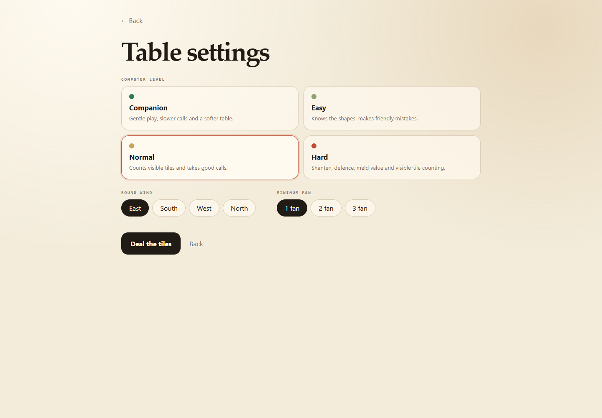 |

| A real hand | Hint with a reason |
| --- | --- |
| 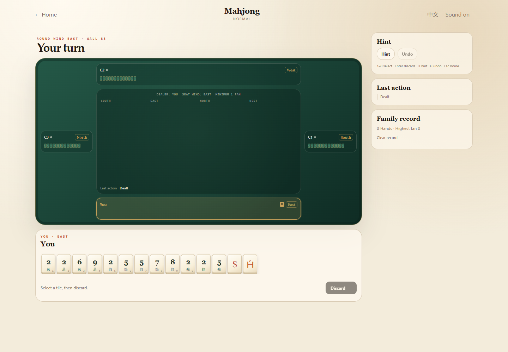 | 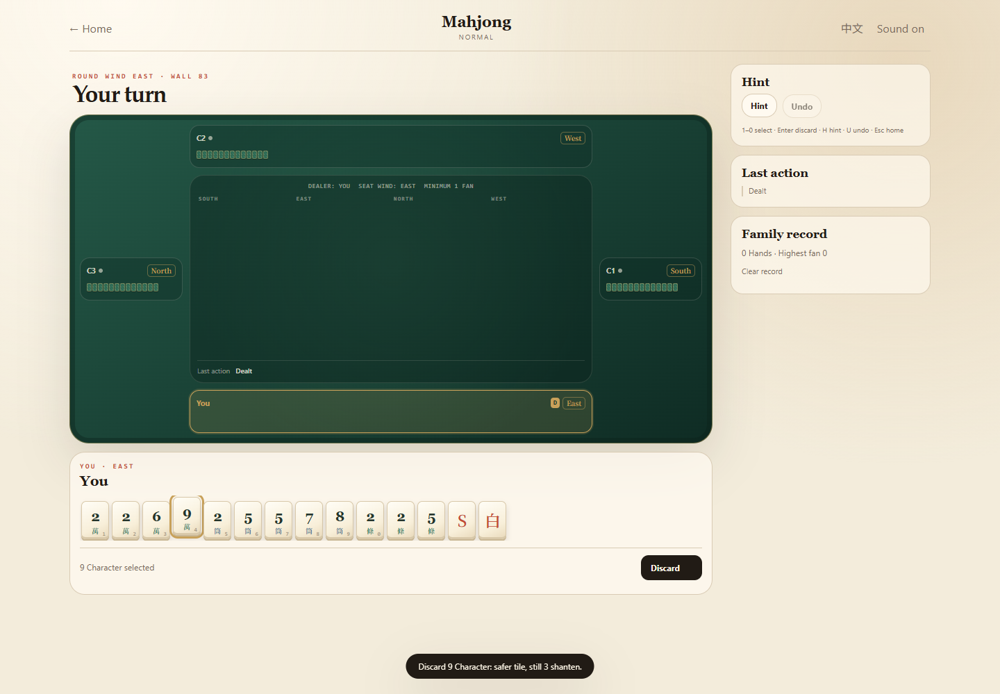 |

| A claim | Result and fan settlement |
| --- | --- |
| 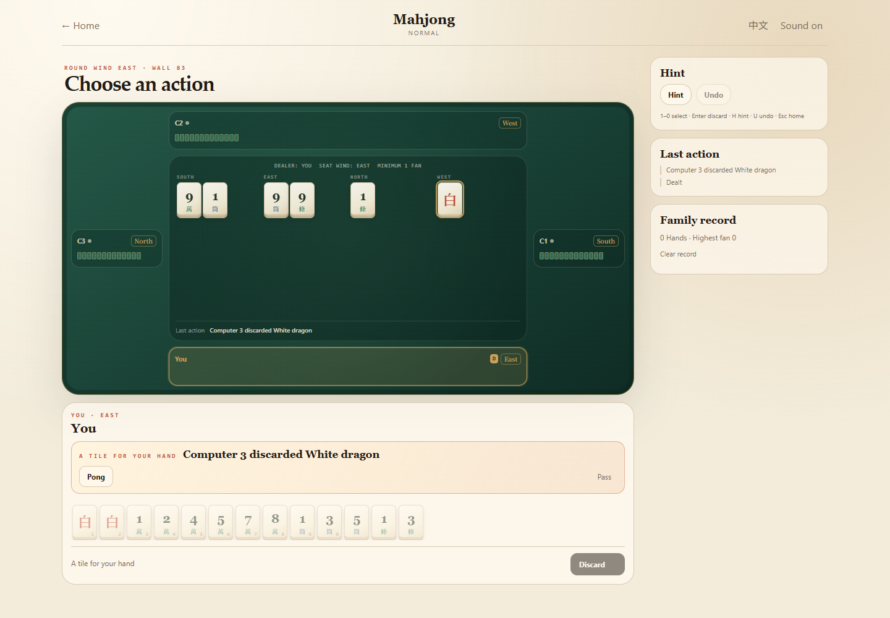 | 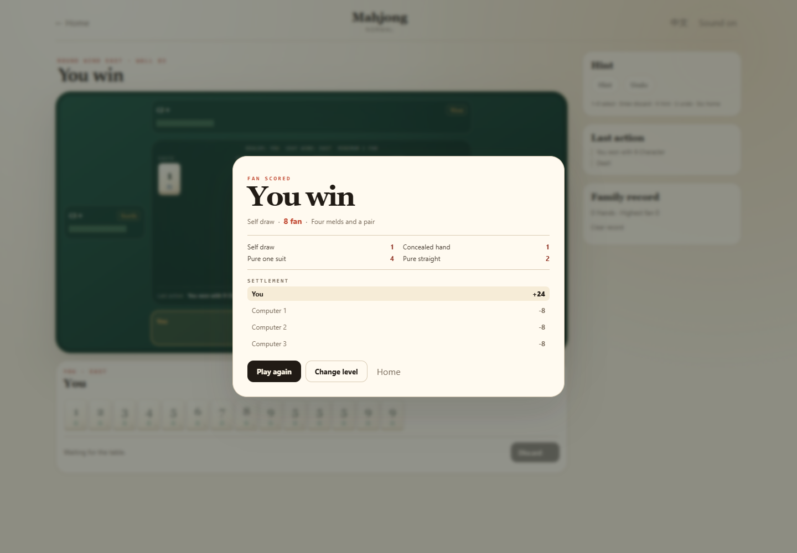 |

| Rules | Family record |
| --- | --- |
| 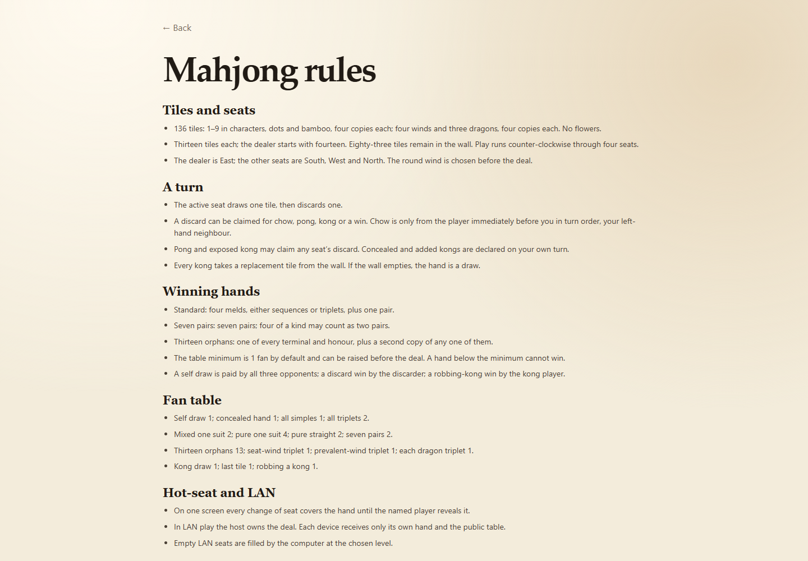 | 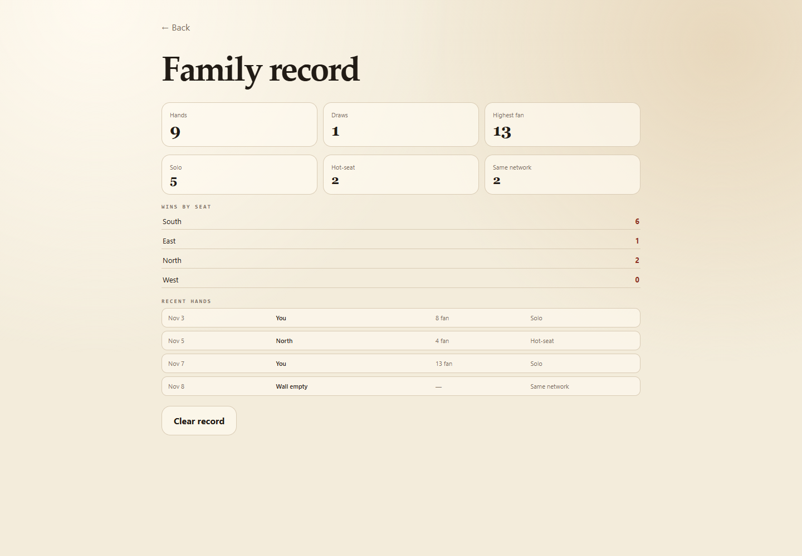 |

| Hot-seat privacy | LAN lobby |
| --- | --- |
| 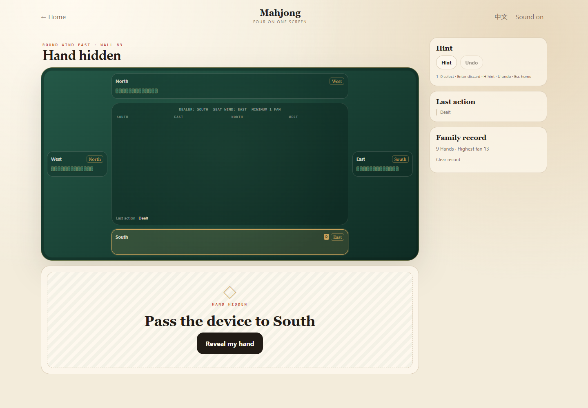 | 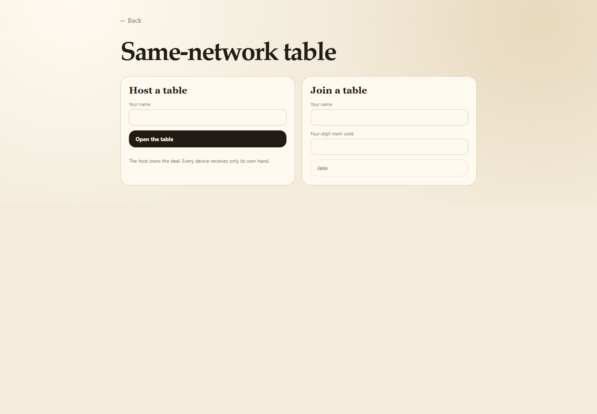 |

| Phone home | Phone table |
| --- | --- |
| 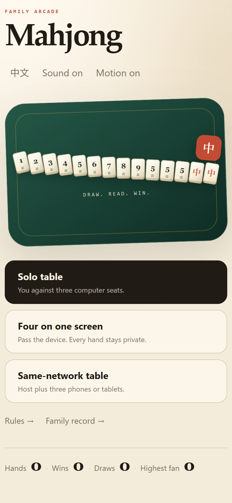 | 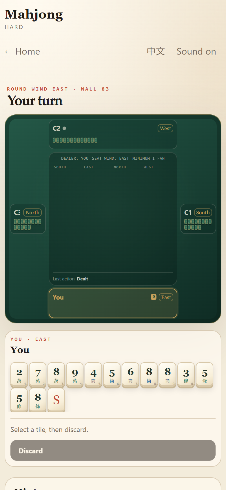 |

All screenshots come from the running app at 1440×1000 (phone 390×844 @2×, saved as
780×1688). The claim and result screens use valid deterministic engine fixtures; live
play is verified by the E2E and LAN tests.

## Play locally

```bash
npm install
npm run dev        # http://localhost:5221
npm run check      # tsc + 51 tests + production build
npm run e2e        # real Chrome; dev server required
npm run lan:e2e    # four browsers against a relay after a build
npm run shots      # regenerate the EN/ZH screenshot sets
```

## LAN night

```bash
npm run build
npm run lan        # relay on :8080, serves dist/
# open the host page, then Same-network table -> Open the table
# guests scan the QR or open the invite URL on the same network
```

The host owns the deal. Guests receive one seat view per device and can send only their
own discard, win, claim or kong intent. The host re-checks turn, tile ownership, claim
priority, minimum fan and kong legality before applying anything. A disconnected seat is
taken over by AI until the guest returns. Undo and hints pause in network play. The LAN
E2E uses port `19021` and stops its relay afterwards.

The desktop build starts the same relay internally. In a browser build the invite may say
`localhost`, which a phone cannot reach; use the desktop build or the host machine’s
network address.

## Build the Windows installer

```bash
npm install
npx tauri build --bundles nsis
# src-tauri/target/release/bundle/nsis/Mahjong_0.1.0_x64-setup.exe
```

The installer is per-game and lightweight; WebView2 uses the standard bootstrapper. An
unsigned family build may show a Windows SmartScreen warning.

## Known limitations

- One hand per session; no dealer rotation or multi-round match. The round wind is a
  setting.
- No flowers, dora, riichi, furiten or abortive draws. The minimum fan is 1/2/3 in the
  UI (default 1); a legal shape below the minimum cannot be declared.
- One winner for simultaneous claims, chosen by nearest turn order.
- Concealed kongs cannot be robbed; added kongs can. No kong when the wall is empty.
- Points are a family convention: self draw pays fan from each opponent; discard and
  robbing-kong wins pay 3 × fan from the responsible player.
- LAN is same-subnet IPv4, host plus three guests; no spectator, online lobby or cloud
  record. The host device records the result.
- Hot-seat covers are family etiquette, not a security boundary.
- Hard is a strong heuristic, not a tournament solver.
- No Tauri build is run in this workspace; the central build agent produces installers.

See [`docs/limitations.md`](docs/limitations.md) and the full audit in
[`docs/rules.md`](docs/rules.md).

## Credits

Original engine, tile faces, table design, copy and sound cues for Family Arcade.
Mahjong is a public-domain tile game; this implementation and its visual design are
original. MIT. See [`NOTICE.md`](NOTICE.md).
