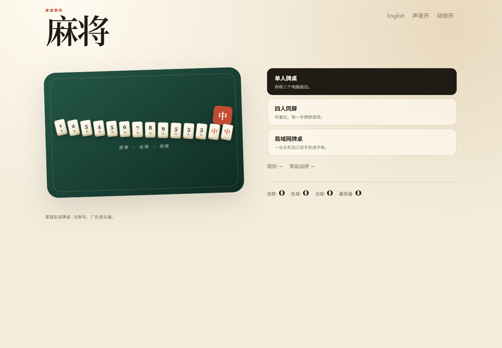
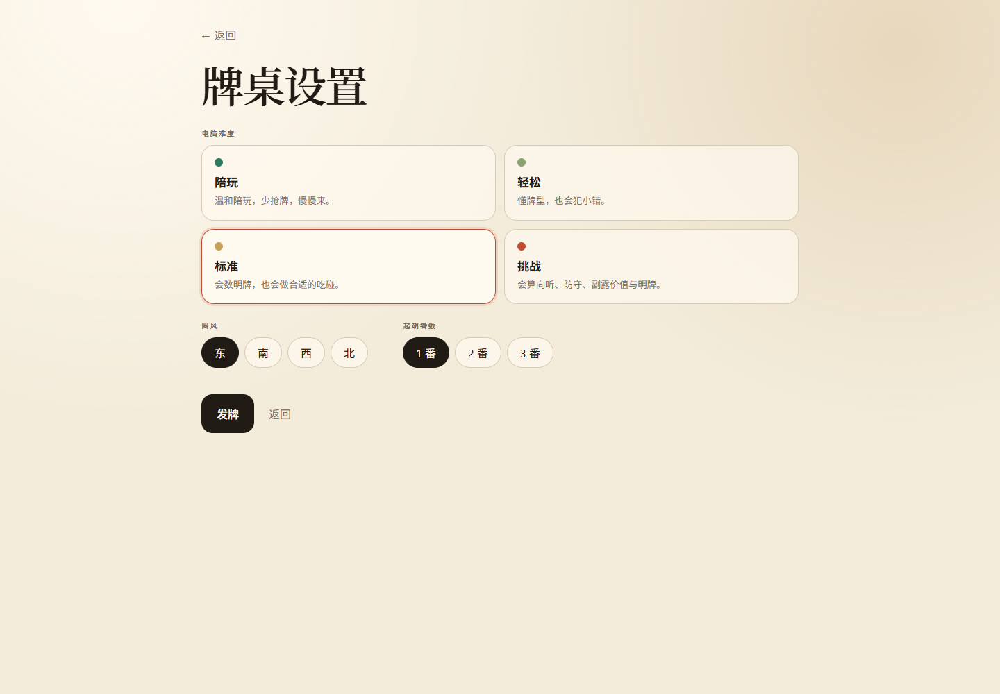
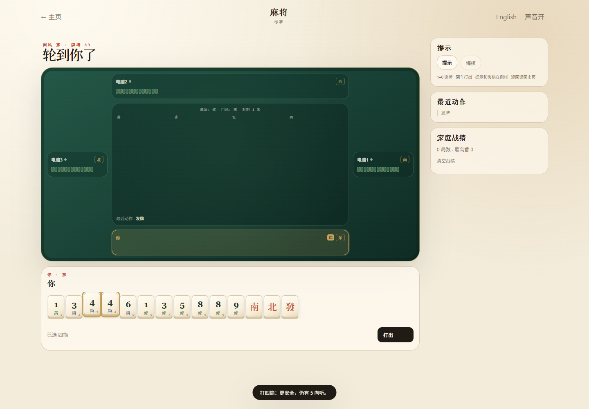
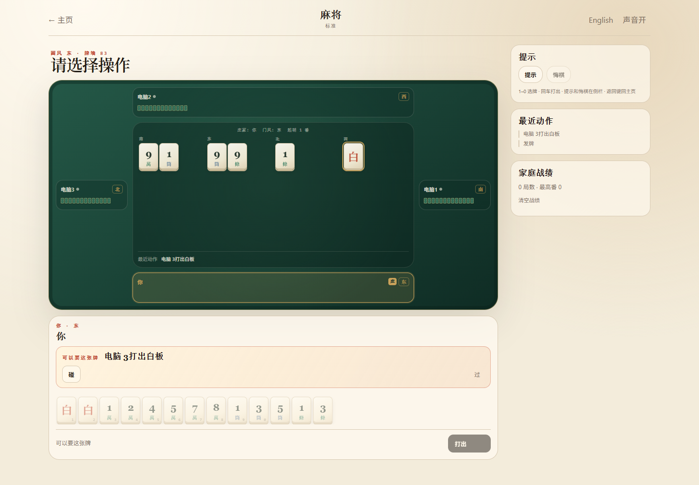
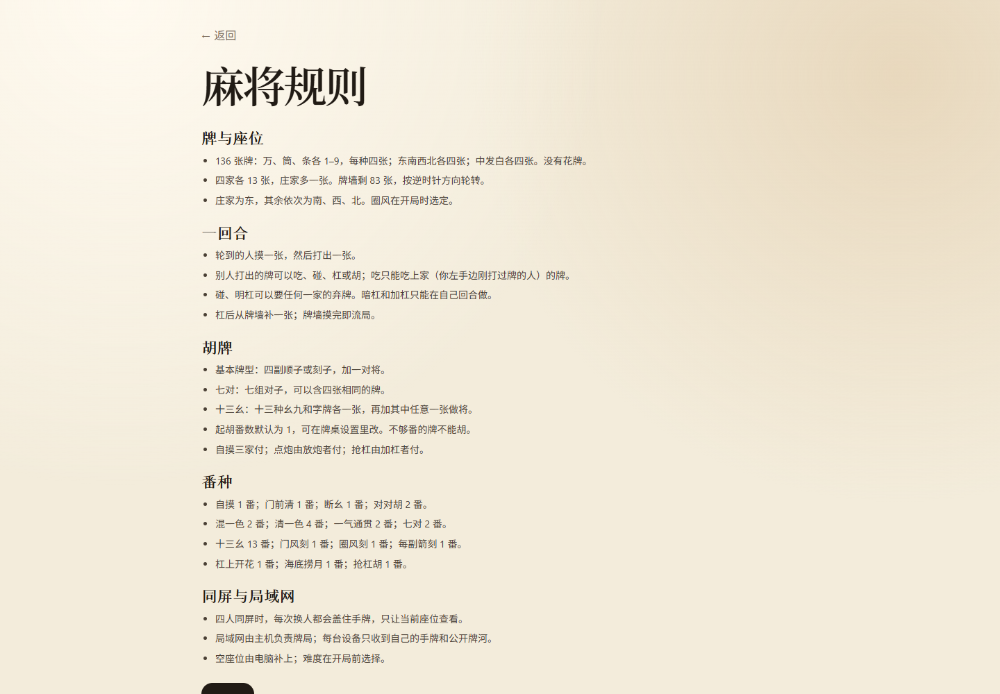
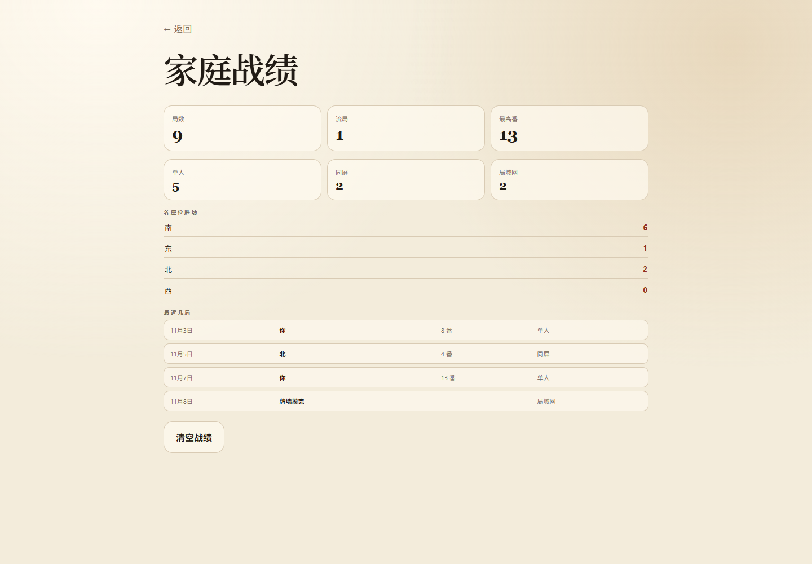
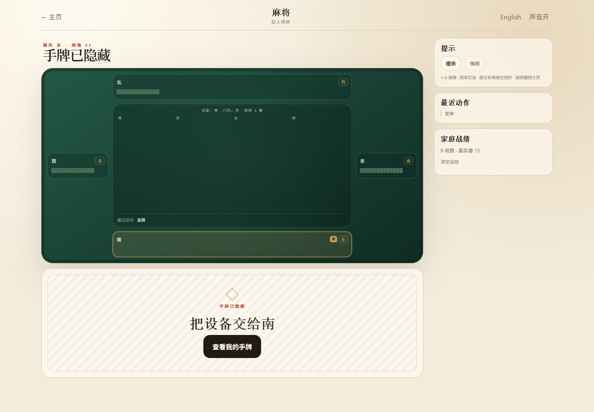
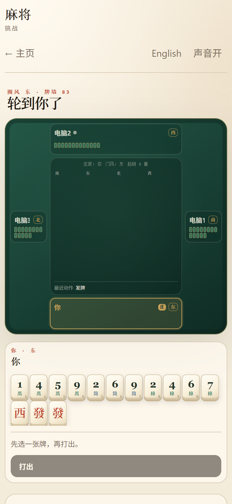

# 麻将

[English](README.md) · **简体中文**

> **摸牌 · 读牌 · 胡牌**

四人中国麻将，给家里的牌桌：真正的 136 张牌引擎、13 张手牌、只能吃上家、碰、明杠/暗杠/加杠、抢杠、自摸和点炮、四副一将、七对、十三幺、可调起胡番数和完整番种表；四档电脑、四人同屏隐私盖牌，以及按座位分别收发的局域网牌桌。



## 五秒看懂一局

| 发牌 | 摸打 | 要牌 | 胡牌 |
| --- | --- | --- | --- |
| 136 张牌，每家 13 张，庄家 14 张。庄家为东，开局前选圈风。 | 摸一张、打一张。牌墙共 83 张；没人要牌时下家摸牌。 | 只能吃你左手边刚打过牌的那家；碰和明杠可以要任何一家；暗杠和加杠只在自己回合。 | 四副顺子或刻子加一对将、七对，或十三幺。达到起胡番数才能胡，默认 1 番。 |

## 里面有什么

- **真正的引擎。** `src/game/mahjong.ts` 是纯 TypeScript，**51 个单元测试**覆盖 136 张牌、种子发牌、轮转、吃碰杠、暗杠/加杠、抢杠、四副一将/七对/十三幺、番数、起胡番数、要牌优先级、按座位视图、向听、明牌计数、四档电脑、提示和整局完成。没有 DOM、网络、时钟或 `Math.random`；每次洗牌都使用注入的随机数。
- **三种玩法。** 单人加三个电脑座位、四人同屏传递设备，或一台主机加三位访客的局域网牌桌。局域网空座位由所选难度的电脑补上。
- **隐私是规则。** 同屏时每次换座位都会盖住手牌；局域网只给每台设备发送 `view(state, seat)`：自己的手牌、公开副露、牌河、牌墙数量和自己的要牌选项。主机重新检查每一次操作。
- **四档电脑。** 陪玩温和、轻松会犯错、标准会算向听和明牌、挑战会计算危险牌、防守和副露价值。任何一档都不会偷看别人的手牌。
- **完整番种表。** 自摸、门前清、断幺、对对胡、混一色、清一色、一气通贯、七对、十三幺、门风、圈风、箭刻、杠上开花、海底捞月、抢杠胡。详见 [`docs/rules.md`](docs/rules.md)。
- **小舒适。** 悔棋、带理由的提示、自动保存/继续、本地家庭战绩、声音开关、动效开关、键盘路径（数字键选牌、回车打出、提示与悔棋、返回主页）和手机布局。
- **默认私密。** 无账号、广告、遥测、远程字体或云端存档。

## 截图

| 主页 | 牌桌设置 |
| --- | --- |
|  |  |

| 真实牌局 | 带理由的提示 |
| --- | --- |
|  |  |

| 要牌 | 胡牌与番数结算 |
| --- | --- |
|  |  |

| 规则 | 家庭战绩 |
| --- | --- |
|  |  |

| 同屏隐私 | 局域网大厅 |
| --- | --- |
|  |  |

| 手机主页 | 手机牌桌 |
| --- | --- |
|  |  |

全部截图来自真实运行的应用，桌面 1440×1000，手机 390×844 二倍图（780×1688）。要牌和结算截图使用合法的确定性引擎夹具；实时对局由端到端测试和局域网测试覆盖。

## 本地运行

```bash
npm install
npm run dev        # http://localhost:5221
npm run check      # 类型检查 + 51 个测试 + 生产构建
npm run e2e        # 真实浏览器；需要开发服务器
npm run lan:e2e    # 构建后，四个浏览器连局域网中继
npm run shots      # 重新生成中英文截图
```

## 局域网牌桌

```bash
npm run build
npm run lan        # 中继在 :8080，同时托管 dist/
# 打开主机页面，选择“局域网牌桌” -> “开桌”
# 访客扫码或打开邀请链接
```

主机负责发牌和牌局。每台访客设备只收到自己的座位视图，只能发送自己的打出、胡、要牌或杠。主机重新检查轮次、牌是否在手里、要牌优先级、起胡番数和杠是否合法。访客断线后由电脑暂时接管。局域网中暂停悔棋和提示。局域网端到端测试使用 `19021` 端口，结束后会关闭中继。

桌面安装包会在内部启动同一个中继。浏览器版邀请链接可能显示 `localhost`，手机无法访问；请使用桌面版或主机在局域网中的地址。

## 构建 Windows 安装包

```bash
npm install
npx tauri build --bundles nsis
# src-tauri/target/release/bundle/nsis/Mahjong_0.1.0_x64-setup.exe
```

每个游戏单独打包，体积轻量；WebView2 使用标准引导程序。未签名的家庭安装包可能触发 Windows SmartScreen 提示。

## 已知限制

- 一局一手牌；没有庄家轮转或多局比赛。圈风是开局设置。
- 没有花牌、宝牌、立直、振听或途中流局。界面起胡番数为 1/2/3（默认 1）；不够番的牌型不能胡。
- 同时多家要牌时只取离出牌者最近的一家。
- 暗杠不能被抢；加杠可以。牌墙为空时不能杠。
- 点数是家庭约定：自摸每家付番数；点炮或抢杠由责任家付 3 倍番数。
- 局域网为同一网段的 IPv4，主机加三位访客；没有观战、在线大厅或云端战绩。战绩写在主机设备上。
- 同屏盖牌是家庭礼仪，不是防止刻意偷看的安全边界。
- 挑战档是强启发式，不是比赛求解器。
- 本次工作区没有运行桌面构建；安装包由中央构建流程生成。

更多见 [`docs/limitations.md`](docs/limitations.md) 和 [`docs/rules.md`](docs/rules.md)。

## 版权

家庭街机原创引擎、牌面、牌桌、文案和音效。麻将是公有领域游戏；本实现和视觉设计为原创。MIT，见 [`NOTICE.md`](NOTICE.md)。
