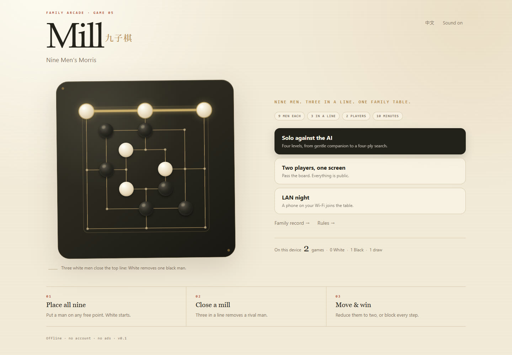
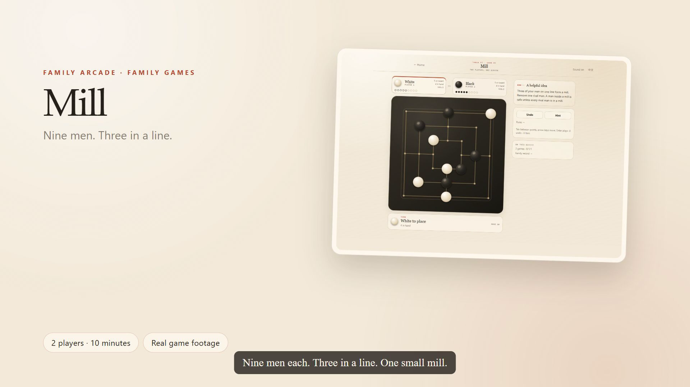
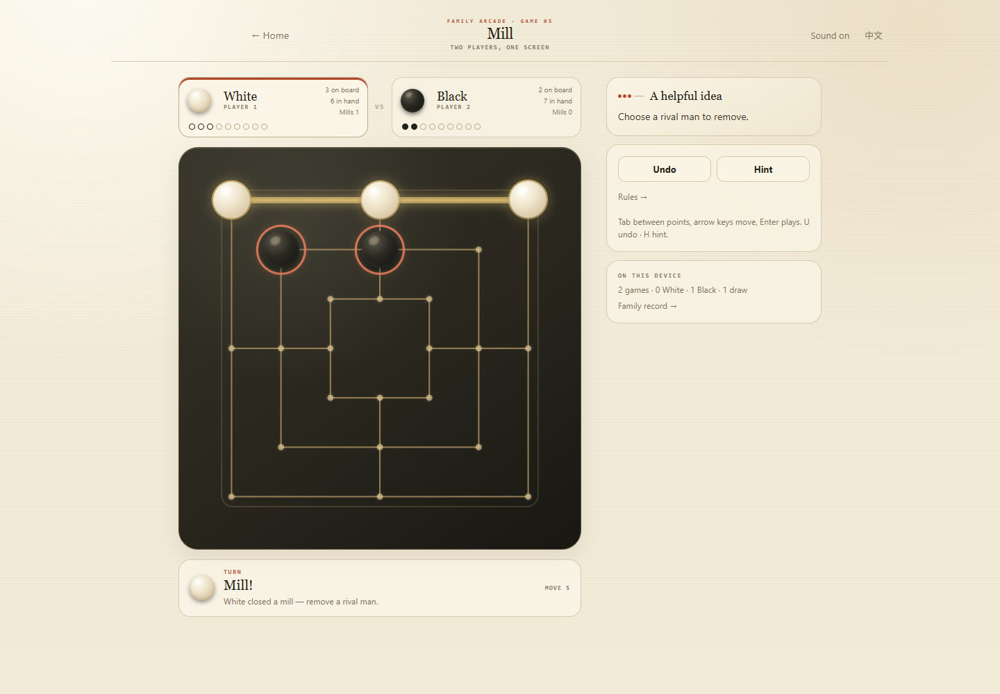
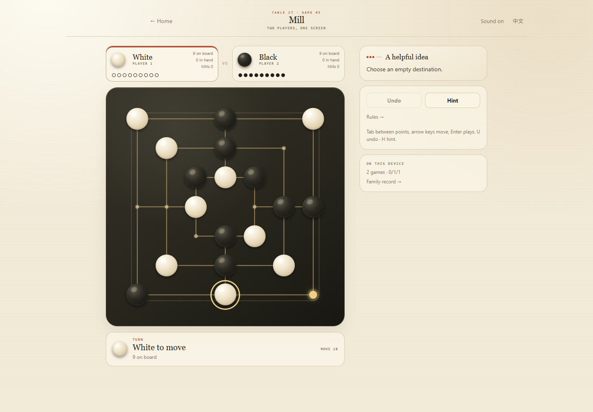
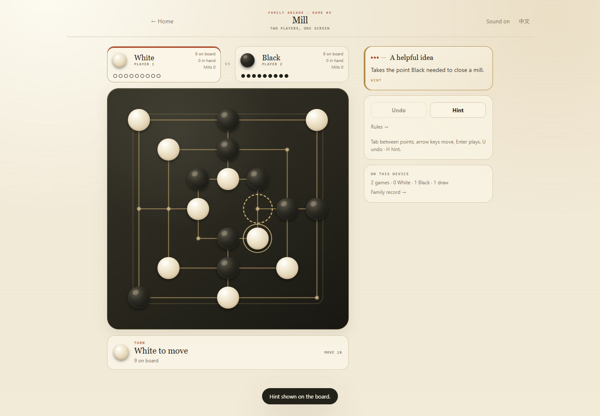
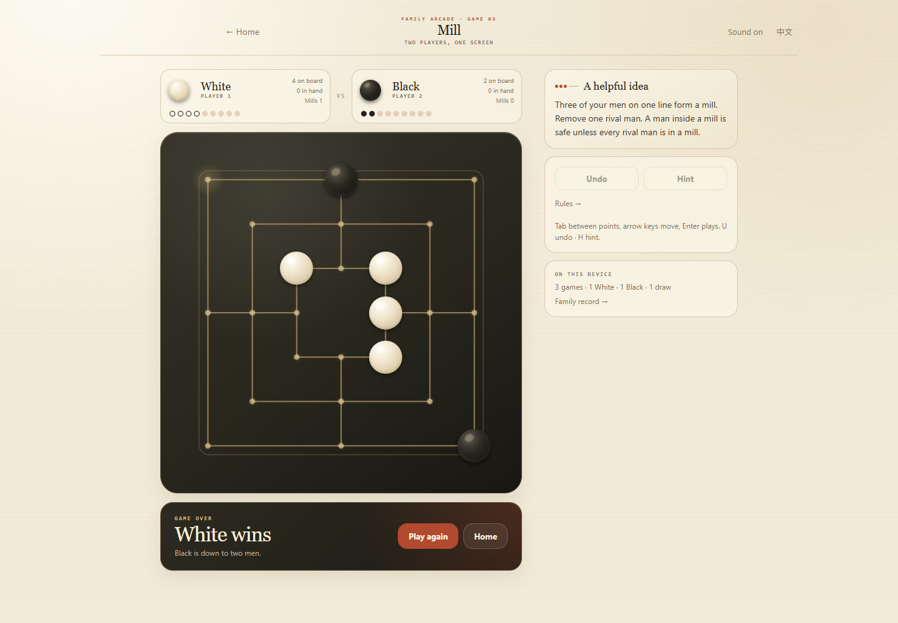
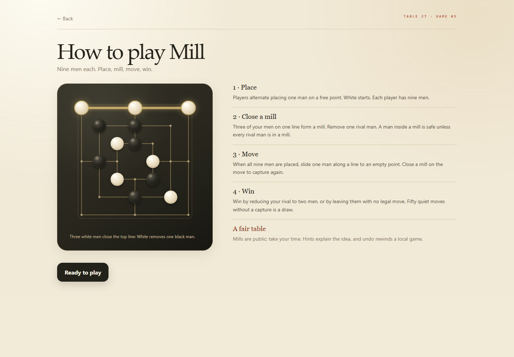
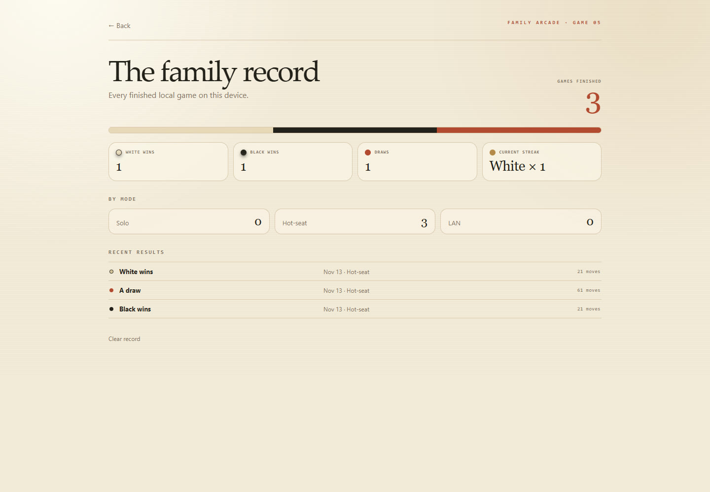
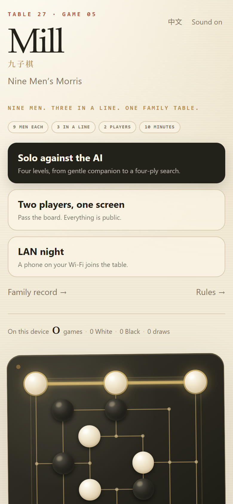
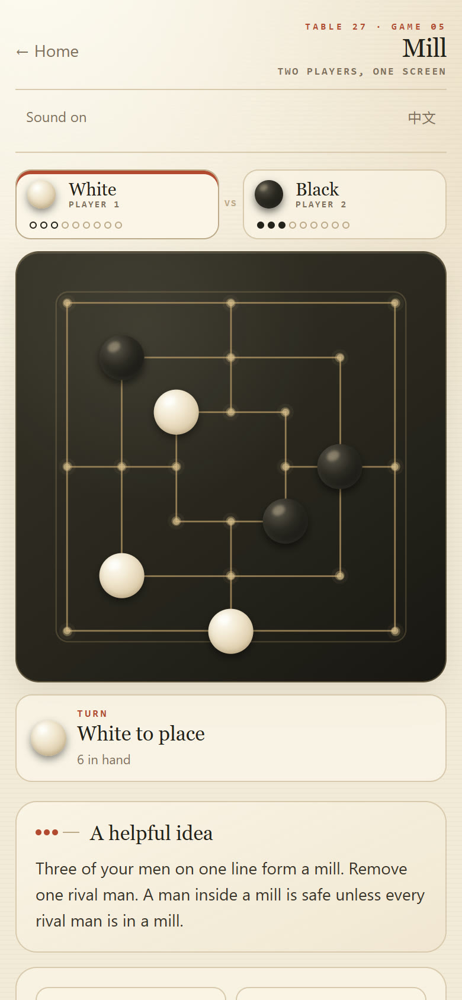

# Mill · 九子棋

**English** · [简体中文](README.zh-CN.md)

> **Nine men. Three in a line. One family table.**

Family Arcade · game 5/42. A complete Nine Men's Morris game for **2 players**:
place nine men, close a mill, slide along the lines, and win by reducing your
rival to two men or blocking every move. Play solo against four AI levels,
hot-seat on one screen, or invite a phone over your own Wi-Fi.



[](docs/promo/mill-promo-en.mp4)

*45 seconds · 1920×1080 · 60 fps · [中文版](docs/promo/mill-promo-zh.mp4) · [video.json](video.json)*

*The 45-second bilingual promo is rendered by the root studio from
[`video.json`](video.json); this app ships the playable game and real screenshots,
not a checked-in MP4.*

## A turn, in five seconds

| Place | Close a mill | Move | Win |
| --- | --- | --- | --- |
| Put a man on any free point. White starts. | Three in a line removes one rival man. | After all nine are placed, step along a line to an empty point. | Reduce the rival to two men, or leave them with no legal move. |

A man inside a mill is protected unless every rival man is in a mill. Fifty quiet
moves without a capture is a draw. Full rule audit: [`docs/rules.md`](docs/rules.md).

## What is inside

- **A real, tested engine.** Pure TypeScript in `src/game/mill.ts`; no DOM, clock,
  network or `Math.random`. **33 unit tests** cover placement, mills, protected
  men, captures, moving, blocking, the quiet draw, seats, views and AI legality.
- **Four AI levels.** Companion plays gently and avoids capture sprees; Easy makes
  mistakes; Normal searches two actions; Hard runs a four-action alpha–beta search.
  Every level accepts an injected RNG, so tests and replays are deterministic.
- **Three ways to play.** Solo vs AI (you may choose White or Black), two-player
  hot-seat, and LAN host/guest.
- **A hint that explains itself.** The board highlights from/to or the capture, and
  the side panel says *why*: closes a mill, blocks a mill, removes a free man,
  starts a second line, or keeps men mobile.
- **Small comforts.** Undo, hint, autosave/resume, local family record with recent
  results, sound on/off, keyboard path (Tab, arrows, Enter, U/H/R), reduced-motion
  support, and a complete Chinese/English interface.
- **A real LAN table.** The host owns the state and sends only the guest's view.
  The guest sends intent moves; the host re-validates seat, turn and rules. The
  shared relay is a dumb message bus.
- **Private by default.** No accounts, telemetry, ads, CDN, remote fonts or
  downloaded art. Stones, lines and board are CSS/SVG; sound is synthesised.

## Screenshots

All images come from the running app at 1440×1000 (phone 390×844 @2×). See
[`docs/screenshots/en`](docs/screenshots/en) and
[`docs/screenshots/zh`](docs/screenshots/zh) — 11 shots per language.

| A real mill | Selecting a move |
| --- | --- |
|  |  |

| Hint with a reason | Result |
| --- | --- |
|  |  |

| Rules | Family record |
| --- | --- |
|  |  |

| Phone home | Phone game |
| --- | --- |
|  |  |

## Play locally

```bash
npm install
npm run dev        # http://localhost:5184
npm run check      # tsc --noEmit + 33 tests + production build
npm run e2e        # real Chrome; run npm run dev first
npm run shots      # regenerate docs/screenshots/{en,zh}
```

The app is responsive down to a 390 px phone. The board supports tap, mouse and
keyboard; Tab moves between points, arrow keys move spatially, Enter plays, and
`U` / `H` / `R` undo, hint and open the rules.

## LAN night

The desktop/Tauri shell starts the relay internally. In the browser:

```bash
npm run build
npm run lan        # relay + built app on :8080
# leave npm run dev running on :5184, or use the built app on :8080
```

Open **LAN night** on the host and show the QR/code. A phone on the same Wi-Fi
opens the invite; no app install is needed. The host plays White, starts when the
guest is connected, and remains authoritative. Reopening the same invite rejoins
after a drop.

If another local app already owns :8080, start the same relay on a free port and
add `?lanPort=` to the host page:

```bash
node ../../tools/lan-server.mjs --dist dist --port 8100
# open http://localhost:5184/?lanPort=8100, then host a room
```

The guest invite will point at the alternate port. See
[`docs/limitations.md`](docs/limitations.md) for the firewall and same-subnet
caveats.

## Build the Windows installer

```bash
npm install
npx tauri build --bundles nsis
# src-tauri/target/release/bundle/nsis/Mill_0.1.0_x64-setup.exe
```

The installer is per-game and lightweight; WebView2 uses the standard bootstrapper.
A SmartScreen warning is expected for an unsigned family build. `npm run check`
does not run `cargo build`; the shared release job builds all installers centrally.

## Known limitations

- Two players only; no spectators or internet matchmaking.
- No optional “flying” rule at three men — moves always follow the lines, per the
  game brief.
- Draw is 50 quiet moves; threefold repetition is not detected.
- Hard is a strong four-action search, not a solved game; it can be beaten.
- A LAN guest does not write the host's family record, and reconnect is “open the
  invite again”, not a live reconnect dialog.
- Screenshots are real app renders; some late-game frames load a valid game through
  the app's own autosave format, then finish through the UI.

See [`docs/limitations.md`](docs/limitations.md) for the full list.

## Credits

Original code, CSS/SVG art, tests and copy for Family Arcade. The traditional
Nine Men's Morris rules are public domain. MIT license; see [`LICENSE`](LICENSE)
and [`NOTICE.md`](NOTICE.md).

## Promo

[](docs/promo/mill-promo-en.mp4)

- [English cut](docs/promo/mill-promo-en.mp4) · [other language](docs/promo/mill-promo-zh.mp4)
- [SRT](docs/promo/mill-promo-en.srt) · [video.json](video.json)
- Real app screenshots and real engine data; claims match the tests.

