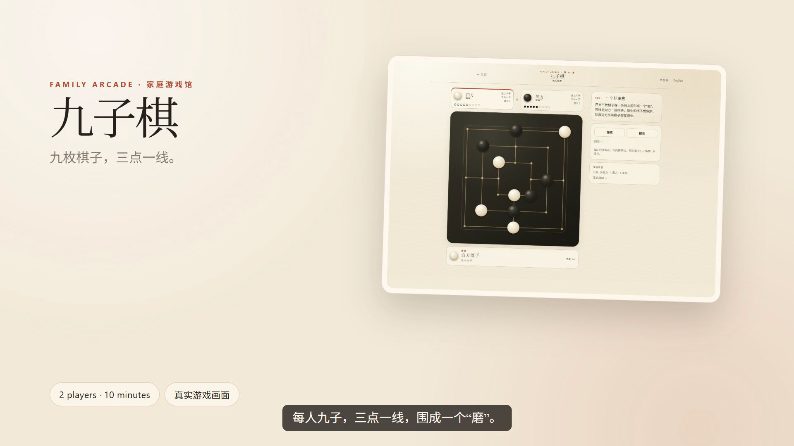
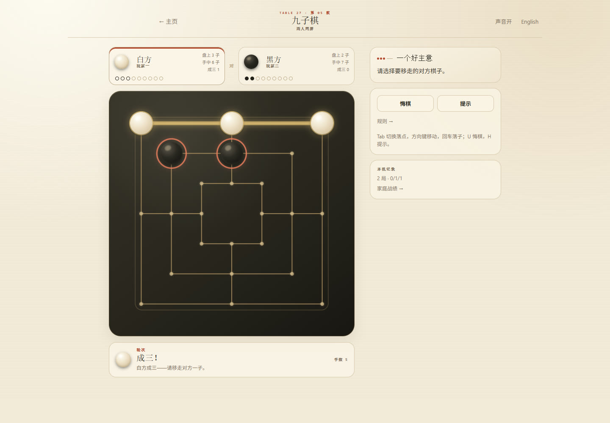
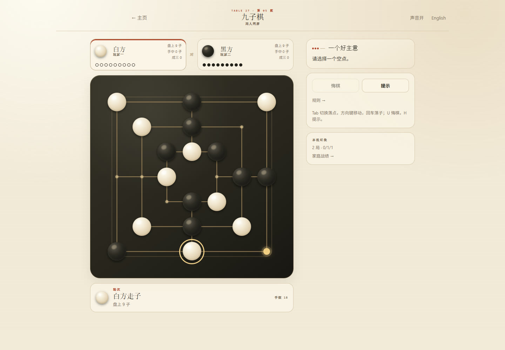
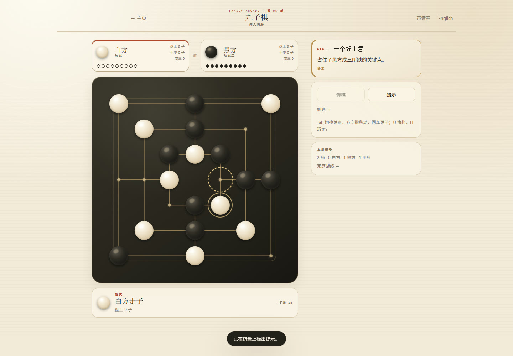
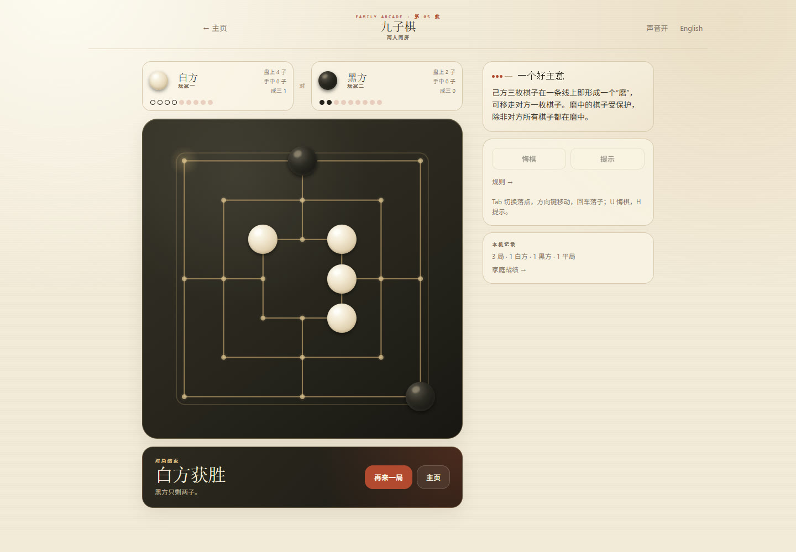
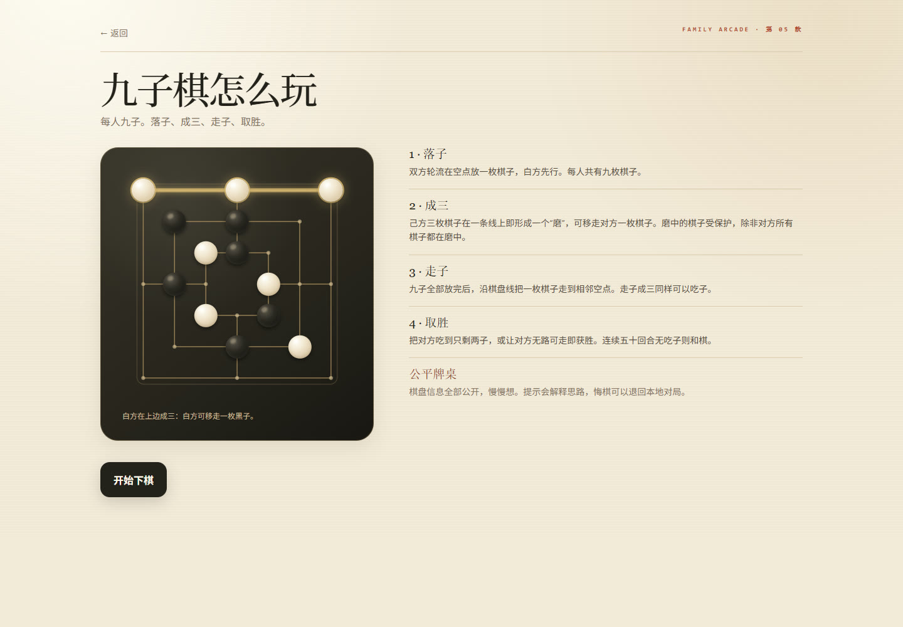
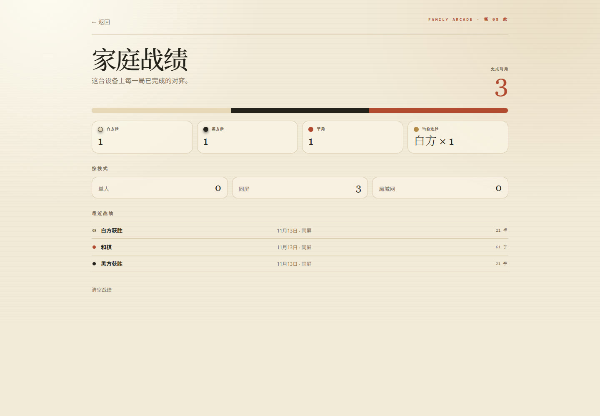
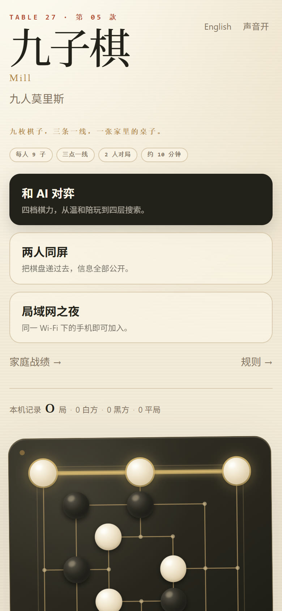
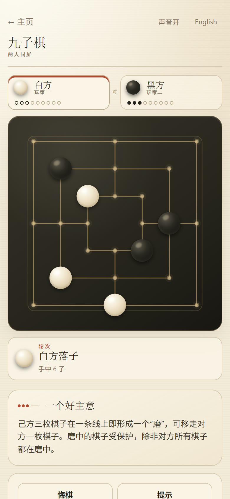

# 九子棋 · Mill

[English](README.md) · **简体中文**

> **九枚棋子，三点一线，一张家里的牌桌。**

Family Arcade · 第 5/42 款。完整的九人莫里斯（Nine Men's Morris）：**2 人**对局，
摆下九子、成三吃子、沿棋盘线走子；把对方吃到只剩两子，或堵得无路可走即可获胜。
可以单人挑战四档 AI、两人同屏，也可以让同一 Wi-Fi 下的手机加入。


[](docs/promo/mill-promo-zh.mp4)

*45 秒 · 1920×1080 · 60fps · [English cut](docs/promo/mill-promo-en.mp4) · [video.json](video.json)*

*45 秒中英双语宣传片由根目录工作台按 [`video.json`](video.json) 渲染；本应用
提供完整游戏与真实截图，不附带单独签入的 MP4。*

## 一回合，五秒看懂

| 落子 | 成三 | 走子 | 取胜 |
| --- | --- | --- | --- |
| 在任意空点放一枚棋子，白方先行。 | 三点一线形成“磨”，移走对方一子。 | 九子放完后，沿棋盘线走到相邻空点。 | 把对方吃到只剩两子，或让对方无路可走。 |

磨中的棋子受保护，除非对方所有棋子都在磨中。连续五十回合无吃子为和棋。完整
规则审计见 [`docs/rules.md`](docs/rules.md)。

## 里面有什么

- **真正可测的引擎。** `src/game/mill.ts` 是纯 TypeScript：不碰 DOM、时钟、网络，
  也不用 `Math.random`。**33 个单元测试**覆盖落子、成三、保护、吃子、走子、围堵、
  五十回合和棋、座位与视图、AI 合法性。
- **四档 AI。** 陪玩温和、不连续猛吃；轻松会犯错；标准看两步；挑战使用四层
  Alpha–Beta 搜索。所有档位都接受注入 RNG，测试与复盘完全确定。
- **三种玩法。** 单人对抗 AI（可执白或执黑）、两人同屏、局域网主机/访客。
- **会解释的提示。** 棋盘标出起点/终点或可吃棋子，侧栏说明原因：成三、堵住对方
  的磨、移走自由子、开始第二条线，或保持更多棋子可走。
- **小细节。** 悔棋、提示、自动保存/继续、本机家庭战绩与最近结果、声音开关、
  完整键盘路径（Tab、方向键、回车、U/H/R）、减少动效支持、中英双语界面。
- **真正的局域网牌桌。** 主机保存权威状态，只给访客自己的视图；访客只发意图，
  主机重新校验座位、轮次与规则。共享中继只负责转发消息。
- **默认私密。** 无账号、无遥测、无广告、无 CDN、无远程字体、无下载素材。
  棋子、线和棋盘都是 CSS/SVG，音效由 Web Audio 实时合成。

## 截图

全部来自真实运行的应用：桌面 1440×1000，手机 390×844 @2×。每种语言各 11 张，
见 [`docs/screenshots/zh`](docs/screenshots/zh) 与
[`docs/screenshots/en`](docs/screenshots/en)。

| 真实成三 | 选择走子 |
| --- | --- |
|  |  |

| 带原因的提示 | 终局 |
| --- | --- |
|  |  |

| 规则 | 家庭战绩 |
| --- | --- |
|  |  |

| 手机主页 | 手机对局 |
| --- | --- |
|  |  |

## 本地运行

```bash
npm install
npm run dev        # http://localhost:5184
npm run check      # tsc --noEmit + 33 个测试 + 生产构建
npm run e2e        # 真实 Chrome，需先运行 dev
npm run shots      # 重新生成 docs/screenshots/{en,zh}
```

界面可自适应到 390px 手机；棋盘支持触摸、鼠标与键盘。Tab 切换落点，方向键按
空间方向移动，回车落子，`U` / `H` / `R` 分别悔棋、提示、打开规则。

## 局域网之夜

桌面/Tauri 版会在应用内启动同一个中继。浏览器版：

```bash
npm run build
npm run lan        # :8080 上启动中继并托管构建产物
# 保持 :5184 的 dev 运行，或直接使用 :8080 的构建版
```

主机点“局域网之夜”，显示二维码和 4 位房间码。同一 Wi-Fi 下的手机打开邀请即可，
无需安装。主机执白、访客到齐后开始，主机保持权威。掉线后重新打开同一邀请即可加入。

如果本机 :8080 已被别的应用占用，可以把中继换到空闲端口，并在主机页面加
`?lanPort=`：

```bash
node ../../tools/lan-server.mjs --dist dist --port 8100
# 打开 http://localhost:5184/?lanPort=8100，再开房间
```

邀请会自动指向新端口。防火墙与同子网限制见
[`docs/limitations.md`](docs/limitations.md)。

## 构建 Windows 安装包

```bash
npm install
npx tauri build --bundles nsis
# src-tauri/target/release/bundle/nsis/Mill_0.1.0_x64-setup.exe
```

每款游戏单独打包，安装包保持轻量；WebView2 使用标准引导程序。未签名的家庭构建会
触发 Windows SmartScreen 提示。`npm run check` 不包含 `cargo build`；所有安装包由
根目录的发布流程统一构建。

## 已知限制

- 仅两人；没有观战、互联网匹配或账号。
- 未实现“三子飞行”可选规则——按本游戏说明，棋子始终沿线移动。
- 和棋以连续 50 回合无吃子判定，不检测三次重复局面。
- 挑战档是四层搜索，很强但并非已求解；仍可能被高手击败。
- 局域网访客不会写入主机的家庭战绩；“重连”指重新打开邀请，没有实时重连弹窗。
- 截图是真实应用渲染；部分残局通过应用自己的自动保存格式载入，再用界面完成对局。

完整列表见 [`docs/limitations.md`](docs/limitations.md)。

## 许可

Family Arcade 原创代码、CSS/SVG 美术、测试与文案。九人莫里斯传统规则属于公有领域。
MIT 许可，见 [`LICENSE`](LICENSE) 与 [`NOTICE.md`](NOTICE.md)。

## 宣传片

[](docs/promo/mill-promo-zh.mp4)

- [中文成片](docs/promo/mill-promo-zh.mp4) · [另一语言](docs/promo/mill-promo-en.mp4)
- [字幕](docs/promo/mill-promo-zh.srt) · [video.json](video.json)
- 画面来自真实应用与真实引擎数据；数字与测试一致。

