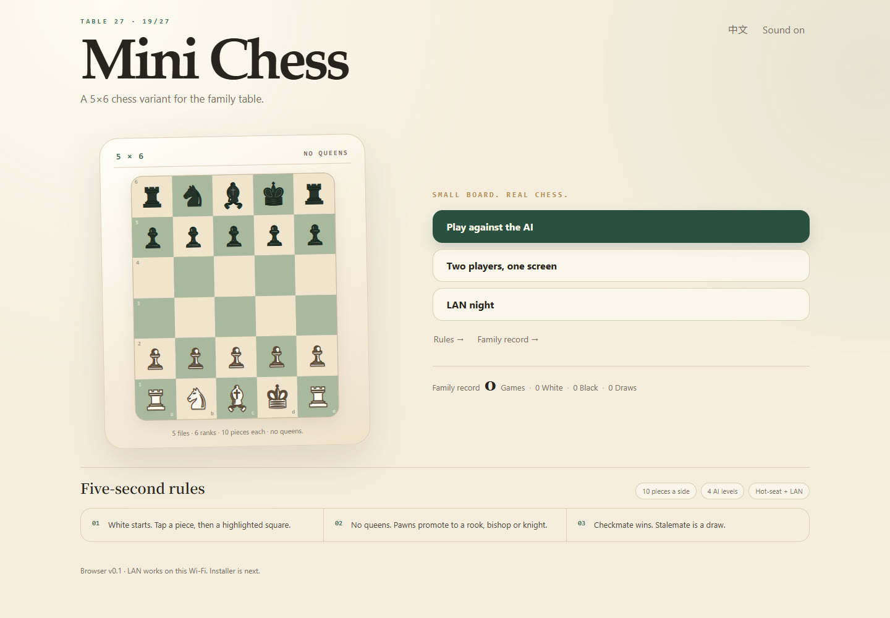
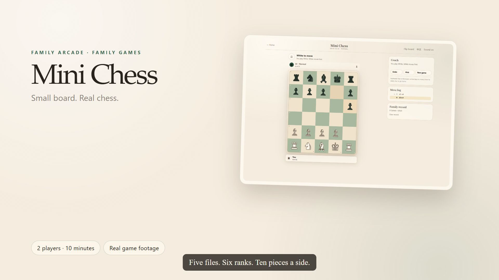
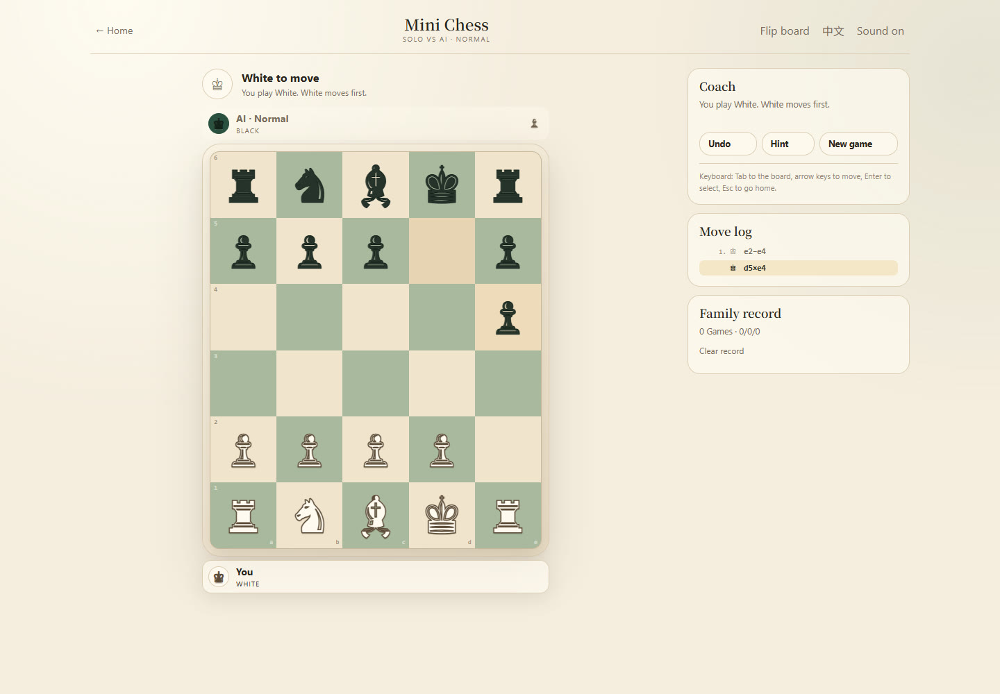
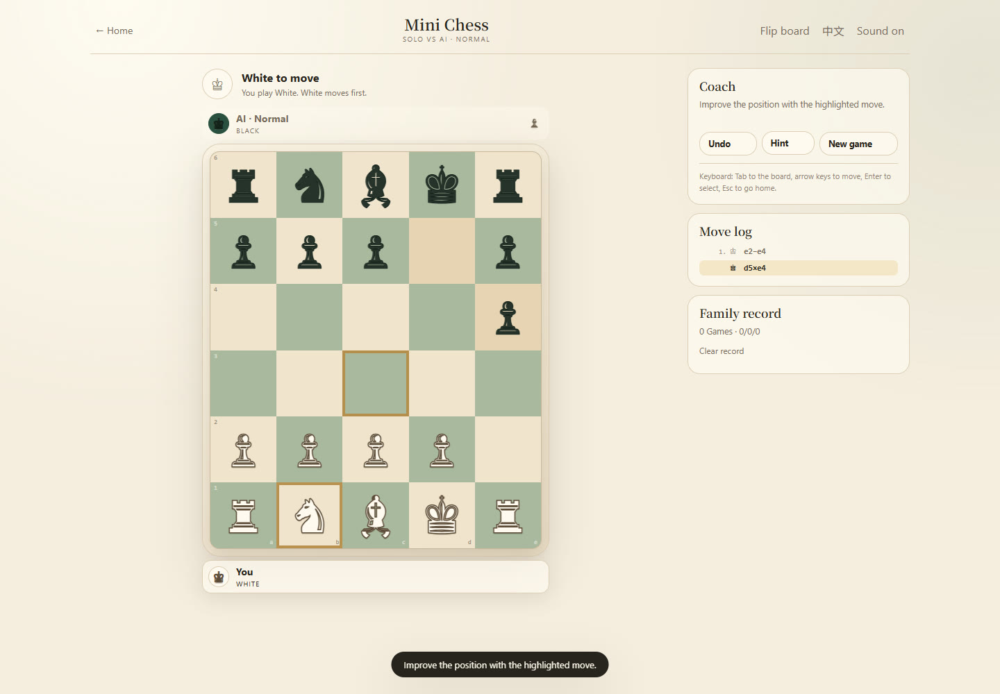
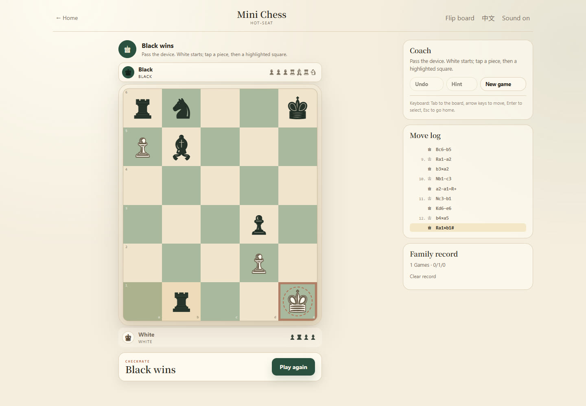
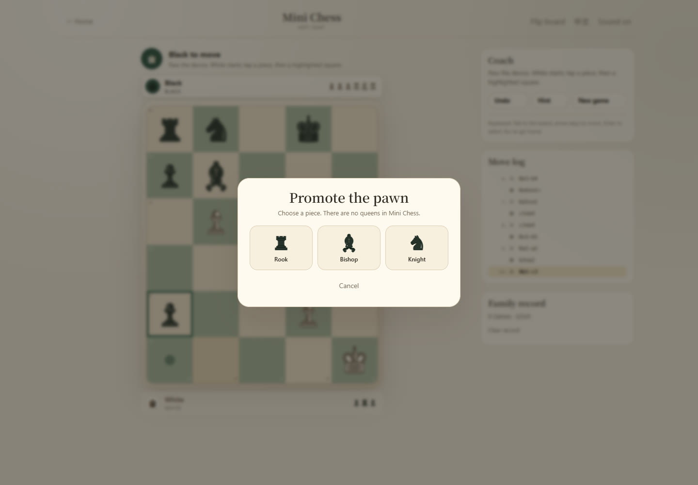
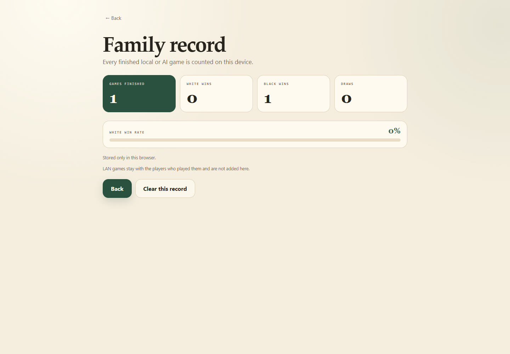
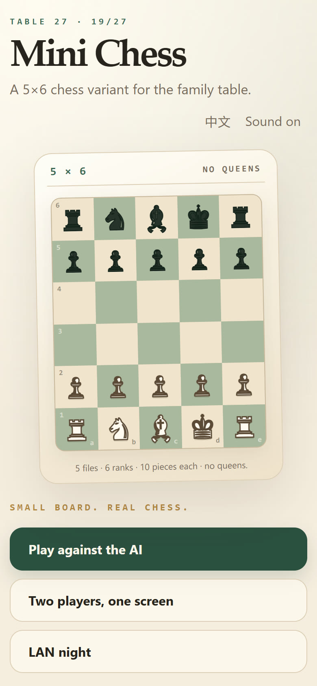

# Mini Chess · 迷你棋

**English** · [简体中文](README.zh-CN.md)

> **Small board. Real chess.**

An original 5×6 chess variant for the family table: **2 players**, ten pieces a
side, no queens, four AI levels, hot-seat, and LAN play from a phone. No account,
no ads, no remote fonts, and no network except your own Wi-Fi.



[](docs/promo/mini-chess-promo-en.mp4)

*45 seconds · 1920×1080 · 60 fps · [中文版](docs/promo/mini-chess-promo-zh.mp4) · [video.json](video.json)*

## A turn, in five seconds

| Board | Move | Win |
| --- | --- | --- |
| Five files by six ranks. White moves first. | Tap a piece, then a highlighted square. | Checkmate wins; stalemate is a draw. |

The compact army is a king, two rooks, a knight, a bishop and five pawns. Pawns
promote on the last rank to a rook, bishop or knight. There are no queens,
castling or en passant on this board.

## What is inside

- **A real, tested engine.** Pure TypeScript in `src/game/`, deterministic and
  free of DOM, network, clock and `Math.random`. **42 unit tests** cover
  movement, pins, check, checkmate, stalemate, promotion, draws, seats and AI.
- **Four AI levels.** Companion avoids early checks and gives children room;
  Easy plays a random legal move; Normal searches two plies; Hard is alpha–beta
  at depth five with quiescence and capture ordering.
- **Three ways to play.** Solo against the AI, two players on one screen, or a
  phone joining a LAN room over the same Wi-Fi.
- **Small comforts.** Undo, a hint with a reason, autosave/resume, local family
  record, move log, captured trays, promotion picker, sound on/off, reduced
  motion, keyboard navigation and a complete Chinese/English UI.
- **Private by default.** No accounts, telemetry, ads, CDN, remote fonts or
  downloaded art.

## Screenshots

| A real game | Hint with a reason |
| --- | --- |
|  |  |

| Checkmate | Promotion |
| --- | --- |
|  |  |

| Family record | Phone |
| --- | --- |
|  |  |

All screenshots are real captures of the running app at 1440×1000; phone shots
are 390×844 at 2× (780×1688).

## Play locally

```bash
npm install
npm run dev        # http://localhost:5198
npm run check      # tsc + 42 tests + production build
npm run e2e        # real Chrome, dev server required
npm run shots      # regenerate docs/screenshots/{en,zh}
npm run e2e:lan    # optional LAN smoke test, relay on :8098 + dev server
```

The E2E run covers a full hot-seat checkmate, promotion, record, restart, undo,
hint, a keyboard-only move, an AI reply, autosave across reload, stats, the
language toggle and the mobile layout.

## Rules

The rule audit, edge cases and deliberate simplifications live in
[`docs/rules.md`](docs/rules.md). In short:

1. White moves first on a 5×6 board.
2. King, rook, bishop, knight and pawn move as in standard chess.
3. A pawn may move two squares from its starting rank and promotes on the last
   rank to a rook, bishop or knight.
4. Check must be answered. Checkmate wins; stalemate is a draw.
5. The fifty-move rule and bare kings with a single minor piece are automatic
   draws.
6. There is no castling, en passant or queen.

## LAN night

Browser/dev build:

```bash
npm run build
npm run lan        # relay on :8080, also serves dist/
# host page: http://localhost:5198  →  LAN night  →  host a room
# guest page: the invite URL at :8080, or open it on a phone

# optional automated LAN smoke test (relay on :8098)
node ../../tools/lan-server.mjs --dist dist --port 8098
npm run e2e:lan
```

Desktop: the Tauri shell starts the same relay internally and serves the built
app to phones. The host shows a four-digit room code and a QR invite. Guests open
the address on the same Wi-Fi; they do not install anything.

The host owns the authoritative game and sends the guest a per-seat view. The
guest can only send `{type:'move', from, to, promotion}` intents; the host
re-validates the seat, turn, piece, geometry and check safety. The guest is
Black and the board is turned around for them.

> Browser tip: if you host from a development machine, open the host page using
> the machine's LAN address (for example `http://192.168.1.20:5198`) so the QR
> invite does not point at `localhost`. The Tauri build does this for you.

## Build the Windows installer

```bash
npm install
npx tauri build --bundles nsis
# src-tauri/target/release/bundle/nsis/Mini Chess_0.1.0_x64-setup.exe
```

Each Family Arcade game has its own lightweight installer; WebView2 uses the standard
bootstrapper. An unsigned family build may show a SmartScreen warning.

## Known limitations

- This is an original 5×6 variant, not FIDE chess. There is no castling, en
  passant, threefold repetition, chess clock or resignation.
- LAN is IPv4 on the same subnet. Reloading the host page drops the room; a guest
  can rejoin from the invite URL. There is no spectator or reconnect lobby.
- Hard searches five plies with quiescence and may take about a second per move
  on an older laptop.
- The Tauri installer is not built by this app agent; the shell is kept working
  for the central build.
- No standalone MP4 is checked in. [`video.json`](video.json) is the manifest the
  root promo studio renders.

See [`docs/limitations.md`](docs/limitations.md).

## Credits

Original code, copy and visual design for Family Arcade. The chess pieces are Unicode
glyphs rendered by the operating system, not bundled assets. MIT — see
[`NOTICE.md`](NOTICE.md) and [`LICENSE`](LICENSE).

## Promo

[](docs/promo/mini-chess-promo-en.mp4)

- [English cut](docs/promo/mini-chess-promo-en.mp4) · [other language](docs/promo/mini-chess-promo-zh.mp4)
- [SRT](docs/promo/mini-chess-promo-en.srt) · [video.json](video.json)
- Real app screenshots and real engine data; claims match the tests.

