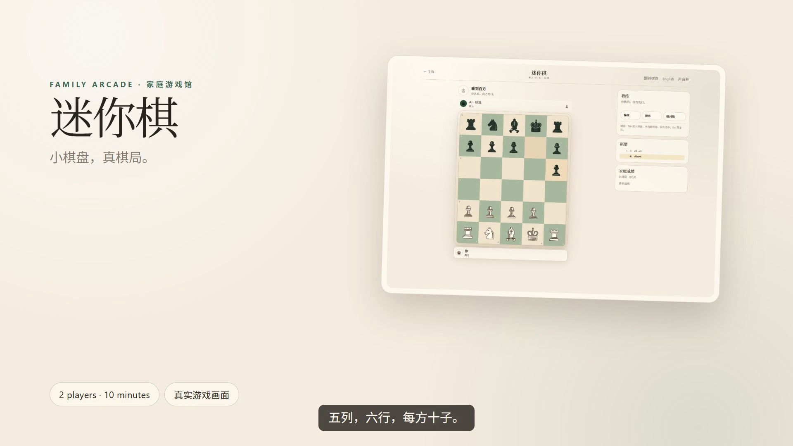
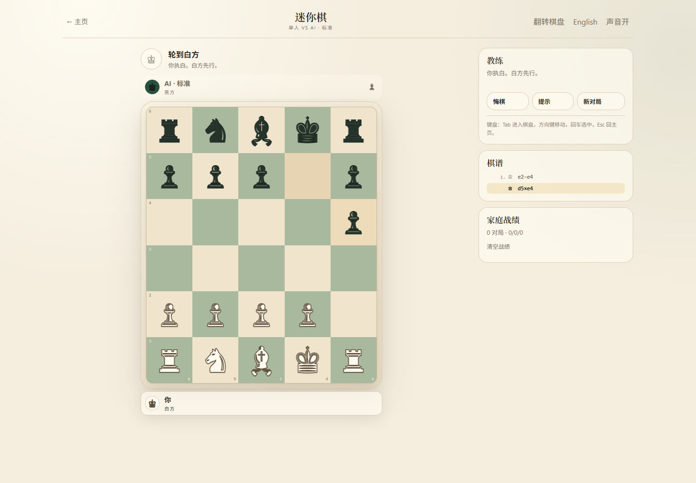
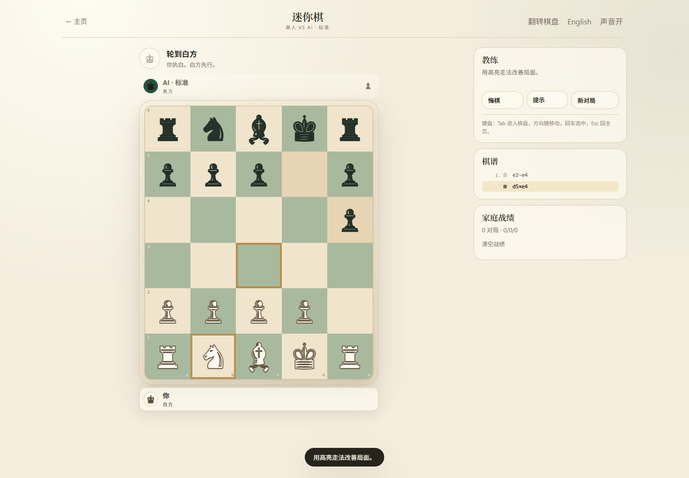
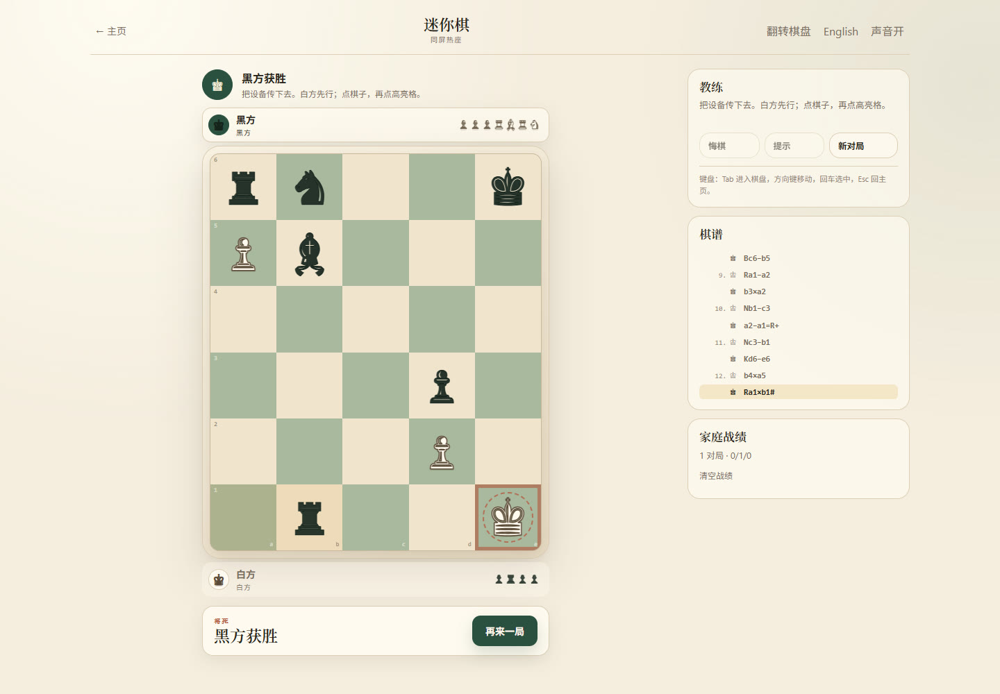
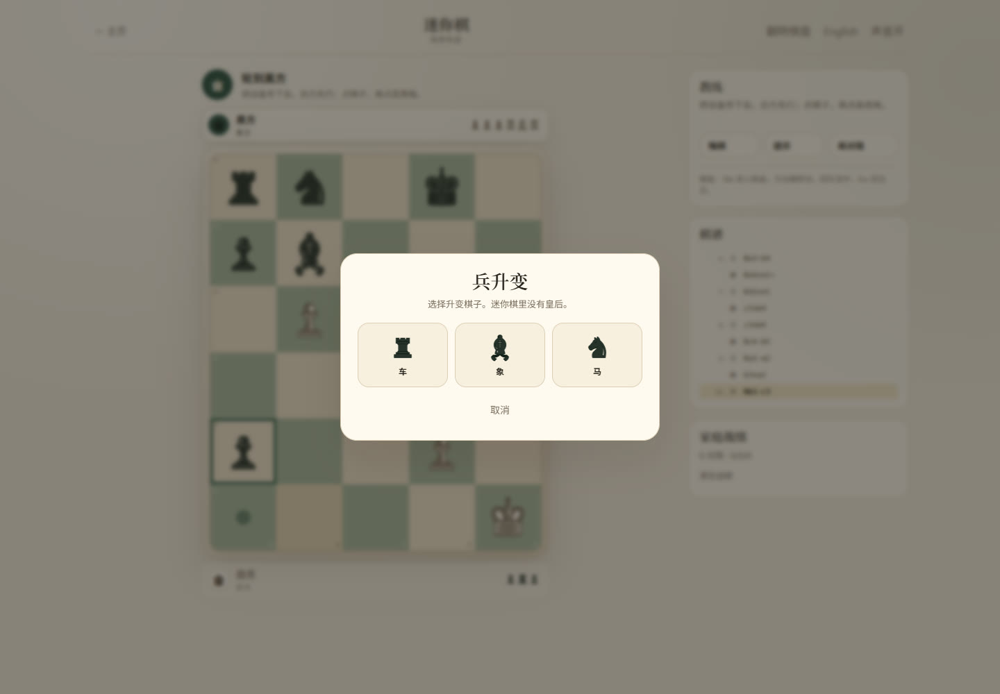
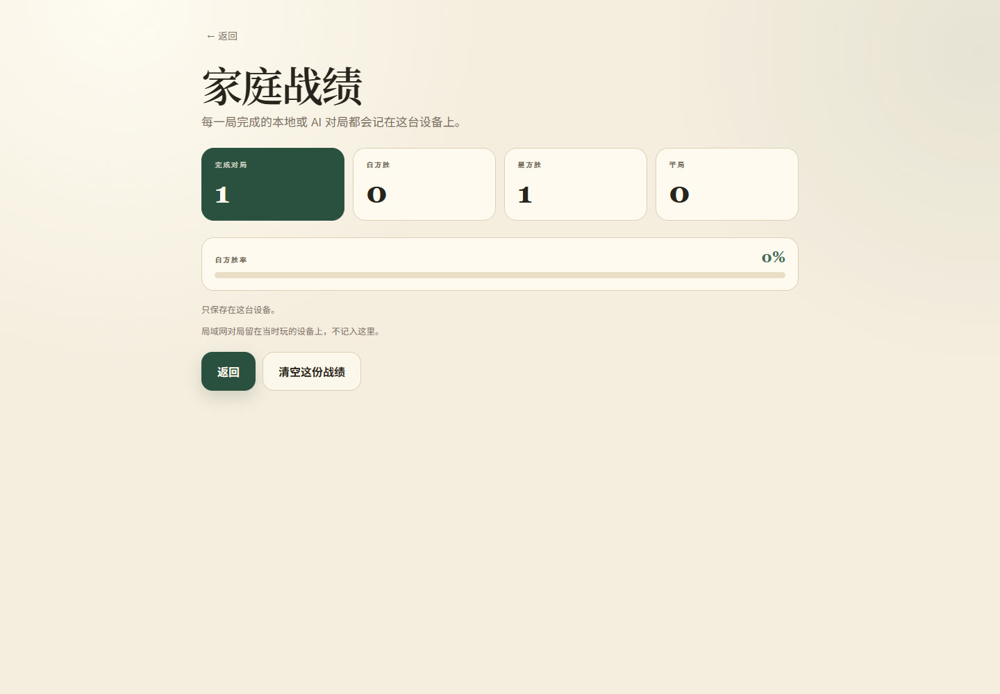
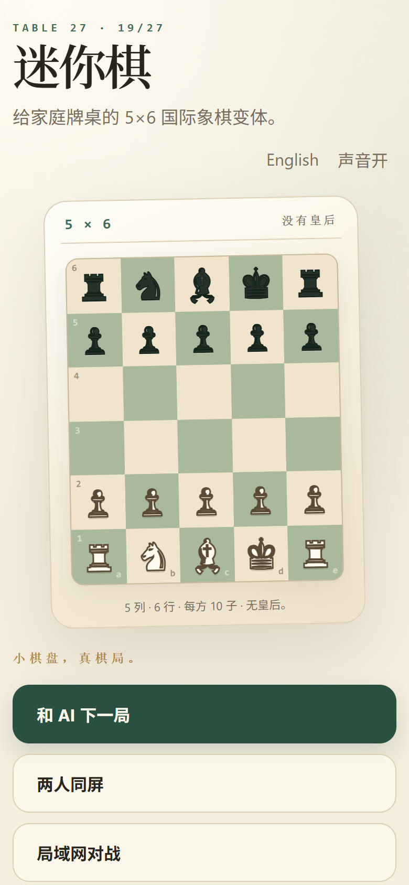

# 迷你棋 · Mini Chess

[English](README.md) · **简体中文**

> **小棋盘，真棋局。**

给家庭牌桌的原创 5×6 国际象棋变体：**2 人**、每方十子、没有皇后、四档 AI、
同屏热座，以及手机浏览器直接加入的局域网对战。无账号、无广告、无远程字体；
除自家 Wi-Fi 外不需要联网。


[](docs/promo/mini-chess-promo-zh.mp4)

*45 秒 · 1920×1080 · 60fps · [English cut](docs/promo/mini-chess-promo-en.mp4) · [video.json](video.json)*

## 一回合，五秒看懂

| 棋盘 | 走子 | 结束 |
| --- | --- | --- |
| 5 列 6 行。白方先行。 | 点棋子，再点高亮格。 | 将死获胜；无子可动为和棋。 |

紧凑的兵力是：一王、两车、一马、一象、五兵。兵到达底线后升变为车、象或马。
小棋盘上没有皇后、王车易位和吃过路兵。

## 里面有什么

- **真正的引擎。** `src/game/` 是纯 TypeScript、确定性代码，不碰 DOM、网络、
  时钟和 `Math.random`。**42 个单元测试**覆盖走子、钉子、将军、将死、无子可动、
  升变、和棋、座位与 AI。
- **四档 AI。** 陪玩开局不将军，给小朋友留思考空间；轻松随机走合法棋；标准看两步；
  挑战使用 Alpha–beta 五层搜索、吃子延伸和走法排序。
- **三种玩法。** 单人对抗 AI、两人同屏，或手机在同一 Wi-Fi 下加入局域网房间。
- **小细节。** 悔棋、带理由的提示、自动保存/继续、本机家庭战绩、棋谱、被吃子托盘、
  升变选择、声音开关、减少动效、键盘操作，以及完整中英双语。
- **默认私密。** 无账号、无遥测、无广告、无 CDN、无远程字体、无下载素材。

## 截图

| 真实对局 | 带理由的提示 |
| --- | --- |
|  |  |

| 将死 | 兵升变 |
| --- | --- |
|  |  |

| 家庭战绩 | 手机 |
| --- | --- |
|  |  |

全部来自真实运行的应用：桌面 1440×1000，手机 390×844 @2×（780×1688）。

## 本地运行

```bash
npm install
npm run dev        # http://localhost:5198
npm run check      # tsc + 42 个测试 + 生产构建
npm run e2e        # 真实 Chrome，需先运行 dev
npm run shots      # 重新生成 docs/screenshots/{en,zh}
npm run e2e:lan    # 可选局域网冒烟测试，中继 :8098 + dev
```

E2E 覆盖完整同屏将死、升变、战绩、重开、悔棋、提示、纯键盘走子、AI 应手、
刷新后自动保存、战绩页、语言切换和手机布局。

## 规则

完整规则审计、边界情况和有意简化见 [`docs/rules.md`](docs/rules.md)。简要版：

1. 5×6 棋盘，白方先行。
2. 王、车、象、马、兵按标准国际象棋走法移动。
3. 兵在初始行可以走两格，到达底线升变为车、象或马。
4. 被将军必须应对。将死获胜；无子可动为和棋。
5. 五十回合规则和只剩王与单马/单象自动判和。
6. 没有皇后、王车易位和吃过路兵。

## 局域网之夜

浏览器/开发版：

```bash
npm run build
npm run lan        # :8080 中继，同时托管 dist/
# 主机页面：http://localhost:5198 → 局域网对战 → 开一个房间
# 访客页面：邀请 URL（:8080），或直接用手机打开

# 可选：自动局域网冒烟测试（中继 :8098）
node ../../tools/lan-server.mjs --dist dist --port 8098
npm run e2e:lan
```

桌面版：Tauri 壳会启动同一个内置中继，并把构建产物托管给手机。主机显示四位房间码
和二维码；访客在同一 Wi-Fi 打开地址即可，无需安装。

主机保存权威棋局，只向访客发送自己的座位视图。访客只能发送
`{type:'move', from, to, promotion}` 意图；主机会重新校验座位、回合、棋子、走法
几何和将军安全。访客执黑，棋盘会为他们翻转。

> 浏览器提示：从开发机开房时，请用本机局域网地址打开主机页面
> （例如 `http://192.168.1.20:5198`），否则二维码里的地址会是 `localhost`。
> Tauri 安装包会自动处理。

## 构建 Windows 安装包

```bash
npm install
npx tauri build --bundles nsis
# src-tauri/target/release/bundle/nsis/Mini Chess_0.1.0_x64-setup.exe
```

Family Arcade 每款游戏单独打包，安装包保持轻量；WebView2 使用标准引导程序。未签名的
家庭构建可能触发 SmartScreen 提示。

## 已知限制

- 这是原创 5×6 变体，不是 FIDE 国际象棋。没有王车易位、吃过路兵、三次重复局面、
  棋钟或认输。
- 局域网仅支持同一子网的 IPv4。刷新主机页面会丢失房间；访客可以用邀请 URL 重新加入。
  没有观战或重连大厅。
- 挑战档搜索五层加吃子延伸，较旧笔记本上每步可能约一秒。
- 本 app agent 不构建 Tauri 安装包，只保持壳可用，由主 agent 统一构建。
- 仓库里没有独立 MP4；[`video.json`](video.json) 是根目录宣传片工作室渲染用的清单。

见 [`docs/limitations.md`](docs/limitations.md)。

## 许可

Family Arcade 原创代码、文案与视觉设计。棋子是操作系统渲染的 Unicode 字符，不是打包素材。
MIT，见 [`NOTICE.md`](NOTICE.md) 与 [`LICENSE`](LICENSE)。

## 宣传片

[](docs/promo/mini-chess-promo-zh.mp4)

- [中文成片](docs/promo/mini-chess-promo-zh.mp4) · [另一语言](docs/promo/mini-chess-promo-en.mp4)
- [字幕](docs/promo/mini-chess-promo-zh.srt) · [video.json](video.json)
- 画面来自真实应用与真实引擎数据；数字与测试一致。

