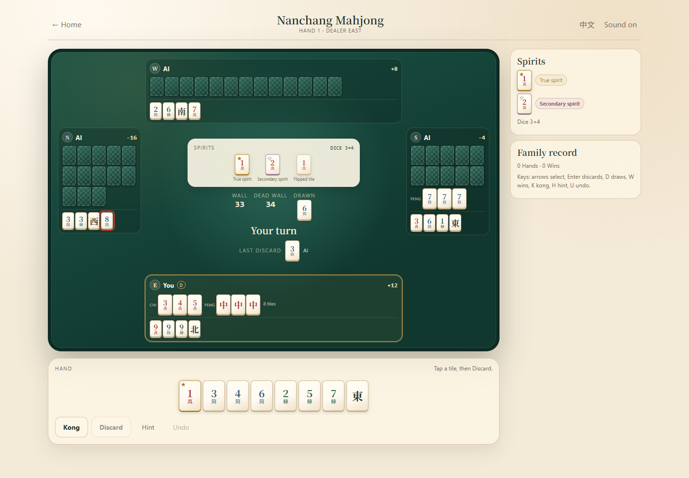
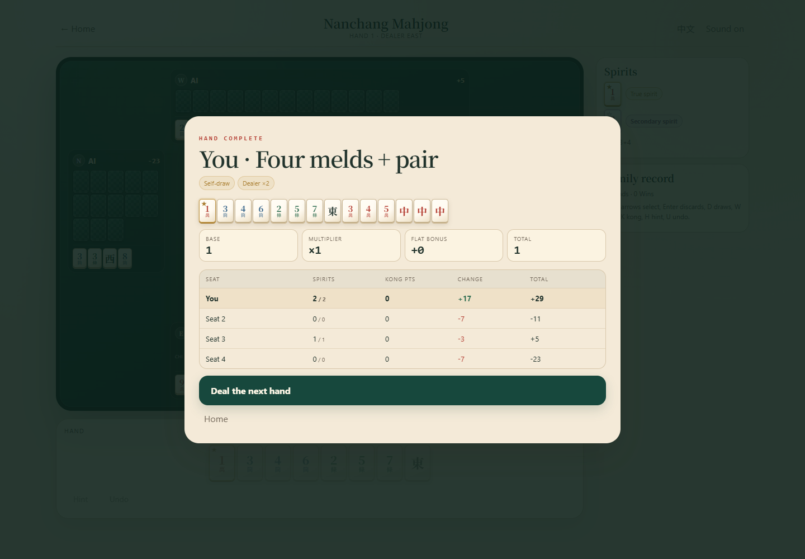

# Nanchang Mahjong

Four seats, one wall, seven spirits. A complete Nanchang Mahjong table for the family:
136 tiles, 13-tile hands, a 17-stack dead wall, true and secondary spirit wildcards,
special wind and dragon sequences, and the published Nanchang scoring table.





## Five-second rules

1. Draw a tile, then discard one. The dealer starts with 14 tiles; everyone else has 13.
2. Chi only from the left player. Peng, exposed kong and concealed kong are allowed.
3. Any three different winds, or any three different dragons, form a sequence.
4. A kong draws a replacement tile. Another player may rob an added kong.
5. Win with four melds + a pair, seven pairs, big seven pairs, Thirteen Scattered or
   Seven-Star Thirteen Scattered.

## The spirits

After the deal the dealer rolls two dice and flips a tile from the wall end. The flipped
tile is the **true spirit**; the next tile in its cycle is the **secondary spirit**. The
flipped physical tile is not a spirit. Seven spirit tiles remain in play: three true and
four secondary.

Spirits are wildcards. They may be discarded, and a spirit claimed by chi, peng, kong or
a win belongs to its new owner. True spirits score 2, secondary spirits 1. The only player
holding spirits has the overlord ×2; five or more spirit points trigger spirit sprint.

## Scoring

The full table, worked examples and audit are in [docs/rules.md](docs/rules.md).

- Self-draw ×2; a discard win is paid by the discarder ×2 and the others ×1.
- Dealer side ×2. Kongs pay 2; a kong of four spirits pays 10.
- German ×2+5, German-in-German ×4+5, spirit single-wait ×2+5.
- Kong draw ×4, robbing a kong ×4, heavenly/human ×20.
- Seven pairs and Thirteen Scattered ×2; Seven-Star ×4.
- Spirit and kong points settle pairwise, including on a drawn hand.

The match target is 100 points. The dealer rotates every hand. Table choices that are
not enabled — copy-dealer, bottom-flip, dealer continuation, pass-first-win and multiple
winners — are listed in [docs/limitations.md](docs/limitations.md).

## Modes

- **Solo** against three AI seats. Four levels: Companion, Easy, Normal and Hard. They
  use exact wait counting, wild-tile efficiency, Thirteen Scattered detection, spirit
  counting and defence.
- **Hot-seat** for four players on one screen. A privacy curtain covers the whole table
  until the device is passed and the next player reveals their hand.
- **LAN** for four seats. The host owns the wall; each guest receives only their own hand
  and the public table. Empty seats are filled by AI. Results are recorded on the host.

## Comforts

- Undo and a reasoned hint in solo and hot-seat.
- Autosave and resume for solo and hot-seat.
- Family record: hands, wins by seat, best hand, mode counts and recent hands.
- Sound on/off; reduced-motion toggle and `prefers-reduced-motion` support.
- Keyboard path: arrow keys select, Enter discards, D draws, W wins, K opens kongs,
  H hints, U undoes, Esc returns home.
- Responsive desktop and mobile layouts. The hand scrolls horizontally when needed.

## Run it

```bash
npm install
npm run dev          # http://localhost:5226
npm run check        # tsc + 60 tests + production build
npm run e2e          # Playwright solo / hot-seat / mobile / Chinese UI
npm run shots        # real screenshots into docs/screenshots/{en,zh}
```

LAN, with the shared relay:

```bash
npm run build
npm run lan          # serves dist and the shared relay on :8080
# Open the host page on :5226 (or the relay), create a room, share the QR/link.
LAN_PORT=19026 npm run lan:e2e
```

The LAN end-to-end test starts its own relay on the assigned port and stops it. Do not
run two relays on the same port.

## Tauri

The shared Tauri shell is kept in `src-tauri/`. The central build agent runs the installer
build; this workspace does not run `cargo` or `tauri build`.

```bash
npm run build
npm run tauri build
```

## Documentation

- [Rules and audit](docs/rules.md)
- [Known limitations and table options](docs/limitations.md)
- [NOTICE](NOTICE.md)
- [Chinese README](README.zh-CN.md)
- [Video manifest](video.json)

## License

MIT. See [LICENSE](LICENSE).
