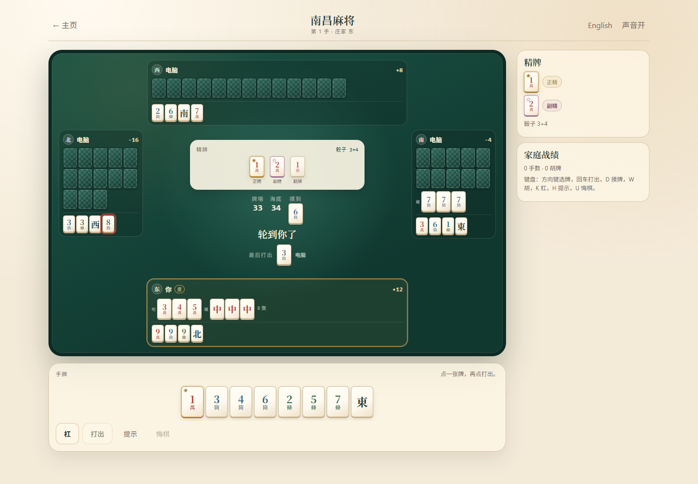

# 南昌麻将

四个座位，一座牌墙，七张精。完整的南昌麻将家庭牌桌：136 张牌、13 张手牌、17 墩海底、
正精与副精、风牌箭牌三张成顺，以及公开的南昌算分表。





## 五秒规则

1. 摸一张，打一张。庄家起手 14 张，其他人 13 张。
2. 只能吃上家。可以碰、明杠、暗杠。
3. 任意三张不同的风牌，或三张不同的箭牌，可以组成一副顺子。
4. 杠后补摸一张。别人可以抢补杠。
5. 胡牌牌型：四副牌加一对将、七对、大七对、十三烂、七星十三烂。

## 精牌

发牌后庄家掷两粒骰子，从牌墙末端翻一张牌。翻开的牌是**正精**，同花色或同字牌组里的
下一张是**副精**。翻开的这张牌本身不算精。场上共有七张精：三张正精、四张副精。

精是万能牌，可以打出；被吃、碰、杠、胡后归新主人。正精 2 分，副精 1 分。只有一家有精时
霸王精 ×2；精分达到 5 分触发冲关。

## 算分

完整算分表、例子和审计见 [docs/rules.md](docs/rules.md)。

- 自摸 ×2；点炮由点炮者 ×2，其他人 ×1。
- 庄家一侧 ×2。普通杠 2 分；四张精开杠 10 分。
- 德国 ×2+5，德中德 ×4+5，精吊 ×2+5。
- 杠开 ×4，抢杠 ×4，天胡/地胡 ×20。
- 七对、十三烂 ×2；七星十三烂 ×4。
- 精分和杠分配对结算，流局也照常结算。

比赛目标 100 分。每手庄家轮换。没有启用的桌规——抄庄、下翻、连庄、弃先胡后、一炮多响——
都列在 [docs/limitations.md](docs/limitations.md)。

## 模式

- **单机**：对三档电脑。四档难度：陪玩、轻松、标准、挑战。电脑会算听牌、算精、算十三烂、
  会防守。
- **同屏**：四个玩家轮流用一台设备。盖牌帘会遮住整张牌桌，直到设备传到下一位玩家并点开手牌。
- **局域网**：四个座位。房主持有牌墙，每位访客只收到自己的手牌和公开牌桌。空位由电脑补上。
  局域网战绩记在房主设备上。

## 舒适功能

- 单机和同屏支持悔棋与带理由的提示。
- 单机和同屏自动保存、继续上一局。
- 家庭战绩：手数、各座位胡牌数、最佳一手、模式统计、最近几手。
- 声音开关；动效开关，并遵循系统的“减少动态效果”设置。
- 键盘：方向键选牌，回车打出，D 摸牌，W 胡，K 杠，H 提示，U 悔棋，Esc 回主页。
- 桌面和手机自适应；手牌放不下时可以横向滚动。

## 运行

```bash
npm install
npm run dev          # http://localhost:5226
npm run check        # 类型检查 + 60 个测试 + 生产构建
npm run e2e          # 浏览器端到端：单机 / 同屏 / 手机 / 中文界面
npm run shots        # 生成 docs/screenshots/{en,zh} 的真实截图
```

局域网使用共享中继：

```bash
npm run build
npm run lan          # 在 :8080 提供构建产物和中继
# 在 :5226（或中继地址）打开房主页面，开房，分享二维码或链接。
LAN_PORT=19026 npm run lan:e2e
```

局域网端到端测试会在指定端口启动中继，结束后关闭。不要在同一端口启动两个中继。

## 桌面安装包

共享桌面安装壳保留在 `src-tauri/`。安装包由中央构建代理生成；本工作区不运行
`cargo` 或 `tauri build`。

```bash
npm run build
npm run tauri build
```

## 文档

- [规则与审计](docs/rules.md)
- [已知限制与桌规](docs/limitations.md)
- [NOTICE](NOTICE.md)
- [英文 README](README.md)
- [视频清单](video.json)

## 许可

MIT。见 [LICENSE](LICENSE)。
