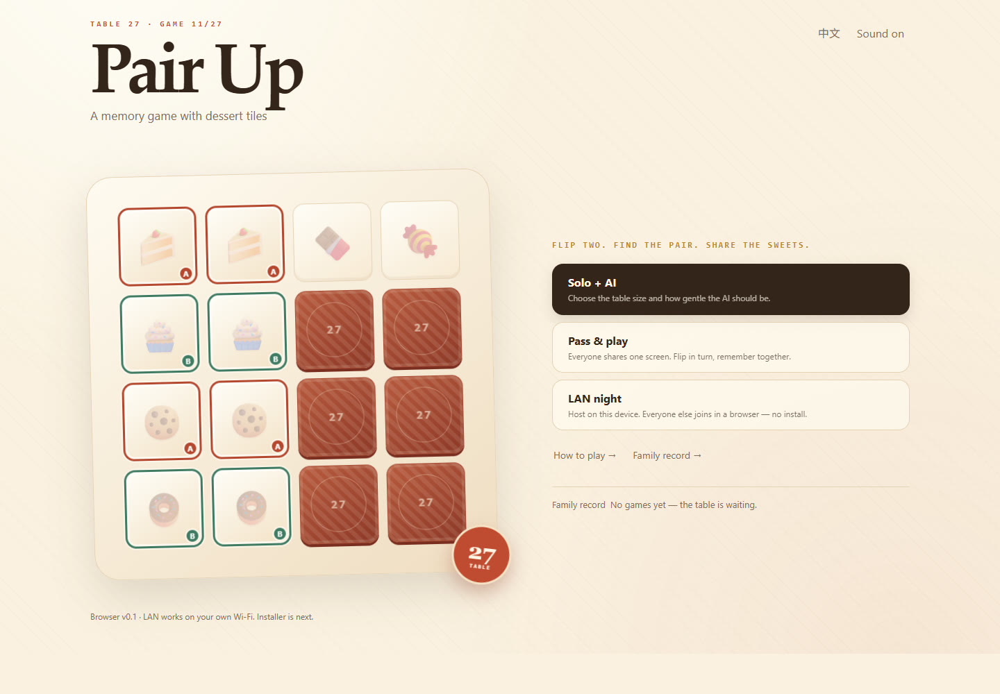
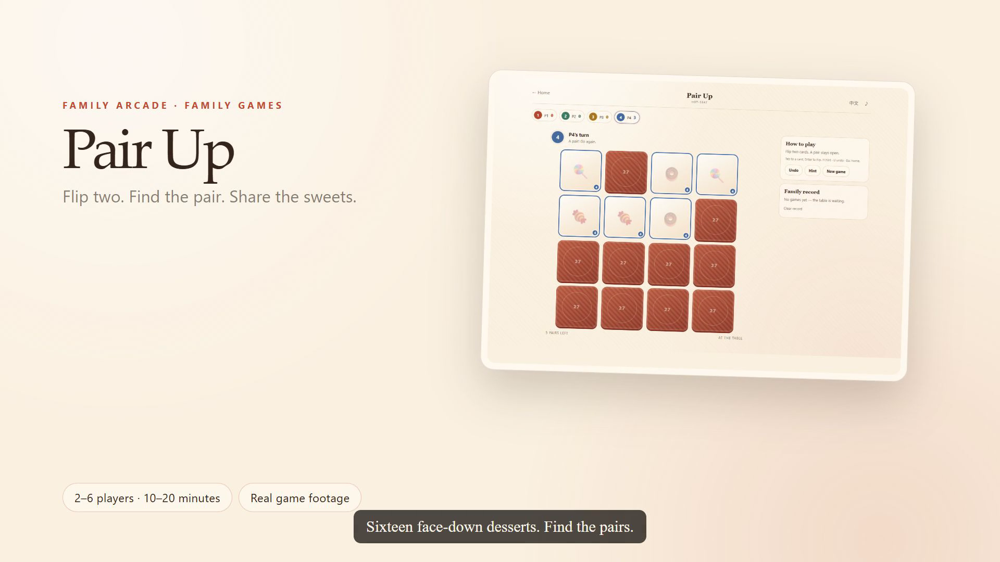
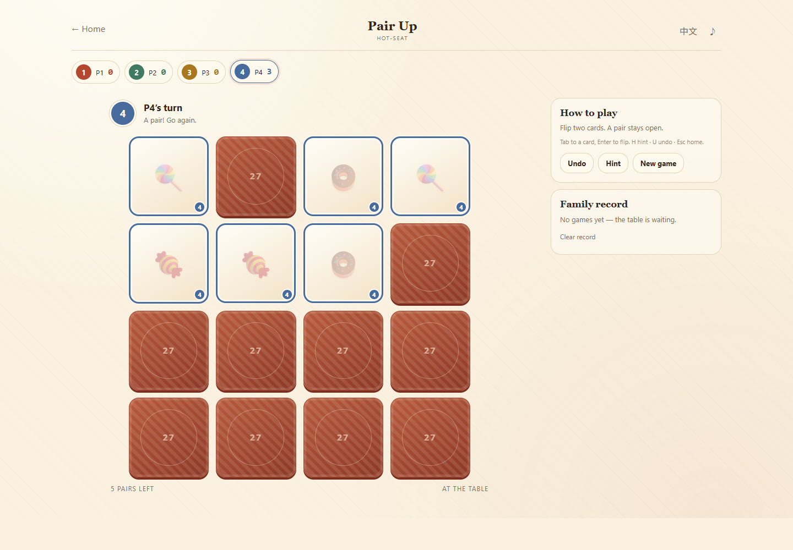
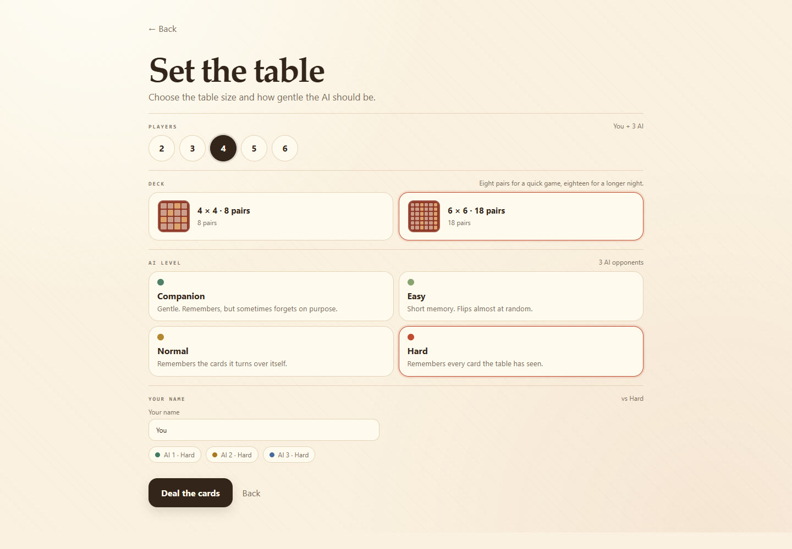
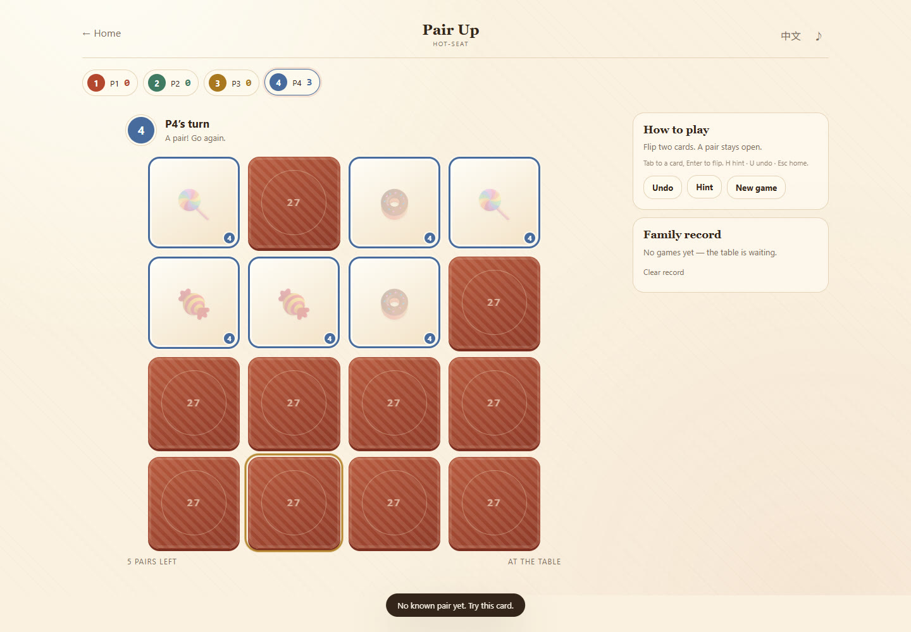
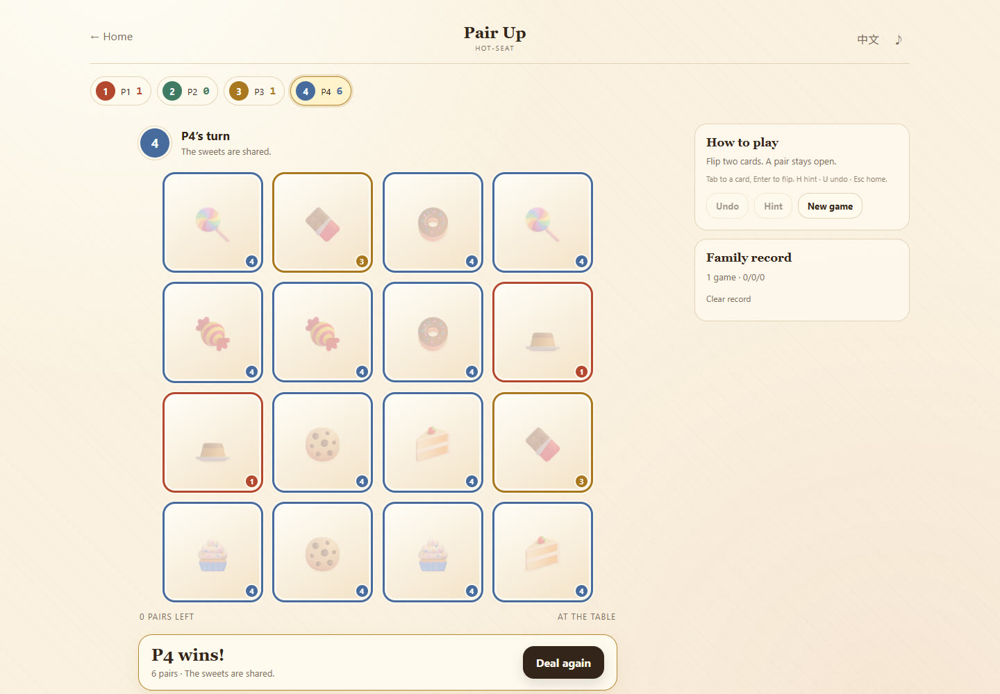
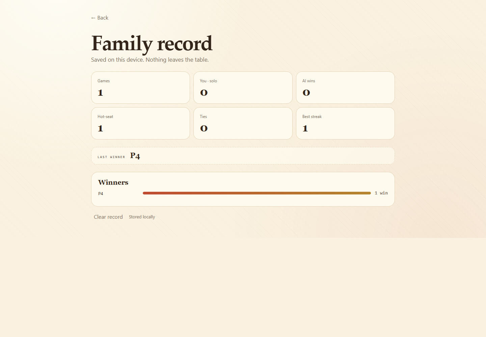
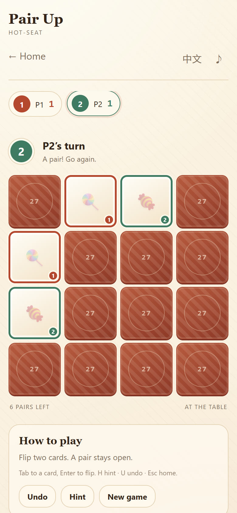

# Pair Up · 翻牌记忆

**English** · [简体中文](README.zh-CN.md)

> **A memory game with dessert tiles**

A warm, offline-first memory game for the family table: **2–6 players**, a 4 × 4 or
6 × 6 dessert deck, four AI levels, one-screen hot-seat, and LAN play from up to five
phones. No account, no ads, no network needed except your own Wi-Fi for LAN night.



[](docs/promo/pair-up-promo-en.mp4)

*45 seconds · 1920×1080 · 60 fps · [中文版](docs/promo/pair-up-promo-zh.mp4) · [video.json](video.json)*

## A turn, in five seconds

| Flip | Match | Miss | Win |
| --- | --- | --- | --- |
| Turn over two face-down cards. | A pair stays open, scores one point, and you go again. | Both cards turn back and the turn passes clockwise. | Most pairs when the board is empty wins. A tie is shared. |

## What is inside

- **A real, tested engine.** Pure TypeScript, deterministic, **35 unit tests**, no DOM,
  clock, network or `Math.random` in the rules. See [`docs/rules.md`](docs/rules.md).
- **Four AI levels.** Companion remembers but sometimes forgets on purpose; Easy has a
  short, unreliable memory; Normal remembers its own reveals; Hard remembers every
  card the table has seen.
- **Three ways to play.** Solo against 1–5 AI, 2–6 players passing one device, or a LAN
  room with 2–6 seats.
- **Two decks.** A quick 4 × 4 (8 pairs) or a longer 6 × 6 (18 pairs).
- **Small comforts.** Undo, hint with a reason, autosave/resume, local family record,
  sound toggle, keyboard path, reduced-motion support, and a complete Chinese/English UI.
- **Private by default.** No accounts, telemetry, ads, remote fonts or downloaded art.

## Screenshots

| A real game | AI setup |
| --- | --- |
|  |  |

| Hint | The sweets are shared |
| --- | --- |
|  |  |

| Family record | Phone |
| --- | --- |
|  |  |

All screenshots come from the running app at 1440 × 1000 (phone 390 × 844 @2×,
780 × 1688 output).

## Play locally

```bash
npm install
npm run dev        # http://localhost:5190
npm run check      # tsc + 35 tests + production build
npm run e2e        # real Chrome; dev server must be running
npm run shots      # regenerate docs/screenshots/{en,zh}
```

Use **Solo + AI** for one human and up to five AI seats, or **Pass & play** for 2–6
people around one screen. Every local game autosaves; the home screen offers
**Continue last game** after a reload.

## LAN night

Browser/dev:

```bash
npm run build      # build the guest page
npm run lan        # relay + built app on :8080
npm run dev        # in another terminal: host on :5190
```

1. Open `http://localhost:5190`, choose **LAN night**, pick 2–6 seats, and create a room.
2. The host shows a 4-digit room code, a QR invitation and a full link.
3. Each guest opens the invitation on the same Wi-Fi, enters a name, and joins. A guest
   can also type the 4-digit code on the **Join room** form without the link.
4. When every seat is connected, the host deals. The host is seat 0; phones are the
   other seats.

If `:8080` is already taken by another Family Arcade relay, run this app's relay on another
port and open the host page with `?lanPort=`:

```bash
node ../../tools/lan-server.mjs --dist dist --port 8181
# host: http://localhost:5190/?lanPort=8181
```

The relay is a dumb message bus. The host keeps the authoritative state and sends each
guest only `view(state, seat)` — face-down values are `null`. Guests send only
`{ type: 'flip', index }`, and the host re-checks the turn before applying
`flipForSeat()`. The 4-digit code is a family convenience, not a security boundary.

Desktop: the Tauri build starts the same relay internally and serves the built app to
phones. The host shows the code and QR invite; guests need no app install.

## Build the Windows installer

```bash
npm install
npx tauri build --bundles nsis
# src-tauri/target/release/bundle/nsis/Pair Up_0.1.0_x64-setup.exe
```

The installer is per-game and lightweight; WebView2 uses the standard bootstrapper.
A Windows SmartScreen warning is expected for an unsigned family build. The main
Family Arcade build agent builds installers centrally; this app does not run Tauri builds.

## Verification

- **Engine:** 35 Vitest cases in `tests/game.test.ts` — setup, hidden views, turns,
  matches, misses, resolve, ties, invalid flips, 6 × 6 finish, JSON round-trip, AI
  memory, companion forgetting, hints and determinism.
- **Browser E2E:** `node scripts/e2e.mjs` plays a complete hot-seat game, checks the
  family record, restart, undo, hint, a real AI reply, autosave/resume and a mobile
  flip in Chrome.
- **Screenshots:** `node scripts/shots.mjs` writes real desktop and phone captures.
- **LAN smoke test (optional):** with `npm run dev` and a relay on `:8181`, run
  `npm run lan:e2e`; it joins two guests, verifies per-seat views and broadcasts a
  guest flip back to the host.

## Known limitations

- LAN is same-subnet IPv4. No cloud rooms, matchmaking, spectators or accounts.
- A disconnected guest stalls their turn; there is no bot takeover. All seats must be
  connected before the host deals.
- Solo uses one AI level for all AI seats. Ties are shared; there is no tie-break.
- LAN guests cannot use hints because their view deliberately hides face-down values.
- Family record and autosave live in this browser/device only.
- Tile faces are system emoji, so they vary slightly across operating systems.
- No promo video is rendered here; `video.json` feeds the central Family Arcade studio.

See [`docs/limitations.md`](docs/limitations.md).

## Credits

Original code, layout, CSS and copy for Family Arcade. The memory-pair mechanic is a
public-domain folk game; this implementation is original. MIT. See
[`NOTICE.md`](NOTICE.md) and [`LICENSE`](LICENSE).

## Promo

[](docs/promo/pair-up-promo-en.mp4)

- [English cut](docs/promo/pair-up-promo-en.mp4) · [other language](docs/promo/pair-up-promo-zh.mp4)
- [SRT](docs/promo/pair-up-promo-en.srt) · [video.json](video.json)
- Real app screenshots and real engine data; claims match the tests.

