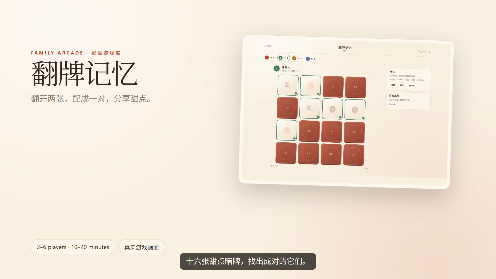
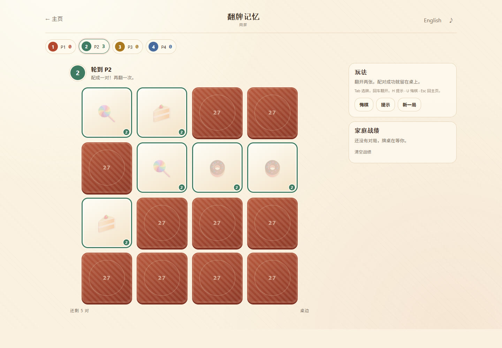
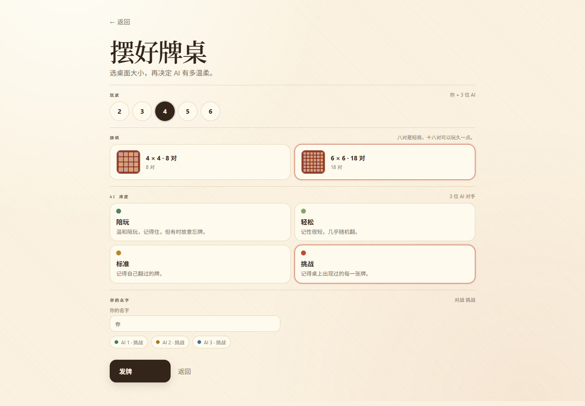
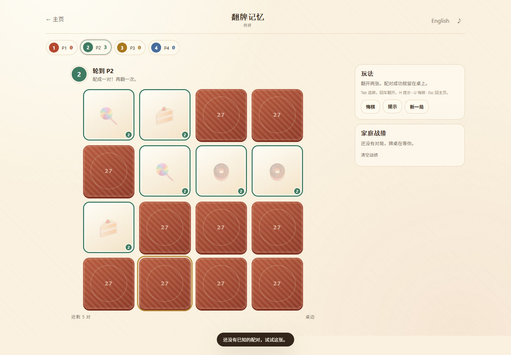
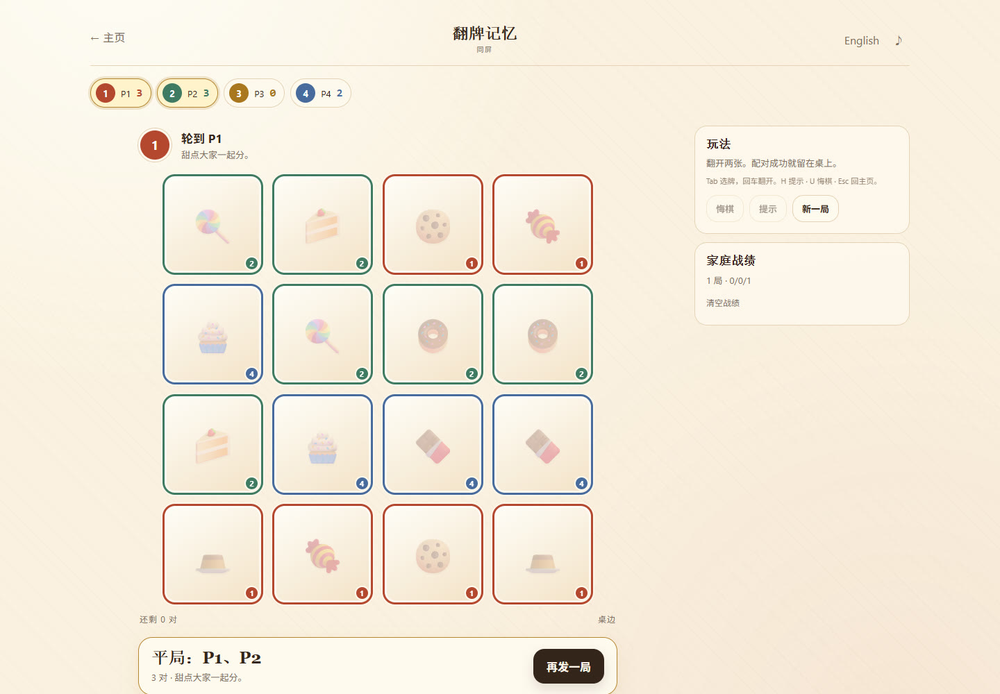
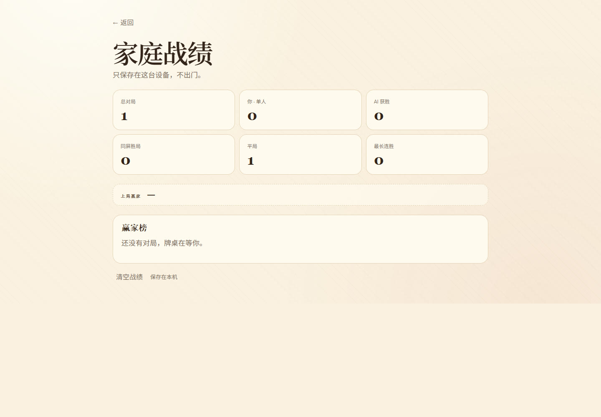
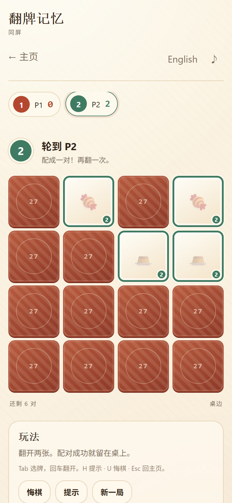

# 翻牌记忆 · Pair Up

[English](README.md) · **简体中文**

> **甜点翻牌记忆游戏**

给家庭牌桌的温暖记忆游戏：**2–6 人**、4 × 4 或 6 × 6 甜点牌组、四档 AI、同屏轮流，
以及最多五台手机加入的局域网对战。无账号、无广告；除自家 Wi-Fi 外不需要联网。


[](docs/promo/pair-up-promo-zh.mp4)

*45 秒 · 1920×1080 · 60fps · [English cut](docs/promo/pair-up-promo-en.mp4) · [video.json](video.json)*

## 一回合，五秒看懂

| 翻牌 | 配对 | 没配上 | 结束 |
| --- | --- | --- | --- |
| 翻开两张暗牌。 | 配对成功：牌留在桌上，得 1 分，同一位玩家继续。 | 两张翻回去，轮到顺时针下一位。 | 牌桌清空时配对最多者获胜；平局共享。 |

## 里面有什么

- **真正的引擎。** 纯 TypeScript、确定性、**35 个单元测试**；规则层不碰 DOM、时钟、
  网络或 `Math.random`。见 [`docs/rules.md`](docs/rules.md)。
- **四档 AI。** 陪玩记得住但会故意忘牌；轻松记性很短、几乎随机；标准记得自己翻过的牌；
  挑战记得桌上出现过的每一张牌。
- **三种玩法。** 单人对抗 1–5 位 AI、2–6 人共用一台设备，或 2–6 个座位的局域网房间。
- **两种牌组。** 4 × 4（8 对）短局，或 6 × 6（18 对）长局。
- **小细节。** 悔棋、带理由的提示、自动保存/继续、本机家庭战绩、声音开关、键盘操作、
  减少动效，以及完整的中英双语界面。
- **默认私密。** 无账号、无遥测、无广告、无远程字体、无下载美术。

## 截图

| 真实对局 | AI 设置 |
| --- | --- |
|  |  |

| 提示 | 甜点大家一起分 |
| --- | --- |
|  |  |

| 家庭战绩 | 手机 |
| --- | --- |
|  |  |

全部来自真实运行的应用：桌面 1440 × 1000，手机 390 × 844 @2×（输出 780 × 1688）。

## 本地运行

```bash
npm install
npm run dev        # http://localhost:5190
npm run check      # tsc + 35 个测试 + 生产构建
npm run e2e        # 真实 Chrome，需先运行 dev
npm run shots      # 重新生成 docs/screenshots/{en,zh}
```

**单人挑战 AI** 是一位真人加最多五位 AI；**同屏轮流** 支持 2–6 人。本地对局每步自动保存，
刷新后主页会出现 **继续上局**。

## 局域网之夜

浏览器/开发版：

```bash
npm run build      # 构建访客页面
npm run lan        # :8080 中继，同时托管构建产物
npm run dev        # 另一个终端：主机在 :5190
```

1. 打开 `http://localhost:5190`，选 **局域网聚会**，选 2–6 个座位并开房。
2. 主机会显示 4 位房间码、二维码邀请和完整链接。
3. 每位访客在同一 Wi-Fi 打开邀请，输入名字加入；也可以直接在 **加入房间** 表单输入
   4 位房间码，无需链接。
4. 所有座位连上后主机发牌。主机是 0 号座位，手机是其余座位。

如果 `:8080` 被另一个 Family Arcade 中继占用，可以换端口，并在主机页加上 `?lanPort=`：

```bash
node ../../tools/lan-server.mjs --dist dist --port 8181
# 主机：http://localhost:5190/?lanPort=8181
```

中继只是消息总线。主机保存权威状态，只给每位访客发送 `view(state, seat)`——暗牌的值是
`null`。访客只发送 `{ type: 'flip', index }`，主机重新校验回合后才调用 `flipForSeat()`。
4 位房间码是家庭便利功能，不是安全边界。

桌面版：Tauri 安装包启动同一个内置中继，并把构建产物托管给手机。主机显示房间码和二维码，
访客无需安装应用。

## 构建 Windows 安装包

```bash
npm install
npx tauri build --bundles nsis
# src-tauri/target/release/bundle/nsis/Pair Up_0.1.0_x64-setup.exe
```

每款游戏单独打包，安装包保持轻量；WebView2 使用标准引导程序。未签名的家庭构建会触发
Windows SmartScreen 提示。主 Family Arcade 构建代理会集中生成安装包；本应用不运行 Tauri 构建。

## 验证

- **引擎：** `tests/game.test.ts` 中 35 个 Vitest 用例——发牌、隐藏视图、轮转、配对、
  未配对、翻回阶段、平局、非法翻牌、6 × 6 完整对局、JSON 往返、AI 记忆、陪玩故意忘牌、
  提示和确定性。
- **浏览器 E2E：** `node scripts/e2e.mjs` 在 Chrome 中完整打完一局同屏游戏，并检查家庭战绩、
  再来一局、悔棋、提示、AI 真实回应、自动保存/继续和手机翻牌。
- **截图：** `node scripts/shots.mjs` 生成真实桌面与手机截图。
- **局域网冒烟测试（可选）：** 先运行 `npm run dev`，并在 `:8181` 启动中继，再运行
  `npm run lan:e2e`；脚本会加入两位访客，检查各自视图，并验证访客翻牌会广播回主机。

## 已知限制

- 局域网仅支持同一子网的 IPv4；没有云房间、匹配、观战或账号。
- 访客断线会卡住自己的回合，没有机器人接管；发牌前所有座位必须在线。
- 单人模式所有 AI 共用一档难度。平局共享，没有加赛。
- 局域网访客不能使用提示，因为其视图故意隐藏暗牌值。
- 家庭战绩和自动保存只在本浏览器/设备上。
- 牌面使用系统 emoji，不同操作系统会有细微差异。
- 这里不渲染宣传片；`video.json` 提供给 Family Arcade 中央工作室。

详见 [`docs/limitations.md`](docs/limitations.md)。

## 许可

Family Arcade 原创代码、布局、CSS 和文案。配对记忆是公有领域民间玩法，本实现为原创。MIT。
见 [`NOTICE.md`](NOTICE.md) 和 [`LICENSE`](LICENSE)。

## 宣传片

[](docs/promo/pair-up-promo-zh.mp4)

- [中文成片](docs/promo/pair-up-promo-zh.mp4) · [另一语言](docs/promo/pair-up-promo-en.mp4)
- [字幕](docs/promo/pair-up-promo-zh.srt) · [video.json](video.json)
- 画面来自真实应用与真实引擎数据；数字与测试一致。

