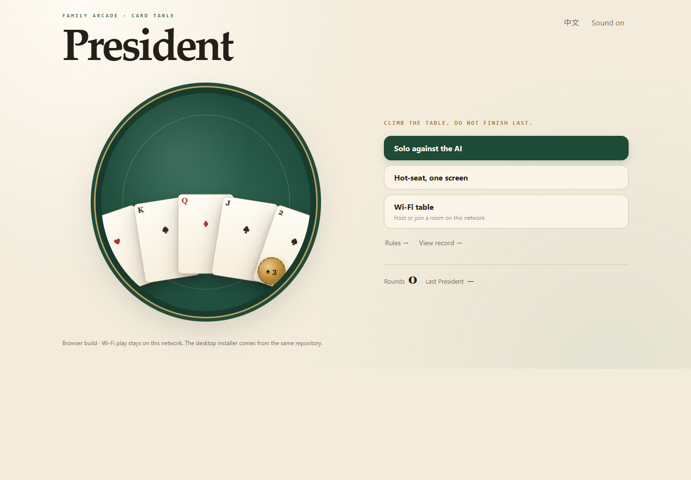
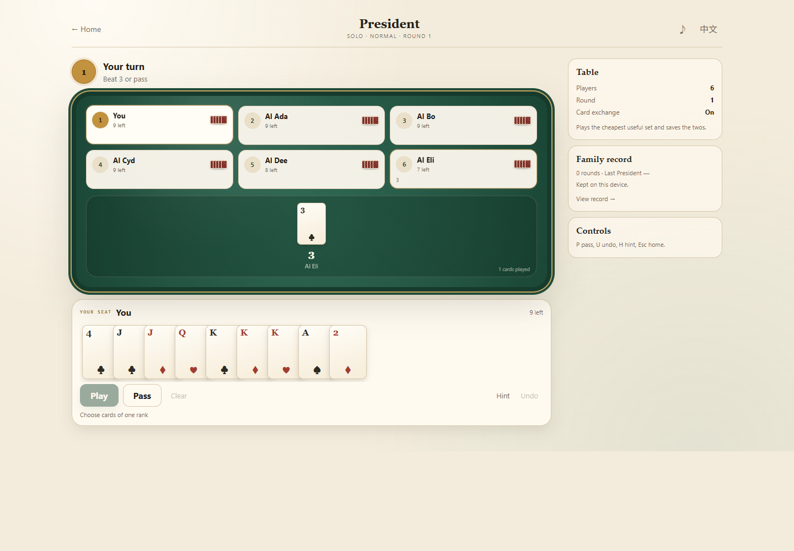
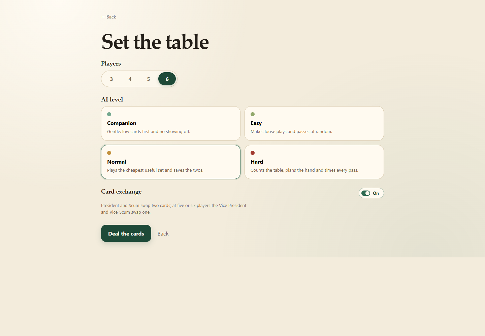
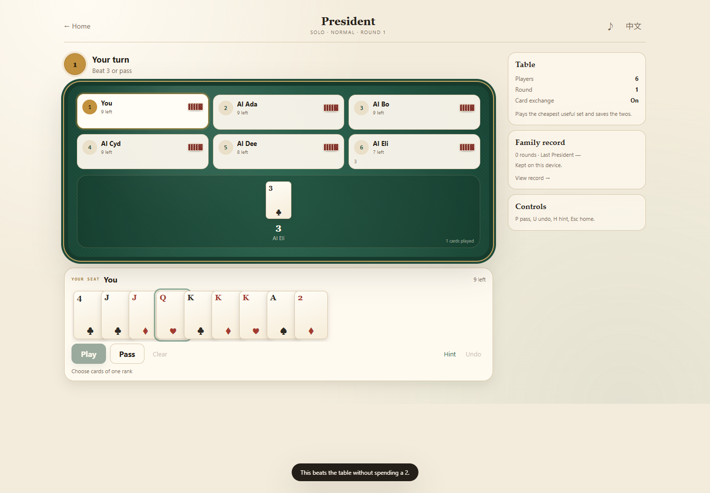
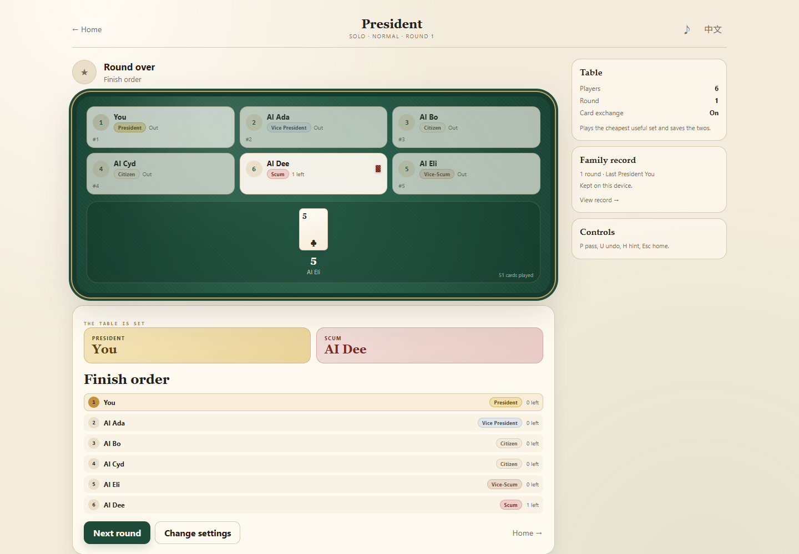
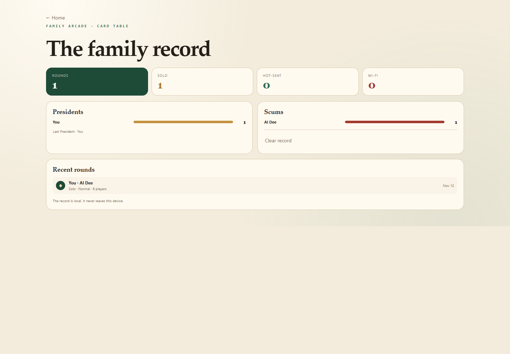
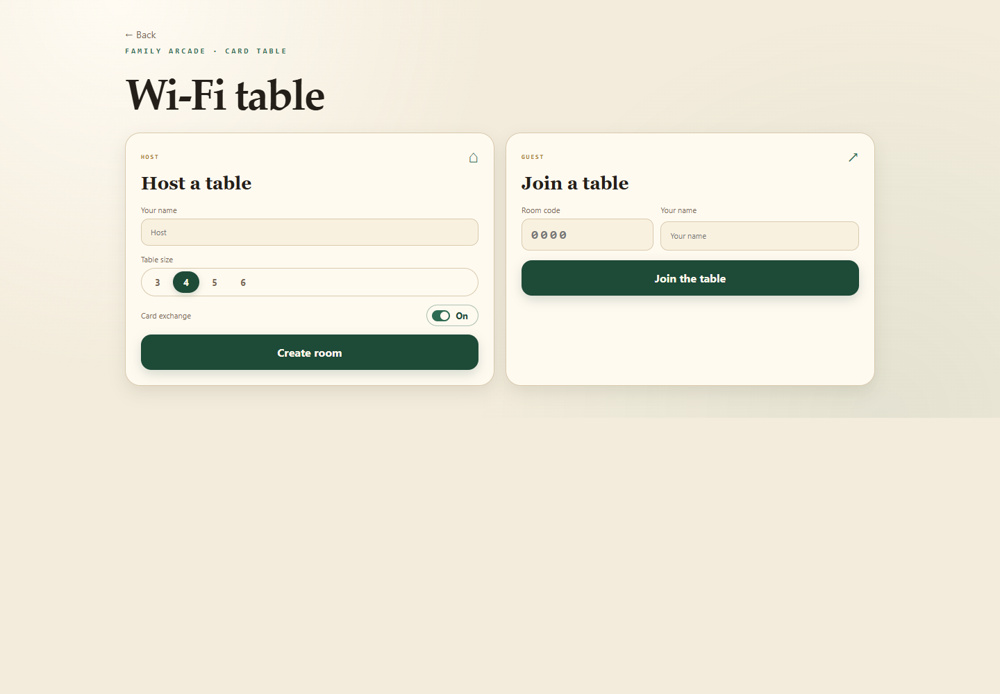
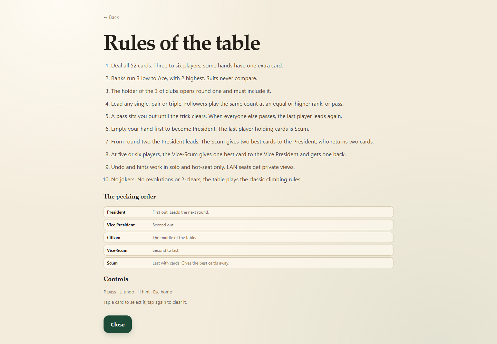
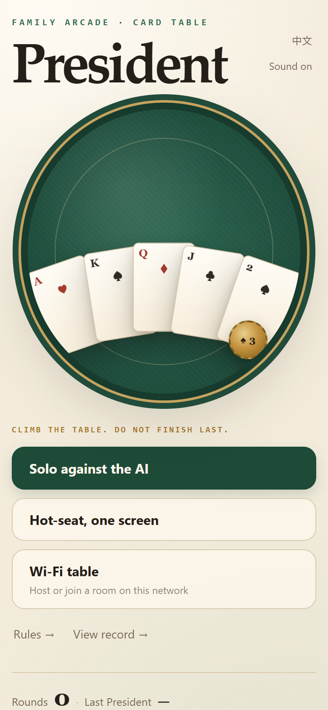
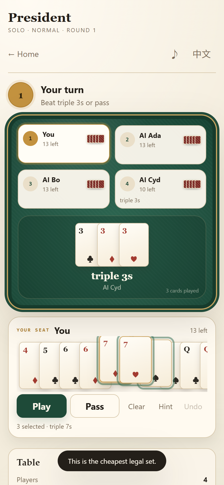

# President

**English** · [简体中文](README.zh-CN.md)

> **Climb the table. Do not finish last.**

A 3–6 player climbing card game for the family table: one 52-card deck, four AI
levels, one-screen hot-seat, private LAN seats, a two-card exchange between rounds,
and a local family record. No account, no ads, no cloud; LAN play stays on your own
network.



## A turn, in five seconds

| Lead or follow | Beat the table | Finish first |
| --- | --- | --- |
| Play a single, pair or triple of one rank. | Followers match the count and play an equal or higher rank — or pass. | First out is President; the last player holding cards is Scum. |

Round one starts with the holder of the 3 of clubs. A pass sits you out until the
trick clears. From round two the President leads and the Scum hands over two best
cards.

## What is inside

- **A real, tested engine.** Pure TypeScript, deterministic, **38 unit tests**, no
  DOM, network, clock or `Math.random` in the rules. See [`docs/rules.md`](docs/rules.md).
- **Four AI levels.** Companion plays gently and keeps low cards in front, Easy is
  loose, Normal saves the twos, Hard counts the table and samples the unseen cards
  before choosing a play or a pass.
- **Three ways to play.** Solo against 2–5 AI opponents, 3–6 people passing one
  screen, or a LAN room with private seats and AI filling empty chairs.
- **Private hands.** Hot-seat hides the next hand behind a pass-the-device screen.
  Every LAN guest receives a per-seat view with only their own hand and the public
  table; the host never broadcasts the other hands.
- **Rounds that carry over.** First out becomes President, last is Scum. The next
  round deals a fresh deck, the Scum gives two best cards to the President (and gets
  two back), and at five or six players the Vice-Scum and Vice President swap one.
  The exchange can be switched off.
- **A full family record.** Rounds, President and Scum tallies, mode split, last
  President and the eight newest rounds. LAN rounds are recorded on the host device.
- **Small comforts.** Undo and a hint that explains *why* in solo/hot-seat, autosave
  and resume, sound on/off, keyboard shortcuts, reduced-motion support, complete
  Chinese/English UI, and a mobile layout designed as a first-class way to play.
- **Private by default.** No accounts, no telemetry, no ads, no remote fonts.

## Screenshots

| A real round | AI setup |
| --- | --- |
|  |  |

| Hint with a reason | The table is set |
| --- | --- |
|  |  |

| Family record | LAN lobby |
| --- | --- |
|  |  |

| Rules |
| --- |
|  |

| Phone home | Phone table |
| --- | --- |
|  |  |

All screenshots come from the running app at 1440×1000 (phone 780×1688, 390×844 @2×).

## Play locally

```bash
npm install
npm run dev        # http://localhost:5215
npm run check      # tsc + 38 tests + production build
npm run e2e        # real Chrome, dev server required
npm run lan:e2e    # starts its own relay after npm run build
npm run shots      # regenerate all ten EN/ZH screenshots
```

## LAN night

Browser/dev:

```bash
npm run build
npm run lan        # relay on :8080, serves dist/
# open http://localhost:5215, choose Wi-Fi table, Create room
# guest: scan the QR, or open the invite URL and type the four-digit code
```

Desktop: the Tauri build starts the same relay internally and serves the built app
to phones. The host chooses a table of 3–6 and shows a four-digit code and QR
invite. Empty seats are filled by the AI, so one guest is enough to start. A guest
who arrives after the deal can take over an AI seat. Each guest opens the address on
the same Wi-Fi and works from their own private view.

The relay is a dumb message bus. The host keeps the authoritative state and sends
only the guest's own view. Every intent carries the current action count; stale
intents, spoofed seats and wrong turns are ignored. A dropped guest seat is passed
or led low by the host after a short wait, so the table never freezes. The guest's
result screen is read-only and waits for the host to deal the next round.

## Build the Windows installer

```bash
npm install
npx tauri build --bundles nsis
# src-tauri/target/release/bundle/nsis/President_0.1.0_x64-setup.exe
```

The installer is per-game and lightweight; WebView2 uses the standard bootstrapper.
A Windows SmartScreen warning is expected for an unsigned family build.

## Known limitations

- 3–6 players only. No two-player duel and no seven-player table.
- No jokers, revolutions, 2-clears or four-card plays. The table uses singles,
  pairs and triples with equal-or-higher climbing.
- A pass locks you out until the trick clears. Some families allow re-entry; this
  app follows the lock-out version.
- The exchange is automatic. The Scum's two best cards are fixed, and the President
  returns the two lowest cards; there is no manual card choice.
- No overall point total. Each round is ranked and written to the local record.
- LAN is IPv4 on the same subnet; phone guests need the host firewall to allow the
  app. Undo and hints are disabled in LAN play.
- Stats are local to each device. A LAN round is recorded on the host, not duplicated
  on the guest.
- A browser-hosted QR may use `localhost`; use the desktop build or open the host
  machine's LAN IP for a phone on the Wi-Fi.
- Hard is a strong heuristic/rollout opponent, not a solved game.
- The 45-second promo is rendered centrally from [`video.json`](video.json); no
  Remotion project or media asset is stored in this app.

See [`docs/limitations.md`](docs/limitations.md).

## Credits

Original code, art and copy for Family Arcade. MIT. See [`NOTICE.md`](NOTICE.md).
