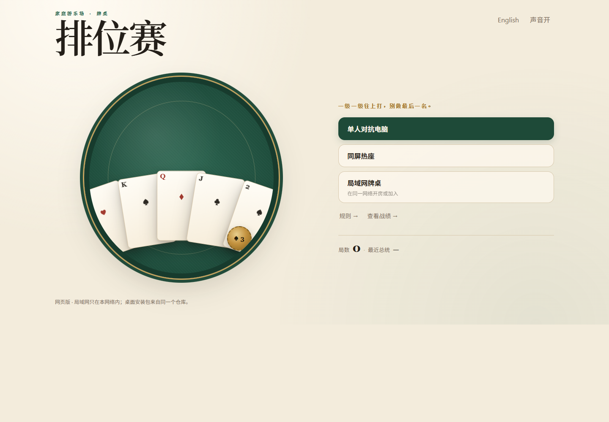
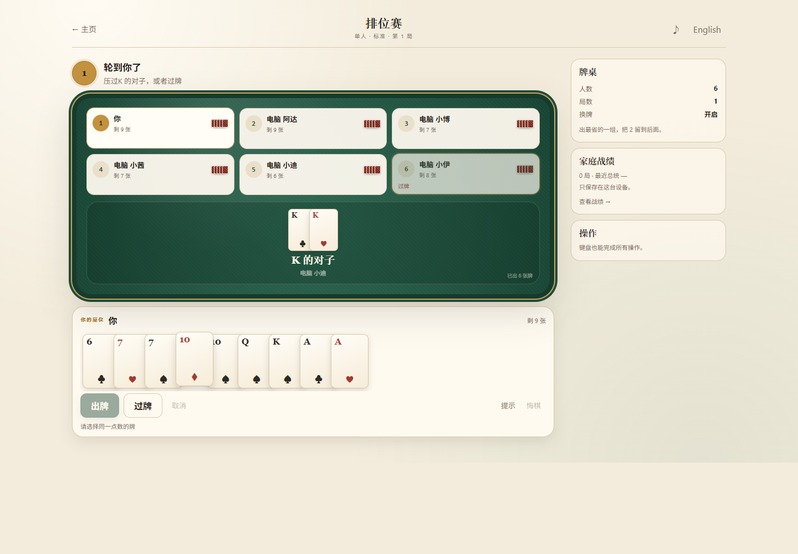
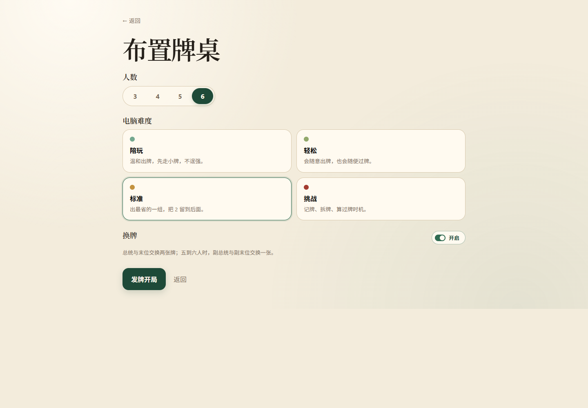
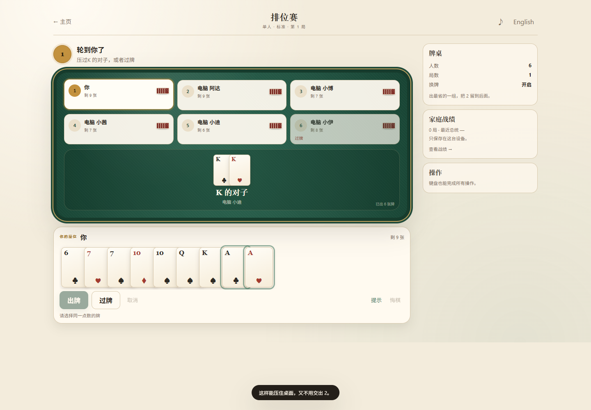
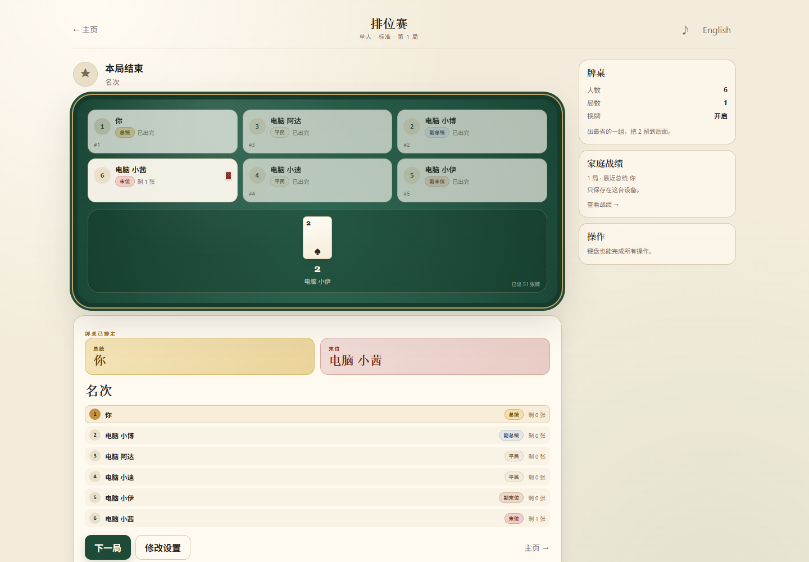
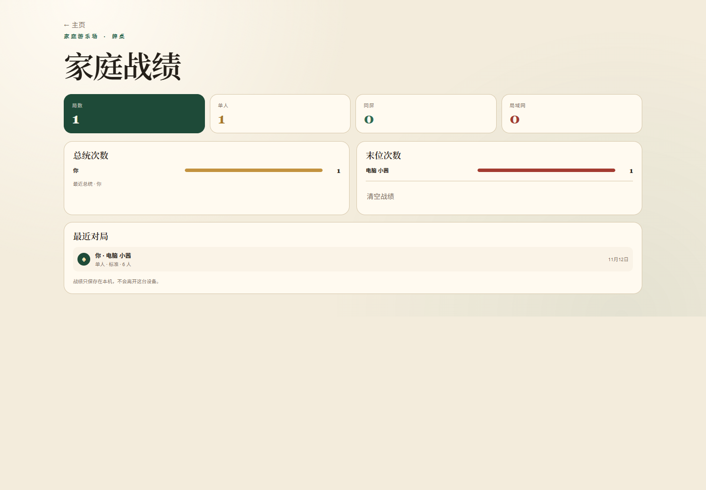
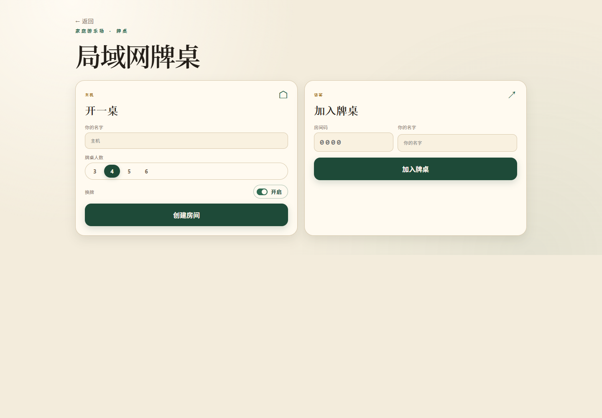
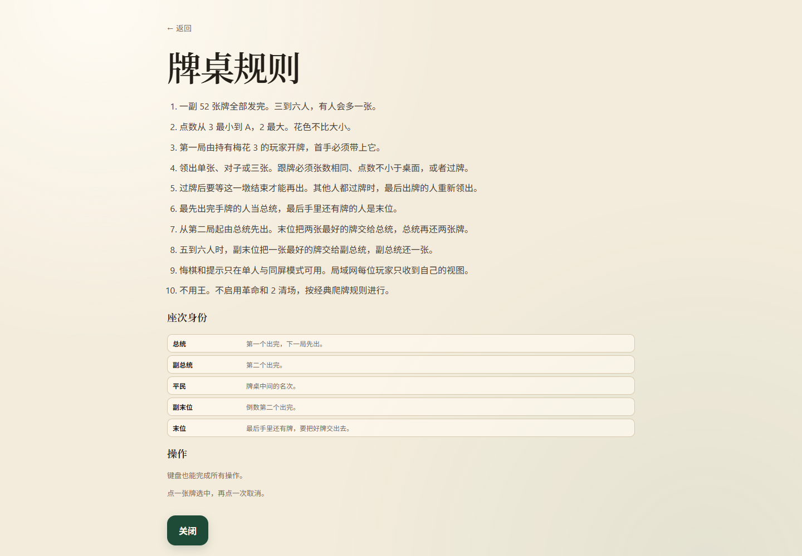
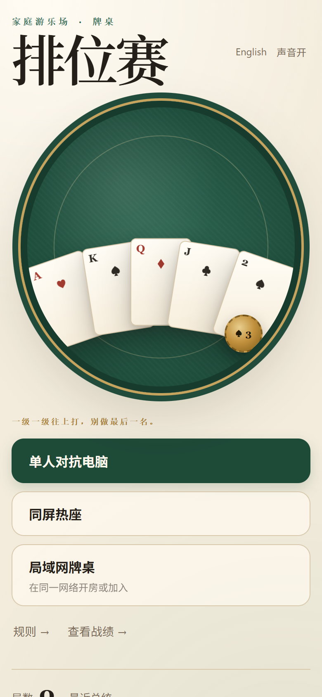
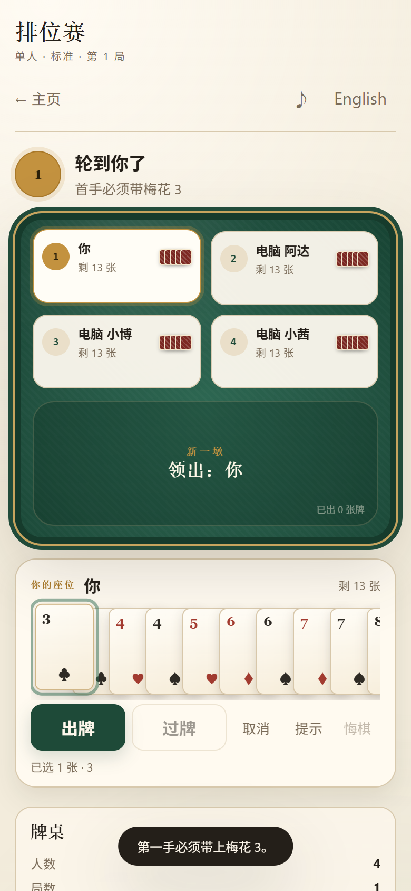

# 排位赛

[English](README.md) · **简体中文**

> **一级一级往上打，别做最后一名。**

给家庭牌桌的 3–6 人爬牌游戏：一副 52 张牌、四档电脑对手、同屏热座、局域网私密座位、
两局之间的换牌，以及保存在本机的家庭战绩。无账号、无广告、无云端；局域网只在自己家里
的网络内。



## 一回合，五秒看懂

| 领出或跟牌 | 压住桌面 | 先出完 |
| --- | --- | --- |
| 出同一点数的单张、对子或三张。 | 跟牌张数要相同，点数不小于桌面，或者过牌。 | 最先出完的人当总统，最后手里还有牌的人是末位。 |

第一局由持有梅花 3 的玩家开牌。过牌后要等这一墩结束才能再出。从第二局起总统先出，
末位把两张最好的牌交给总统，总统再还两张。

## 里面有什么

- **真正的引擎。** 纯 TypeScript、确定性、**38 个单元测试**；规则层不碰页面、网络、
  时钟或随机数。见 [`docs/rules.md`](docs/rules.md)。
- **四档电脑对手。** 陪玩温和、先走小牌；轻松会随意出牌；标准会省着用 2；挑战会记牌、
  拆牌，并在出牌与过牌之间做取舍。
- **三种玩法。** 单人对 2–5 个电脑、3–6 人同屏轮流传设备，或开一个局域网房间，空位由
  电脑补上。
- **手牌保密。** 同屏模式在换人时用“传递设备”挡住下一手牌；局域网每位访客只收到自己的
  手牌和公开牌桌，主机不会把别人的手牌发出去。
- **一局接一局。** 第一个出完当总统，最后一名是末位。下一局重新发牌，末位把两张最好的
  牌交给总统并拿回两张；五到六人时，副末位与副总统再交换一张。换牌可以关闭。
- **完整的家庭战绩。** 局数、总统与末位次数、各模式分布、最近总统和最近八局。局域网
  对局记在主机设备上。
- **小细节。** 单人与同屏模式有悔棋和会解释原因的提示；自动保存/继续；声音开关；
  键盘快捷键；减少动效；完整中英双语；按手机优先设计，而不是缩小的桌面版。
- **默认私密。** 无账号、无遥测、无广告、无远程字体。

## 截图

| 真实对局 | 电脑设置 |
| --- | --- |
|  |  |

| 带原因的提示 | 牌桌已排定 |
| --- | --- |
|  |  |

| 家庭战绩 | 局域网大厅 |
| --- | --- |
|  |  |

| 规则 |
| --- |
|  |

| 手机主页 | 手机牌桌 |
| --- | --- |
|  |  |

全部来自真实运行的应用：1440×1000，手机 780×1688（390×844 @2×）。

## 本地运行

```bash
npm install
npm run dev        # http://localhost:5215
npm run check      # tsc + 38 个测试 + 生产构建
npm run e2e        # 真实 Chrome，需先运行开发服务器
npm run lan:e2e    # 构建后自动启动中继并跑完整局域网流程
npm run shots      # 重新生成十张中英截图
```

## 局域网

浏览器/开发版：

```bash
npm run build
npm run lan        # :8080 中继，同时托管 dist/
# 打开 http://localhost:5215，选“局域网牌桌”→“创建房间”
# 访客：扫码，或打开邀请链接并输入四位房间码
```

桌面版：安装包启动同一个内置中继，并把构建产物托管给手机。主机选择 3–6 人的牌桌，
显示四位房间码和二维码邀请。空位由电脑入座，所以有一位访客就能开局；开局后加入的
访客可以接手一个电脑座位。访客在同一网络打开地址，各自使用自己的私密视图。

中继只负责转发消息；主机保存权威状态，只发送访客自己的视图。每个操作都带着当前动作
计数，过期操作、伪造座位和错误回合都会被忽略。访客掉线后，主机会在短暂等待后替他过牌
或用最小单张领出，牌桌不会卡住。访客的终局界面是只读的，等主机发下一局。

## 构建 Windows 安装包

```bash
npm install
npx tauri build --bundles nsis
# src-tauri/target/release/bundle/nsis/President_0.1.0_x64-setup.exe
```

每款游戏单独打包，安装包保持轻量；WebView2 使用标准引导程序。未签名的家庭构建会触发
Windows SmartScreen 提示。

## 已知限制

- 只支持 3–6 人。没有两人对决，也没有七人桌。
- 不用王，不启用革命、2 清场或四张同点。牌桌只使用单张、对子和三张，按同点或不小于
  桌面的规则往上压。
- 过牌后要等这一墩结束才能再出。部分地区允许重新加入，本应用采用锁定版本。
- 换牌是全自动的：末位交出两张最好的牌，总统还回两张最小的牌，不能手动挑牌。
- 没有总结分。每一局单独排名并写入本机战绩。
- 局域网仅支持同一子网的 IPv4；手机访客需要主机防火墙放行。局域网对局暂停悔棋和提示。
- 战绩按设备保存。局域网对局记在主机，不会在访客设备重复记录。
- 浏览器开房生成的二维码可能带本机地址；手机加入请用桌面版，或在同一网络打开主机的
  局域网地址。
- 挑战档是强启发式加抽样推演，不是已解算的完美对手。
- 45 秒宣传片由根目录工作室按 [`video.json`](video.json) 统一渲染；本应用不另存
  Remotion 工程或媒体文件。

见 [`docs/limitations.md`](docs/limitations.md)。

## 许可

Family Arcade 原创代码、美术与文案，MIT。见 [`NOTICE.md`](NOTICE.md)。
