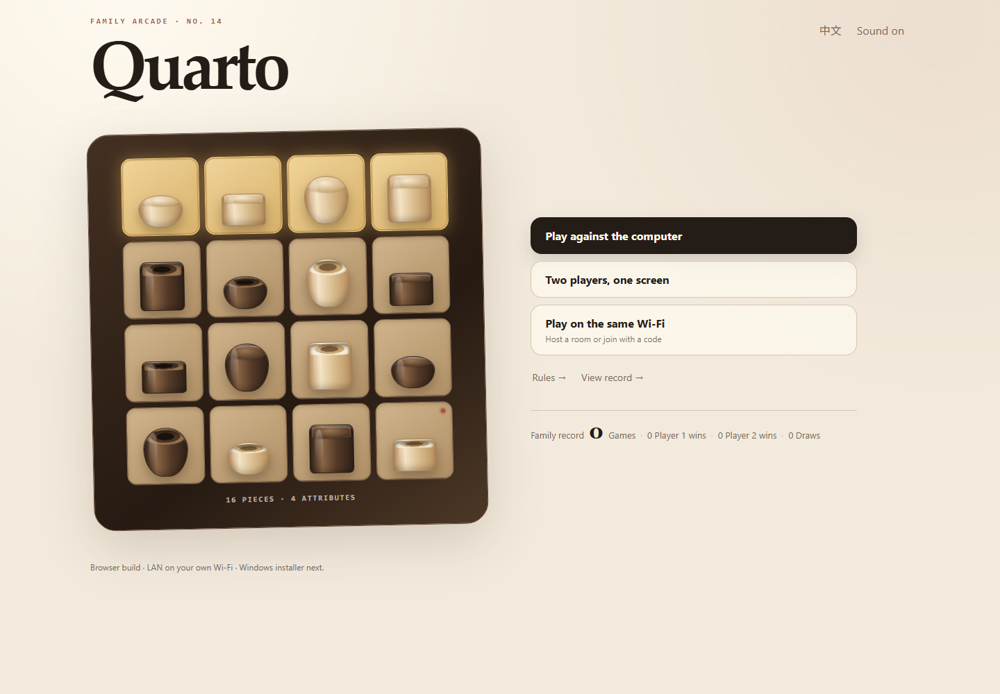
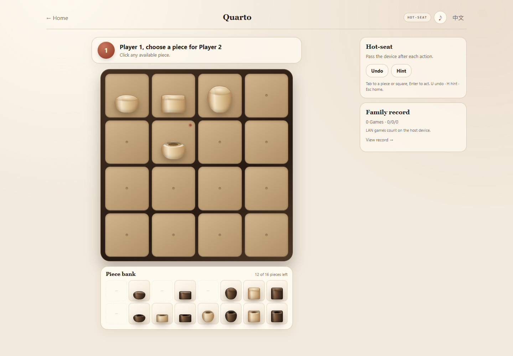
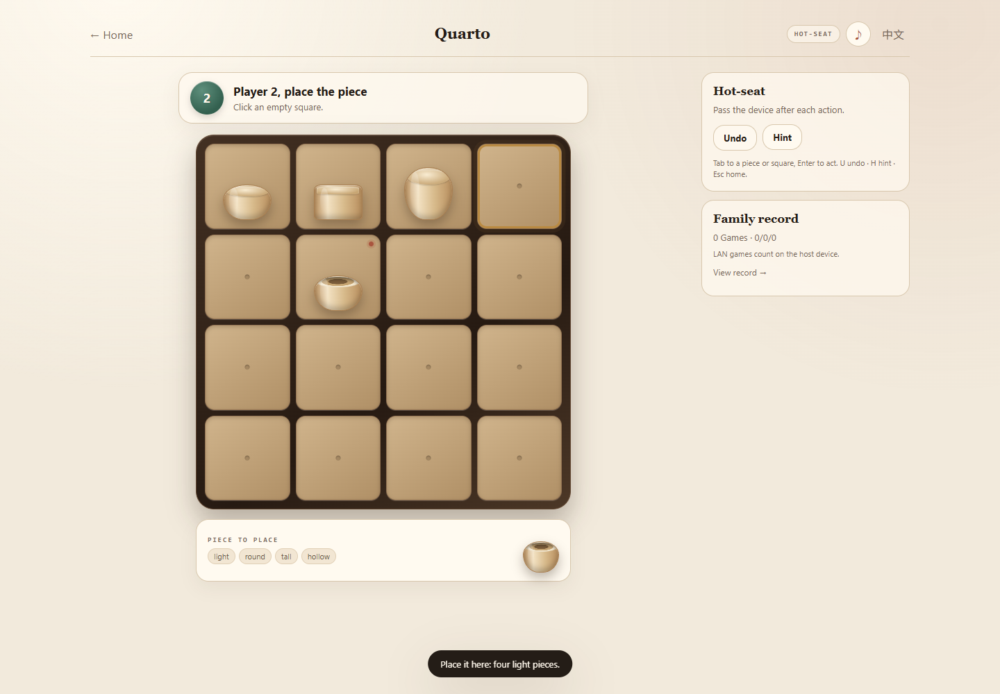
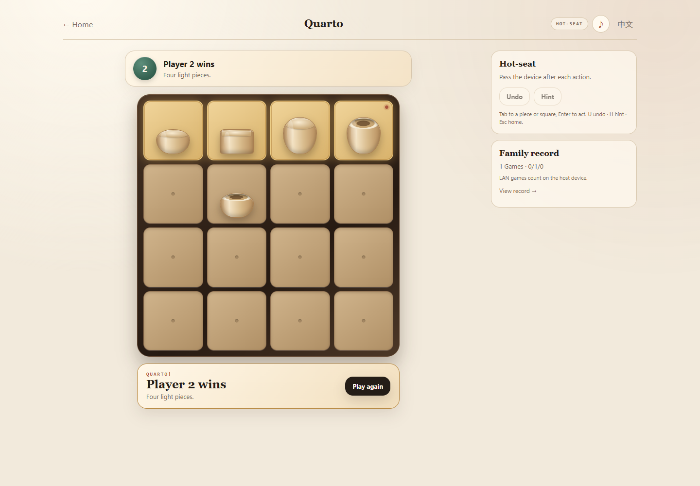
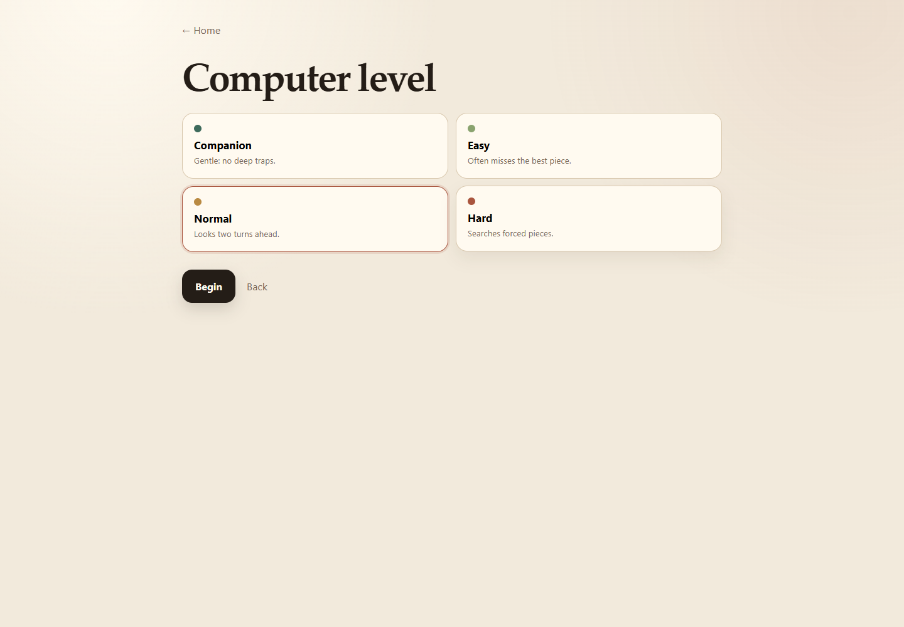
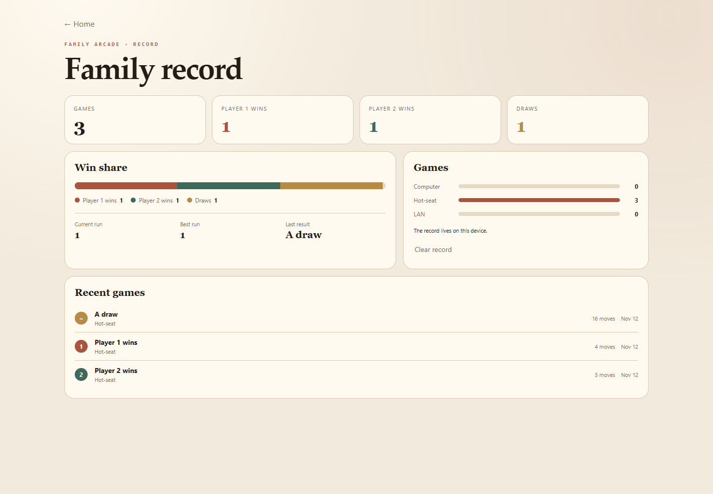
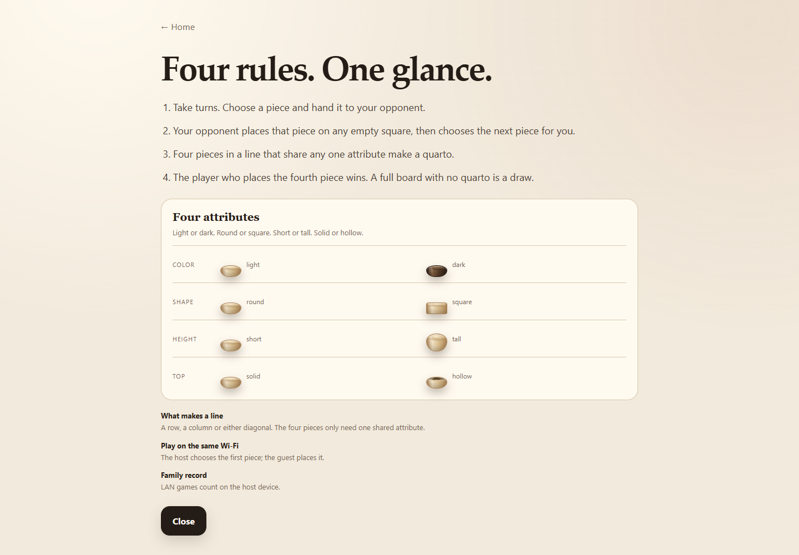
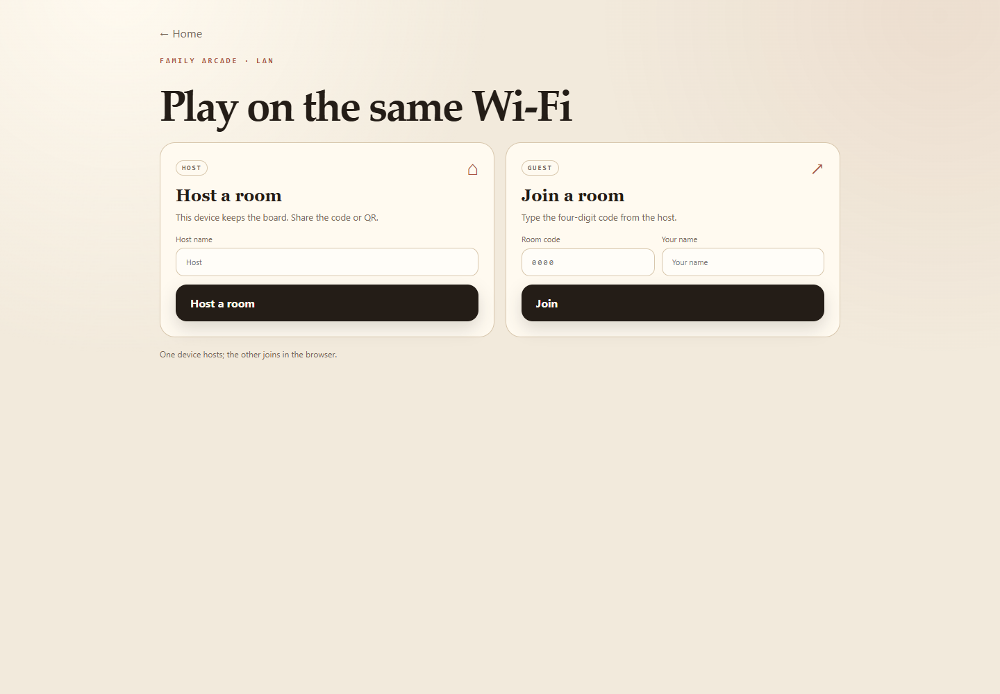
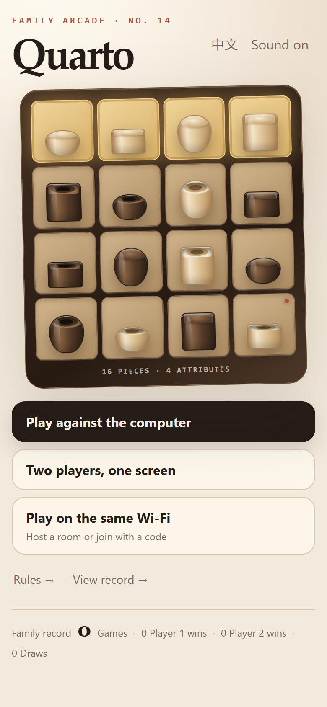
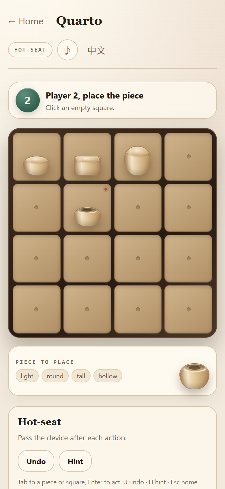

# Quarto

**English** · [简体中文](README.zh-CN.md)

> **Sixteen pieces. One rule.**

A complete two-player Quarto table for the family: **16 unique pieces**, four binary
attributes, a 4×4 board, four computer levels, one-screen hot-seat, and LAN play from a
phone. Choose a piece for your opponent; they place it and choose the next piece for you.
Four pieces in a line sharing any one attribute make a quarto. No accounts, ads,
telemetry or remote assets.



## A turn, in five seconds

| Choose | Place | Win |
| --- | --- | --- |
| Pick any remaining piece and hand it to your opponent. | They place it on an empty square, then choose the next piece for you. | Four pieces in a row, column or diagonal sharing one attribute win. A full board with no quarto is a draw. |

## What is inside

- **A real, tested engine.** Pure TypeScript, deterministic, **31 unit tests**, no DOM,
  network, clock or randomness in the rules. See [`docs/rules.md`](docs/rules.md).
- **Four computer levels.** Companion is gentle and tactical, Easy makes mistakes,
  Normal looks two turns ahead, Hard runs iterative deepening with a forced-piece filter.
- **Three ways to play.** Solo against the computer, two players passing one device, or
  a phone joining the host over Wi-Fi.
- **A LAN table that handles real life.** Host a room, share the four-digit code or QR,
  and join from a phone. The host owns the board and sends the public view to the guest.
  A guest can reload or rejoin mid-game; the host resends the current position. The guest
  result banner never starts a local game — only the host can begin the next round.
- **A proper family record.** Totals, Player 1/Player 2/draw shares, mode split, current
  and best runs, and the eight most recent games. LAN results are recorded on the host
  device only; the guest does not duplicate them.
- **Small comforts.** Undo (local and computer games), a hint that explains *why*,
  autosave and resume, sound on/off, a keyboard path, reduced-motion support, complete
  Chinese/English UI, and a mobile layout designed as a first-class way to play.
- **Private by default.** No accounts, no telemetry, no ads, no remote fonts.

## Screenshots

| A real game | A hint that explains why | Result |
| --- | --- | --- |
|  |  |  |

| Computer setup | Family record | Rules |
| --- | --- | --- |
|  |  |  |

| LAN night | Phone home | Phone game |
| --- | --- | --- |
|  |  |  |

All screenshots come from the running app at 1440×1000 (phone 390×844 @2×).

## Play locally

```bash
npm install
npm run dev        # http://localhost:5214
npm run check      # tsc + 31 tests + production build
npm run e2e        # real Chrome, dev server required
npm run lan:e2e    # after npm run build; starts its own relay on :18927
npm run shots      # regenerate home/setup/game/hint/result/rules/stats/LAN/mobile
```

## LAN night

Browser/dev:

```bash
npm run build
npm run lan        # relay on :8080, serves dist/
# open http://localhost:5214, LAN night, Create room
# guest: scan the QR, or open the invite and type the code
```

Desktop: the Tauri build starts the same relay internally and serves the built app to
phones. The host shows a four-digit room code and a QR invite. Guests open the address
on the same Wi-Fi; no app install is needed on their side. The same code also works as
the room ID in the browser join card.

The relay is a dumb message bus. The host keeps the authoritative state and sends only
the guest's own view. Room codes, reconnect tokens and phase/turn checks are enforced in
TypeScript; stale intents are ignored. The guest's result screen is read-only and waits
for the host to start the next game.

## Build the Windows installer

```bash
npm install
npx tauri build --bundles nsis
# src-tauri/target/release/bundle/nsis/Quarto_0.1.0_x64-setup.exe
```

The installer is per-game and lightweight; WebView2 uses the standard bootstrapper.
A Windows SmartScreen warning is expected for an unsigned family build.

## Known limitations

- Hard is strong but not a solved player; it can be beaten.
- LAN is IPv4 on the same subnet; guest phones need the host firewall to allow the app.
- Stats are local to each device. A LAN game is recorded on the host, not duplicated on
  the guest; clearing the record only affects this browser/device.
- A browser-hosted QR may use `localhost`; for a phone on the Wi-Fi use the desktop build
  or open the host machine's LAN IP.
- Autosave covers local and computer games. LAN games are authoritative on the host, and
  undo history is not persisted across a reload.
- No 4K/vertical promo cut; no double-quarto scoring or tournament clocks.

See [`docs/limitations.md`](docs/limitations.md).

## Credits

Original code, CSS art and copy for Family Arcade. MIT. See [`NOTICE.md`](NOTICE.md).
