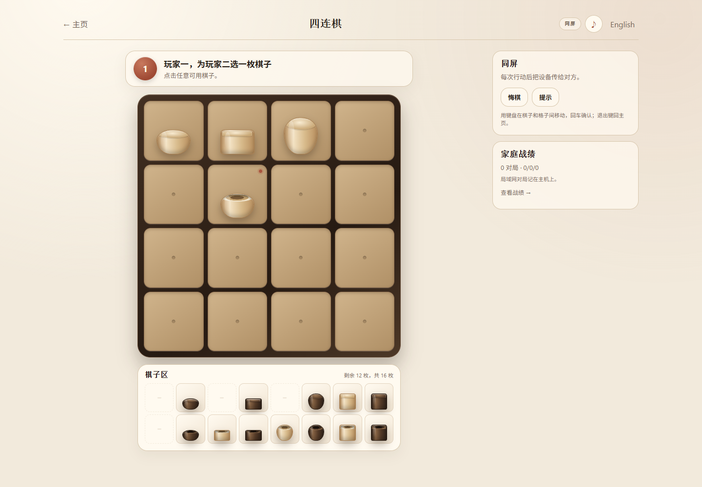
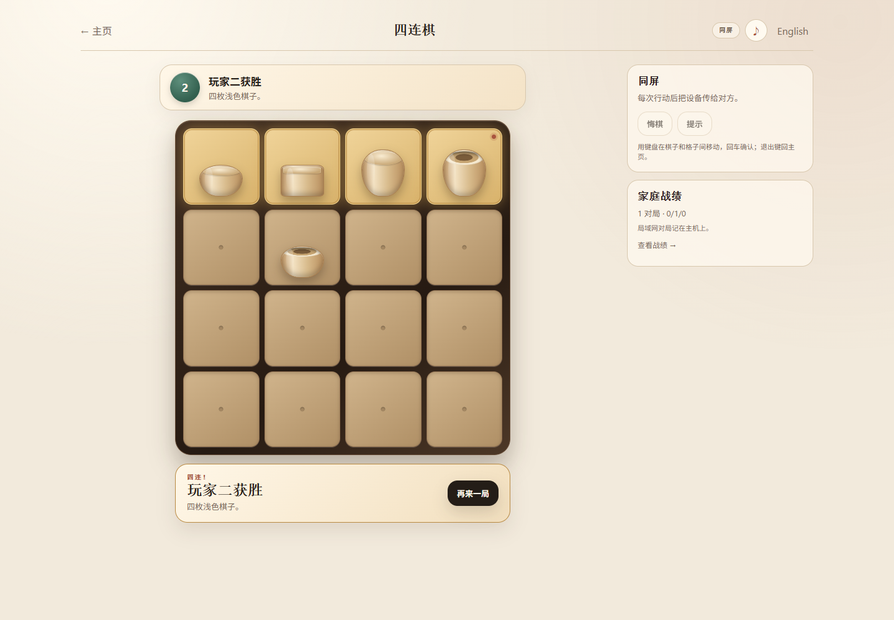
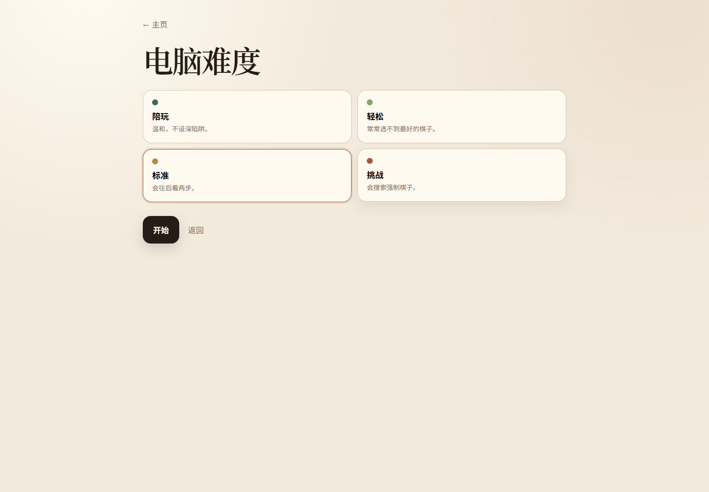
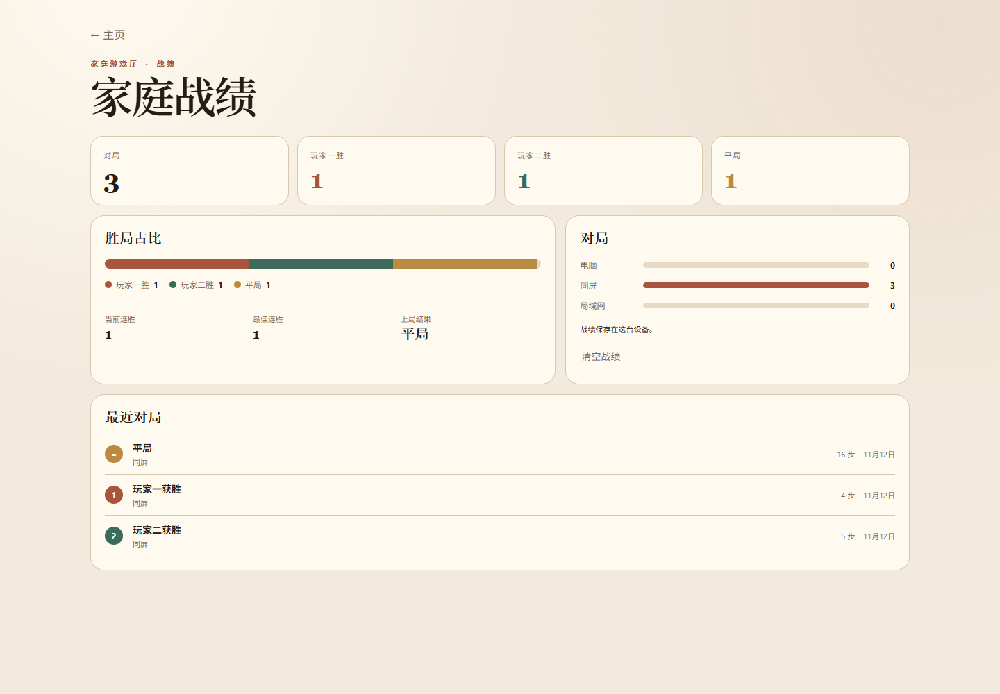
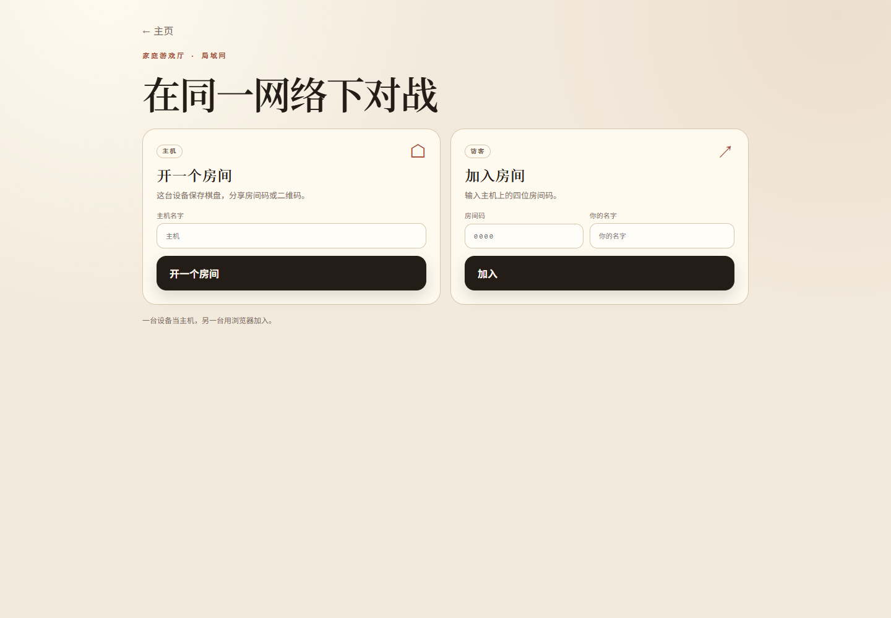
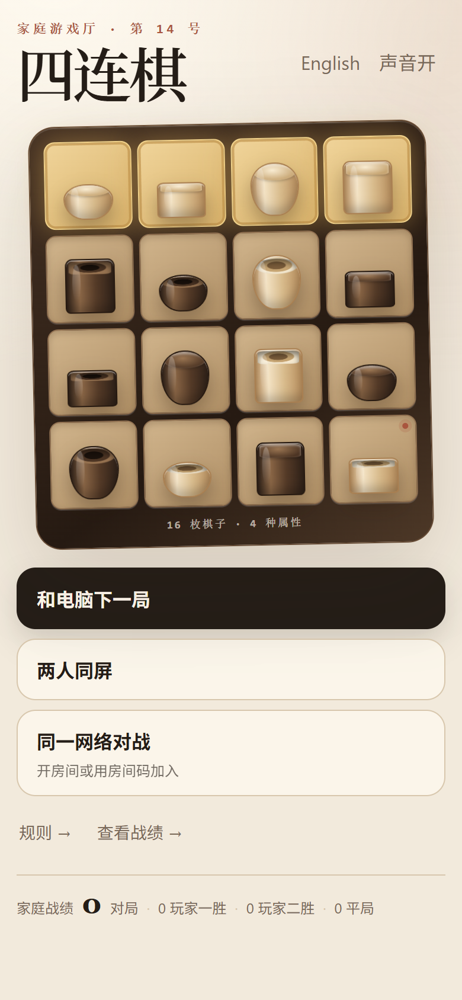
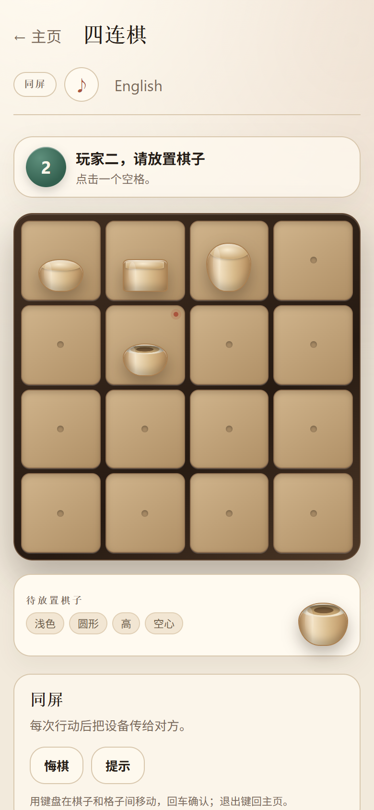

# 四连棋

[English](README.md) · **简体中文**

> **十六枚棋子，一条规则。**

一副完整的双人四连棋：**16 枚独一无二的棋子**、四种二元属性、4×4 棋盘、四档电脑
难度、两人同屏，以及手机通过局域网加入。你为对手选一枚棋子，对手把它放上棋盘，
再为你选下一枚。横、竖或斜线上四枚棋子只要共享一种属性，就是四连。无账号、无广告、
无遥测、无远程素材。


## 一回合，五秒看懂

| 选棋子 | 放棋子 | 获胜 |
| --- | --- | --- |
| 从剩余棋子里挑一枚，交给对手。 | 对手把它放在空格，再为你挑下一枚。 | 横、竖或斜线上四枚棋子共享一种属性即获胜。棋盘填满仍无四连则平局。 |

## 里面有什么

- **真正的规则引擎。** 纯 TypeScript、确定性、**31 个单元测试**；规则层不碰 DOM、
  网络、时钟或随机数。见 [`docs/rules.md`](docs/rules.md)。
- **四档电脑难度。** 陪玩温和且懂基本战术，轻松会犯错，标准会往后看两步，挑战使用
  迭代加深和强制棋子筛选。
- **三种玩法。** 单人对抗电脑、两人共用一台设备，或手机加入主机的局域网房间。
- **能应付真实牌桌的局域网。** 开房后展示四位房间码或二维码；访客可扫码、打开邀请
  链接，也可直接输入房间码。访客中途刷新或重连，主机会补发当前棋局；访客的终局横幅
  只读，下一局只能由主机开始。
- **完整的家庭战绩。** 总对局、玩家一/玩家二/平局占比、各模式分布、当前与最佳连续、
  最近八局。局域网结果只记在主机设备，访客不会重复写入。
- **小细节。** 悔棋（本地与电脑对局）、会解释原因的提示、自动保存/继续、声音开关、
  键盘操作、减少动效、完整中英双语，以及为手机重新排版的界面。
- **默认私密。** 无账号、无遥测、无广告、无远程字体。

## 截图

| 真实对局 | 会解释原因的提示 | 终局 |
| --- | --- | --- |
|  |  |  |

| 电脑难度 | 家庭战绩 | 规则 |
| --- | --- | --- |
|  |  |  |

| 局域网 | 手机主页 | 手机对局 |
| --- | --- | --- |
|  |  |  |

全部来自真实运行的应用：1440×1000，手机 390×844 @2×。

## 本地运行

```bash
npm install
npm run dev        # http://localhost:5214
npm run check      # tsc + 31 个测试 + 生产构建
npm run e2e        # 真实 Chrome，需先运行 dev
npm run lan:e2e    # 构建后自动在 :18927 启动中继并跑完整局域网流程
npm run shots      # 重新生成主页/设置/对局/提示/终局/规则/战绩/局域网/手机截图
```

## 局域网

浏览器/开发版：

```bash
npm run build
npm run lan        # :8080 中继，同时托管 dist/
# 打开 http://localhost:5214，选“同一网络对战”→“开一个房间”
# 访客：扫码，或打开邀请链接并输入房间码
```

桌面版会启动同一个中继，并把构建好的页面提供给手机。主机展示四位房间码和二维码，
访客在同一网络下打开地址即可，无需安装。房间码同时也是加入卡片里的房间号。

中继只负责转发消息。主机保存权威棋局，只把公开视图发给访客。房间码、重连令牌、
阶段与回合检查都在 TypeScript 里执行；过期意图会被忽略。访客的终局界面是只读的，
等待主机开始下一局。

## 构建桌面安装包

```bash
npm install
npx tauri build --bundles nsis
# src-tauri/target/release/bundle/nsis/Quarto_0.1.0_x64-setup.exe
```

安装包按游戏单独生成，体量轻；系统浏览器组件使用标准引导程序。未签名的家庭版出现
系统安全提示是正常的。

## 已知限制

- 挑战难度很强，但不是已解算的完美棋手，仍然可以赢。
- 局域网限于同一网段的 IPv4；访客手机需要主机防火墙放行。
- 战绩保存在各自的设备上。局域网对局记在主机，不会在访客设备重复记录；清空战绩只
  影响当前设备。
- 浏览器里生成的二维码可能指向 `localhost`；手机加入时请用桌面版，或打开主机的
  局域网地址。
- 自动保存覆盖本地与电脑对局。局域网以主机为准；刷新后不会保留此前的悔棋历史。
- 没有 4K/竖屏宣传片；没有双四连计分或比赛计时。

更多说明见 [`docs/limitations.md`](docs/limitations.md)。

## 致谢

Family Arcade 的原创代码、CSS 棋子和文案。MIT 许可证。见 [`NOTICE.md`](NOTICE.md)。
