# Race Home · 飞行棋

**English** · [简体中文](README.zh-CN.md)

> **A four-colour race around the house**

Race Home is an original, offline-first Ludo-like race for **2–4 players**. Four
pawns, one die, a 52-square ring and a little house in the middle. Play solo against
four levels of AI, pass one device around the table, or let phones join over your own
Wi-Fi. No account, no ads, no remote fonts, no network unless you choose LAN night.

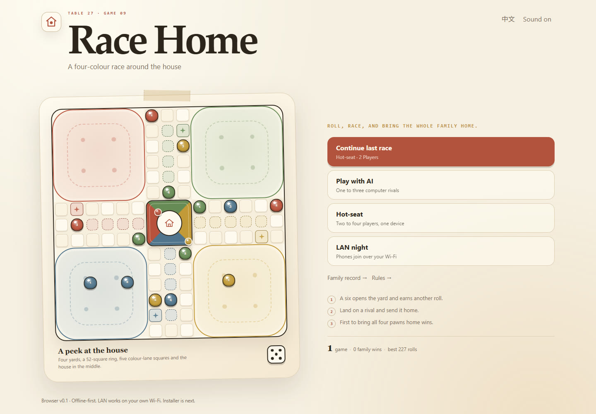

[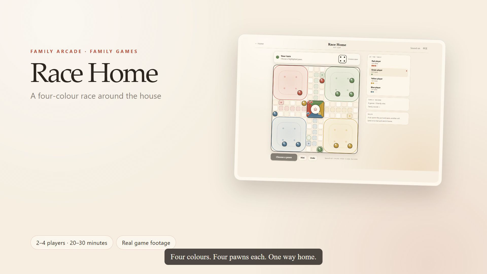](docs/promo/race-home-promo-en.mp4)

*45 seconds · 1920×1080 · 60 fps · [中文版](docs/promo/race-home-promo-zh.mp4) · [video.json](video.json)*

## A whole race, in five seconds

| Roll | Race | Capture | Arrive |
| --- | --- | --- | --- |
| Red rolls first. A **6** opens the yard and earns another roll. | Move clockwise around the 52-square ring. Own pawns may share a square. | Land exactly on a rival to send it back to its yard. Colour lanes are safe. | Turn into your lane, then land exactly on the house. First to bring all four pawns home wins. |

## What is inside

- **A real, tested rules engine.** Pure TypeScript in `src/game/`, deterministic,
  with an injected die. **28 unit tests** cover movement, captures, exact home rolls,
  views, serialization, AI choices and a complete seeded race.
- **Four AI levels.** Companion plays gently and avoids sending children home. Easy
  is loose and makes mistakes. Normal is greedy about captures and progress. Hard is
  a one-ply planner that weighs the risk of being captured on the reply.
- **Three ways to play.** Solo with one to three AI rivals, hot-seat for 2–4 people,
  or LAN host/guest with the shared `@family-arcade/lan` relay.
- **Table comforts.** Undo in local games, a reasoned hint, autosave/resume, local
  family record, sound toggle, reduced-motion support, keyboard play, and a complete
  Chinese/English interface.
- **A real board.** A 15×15 Ludo grid drawn in CSS: four yards, 52 ring cells, four
  five-square colour lanes and a central house. Every pawn is a real button; legal
  moves glow and destination squares are marked.
- **Private by default.** No accounts, telemetry, ads or remote assets. The only
  network call is the optional LAN WebSocket to your own relay.

## Screenshots

All screenshots come from the running app at **1440×1000**, phone at **390×844 @2×**.

| Home | Mid-race |
| --- | --- |
|  | 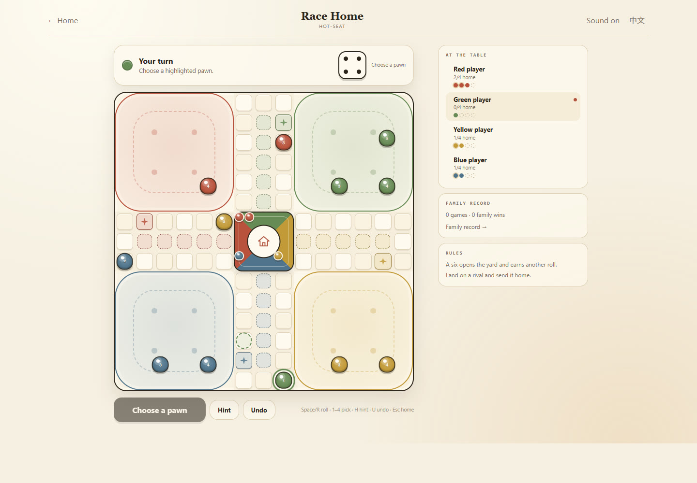 |

| Setup | A reasoned hint |
| --- | --- |
| 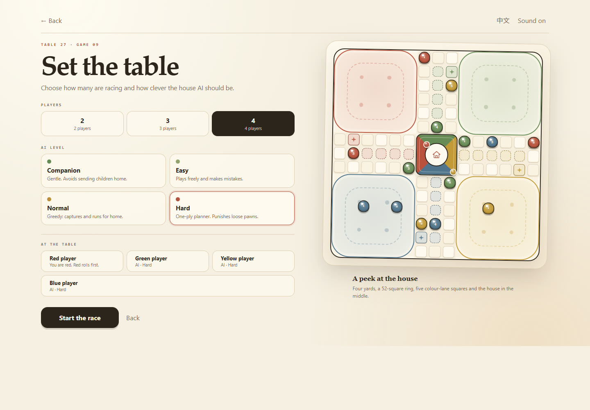 | 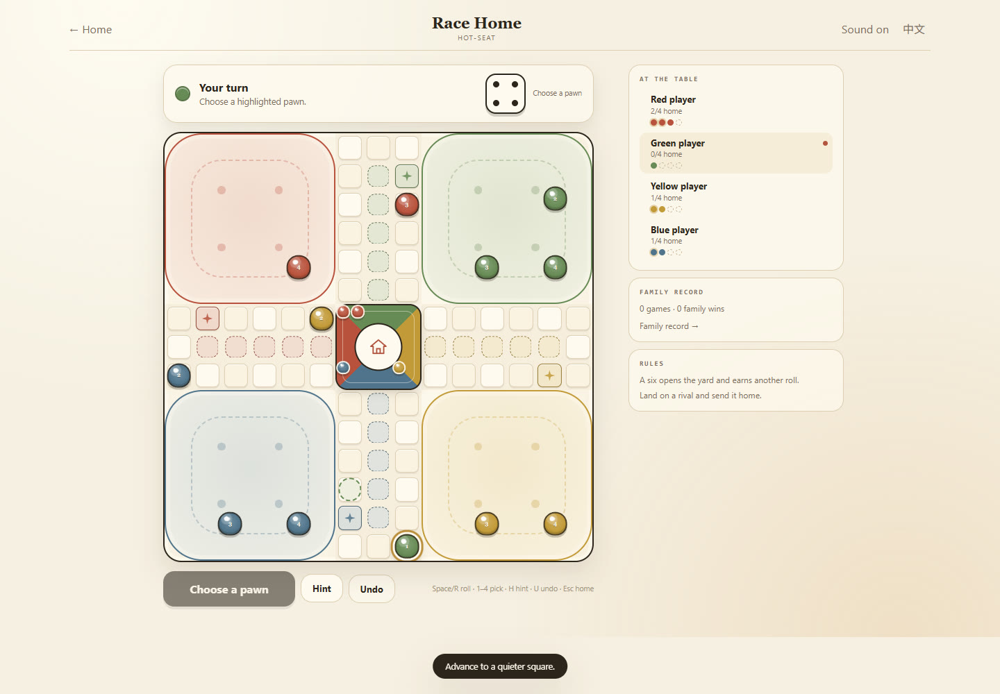 |

| Result | Family record |
| --- | --- |
| 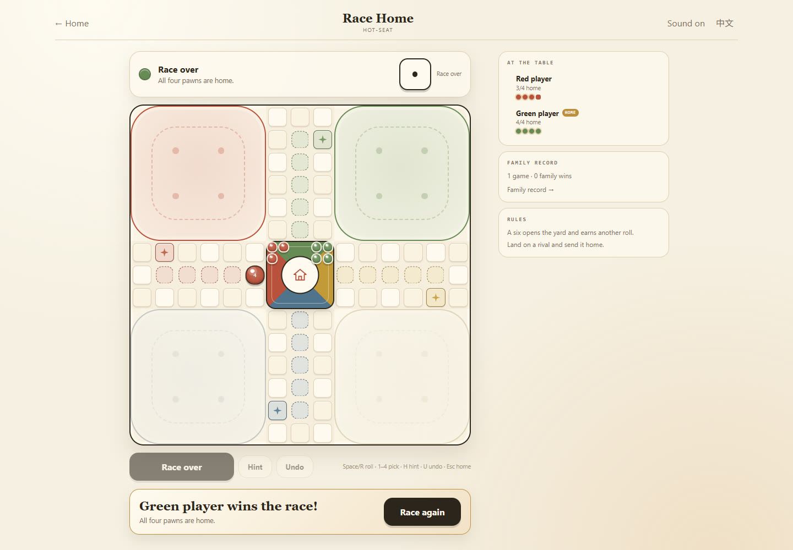 | 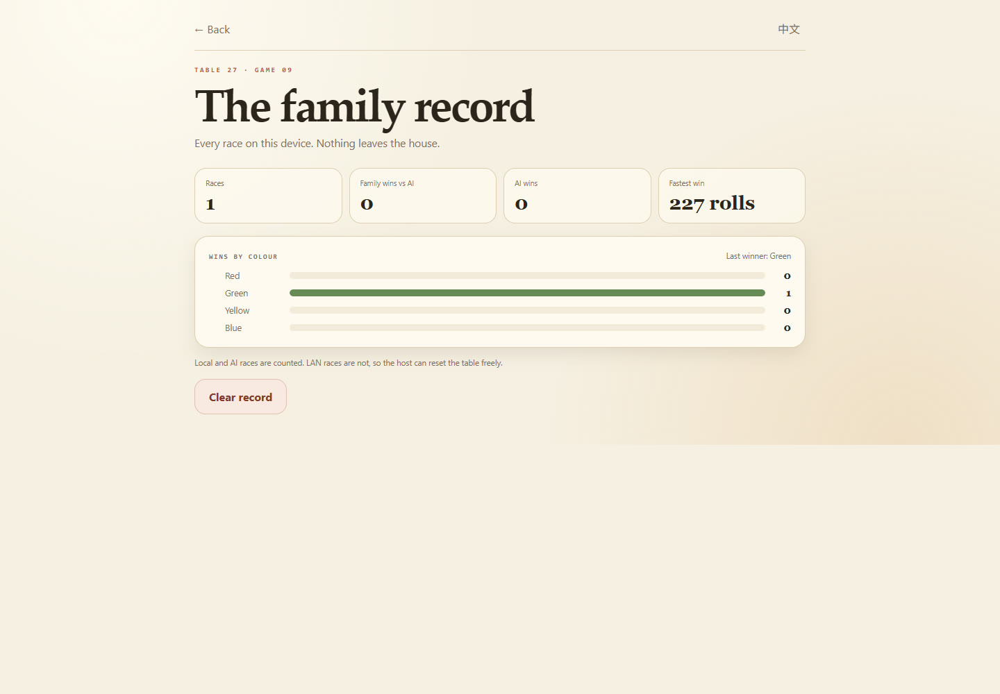 |

| Rules | LAN setup |
| --- | --- |
| 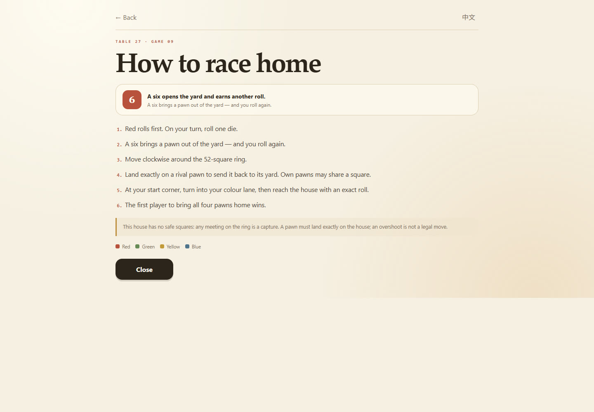 | 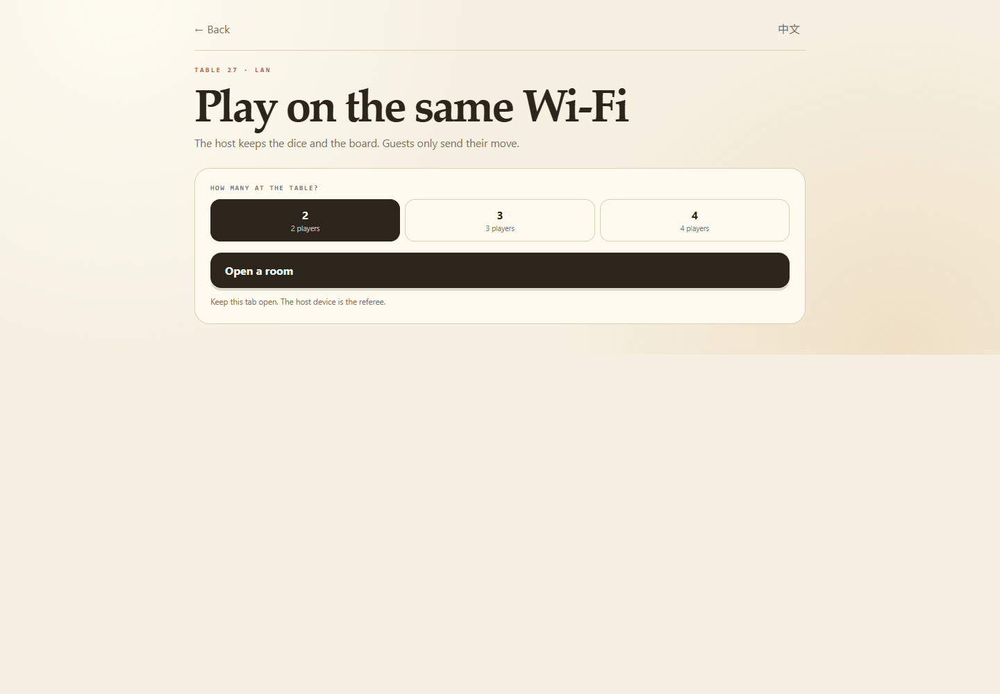 |

| Phone home | Phone race |
| --- | --- |
| 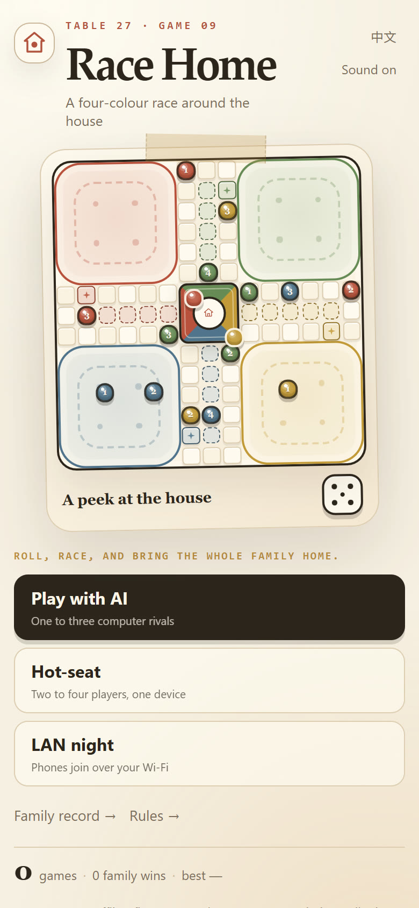 | 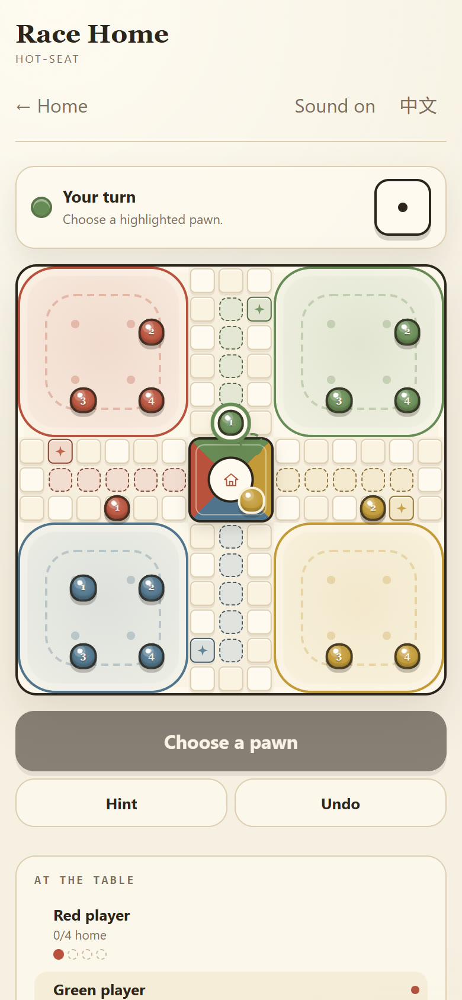 |

## Play locally

```bash
npm install
npm run dev        # http://localhost:5188
npm run check      # tsc + 28 tests + production build
npm run e2e        # real Chrome; requires the dev server
npm run lan-e2e    # LAN smoke test; requires dev + relay + dist
npm run shots      # regenerate docs/screenshots/{en,zh}
```

Keyboard: **Space/R** rolls, **1–4** picks a pawn, **H** shows a hint, **U** undoes
a local move, **Esc** returns home.

## LAN night

The relay is a dumb message bus. The host keeps the authoritative board and die;
guests receive their own view and send only `{type:'roll'}` or
`{type:'pawn', pawn}`. The host re-checks the seat, phase and legal move. The room
code, reconnect token and range checks come from the shared `@family-arcade/lan` package.

Browser, for the best phone experience:

```bash
npm run build
npm run lan        # serves dist and the relay on :8080
```

On the **host device**, open `http://<your-LAN-IP>:8080` (not `localhost` if a phone
will join), choose **LAN night → Open a room**, then scan the QR code or share the
4-digit room code. Guests need no install, just the same Wi-Fi.

For a same-machine development test, open `http://localhost:5188`, host a room, and
open the shown `http://localhost:8080/?lan=…` invite in another tab. The desktop
Tauri build starts the same relay internally.

If a guest disconnects mid-game, the host sees **Skip offline player** when that seat
comes around, so the table never freezes.

## Build the Windows installer

```bash
npm install
npx tauri build --bundles nsis
# src-tauri/target/release/bundle/nsis/Race Home_0.1.0_x64-setup.exe
```

The Tauri shell and LAN relay wiring are kept from the shared reference. The app
does not run `cargo build` here; the main Family Arcade build handles installers centrally.
The build is unsigned, so Windows SmartScreen may warn.

## Known limitations

- No safe squares in this house: any meeting on the ring is a capture. An exact roll
  is required to enter the central house.
- LAN is single-host, IPv4, same subnet. Use the host's LAN IP when opening the relay
  build so the QR invite is reachable from a phone.
- Autosave covers solo and hot-seat games; LAN state lives only on the host.
- LAN games are not counted in the local family record.
- Hard is a one-ply heuristic, not a perfect solver.
- The Tauri installer was not built here; only the shell and type-check were kept.
- There is no cloud save, matchmaking, spectator mode or in-game chat.
- `?seed=` is a documented test/demo hook used by the Playwright suite and screenshot
  generator. It only makes the die repeatable; normal play uses `Math.random`.

See [`docs/limitations.md`](docs/limitations.md) for the honest full list.

## Credits

Original code, board art, copy and synthesized sound for Family Arcade. The Ludo-like
public-domain race mechanic is traditional; this implementation and its name, UI and
art are original. MIT — see [`NOTICE.md`](NOTICE.md) and [`LICENSE`](LICENSE).

## Promo

[](docs/promo/race-home-promo-en.mp4)

- [English cut](docs/promo/race-home-promo-en.mp4) · [other language](docs/promo/race-home-promo-zh.mp4)
- [SRT](docs/promo/race-home-promo-en.srt) · [video.json](video.json)
- Real app screenshots and real engine data; claims match the tests.

