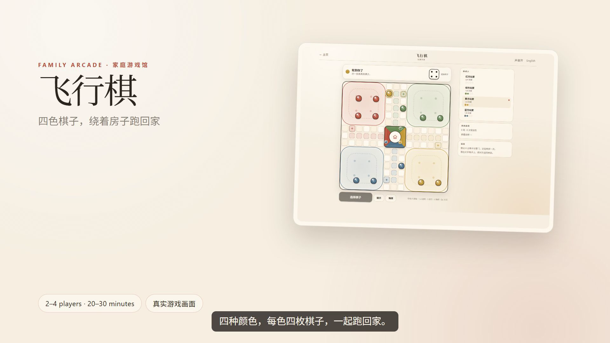
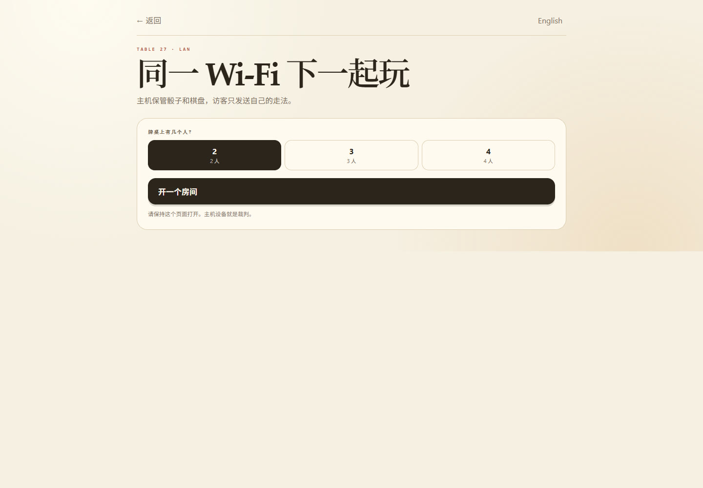
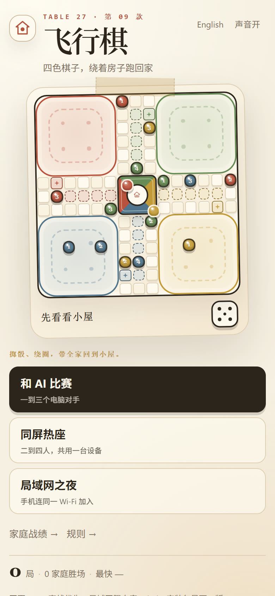
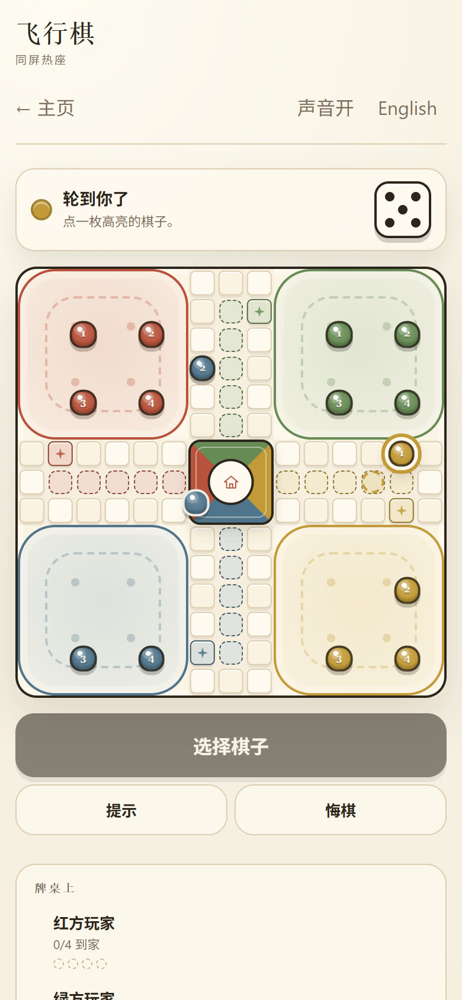

# 飞行棋 · Race Home

[English](README.md) · **简体中文**

> **四色棋子，绕着房子跑回家**

《飞行棋》是一款原创、离线优先的 Ludo 式家庭竞速游戏，支持 **2–4 人**。四枚棋子、
一枚骰子、52 格公共跑道，中间是一栋小屋。可以单人挑战四档 AI，可以把一台设备传
着玩，也可以让手机连上自家 Wi-Fi 加入。无账号、无广告、无远程字体；不选局域网时
完全不需要联网。


[](docs/promo/race-home-promo-zh.mp4)

*45 秒 · 1920×1080 · 60fps · [English cut](docs/promo/race-home-promo-en.mp4) · [video.json](video.json)*

## 五秒看懂一局

| 掷骰 | 绕圈 | 吃子 | 到家 |
| --- | --- | --- | --- |
| 红方先掷。掷出 **6** 让棋子出家门，还能再掷一次。 | 沿 52 格公共跑道顺时针前进。自己的棋子可以叠在一起。 | 正好落在对手棋子上，就把它送回老家。颜色跑道内不会被吃。 | 拐进自己的颜色跑道，再以正好的点数进入小屋。四枚棋子先全部到家的人获胜。 |

## 里面有什么

- **真正经过测试的规则引擎。** `src/game/` 是纯 TypeScript，确定性，骰子由外部注入。
  **28 个单元测试**覆盖走子、吃子、正好到家、座位视图、序列化、AI 选择和完整的一局
  种子对局。
- **四档 AI。** 陪玩温和，尽量不把小朋友送回家；轻松会犯错；标准贪心地吃子和前进；
  挑战会做一步预判，计算对手下一掷的吃子威胁。
- **三种玩法。** 单人对抗一到三个 AI、2–4 人同屏热座，以及基于共享
  `@family-arcade/lan` 中继的局域网主机/访客。
- **牌桌细节。** 本地悔棋、带理由的提示、自动保存/继续、本机家庭战绩、声音开关、
  减少动效、键盘操作，以及完整的中英双语界面。
- **真实的棋盘。** 15×15 的 Ludo 网格全部由 CSS 绘制：四个家门、52 格公共跑道、
  四段五格颜色跑道和中央小屋。每枚棋子都是真实按钮；可走的棋子会发光，目标格会标出。
- **默认私密。** 无账号、无遥测、无广告、无远程素材。唯一的网络请求是你自己开的
  局域网 WebSocket 中继。

## 截图

全部来自真实运行的应用：桌面 **1440×1000**，手机 **390×844 @2×**。

| 主页 | 对局中 |
| --- | --- |
|  |  |

| 设置 | 带理由的提示 |
| --- | --- |
|  |  |

| 终局 | 家庭战绩 |
| --- | --- |
|  |  |

| 规则 | 局域网设置 |
| --- | --- |
|  |  |

| 手机主页 | 手机对局 |
| --- | --- |
|  |  |

## 本地运行

```bash
npm install
npm run dev        # http://localhost:5188
npm run check      # tsc + 28 个测试 + 生产构建
npm run e2e        # 真实 Chrome，需要先启动 dev
npm run lan-e2e    # 局域网冒烟测试，需要 dev + 中继 + dist
npm run shots      # 重新生成 docs/screenshots/{en,zh}
```

键盘：**空格/R** 掷骰，**1–4** 选择棋子，**H** 提示，**U** 悔棋，**Esc** 回主页。

## 局域网之夜

中继只负责转发消息。主机保存权威棋盘和骰子；访客只收到自己的视图，并发送
`{type:'roll'}` 或 `{type:'pawn', pawn}`。主机重新校验座位、阶段和合法性。房间码、
重连令牌和范围检查来自共享的 `@family-arcade/lan` 包。

浏览器版，手机体验最好：

```bash
npm run build
npm run lan        # 在 :8080 同时托管 dist 和中继
```

在**主机设备**上打开 `http://<你的局域网 IP>:8080`（如果有手机加入，不要用
`localhost`），选择 **局域网之夜 → 开一个房间**，然后扫码或说出 4 位房间码。
访客在同一 Wi-Fi 下用浏览器打开即可，无需安装。

同一台电脑开发测试：打开 `http://localhost:5188` 开房间，再在另一个标签页打开
页面显示的 `http://localhost:8080/?lan=…` 邀请地址。桌面 Tauri 安装包会启动同一个
内置中继。

如果访客中途掉线，轮到该座位时主机会看到 **跳过离线玩家**，牌桌不会卡住。

## 构建 Windows 安装包

```bash
npm install
npx tauri build --bundles nsis
# src-tauri/target/release/bundle/nsis/Race Home_0.1.0_x64-setup.exe
```

Tauri 外壳和局域网中继接线沿用共享参考实现。本次没有运行 `cargo build`；安装包由
Family Arcade 主构建统一生成。未签名的家庭构建会触发 Windows SmartScreen 提示。

## 已知限制

- 本版没有安全格：跑道上相遇就会吃子。进入中央小屋必须点数正好。
- 局域网为单主机、IPv4、同一子网。手机上扫码时请用主机局域网 IP 打开中继页面，
  否则邀请地址会是 `localhost`。
- 自动保存覆盖单人和同屏热座；局域网状态只保存在主机。
- 局域网对局不计入本机家庭战绩。
- 挑战档是一步预判启发式，不是完美求解器。
- 本次没有构建 Tauri 安装包，只保留外壳并通过类型检查。
- 没有云存档、匹配、观战或局内聊天。
- `?seed=` 是测试/截图用的骰子种子钩子，只让骰子可复现；正常游玩使用
  `Math.random`。

完整说明见 [`docs/limitations.md`](docs/limitations.md)。

## 许可

Family Arcade 原创代码、棋盘美术、文案和合成音效。Ludo/飞行棋的绕圈竞速机制属于传统
公共玩法；本实现及其名称、界面和美术均为原创。MIT，见 [`NOTICE.md`](NOTICE.md)
与 [`LICENSE`](LICENSE)。

## 宣传片

[](docs/promo/race-home-promo-zh.mp4)

- [中文成片](docs/promo/race-home-promo-zh.mp4) · [另一语言](docs/promo/race-home-promo-en.mp4)
- [字幕](docs/promo/race-home-promo-zh.srt) · [video.json](video.json)
- 画面来自真实应用与真实引擎数据；数字与测试一致。

