# Rummy 500 · 五百分拉米

**English** · [简体中文](README.zh-CN.md)

> **Draw. Meld. Lay off. Reach 500.**

A full-rules Rummy 500 table for **2–4 players**, offline-first: solo against four
AI levels, pass-and-play hot-seat with per-turn hand privacy, or a LAN room where
each phone receives only its own hand. No account, no ads, no cloud.

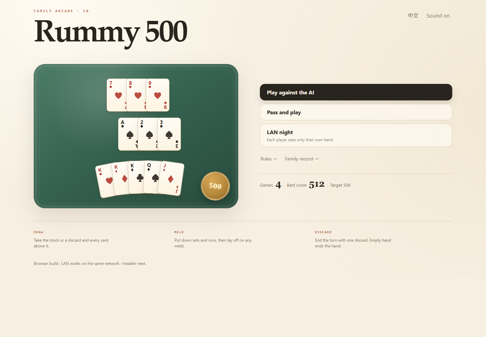

## A turn in five seconds

| Draw | Meld | Lay off | Discard |
| --- | --- | --- | --- |
| Take the stock, or take any discard and every card above it. | Put down a set of one rank or a run of one suit. | Add cards to any meld, yours or another player’s. | End the turn with one discard. Empty hand ends the hand. |

Scores are the cards you melded and laid off, minus the cards left in your hand.
The first player to a unique highest total of **500** wins.

## What is inside

- **A real, tested engine.** Pure TypeScript, deterministic, **45 unit tests**, no
  DOM, network, clock or `Math.random` in the rules. The audit is in
  [`docs/rules.md`](docs/rules.md).
- **Full Rummy 500 rules.** Buried discard takes with the must-meld obligation,
  sets and runs of any length, lay-offs on anyone’s melds, ace high or low without
  wrapping, going out by meld or discard, and cumulative 500-point scoring.
- **Four AI levels.** Companion is gentle, Easy makes mistakes, Normal takes
  profitable discards and lays off, Hard weighs hand potential and discard safety.
- **Three ways to play.** Solo vs one to three AI seats, pass-and-play for 2–4
  people, and LAN host/guest for 2–4 seats.
- **Real privacy.** Hot-seat hides the previous hand behind a “pass the device”
  screen. LAN sends each guest a per-seat view only; the host never sends another
  hand or the stock order.
- **Comforts.** Undo in local/AI games, a hint that explains why, autosave and
  resume, sound toggle, keyboard shortcuts, reduced-motion support, a complete
  Chinese/English UI, and a mobile layout designed as a first-class way to play.
- **A family record.** Games, best winning score, mode split, and the eight most
  recent results. LAN results are recorded on the host device only.
- **No remote assets.** Cards, table and icons are CSS/SVG. System fonts only.

## Screenshots

| A real game | AI setup |
| --- | --- |
| 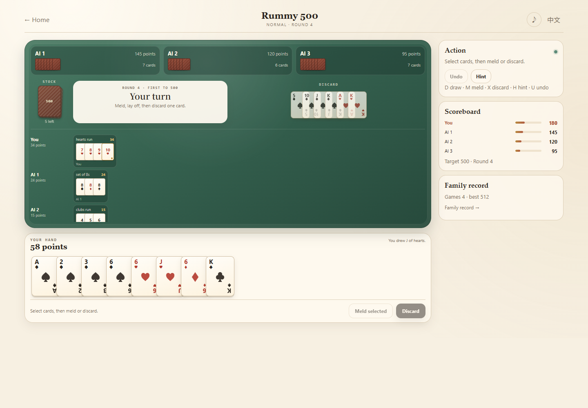 | 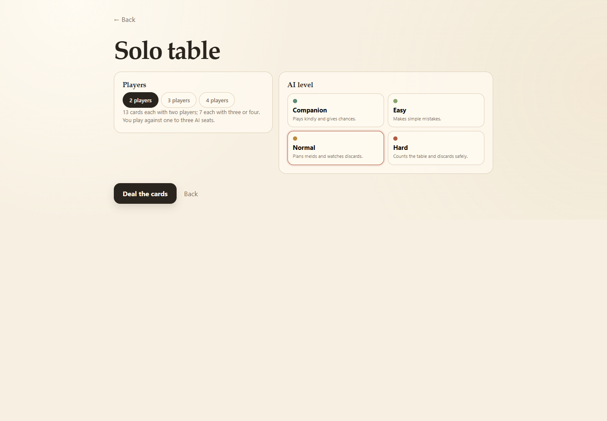 |

| Hint with a reason | Game over |
| --- | --- |
| 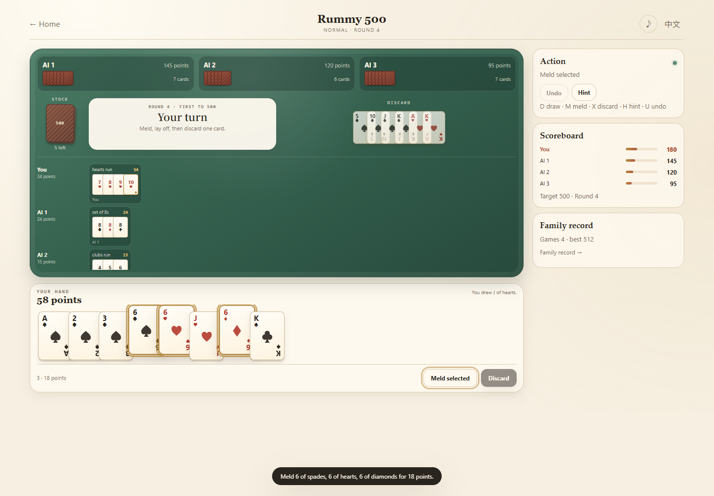 | 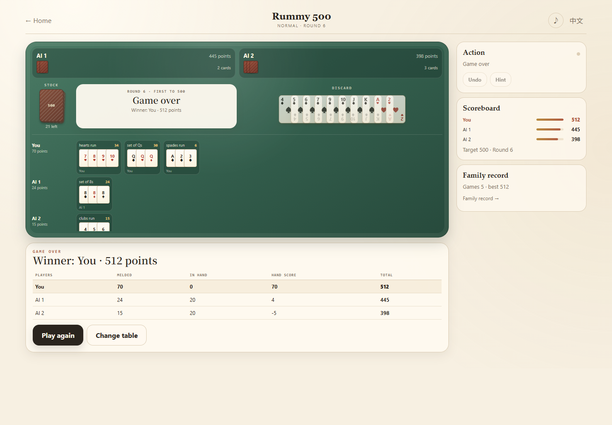 |

| Family record | Rules |
| --- | --- |
| 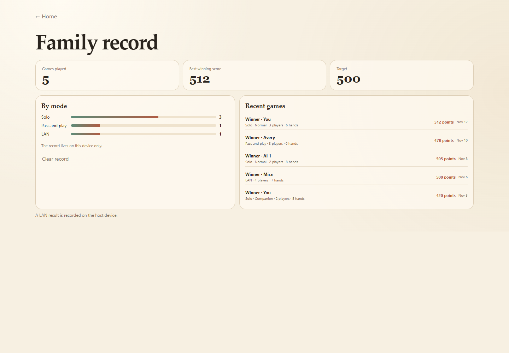 | 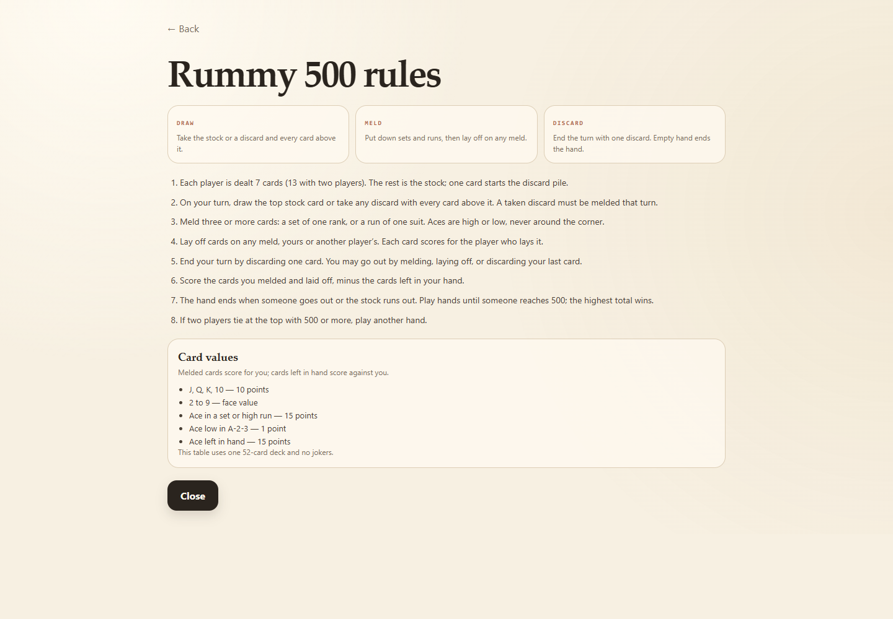 |

| LAN host | LAN guest |
| --- | --- |
| 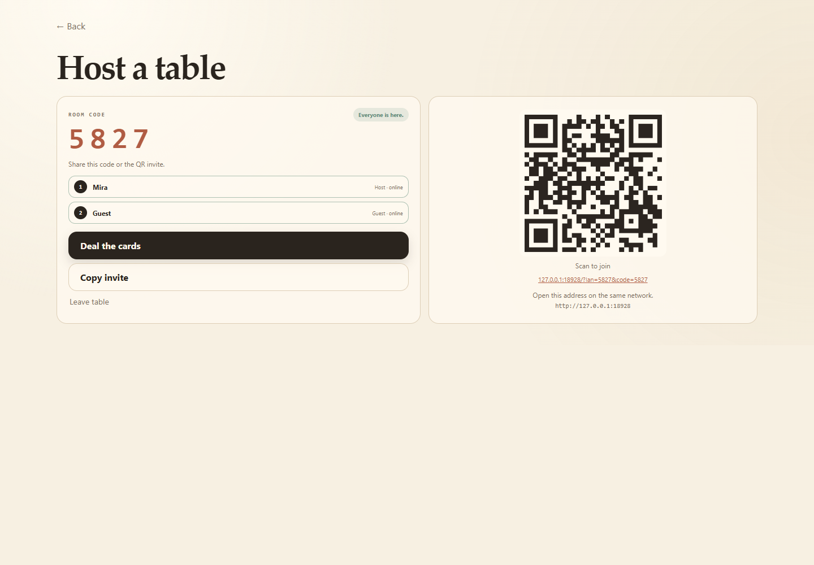 | 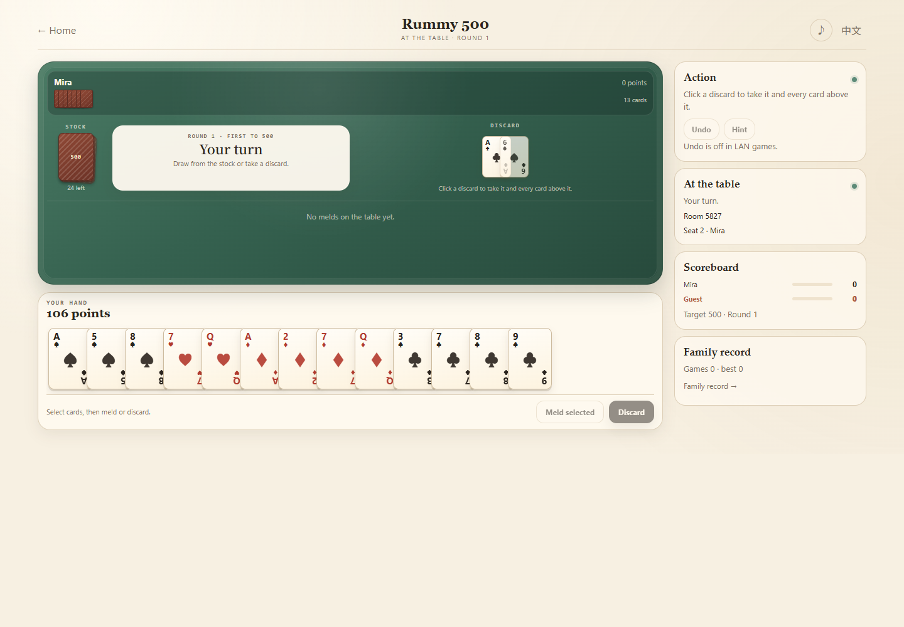 |

| Hot-seat privacy | LAN lobby |
| --- | --- |
| 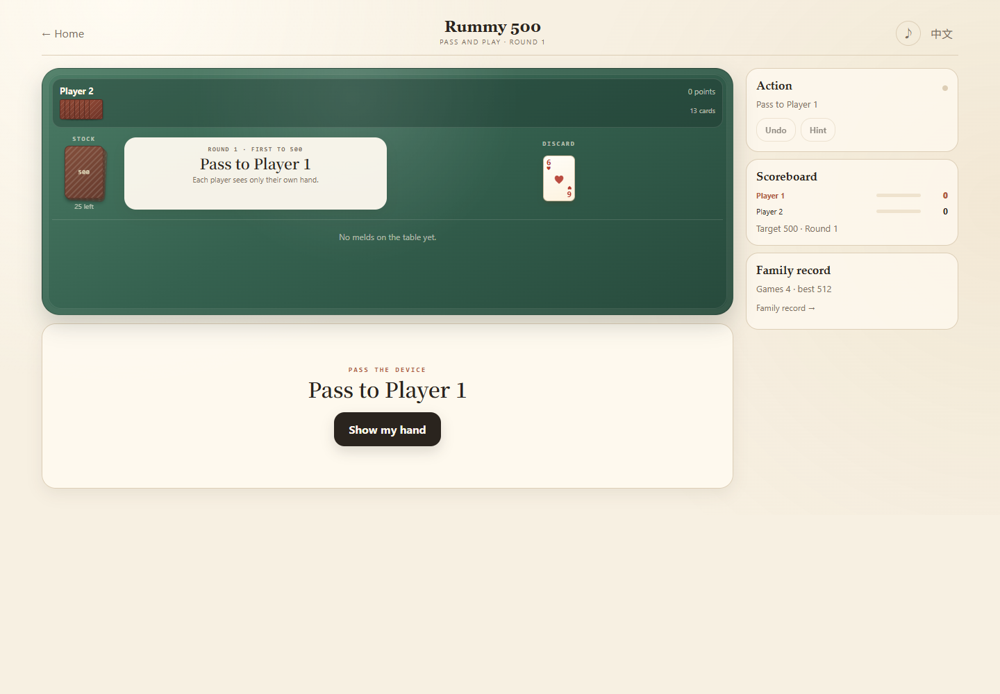 | 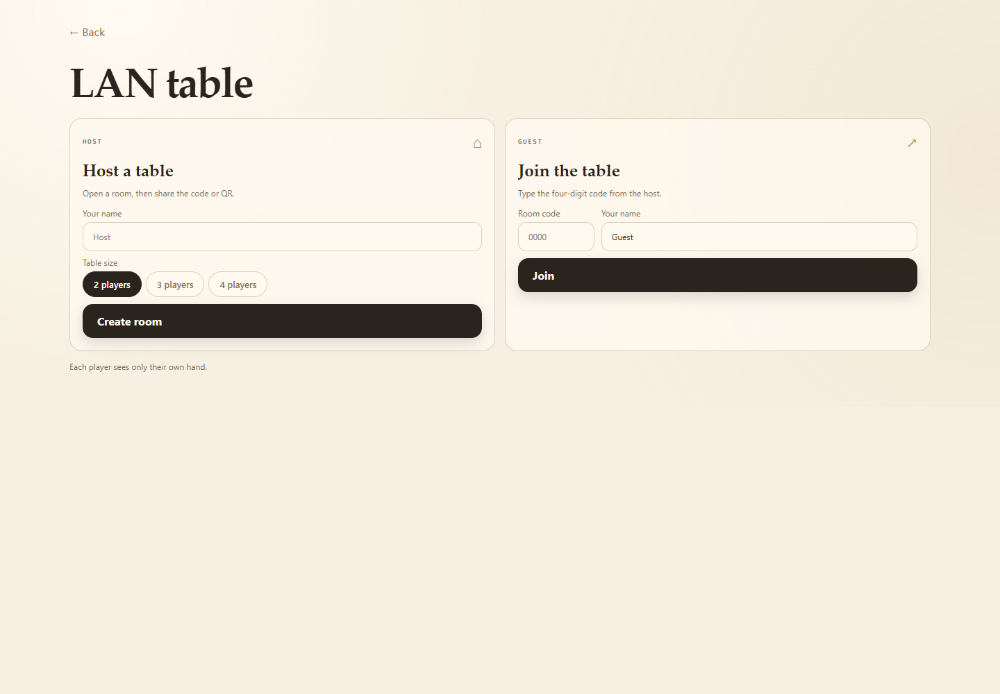 |

| Phone home | Phone game |
| --- | --- |
| 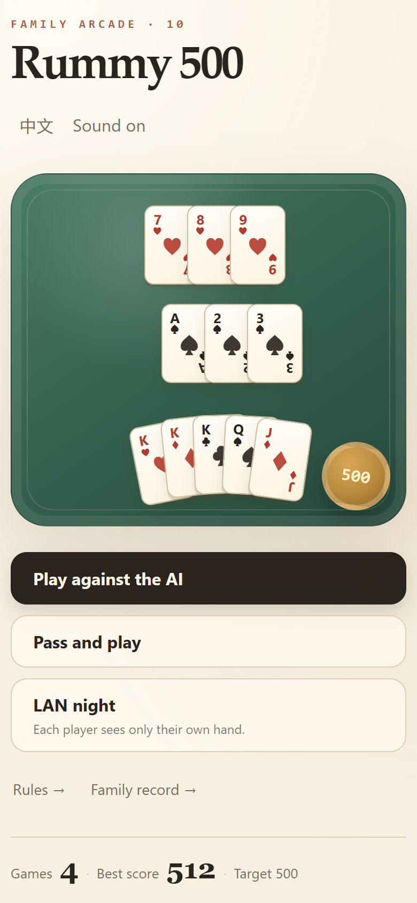 | 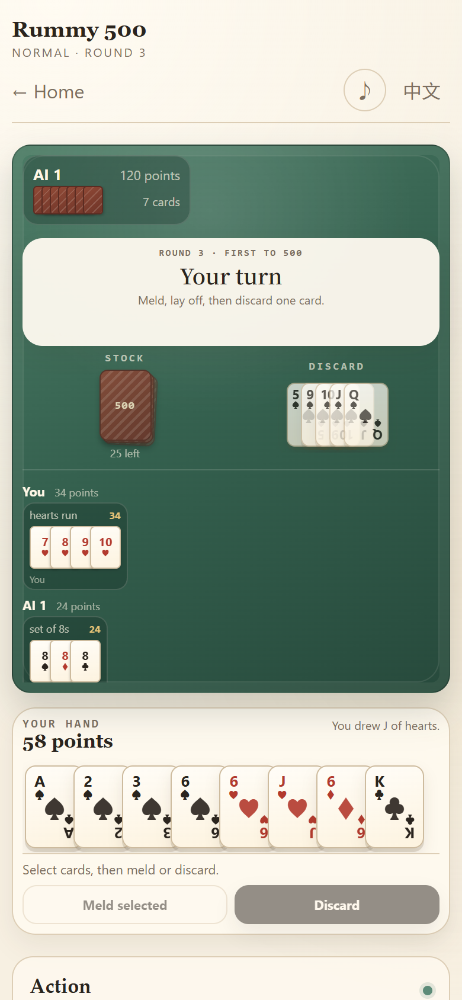 |

All screenshots come from the running app: desktop at 1440×1000, phone at
390×844 @2×.

## Run locally

```bash
npm install
npm run dev        # http://localhost:5210
npm run check      # tsc + 45 tests + production build
npm run e2e        # real Chrome, dev server required
npm run shots      # regenerate the screenshots
npm run build
npm run lan        # relay on :8080, serves dist/
npm run lan:e2e    # relay on :18927, full host/guest flow
npm run lan:shots  # live LAN host/guest screenshots
```

## LAN night

Browser/dev:

```bash
npm run build
npm run lan        # relay on :8080 and serves dist/
# host: open http://localhost:5210, LAN night, Create room
# guest: scan the QR, or open the invite on the same Wi-Fi
```

Desktop: the Tauri build starts the same relay internally and serves the built app
to phones. The host picks 2, 3 or 4 seats, shows a four-digit room code and a QR
invite, and starts when every seat is online. The relay is a dumb message bus; the
host keeps the authoritative state and sends only each seat’s own view. A guest can
reload and reclaim the same seat with the stored token. The guest result screen is
read-only and waits for the host.

## Build the Windows installer

```bash
npm install
npx tauri build --bundles nsis
# src-tauri/target/release/bundle/nsis/Rummy 500_0.1.0_x64-setup.exe
```

The installer is per-game and lightweight; WebView2 uses the standard bootstrapper.
A Windows SmartScreen warning is expected for an unsigned family build. No Tauri
build is run by this app’s own check script.

## Known limitations

- One 52-card deck with no jokers; no wild cards.
- The stock is not reshuffled; an empty stock ends the hand.
- A taken discard must be melded that turn, including buried takes.
- Going out by melding or laying off the last card is allowed; no final discard is
  required.
- Hard is a careful heuristic, not a perfect solver.
- LAN is same-network IPv4 only; a disconnected seat waits for its guest to return.
- Browser QR may use `localhost`; use the desktop build or the host’s LAN IP.
- Stats are local to each device; a LAN result is recorded on the host only.
- Hot-seat privacy is a UI boundary on a shared device, not a security boundary.
- No 4K or vertical promo cut; the shared studio renders the manifest.

See [`docs/limitations.md`](docs/limitations.md) and [`docs/rules.md`](docs/rules.md).

## Credits

Original code, cards, table art and copy for Family Arcade. MIT. See
[`NOTICE.md`](NOTICE.md) and [`LICENSE`](LICENSE).
