# 五百分拉米

[English](README.md) · **简体中文**

> **摸牌。组牌。接牌。先到五百分。**

一张给 **2–4 人** 的完整五百分拉米牌桌：单人对四档电脑、同屏传牌（每位玩家只看自己的手牌），
或同一网络内用手机加入的局域网牌桌（每个座位只收到自己的手牌）。无账号、无广告、无云端。

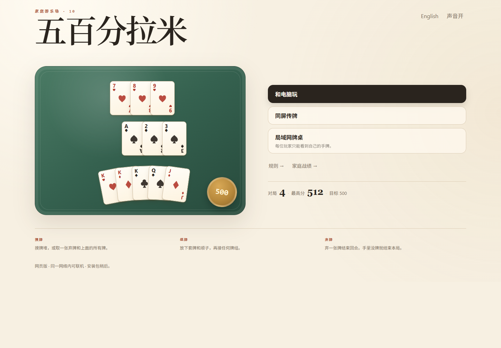

## 一回合，五秒看懂

| 摸牌 | 组牌 | 接牌 | 弃牌 |
| --- | --- | --- | --- |
| 摸牌堆，或取一张弃牌和它上面的所有牌。 | 放下同点数的套牌，或同花色的顺子。 | 把牌接到任何牌组上，自己的或别人的都行。 | 弃一张牌结束回合。手里没牌就结束本局。 |

已组和接上的牌计正分，手里剩牌计负分。第一个达到 **500 分** 且总分最高的人获胜。

## 里面有什么

- **真正的引擎。** 纯 TypeScript、确定性、**45 个单元测试**；规则层不碰界面、网络、
  时钟或随机数。规则审计见 [`docs/rules.md`](docs/rules.md)。
- **完整的五百分规则。** 可从弃牌堆深处取牌并必须当回合用上；套牌与顺子长度不限；
  可以接任何人的牌组；A 可大可小但不能绕角；组牌或弃牌都能出完；分数跨局累计到 500。
- **四档电脑对手。** 陪玩温和，轻松会犯错，标准会取有用的弃牌并接牌，挑战会算手里潜力
  和弃牌安全。
- **三种玩法。** 单人对一到三位电脑、2–4 人同屏传牌、2–4 个座位的局域网牌桌。
- **真正的隐私。** 同屏时上一家的手牌会藏在“把设备传给下一位”的界面后；局域网只发送
  每个座位自己的视图，主机不会发送别人的手牌或牌堆顺序。
- **小细节。** 本地与单人可悔棋、会解释原因的提示、自动保存/继续、声音开关、键盘操作、
  减少动效、完整中英双语，以及按手机优先设计的布局。
- **家庭战绩。** 对局数、最高获胜分、模式分布、最近八局。局域网结果只记在主机设备。
- **无远程素材。** 牌面、牌桌和图标都用样式与矢量绘制，只使用系统字体。

## 截图

| 真实对局 | 单人设置 |
| --- | --- |
| 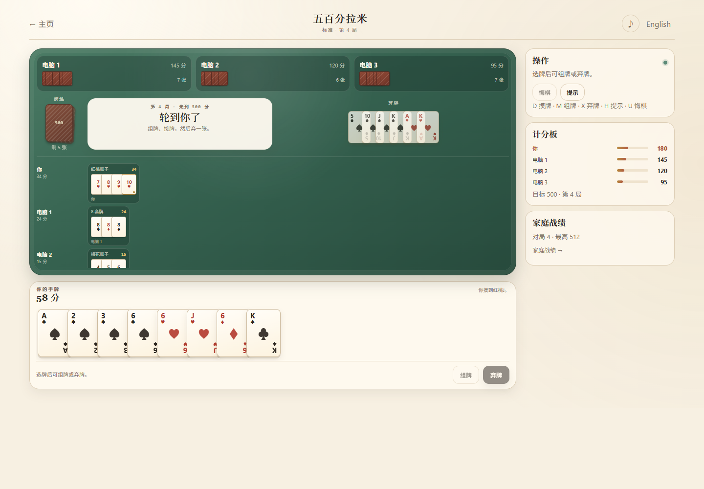 | 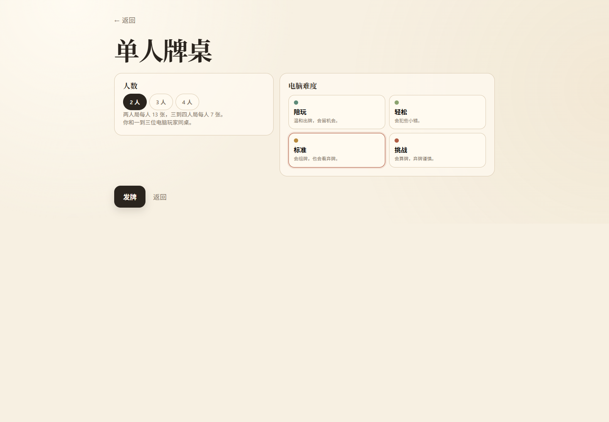 |

| 带原因的提示 | 终局 |
| --- | --- |
| 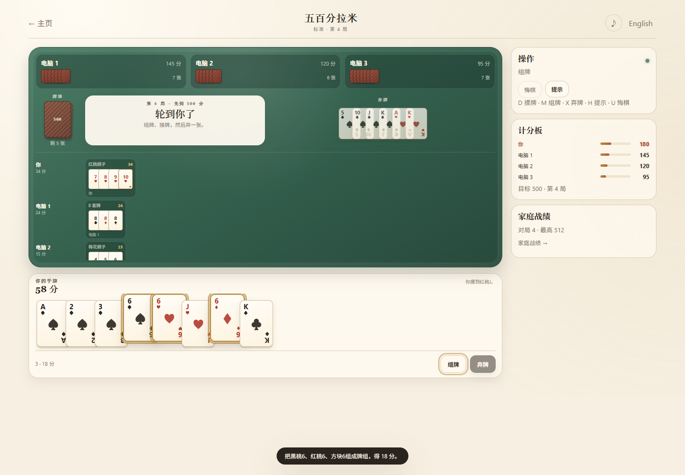 | 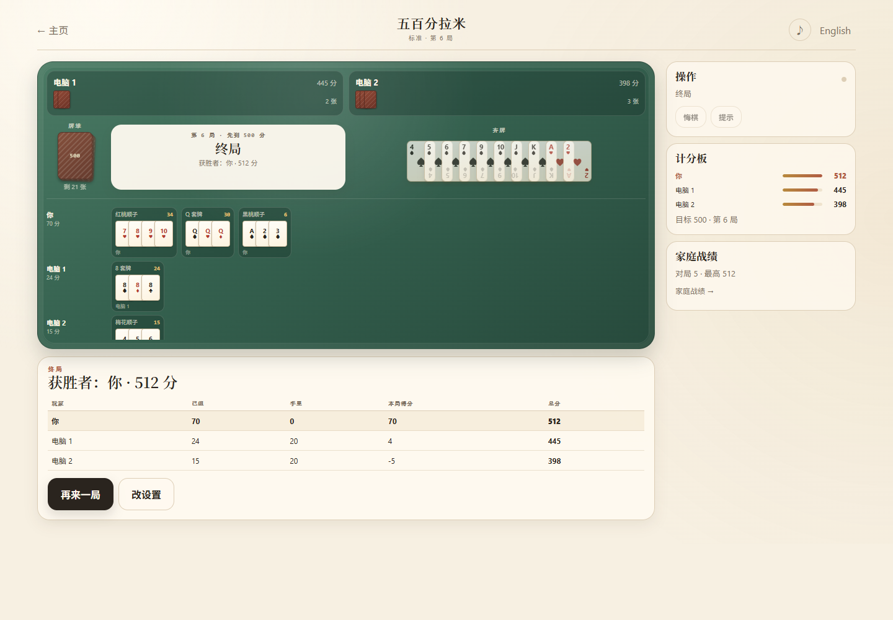 |

| 家庭战绩 | 规则 |
| --- | --- |
| 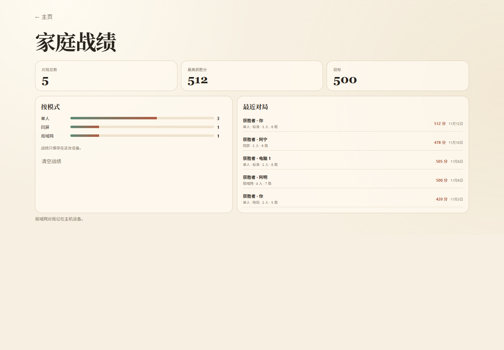 | 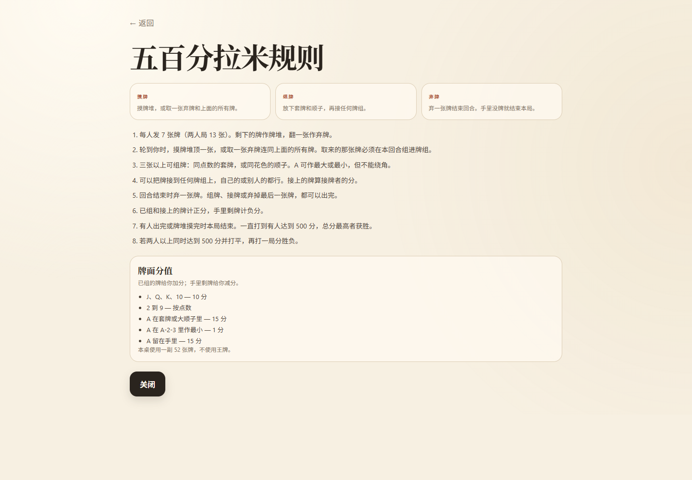 |

| 局域网主机 | 局域网访客 |
| --- | --- |
| 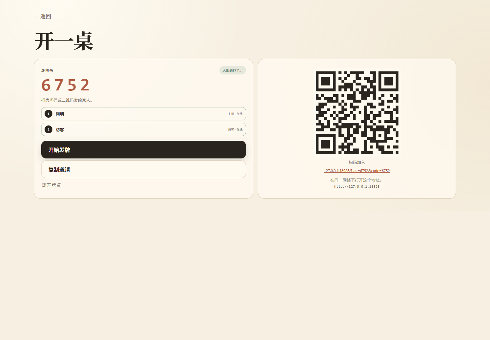 | 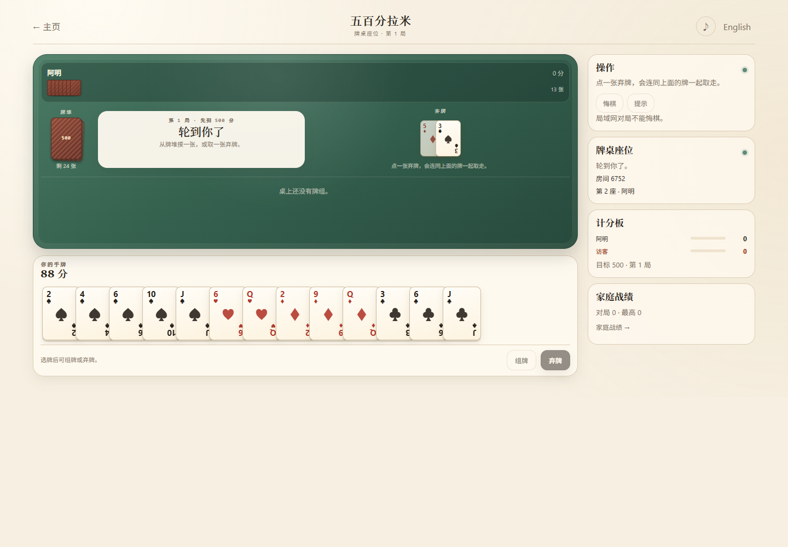 |

| 同屏传牌隐私 | 局域网大厅 |
| --- | --- |
| 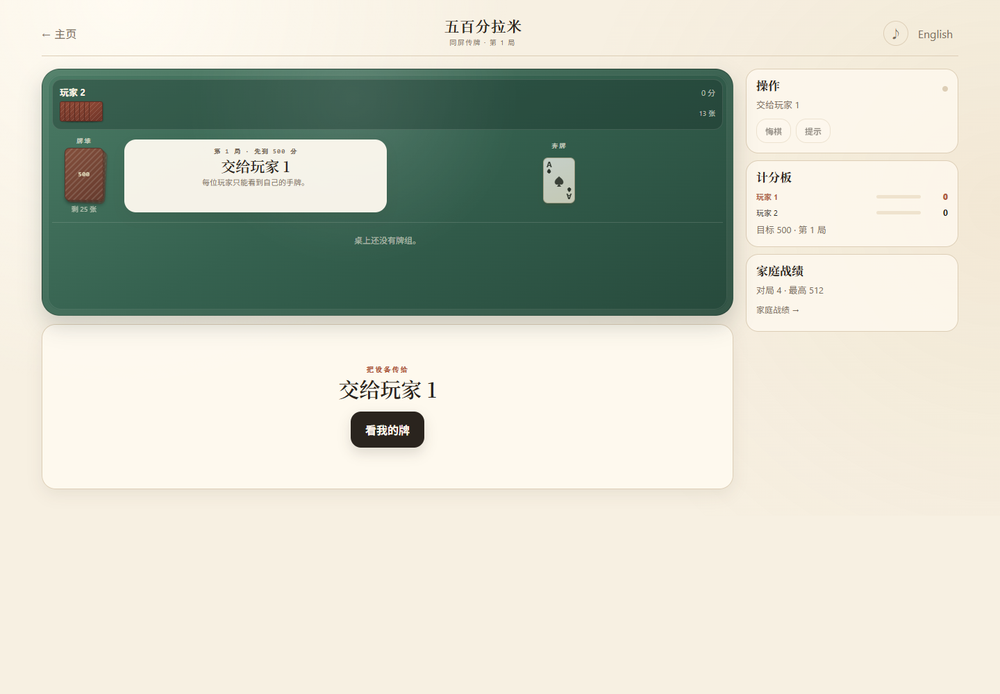 | 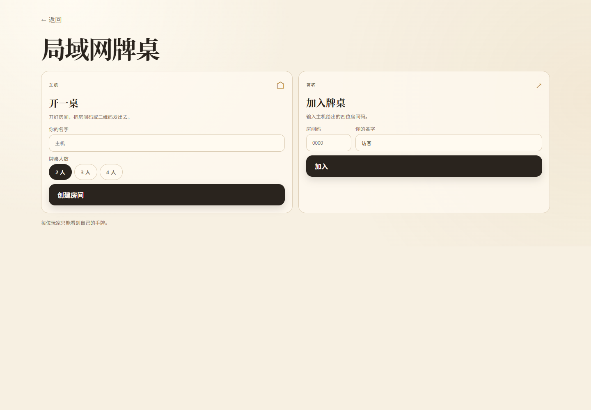 |

| 手机主页 | 手机对局 |
| --- | --- |
| 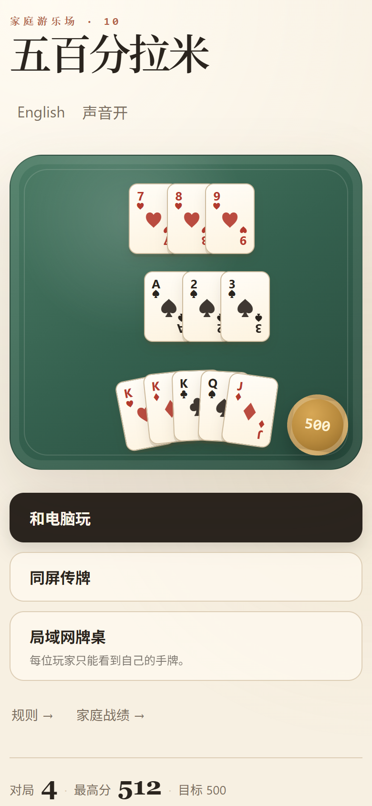 | 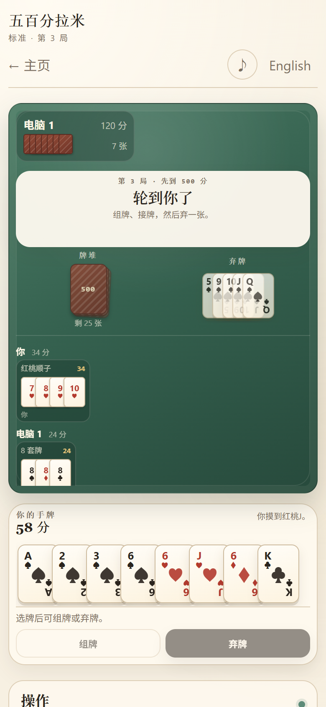 |

全部来自真实运行的应用：桌面 1440×1000，手机 390×844 @2×。

## 本地运行

```bash
npm install
npm run dev        # http://localhost:5210
npm run check      # 类型检查 + 45 个测试 + 生产构建
npm run e2e        # 真实浏览器，需要先运行 dev
npm run shots      # 重新生成截图
npm run build
npm run lan        # 中继在 :8080，同时托管 dist/
npm run lan:e2e    # 中继在 :18927，跑完整主机/访客流程
npm run lan:shots  # 抓取真实局域网主机/访客截图
```

## 局域网牌桌

浏览器/开发版：

```bash
npm run build
npm run lan        # 中继在 :8080，同时托管 dist/
# 主机：打开 http://localhost:5210，选“局域网牌桌”→“创建房间”
# 访客：扫码，或在同一网络打开邀请链接
```

桌面版：Tauri 安装包会启动同一个内置中继，并把构建产物托管给手机。主机选择 2、3 或 4 个
座位，亮出四位房间码和二维码，所有座位在线后开始。中继只负责转发消息；主机保存权威状态，
只发送每个座位自己的视图。访客刷新后可用本机令牌回到原座位；访客的终局界面只读，等主机
开始下一局。

## 构建 Windows 安装包

```bash
npm install
npx tauri build --bundles nsis
# src-tauri/target/release/bundle/nsis/Rummy 500_0.1.0_x64-setup.exe
```

每款游戏单独打包，安装包保持轻量；WebView2 使用标准引导程序。未签名的家庭构建会触发
Windows SmartScreen 提示。本应用自己的检查脚本不会运行 Tauri 构建。

## 已知限制

- 使用一副 52 张牌，不使用王牌，也没有百搭牌。
- 牌堆摸完后本局结束，不重新洗弃牌堆。
- 从弃牌堆取的牌必须当回合组进牌组，从深处取也一样。
- 组牌或接牌出完最后一张也可以，不强制用弃牌收尾。
- 挑战档是谨慎的启发式对手，不是完美求解器。
- 局域网仅限同一网络的 IPv4；座位掉线时牌桌会等待该访客回来。
- 浏览器开房生成的二维码可能带 `localhost`；手机加入请用桌面版或主机局域网地址。
- 战绩按设备保存；局域网结果只记在主机。
- 同屏隐私是共用设备上的界面边界，不是安全边界。
- 暂无 4K 或竖屏宣传片；共享工作室会按清单渲染。

见 [`docs/limitations.md`](docs/limitations.md) 与 [`docs/rules.md`](docs/rules.md)。

## 许可

Family Arcade 原创代码、牌面、牌桌与文案，MIT。见 [`NOTICE.md`](NOTICE.md) 与
[`LICENSE`](LICENSE)。
