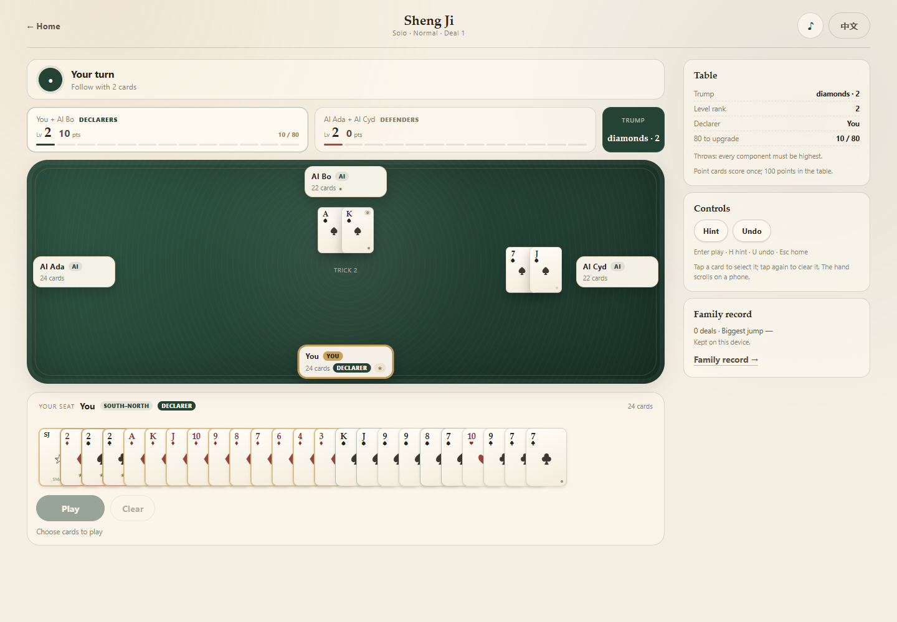
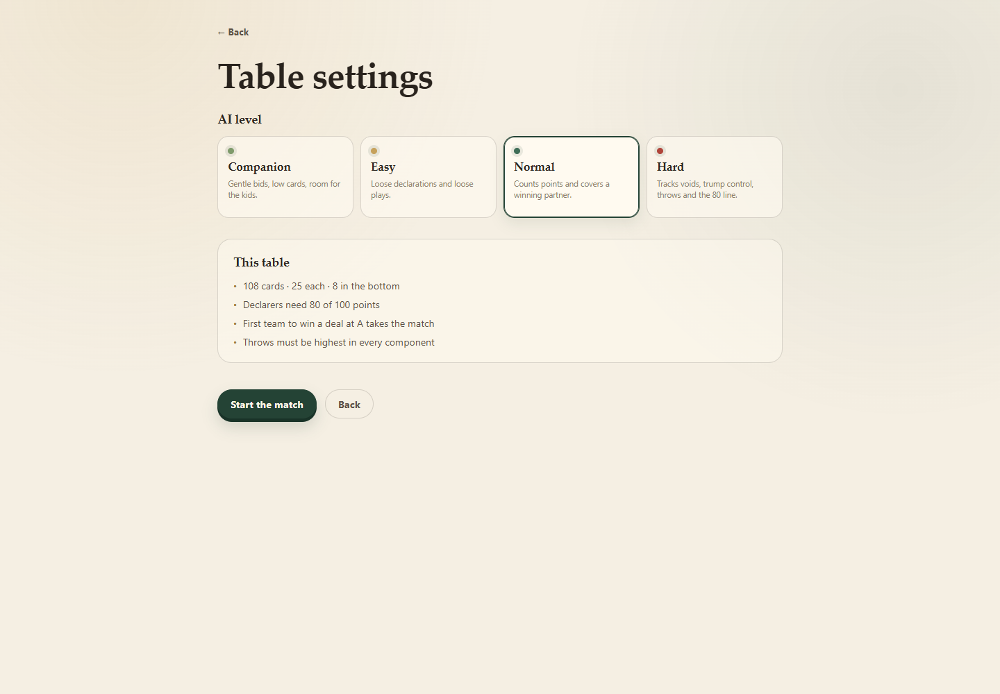
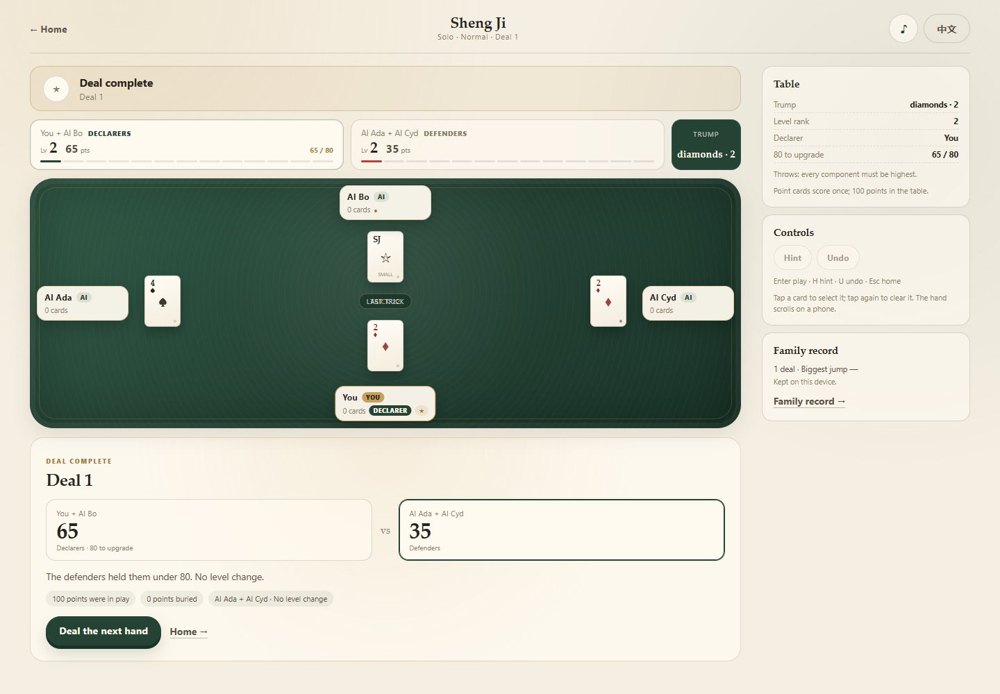
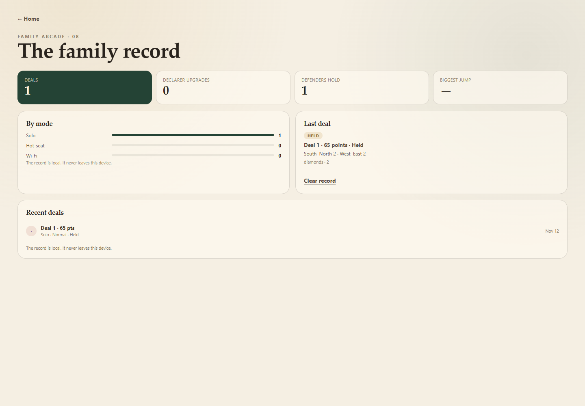
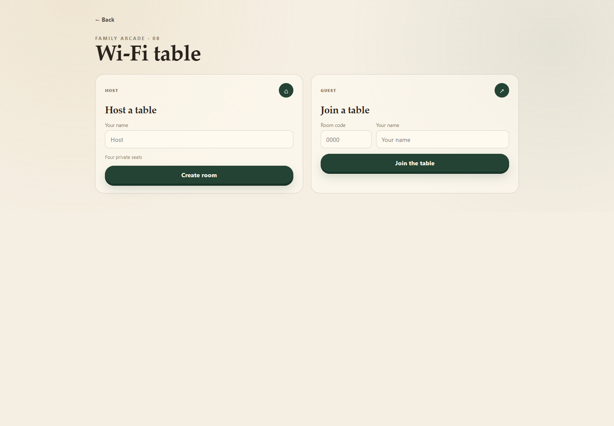
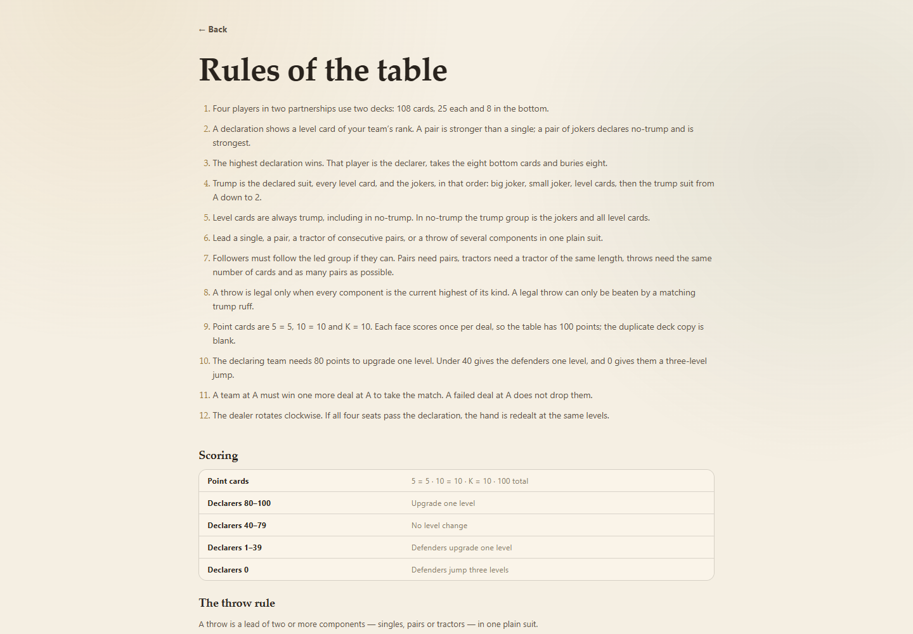
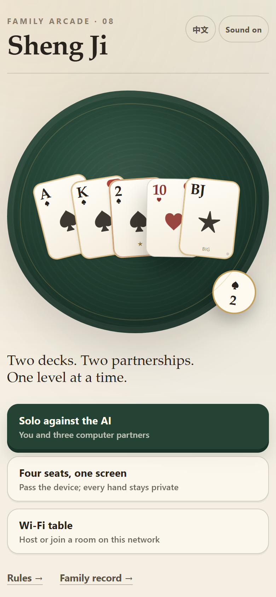
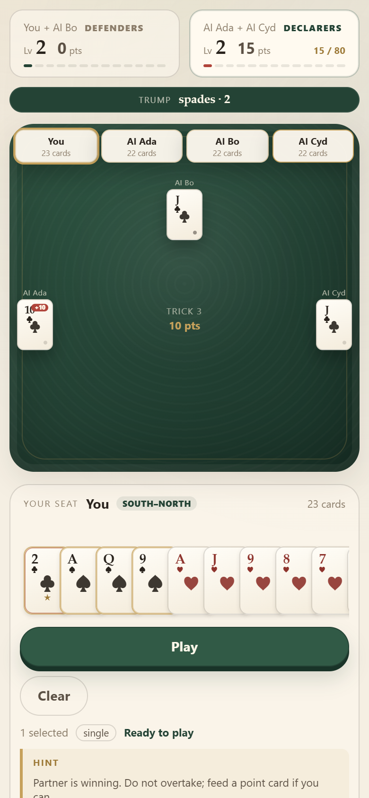

# Sheng Ji

**English** · [简体中文](README.zh-CN.md)

> **Two decks. Two partnerships. One level at a time.**

A four-player partnership trick-taking game for the family table: 108 cards, an
eight-card bottom, level-card declarations, no-trump, tractors and throws. Play solo
against three AI opponents, pass one screen around four seats, or host a private LAN
table. No account, no ads, no cloud; LAN play stays on your own network.


## A deal, in five seconds

| Declare | Bury | Play |
| --- | --- | --- |
| Show a level card, a pair, or a pair of jokers for no-trump. The highest declaration wins. | The declarer takes the eight bottom cards and buries eight face down. | Follow the led group, ruff with trump, and take 5 / 10 / K point cards. |

The declaring team needs **80 of 100 points** to upgrade one level. Under 40 gives
the defenders a level; a shutout gives them a three-level jump. The first team to
make a deal while at **A** wins the match.

## What is inside

- **A real, tested engine.** Pure TypeScript, deterministic, **70 unit tests**, no
  DOM, network, clock or `Math.random` in the rules. The full audit is in
  [`docs/rules.md`](docs/rules.md).
- **Two decks, real structure.** 108 cards; 25 each and an eight-card bottom. Pairs,
  consecutive-pair tractors and multi-component throws all use the same physical
  cards. Throws are legal only when every component is currently highest; a legal
  throw can only be taken by a matching trump ruff.
- **Level cards and no-trump.** A declaration uses the declaring team's own level
  card. Level cards are always trump, even in no-trump. A pair of jokers can declare
  no-trump.
- **Four AI levels.** Companion is gentle around children, Easy is loose, Normal
  counts points and covers a winning partner, and Hard tracks the 80 line, voids,
  trump control and throw safety. Hard's valuation never uses another hand; the
  engine's throw-legality check is the only whole-table rule check.
- **Three ways to play.** Solo against three AI opponents, four people passing one
  screen with a privacy curtain for every hand, or a LAN room with up to four private
  seats. Empty LAN seats are played by the AI.
- **Private hands.** Hot-seat hides the next hand, including the declarer's 33-card
  bury hand. Every LAN guest receives a per-seat view with only their own hand and
  the public table; the host never broadcasts another hand.
- **A full family record.** Completed deals, declarer upgrades, defender holds, the
  biggest jump, mode split and the eight newest deals. LAN deals are recorded on the
  host device.
- **Small comforts.** Undo and a hint that explains *why* in solo and hot-seat,
  autosave/resume, sound on/off, keyboard shortcuts, reduced-motion support, complete
  Chinese/English UI, and a mobile layout built for a phone rather than shrunk from a
  desktop.
- **Private by default.** No accounts, telemetry, ads or remote fonts.

## The 100-point table

The brief asks for two decks and a 100-point table. This app uses the classic face
values — **5 = 5, 10 = 10, K = 10** — and scores each point-card face once per deal.
The first deck's copy carries the value; the duplicate deck copy is a blank point
card and shows a small `0`. Buried point cards leave the deal. The full deck is 100
points before the bury.

## Screenshots

| A real deal | Table settings |
| --- | --- |
|  |  |

| Hint with a reason | Deal complete |
| --- | --- |
|  |  |

| Family record | LAN lobby |
| --- | --- |
|  |  |

| Rules |
| --- |
|  |

| Phone home | Phone table |
| --- | --- |
|  |  |

All screenshots come from the running app at 1440×1000 (phone 780×1688, 390×844
at 2×).

## Play locally

```bash
npm install
npm run dev        # http://localhost:5223
npm run check      # tsc + 70 tests + production build
npm run e2e        # real Chrome; dev server must be running
npm run lan:e2e    # uses dist, starts its own relay on LAN_PORT, stops it afterwards
npm run shots      # regenerate all EN/ZH screenshots
```

The assigned dev port is **5223**; the preview port is **4223**. The LAN E2E uses
`LAN_PORT=19023` and kills its relay in `finally`.

## LAN night

Browser/dev:

```bash
npm run build
npm run lan        # relay on :8080, serves dist/
# open http://localhost:5223, choose Wi-Fi table, Create room
# guest: scan the QR, or open the invite URL and type the four-digit code
```

Desktop: the Tauri build starts the same relay internally and serves the built app
to phones. The host chooses a name, opens a room, and shows a four-digit code and QR
invite. Empty seats are filled by the AI, so one guest is enough to start. A guest
who reloads reconnects to the same seat by client token and receives the current
private view.

The relay is a dumb message bus. The host keeps the authoritative state and sends
only the guest's own view. Every intent carries the current state version; stale
intents, spoofed seats and wrong turns are ignored. A dropped guest seat is covered
by the host AI after a short wait, so the table never freezes. The guest's result
screen is read-only and waits for the host to deal the next hand. Undo and hints are
paused in LAN play.

## Build the Windows installer

```bash
npm install
npx tauri build --bundles nsis
# src-tauri/target/release/bundle/nsis/Sheng Ji_0.1.0_x64-setup.exe
```

The installer is per-game and lightweight; WebView2 uses the standard bootstrapper.
A Windows SmartScreen warning is expected for an unsigned family build. Do not run
this build in the app's check loop; the central build agent owns installers.

## Known limitations

- Four players only. No two-player duel or six-seat table.
- The 100-point duplicate table is a family-table choice; the 200-point tournament
  table is not implemented.
- Throws are one plain suit only, with the longest-tractor-first family rule. Trump
  throws are not allowed. Some families use a different throw penalty.
- Declaration is one quick window; no repeated counter-bids, tribute or exchange.
- Levels never fall. A failed deal at A does not demote the team; reaching A does
  not win the match until the team makes a deal at A.
- Hard is a strong heuristic, not a solved game. It does not peek.
- LAN is same-subnet IPv4; phones need the host firewall to allow the relay. The
  browser build needs the shared relay or the desktop app.
- Stats are local to each device. A LAN deal is recorded on the host, not duplicated
  on the guest.
- A browser-hosted QR may use `localhost`; use the desktop build or open the host
  machine's LAN IP for a phone on the Wi-Fi.
- The 45-second promo is rendered centrally from [`video.json`](video.json); no
  Remotion project or media asset is stored in this app.

See [`docs/limitations.md`](docs/limitations.md).

## Credits

Original code, art and copy for Family Arcade. MIT. See [`NOTICE.md`](NOTICE.md).
