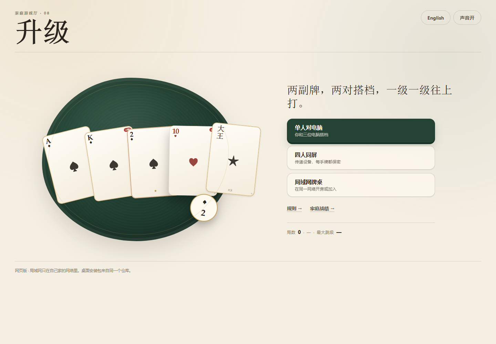
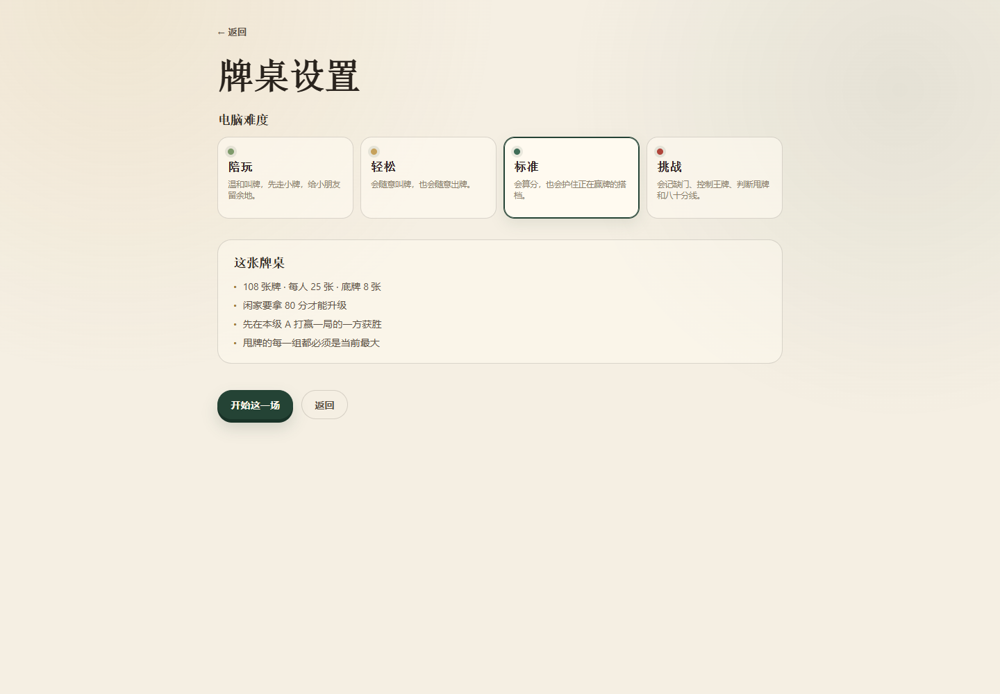
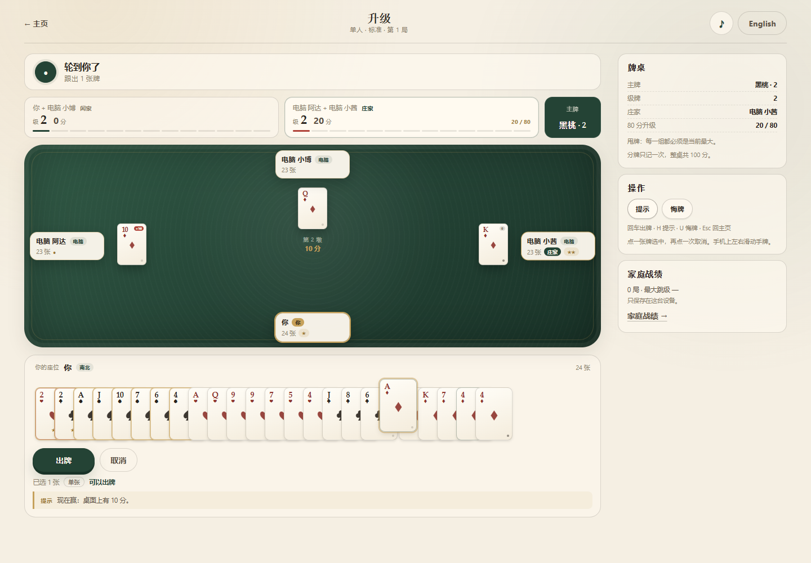
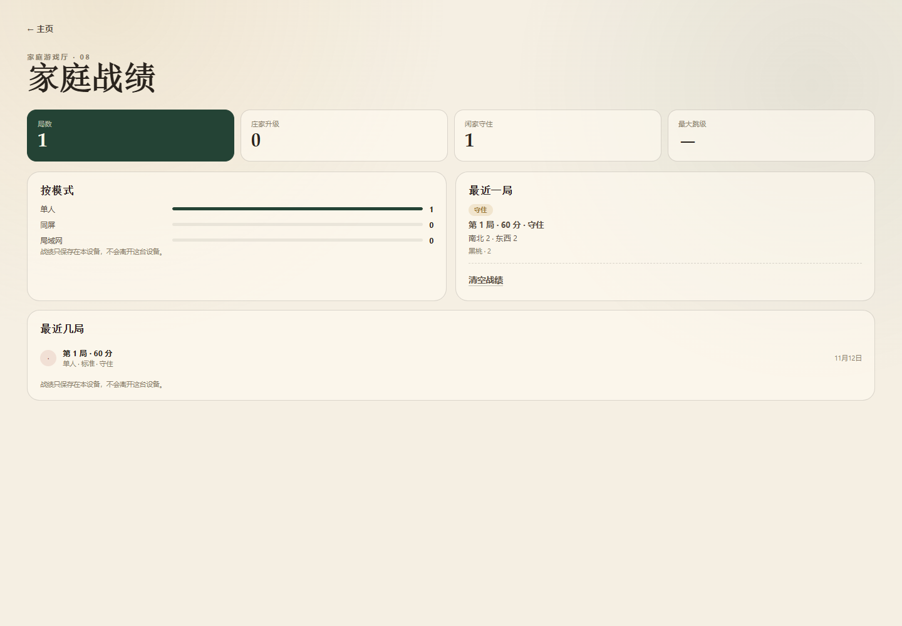
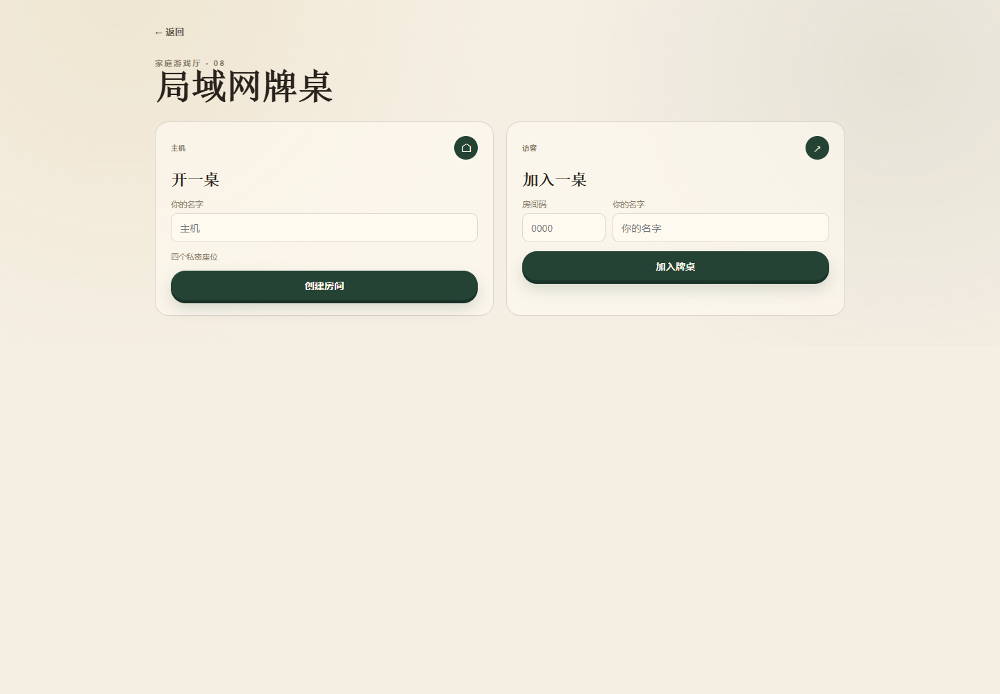
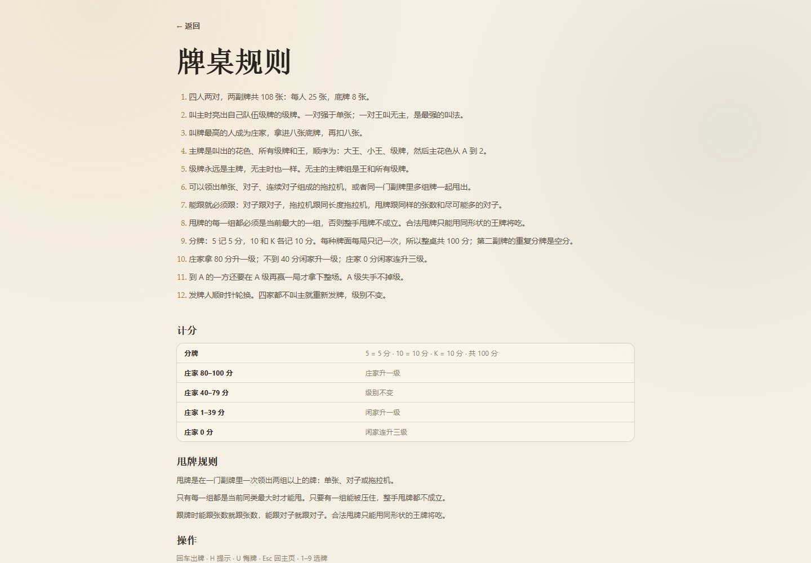
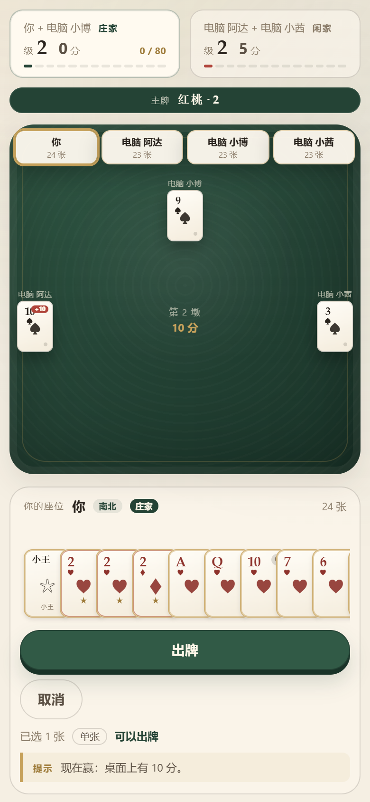

# 升级

[English](README.md) · **简体中文**

> **两副牌，两对搭档，一级一级往上打。**

给家庭牌桌的四人两对扑克牌游戏：108 张牌、八张底牌、级牌叫主、无主、拖拉机
和甩牌。可以单人对三个电脑，四人同屏轮流传设备，或者在自己的局域网开一桌。
无账号、无广告、无云端；局域网只在自己家的网络里。



## 一局牌，五秒看懂

| 叫主 | 扣底 | 出牌 |
| --- | --- | --- |
| 亮出自己队伍的级牌，或者一对级牌；一对王可以叫无主。叫得最高的人当庄家。 | 庄家拿进八张底牌，再扣八张下去。 | 能跟就跟，跟不上就用主牌将吃，拿走 5、10、K 这些分牌。 |

庄家拿到 **80 分**升一级；不到 40 分闲家升一级；庄家零分闲家连升三级。
先在本级 **A** 打赢一局的一方拿下整场。

## 里面有什么

- **真正的引擎。** 纯 TypeScript、确定性、**70 个单元测试**；规则层不碰页面、
  网络、时钟或随机数。完整规则审计见 [`docs/rules.md`](docs/rules.md)。
- **两副牌的真结构。** 108 张牌，每人 25 张，底牌 8 张。对子、连续对子组成的
  拖拉机、同门多组牌一起甩出，都使用同一批实体牌。甩牌的每一组都必须是当前
  最大；合法甩牌只能用同形状的王牌将吃。
- **级牌和无主。** 叫主时亮出自己队伍的级牌。级牌永远是主牌，无主时也一样。
  一对王可以叫无主。
- **四档电脑。** 陪玩温和，给小朋友留余地；轻松会随意出牌；标准会算分、护住
  正在赢牌的搭档；挑战会盯住八十分线、记缺门、控制王牌、判断甩牌安全。挑战档
  不会偷看别人的手牌。
- **三种玩法。** 单人对三个电脑；四人同屏，每手牌都有传递设备的遮罩；局域网
  最多四个私密座位，空位由电脑补上。
- **手牌保密。** 同屏模式在换人时挡住下一手牌，庄家扣底时的 33 张手牌也一样。
  局域网每位访客只收到自己的座位视图和公开牌桌，主机不会把别人的手牌发出去。
- **完整的家庭战绩。** 完成的牌局、庄家升级、闲家守住、最大跳级、各模式分布、
  最近八局。局域网牌局记在主机设备上。
- **小细节。** 单人与同屏模式有悔牌和会解释原因的提示；自动保存/继续；声音
  开关；键盘快捷键；减少动效；完整中英双语；按手机优先设计，而不是缩小的桌面版。
- **默认私密。** 无账号、无遥测、无广告、无远程字体。

## 一百分的分牌表

按需求使用两副牌和一百分牌桌。本应用采用经典牌面分：**5 记 5 分，10 和 K
各记 10 分**；每种牌面每局只记一次。第一副牌的那张带分值，第二副牌的重复牌是
空分牌，牌面上会显示一个小小的 `0`。扣下去的分牌离开本局；整副牌在扣底前共
100 分。

## 截图

| 真实牌局 | 牌桌设置 |
| --- | --- |
|  |  |

| 带原因的提示 | 本局结束 |
| --- | --- |
|  |  |

| 家庭战绩 | 局域网大厅 |
| --- | --- |
|  |  |

| 规则 |
| --- |
|  |

| 手机主页 | 手机牌桌 |
| --- | --- |
|  |  |

全部来自真实运行的应用：桌面 1440×1000，手机 780×1688（390×844 @2×）。

## 本地运行

```bash
npm install
npm run dev        # http://localhost:5223
npm run check      # 类型检查 + 70 个测试 + 生产构建
npm run e2e        # 真实 Chrome；需先运行开发服务器
npm run lan:e2e    # 构建后按 LAN_PORT 启动中继，跑完自动关闭
npm run shots      # 重新生成中英双语全部截图
```

开发端口是 **5223**，预览端口是 **4223**。局域网端到端测试使用
`LAN_PORT=19023`，并在结束时关闭中继。

## 局域网

浏览器/开发版：

```bash
npm run build
npm run lan        # :8080 中继，同时托管 dist/
# 打开 http://localhost:5223，选“局域网牌桌”→“创建房间”
# 访客：扫码，或打开邀请链接并输入四位房间码
```

桌面版：安装包启动同一个内置中继，并把构建产物托管给手机。主机填写名字、开桌，
显示四位房间码和二维码邀请。空位由电脑入座，所以有一位访客就能开局；访客刷新
后会凭客户端令牌回到原来的座位，并收到当前的私密视图。

中继只负责转发消息；主机保存权威状态，只发送访客自己的座位视图。每个操作都带着
当前状态版本，过期操作、伪造座位和错误回合都会被忽略。访客掉线后，主机会在短暂
等待后让电脑替他出最小合法牌，牌桌不会卡住。访客的终局界面是只读的，等主机发
下一手。局域网对局暂停悔牌和提示。

## 构建 Windows 安装包

```bash
npm install
npx tauri build --bundles nsis
# src-tauri/target/release/bundle/nsis/Sheng Ji_0.1.0_x64-setup.exe
```

每款游戏单独打包，安装包保持轻量；WebView2 使用标准引导程序。未签名的家庭构建会
触发 Windows SmartScreen 提示。请不要在本应用的检查流程里运行安装包构建；安装包
由中央构建代理统一生成。

## 已知限制

- 只支持四人。没有两人对决，也没有六人桌。
- 一百分的重复牌记分是本牌桌的家庭规则；锦标赛常见的两副牌二百分、80/120/160
  门槛没有实现。
- 甩牌只允许一门副牌，并按“最长拖拉机优先”的家庭规则拆分。不设王牌甩牌。部分
  家庭会用“最小一组被压就罚出最小牌”的其他规则。
- 叫主只有一轮；没有反复反主、进贡或换牌。
- 级别不会下降。A 级失手不掉级；升到 A 也不会立刻获胜，还要在 A 级再赢一局。
- 挑战档是强启发式，不是已解算的完美对手；它不会偷看。
- 局域网仅支持同一子网的 IPv4；手机访客需要主机防火墙放行中继。浏览器开房需要
  共享中继或桌面版。
- 战绩按设备保存。局域网牌局记在主机，不会在访客设备重复记录。
- 浏览器开房生成的二维码可能带本机地址；手机加入请用桌面版，或在同一网络打开
  主机的局域网地址。
- 45 秒宣传片由根目录工作室按 [`video.json`](video.json) 统一渲染；本应用不另存
  Remotion 工程或媒体文件。

见 [`docs/limitations.md`](docs/limitations.md)。

## 许可

Family Arcade 原创代码、美术与文案，MIT。见 [`NOTICE.md`](NOTICE.md)。
