# Shogi

**English** · [简体中文](README.zh-CN.md)

> **Drops, promotion, checkmate.**

A complete 9×9 shogi table for the family: **2 players**, all forty pieces, drops,
promotion, check, checkmate and repetition. Play solo against four AI levels, pass one
device between two players, or join a phone over your own Wi-Fi. No account, no ads, no
cloud; only your LAN for the phone mode.

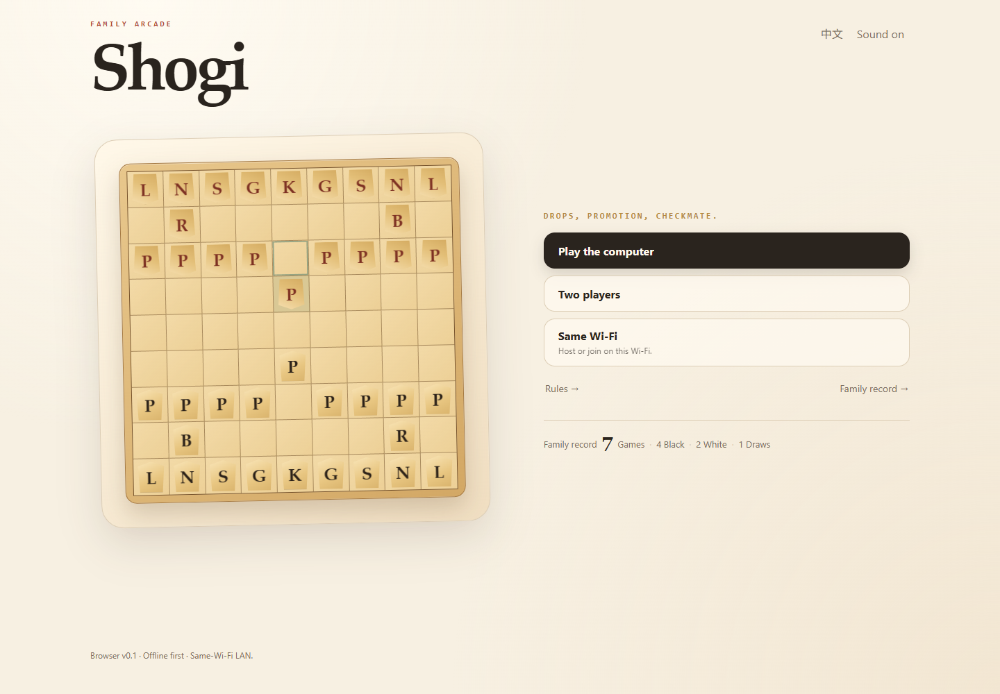

## A turn, in five seconds

| Move | Capture | Drop or promote |
| --- | --- | --- |
| Black starts; each side moves one piece. | A captured piece reverts and joins your hand. | Instead of moving, drop a hand piece on a legal empty square. Promote in the last three ranks. |

Checkmate wins. Fourfold repetition draws. A side with no legal move loses. Pawns cannot
be doubled on a file, dropped on the last rank, or dropped as immediate checkmate
(*uchifuzume*).

## What is inside

- **A real, tested engine.** Pure TypeScript, deterministic, **27 unit tests**, no DOM,
  network, clock or randomness in the rules. See [`docs/rules.md`](docs/rules.md).
- **All the pieces.** King, rook, bishop, gold, silver, knight, lance and pawn, plus
  dragon, horse and the promoted small pieces. Optional promotion in the last three
  ranks and forced promotion when a piece would be stuck.
- **Drops with the real restrictions.** Nifu, last-rank pawn/lance limits, knight
  landing limits, drop-to-block-check, and the pawn-drop-mate prohibition.
- **Four AI levels.** Companion is gentle and forgiving; Easy sees a capture but misses a
  plan; Normal searches two plies; Hard searches three plies with material, king safety
  and drop-safety scoring.
- **Three ways to play.** Solo against the computer as Black, two players passing one
  device, or a phone joining the host over Wi-Fi.
- **A LAN table that handles real life.** Host a room, share the four-digit code or QR,
  and join from a phone. A guest can reload and reconnect to the same seat; the host
  resends the live view. Only the host can start the next game.
- **Small comforts.** Undo (local and AI), a hint that explains *why*, autosave and
  resume, sound on/off, keyboard arrows + Enter, reduced-motion support, complete
  Chinese/English UI, and a mobile layout designed as a first-class way to play.
- **A family record.** Totals, Black/White/draw shares, mode split, current and best
  runs, and the eight most recent games. LAN results are recorded on the host device.
- **Private by default.** No accounts, no telemetry, no ads, no remote fonts.

## Screenshots

| A real game | Choose a piece |
| --- | --- |
| 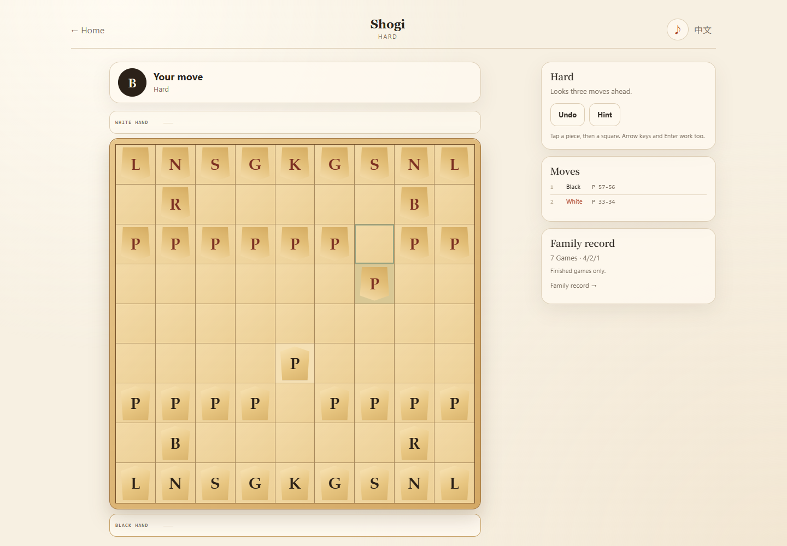 | 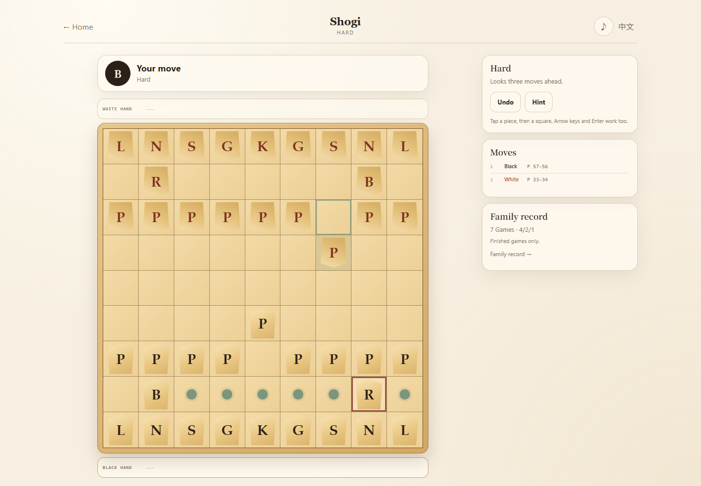 |

| Hint with a reason | Checkmate |
| --- | --- |
| 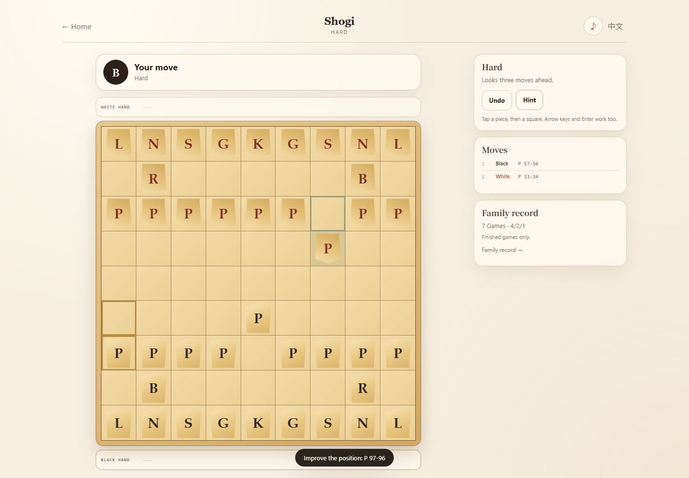 | 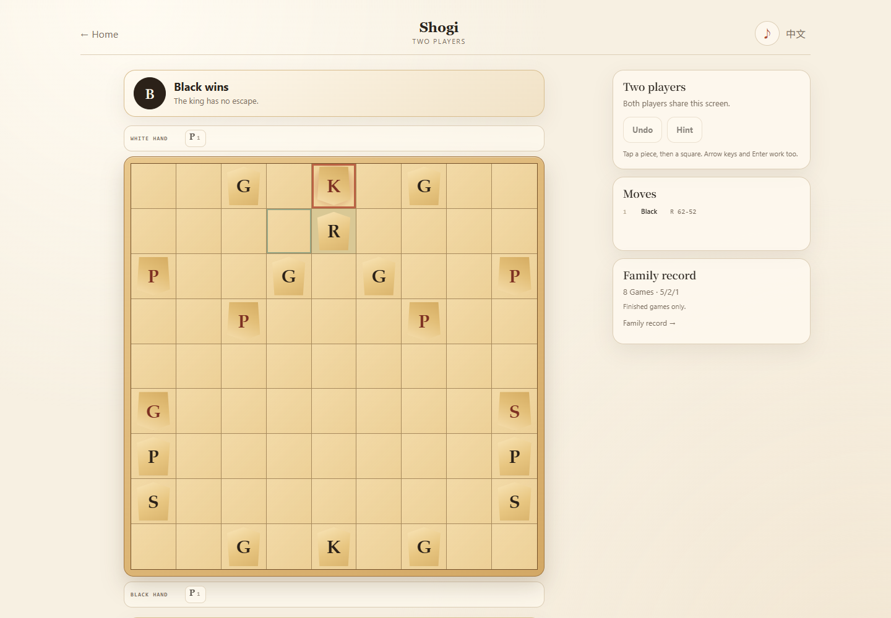 |

| Promotion choice | Family record |
| --- | --- |
| 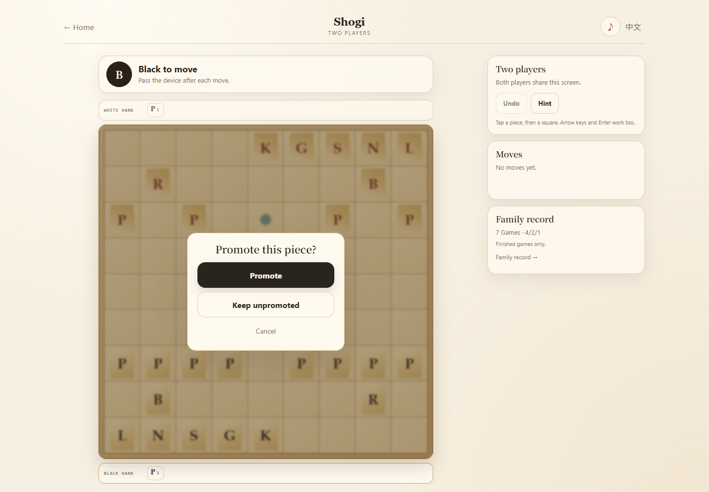 | 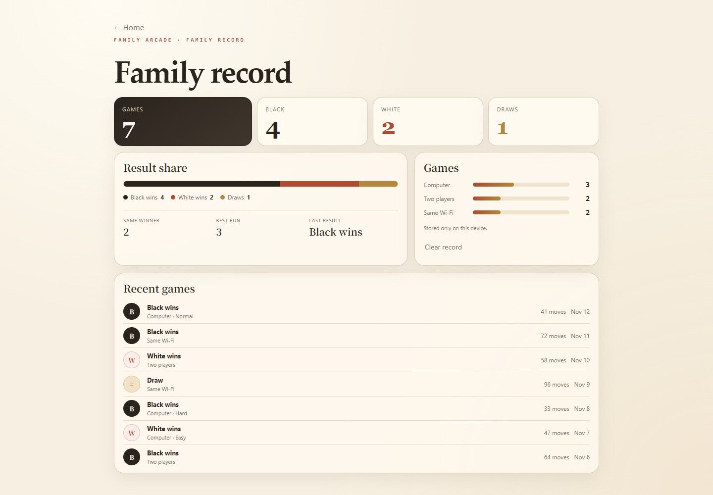 |

| LAN host | LAN guest |
| --- | --- |
| 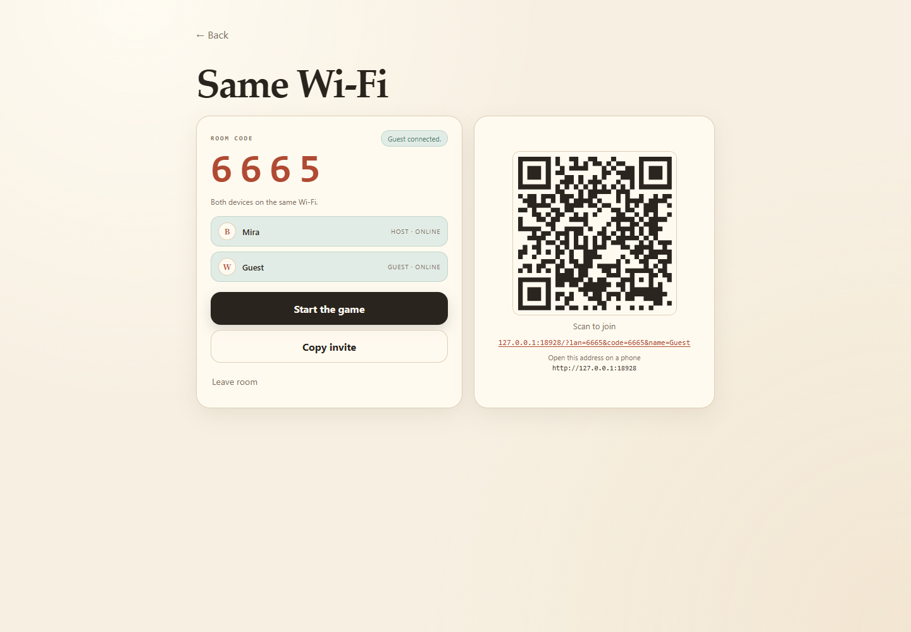 | 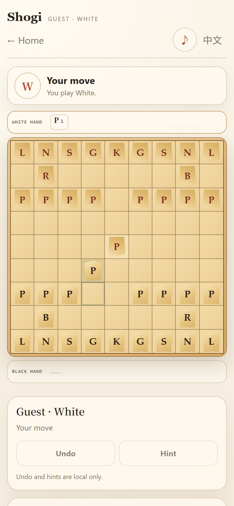 |

| Phone home | Phone game |
| --- | --- |
| 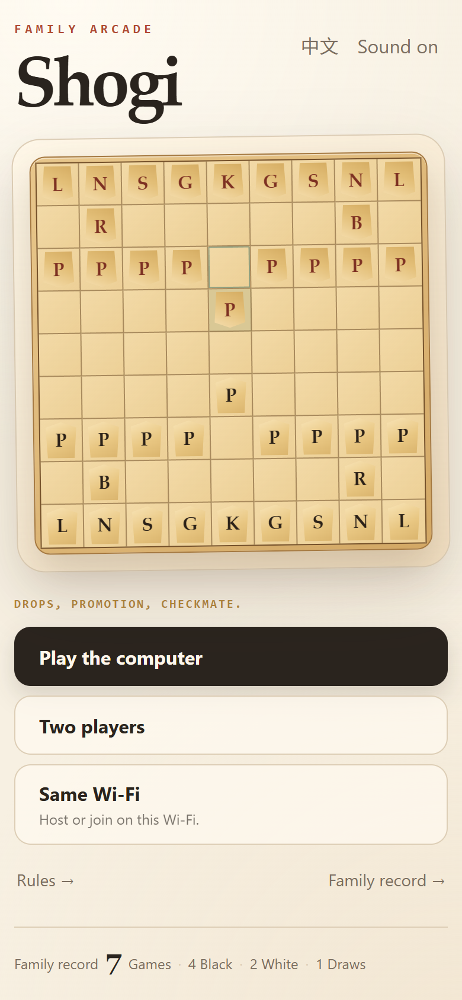 | 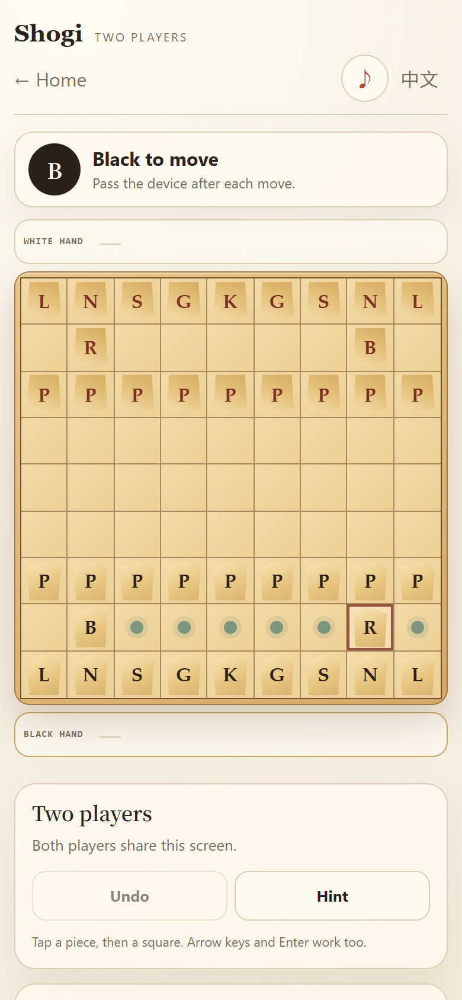 |

All screenshots come from the running app at 1440×1000 (phone 390×844 @2×).

## Play locally

```bash
npm install
npm run dev        # http://localhost:5205
npm run check      # tsc + 27 tests + production build
npm run e2e        # real Chrome, dev server required
npm run lan:e2e    # starts its own relay on a free port after a build
npm run shots      # regenerate home/setup/game/rules/stats/mobile shots
npm run lan:shots  # live LAN host + guest shots (after npm run build)
```

## LAN night

Browser/dev:

```bash
npm run build
npm run lan        # relay on :8080, serves dist/
# open http://localhost:5205, Same Wi-Fi, Create room
# guest: scan the QR, or open the invite and type the code
```

Desktop: the Tauri build starts the same relay internally and serves the built app to
phones. The host shows a four-digit room code and a QR invite. Guests open the address
on the same Wi-Fi; no app install is needed on their side.

The relay is a dumb message bus. The host keeps the authoritative state and sends the
guest the full public position. Room codes, reconnect tokens and move counts are
enforced in TypeScript; stale or spoofed intents are ignored. The guest’s result screen
is read-only and waits for the host to start the next game.

## Build the Windows installer

```bash
npm install
npx tauri build --bundles nsis
# src-tauri/target/release/bundle/nsis/Shogi_0.1.0_x64-setup.exe
```

The installer is per-game and lightweight; WebView2 uses the standard bootstrapper. A
Windows SmartScreen warning is expected for an unsigned family build.

## Known limitations

- Browser build plus a local Tauri shell; no cloud, accounts, matchmaking or spectators.
- LAN is IPv4 on the same subnet; guest phones need the host firewall to allow the app.
- Stats are local to each device. A LAN game is recorded on the host, not duplicated on
  the guest; clearing the record only affects this browser/device.
- A browser-hosted QR may use `localhost`; for a phone on the Wi-Fi use the desktop
  build or open the host machine’s LAN IP.
- Impasse declaration and perpetual-check adjudication are not implemented; fourfold
  repetition is a draw.
- Hard is a solid three-ply family opponent, not a title-strength engine.
- No 4K or vertical promo cut.

See [`docs/limitations.md`](docs/limitations.md).

## Credits

Original code, art and copy for Family Arcade. MIT. See [`NOTICE.md`](NOTICE.md).
