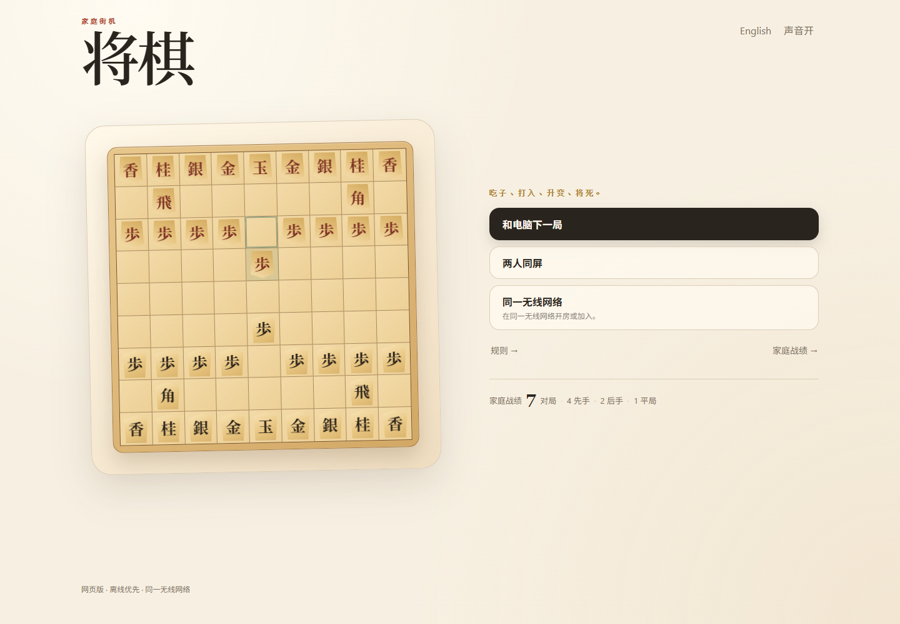
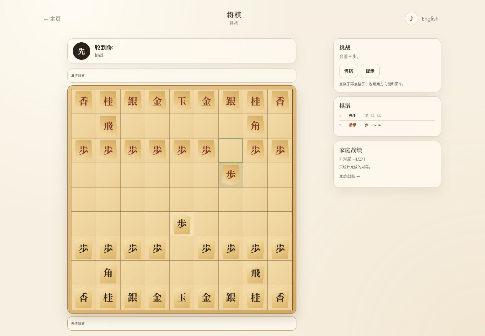
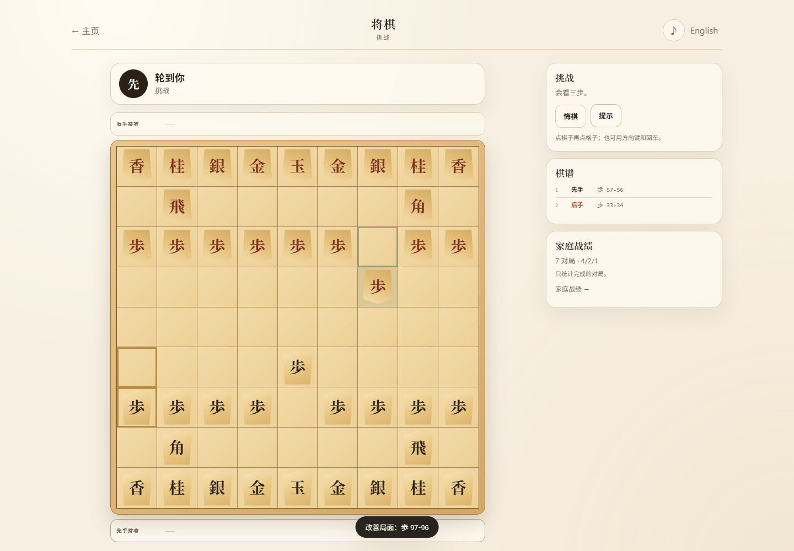
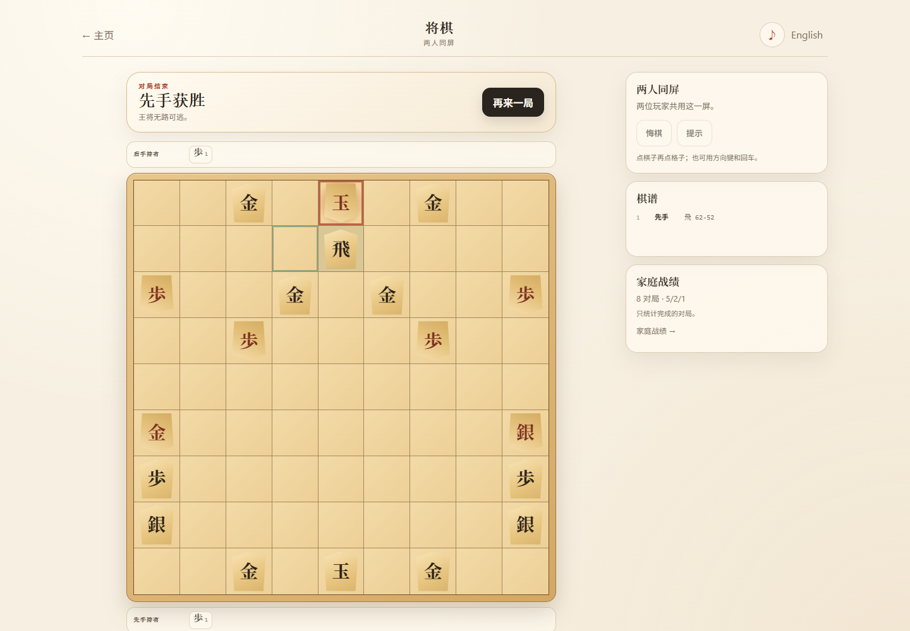
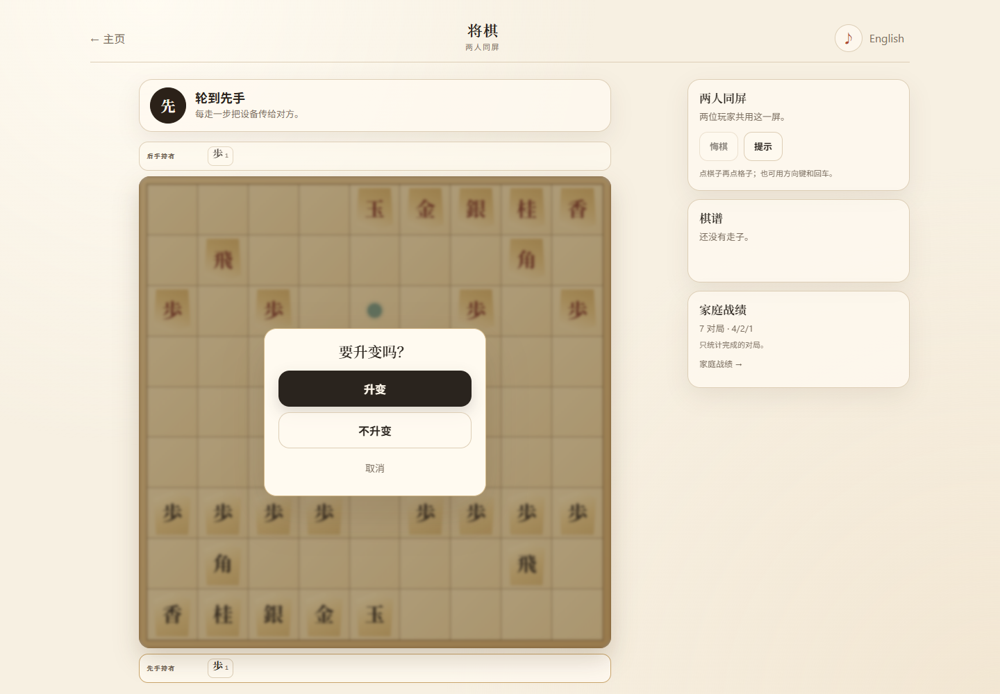
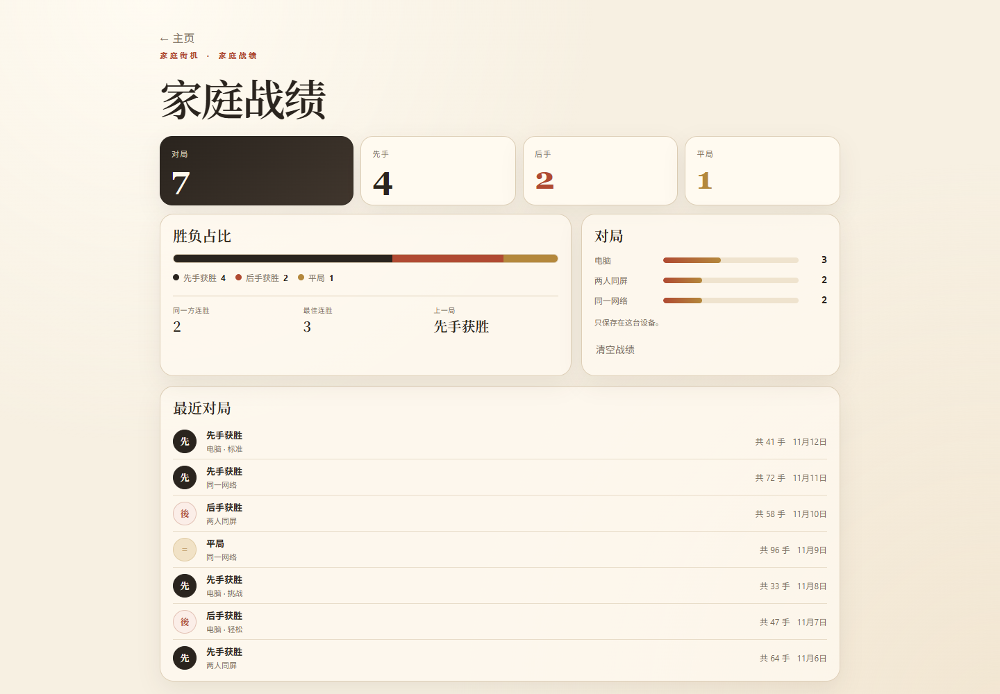
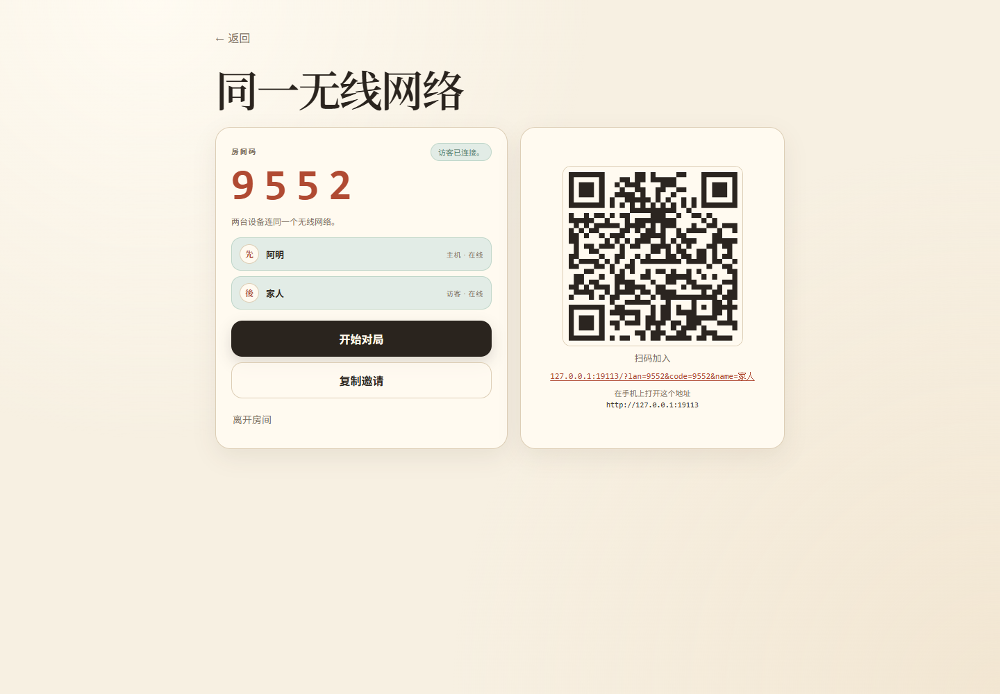
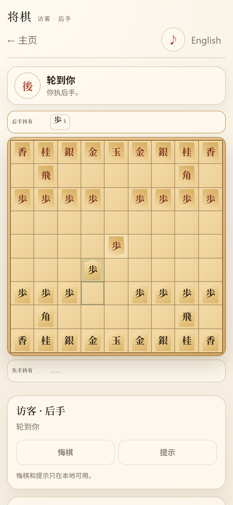
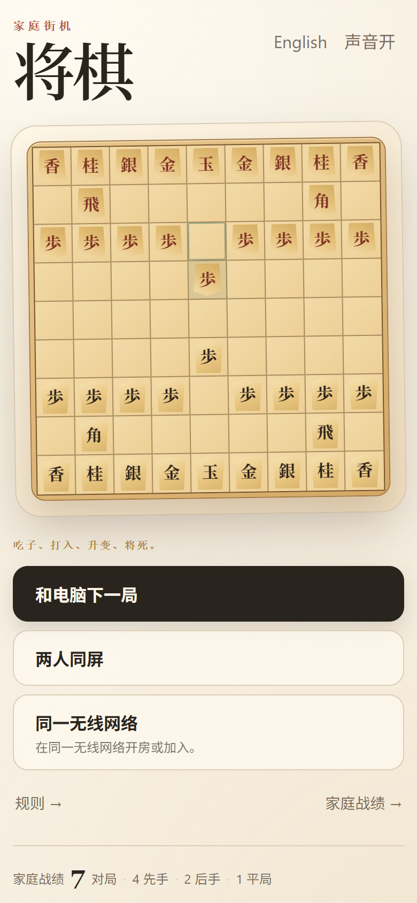
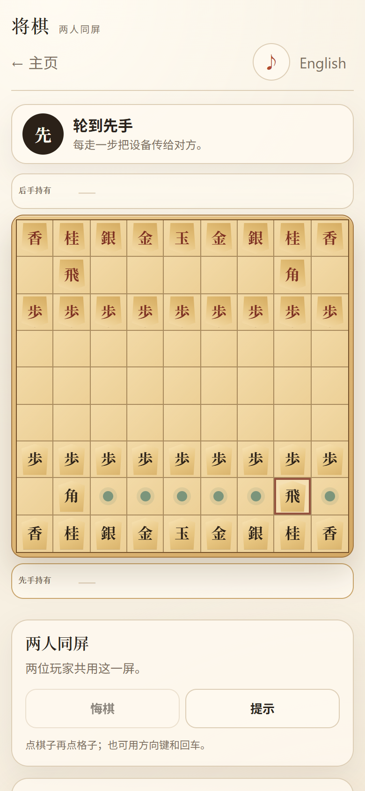

# 将棋

[English](README.md) · **简体中文**

> **吃子、打入、升变、将死。**

一张完整的九乘九家庭将棋盘：**2 人**、四十枚棋子、吃子入手中、升变、将军、将死与
同型重复。可以和四档电脑对战，也可以两人同屏，或让手机连上自家无线网络加入。无账号、
无广告、无云端；手机模式只需要同一个局域网。



## 一回合，五秒看懂

| 走子 | 吃子 | 打入或升变 |
| --- | --- | --- |
| 先手先行，双方轮流走一枚棋子。 | 吃掉的棋子恢复未升变状态，进入自己手中。 | 也可以不移动，把手里的棋子打入合法空格。进入最后三行可以升变。 |

将死获胜；四次同型为平局；无合法走法判负。同一列不能有两枚未升变歩；歩不能打在
最后一行，也不能打入形成立即将死（打入诘）。

## 里面有什么

- **真正的引擎。** 纯 TypeScript、确定性、**27 个单元测试**；规则层不碰 DOM、网络、
  时钟或随机数。见 [`docs/rules.md`](docs/rules.md)。
- **全部棋子。** 王将、飞车、角行、金将、银将、桂马、香车、步兵，以及龙王、龙马和
  各种成子。最后三行可自由选择升变；走到无路可走时强制升变。
- **完整的打入规则。** 二歩、歩香不能打到最后一行、桂马不能打到最后两行、打入解将，
  以及歩打入诘的限制都已实现。
- **四档电脑。** 陪玩温和宽容；轻松看得见吃子但缺少计划；标准会看两步；挑战会看三步，
  并计算子力、王将安全和打入安全。
- **三种玩法。** 执先手单人对抗电脑、两人共用一台设备，或手机加入主机的无线网络房间。
- **能应付真实牌桌的局域网。** 开房后展示四位房间码或二维码；访客可扫码或输入房间码。
  访客刷新后能回到原座位，主机会补发当前局面；只有主机能开始下一局。
- **小细节。** 悔棋（本地与电脑）、会解释原因的提示、自动保存/继续、声音开关、
  方向键加回车、减少动效、完整中英双语，以及按手机优先设计的布局。
- **完整的家庭战绩。** 总对局、先手/后手/平局占比、各模式分布、当前与最佳连续、
  最近八局。局域网结果记在主机设备。
- **默认私密。** 无账号、无遥测、无广告、无远程字体。

## 截图

| 真实对局 | 选择棋子 |
| --- | --- |
|  |  |

| 有理由的提示 | 将死 |
| --- | --- |
|  |  |

| 升变选择 | 家庭战绩 |
| --- | --- |
|  |  |

| 局域网主机 | 局域网访客 |
| --- | --- |
|  |  |

| 手机主页 | 手机对局 |
| --- | --- |
|  |  |

全部来自真实运行的应用：1440×1000，手机 390×844 @2×。

## 本地运行

```bash
npm install
npm run dev        # http://localhost:5205
npm run check      # tsc + 27 个测试 + 生产构建
npm run e2e        # 真实 Chrome，需先运行 dev
npm run lan:e2e    # 构建后自动在空闲端口启动中继并跑完整局域网流程
npm run shots      # 重新生成主页/设置/对局/规则/战绩/手机截图
npm run lan:shots  # 构建后抓取真实局域网主机与访客截图
```

## 局域网

浏览器/开发版：

```bash
npm run build
npm run lan        # :8080 中继，同时托管 dist/
# 打开 http://localhost:5205，选“同一无线网络”→“创建房间”
# 访客：扫码，或打开邀请链接并输入房间码
```

桌面版：Tauri 安装包启动同一个内置中继，并把构建产物托管给手机。主机显示四位房间码
和二维码；访客在同一无线网络打开地址即可，无需安装。

中继只负责转发消息；主机保存权威状态，并发送完整的公开局面。房间码、重连令牌和手数
校验都在 TypeScript 中完成，过期或伪造的意图会被忽略。访客的终局界面是只读的，等主机
开始下一局。

## 构建 Windows 安装包

```bash
npm install
npx tauri build --bundles nsis
# src-tauri/target/release/bundle/nsis/Shogi_0.1.0_x64-setup.exe
```

每款游戏单独打包，安装包保持轻量；WebView2 使用标准引导程序。未签名的家庭构建会触发
Windows SmartScreen 提示。

## 已知限制

- 浏览器版加本地 Tauri 壳；没有云、账号、匹配或观战。
- 局域网仅支持同一子网的 IPv4；手机访客需要主机防火墙放行。
- 战绩按设备保存。局域网对局记在主机，不会在访客设备重复记录；清空战绩只影响当前
  浏览器/设备。
- 浏览器开房生成的二维码可能带 `localhost`；手机加入请用桌面版，或在同一无线网络下
  打开主机局域网地址。
- 未实现入玉宣言和连续将军裁定；四次同型按平局处理。
- 挑战档是稳健的三步家庭对手，不是职业强度引擎。
- 暂无 4K/竖屏宣传片。

见 [`docs/limitations.md`](docs/limitations.md)。

## 许可

Family Arcade 原创代码、美术与文案，MIT。见 [`NOTICE.md`](NOTICE.md)。
