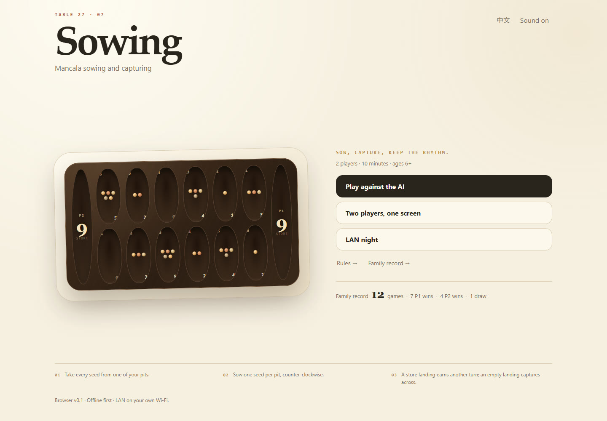
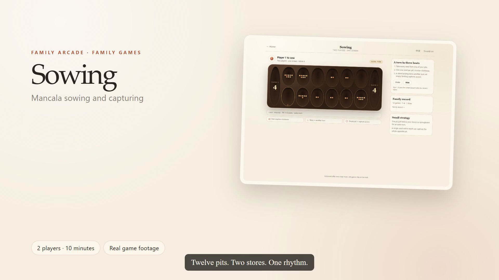
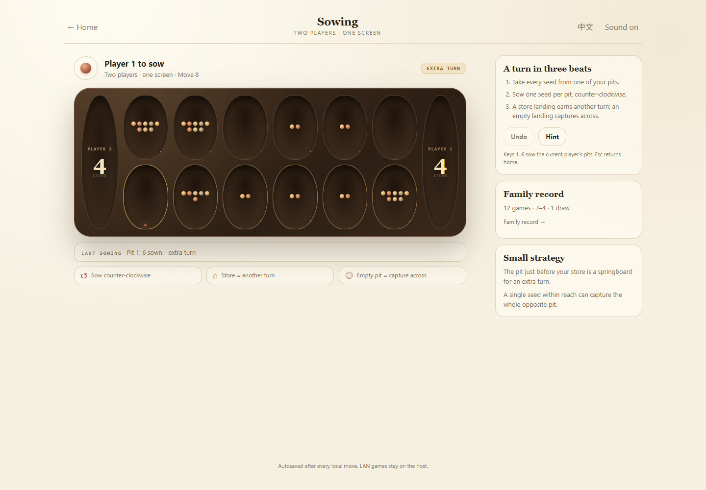
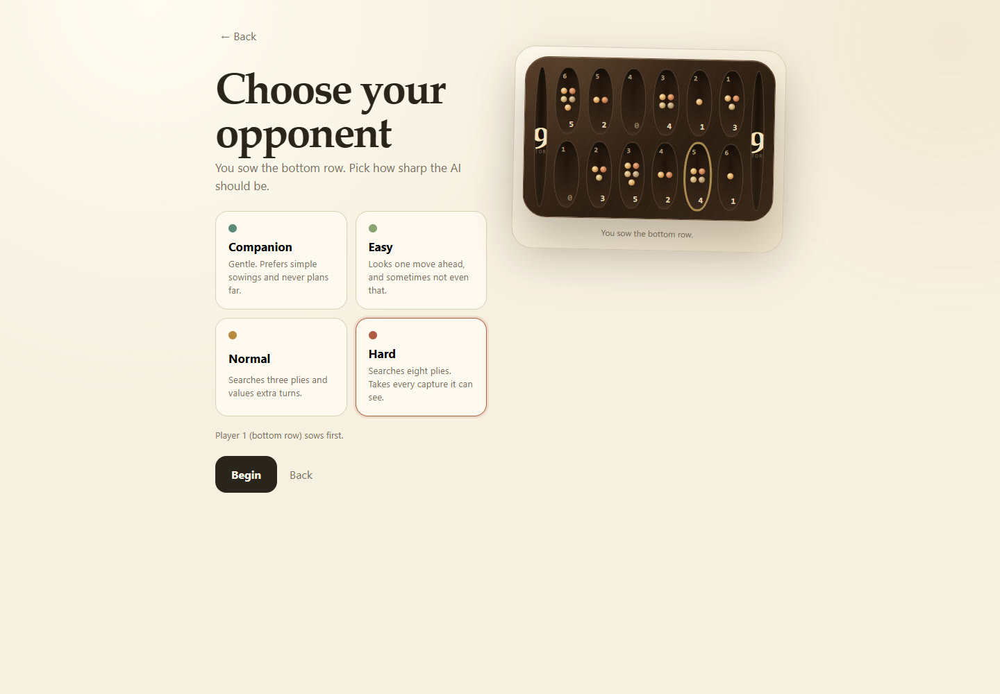
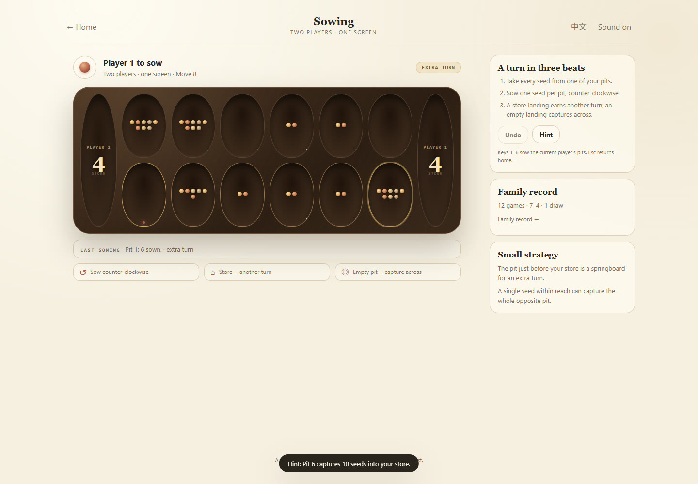
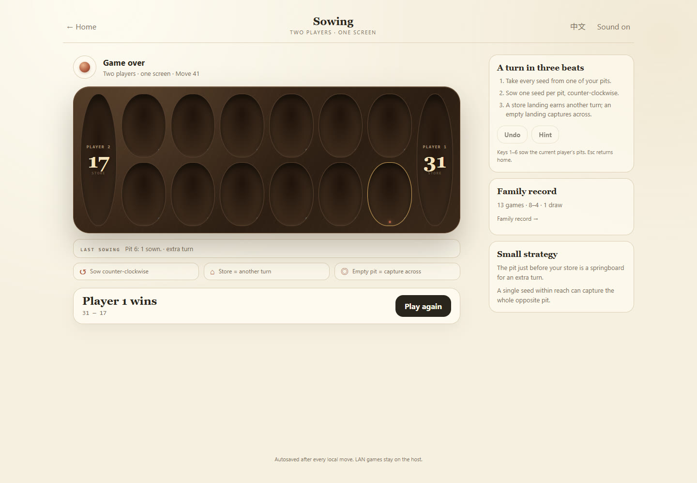
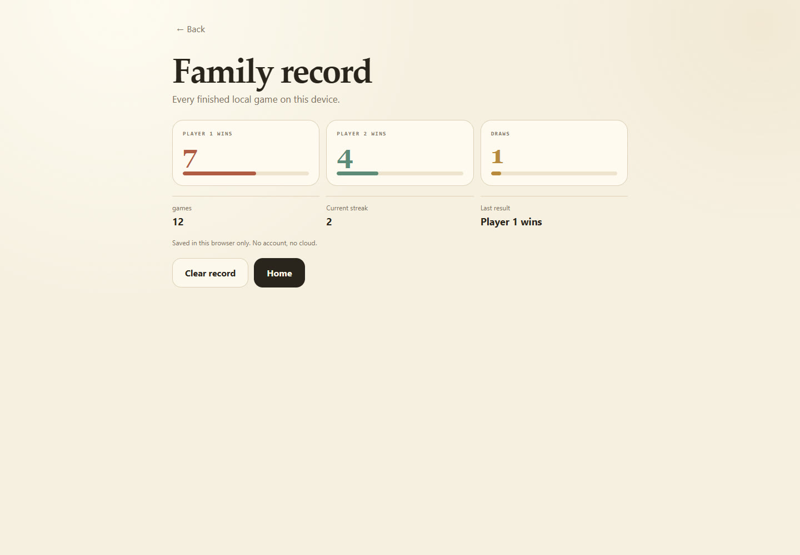
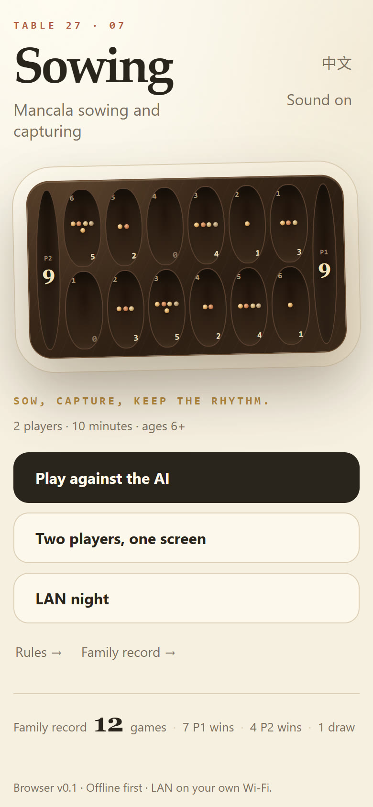
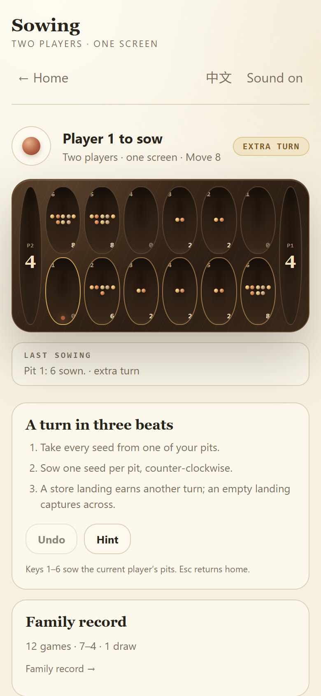

# Sowing · 播棋

**English** · [简体中文](README.zh-CN.md)

> **Mancala sowing and capturing**

A calm, offline-first mancala game for the family table: **2 players**, twelve pits
and two stores, four AI levels, one-screen hot-seat and LAN play from a phone. No
account, no ads, no network required except your own Wi-Fi for LAN night.



[](docs/promo/sowing-promo-en.mp4)

*45 seconds · 1920×1080 · 60 fps · [中文版](docs/promo/sowing-promo-zh.mp4) · [video.json](video.json)*

*The 45-second promo is rendered centrally by the Family Arcade studio from [`video.json`](video.json).*

## A turn, in five seconds

| Sow | Capture | Win |
| --- | --- | --- |
| Lift every seed from one of your six pits and drop one per pit, counter-clockwise. Skip the other store. | Land in your store for another turn. Land in an empty pit on your side and take that seed plus the opposite pit. | The game ends when one row is empty. Remaining seeds go home; the bigger store wins. |

## What is inside

- **A real, tested engine.** Pure TypeScript, deterministic, **31 unit tests**, no DOM,
  clock, network or `Math.random` in the rules. See [`docs/rules.md`](docs/rules.md).
- **Four AI levels.** Companion prefers simple, quiet sowings and never plans far.
  Easy looks one move ahead. Normal searches three plies. Hard searches eight plies
  with alpha-beta pruning and move ordering.
- **Three ways to play.** Solo against the AI, two players passing one device, or a
  phone joining over the local network.
- **LAN night.** Host a room, show the QR code, and a phone joins from the browser.
  The host is authoritative; the guest receives its own seat view and sends intents.
- **Small comforts.** Undo, a hint with a stated reason, autosave/resume, local family
  record, sound on/off, keyboard 1–6, reduced-motion support, complete Chinese/English UI.
- **Private by default.** No accounts, no telemetry, no ads, no remote fonts or art.

## Screenshots

All pictures are real captures of the running app.

| Home | A game |
| --- | --- |
|  |  |

| AI setup | Hint |
| --- | --- |
|  |  |

| Result | Family record |
| --- | --- |
|  |  |

| Phone home | Phone game |
| --- | --- |
|  |  |

Desktop 1440×1000; phone 390×844 at 2× (780×1688). The Chinese set is in
`docs/screenshots/zh/`.

## Play locally

```bash
npm install
npm run dev        # http://localhost:5186
npm run check      # tsc + 31 tests + production build
npm run e2e        # real Chrome; start the dev server first
npm run shots      # regenerate docs/screenshots/{en,zh}
```

## LAN night

Browser/dev:

```bash
npm run build
npm run lan        # relay on :8080, serves dist/
# open http://localhost:5186, choose LAN night, host a room
```

Desktop: the Tauri build starts the same relay internally and serves the built app to
phones. The host shows a 4-digit room code and a QR invite. Guests open the address on
the same Wi-Fi, enter the code (it is already in the invite) and tap **Enter the board**
after the host starts. No app install is needed on their side.

The relay is a dumb message bus. The host keeps the authoritative state and sends only
the guest's seat view. Room codes, reconnect tokens and turn checks are enforced in
TypeScript; a stale or spoofed intent is rejected by `applySeat`.

## Build the Windows installer

```bash
npm install
npx tauri build --bundles nsis
# src-tauri/target/release/bundle/nsis/Sowing_0.1.0_x64-setup.exe
```

The installer is per-game and lightweight; WebView2 uses the standard bootstrapper.
A Windows SmartScreen warning is expected for an unsigned family build.

## Known limitations

- Browser v0.1 plus a local Tauri shell; no cloud, accounts, matchmaking or spectators.
- The rules use the family Kalah convention: four seeds per pit, capture even when the
  opposite pit is empty, and **finish-and-sweep** when a row empties.
- Undo and hints are for solo/hot-seat only. LAN has no undo, so neither seat can rewind
  the other.
- The family record counts finished local games on this device; LAN results stay on the host.
- Hard is a real 8-ply search, not a perfect solver; it can think for a moment on a full
  board. Companion is intentionally gentle, not a challenge.
- LAN is IPv4 on the same subnet; guest phones need the host firewall to allow the app.
- No 4K or vertical promo cut; the root studio renders the 1080p portrait/landscape cut.

See [`docs/limitations.md`](docs/limitations.md).

## Credits

Original code, art and copy for Family Arcade. Mancala is a public-domain folk game; this
implementation, name, copy and visual design are original. MIT. See [`NOTICE.md`](NOTICE.md).

## Promo

[](docs/promo/sowing-promo-en.mp4)

- [English cut](docs/promo/sowing-promo-en.mp4) · [other language](docs/promo/sowing-promo-zh.mp4)
- [SRT](docs/promo/sowing-promo-en.srt) · [video.json](video.json)
- Real app screenshots and real engine data; claims match the tests.

