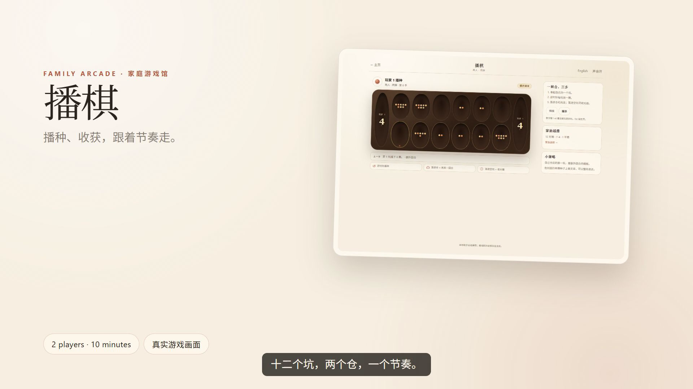
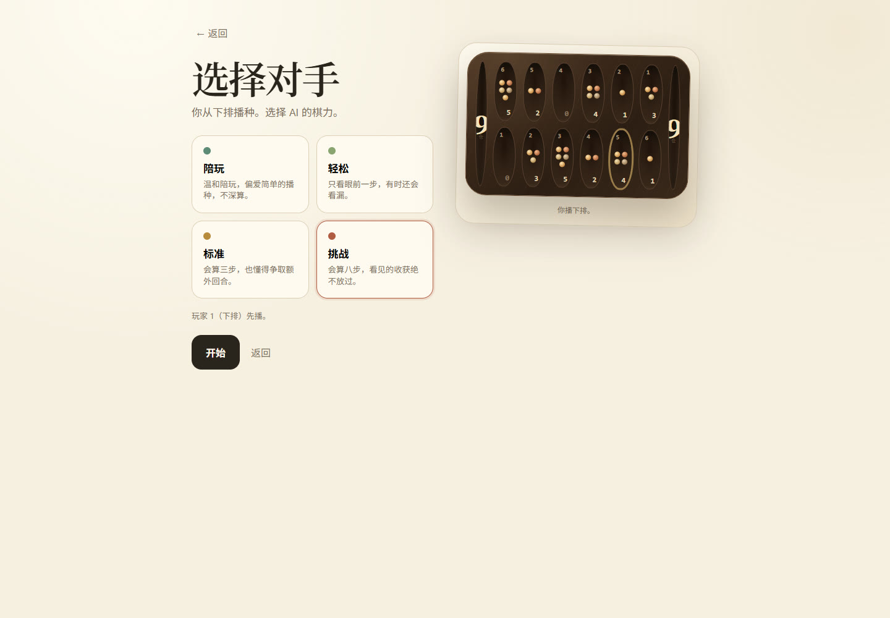
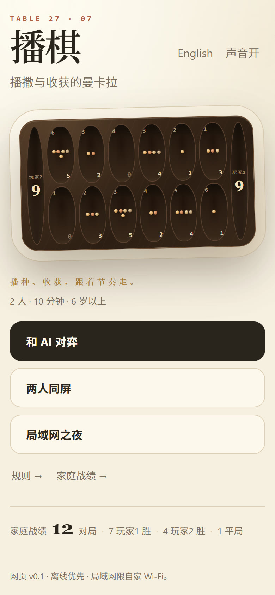
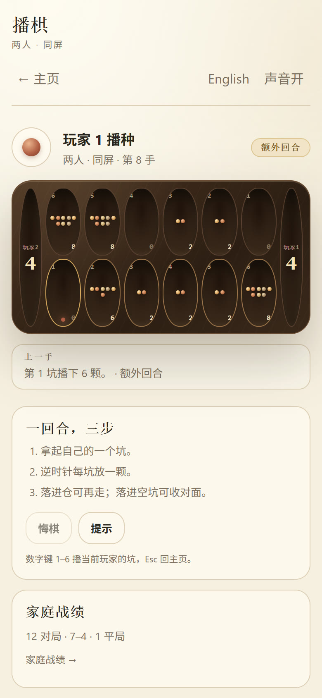

# 播棋 · Sowing

[English](README.md) · **简体中文**

> **播撒与收获的曼卡拉**

给家庭牌桌的一款安静小游戏：**2 人**、十二个坑和两个仓、四档 AI、同屏热座，以及
手机浏览器直接加入的局域网对战。无账号、无广告；除自家 Wi-Fi 外不需要联网。


[](docs/promo/sowing-promo-zh.mp4)

*45 秒 · 1920×1080 · 60fps · [English cut](docs/promo/sowing-promo-en.mp4) · [video.json](video.json)*

*45 秒宣传片由 Family Arcade 根目录的工作室根据 [`video.json`](video.json) 统一渲染。*

## 一回合，五秒看懂

| 播种 | 收获 | 结束 |
| --- | --- | --- |
| 拿起自己一个坑里的全部种子，逆时针每坑放一颗。经过对方的仓要跳过。 | 最后一颗落进自己的仓，就再来一回合；落进自己一侧的空坑，就收走它和正对面的整坑。 | 任意一排坑空了，对局立刻结束。剩下的种子归各自的主人，仓里多的获胜。 |

## 里面有什么

- **真正的引擎。** 纯 TypeScript、确定性、**31 个单元测试**；规则层不碰 DOM、时钟、
  网络，也不用 `Math.random`。见 [`docs/rules.md`](docs/rules.md)。
- **四档 AI。** 陪玩偏爱简单安静的播种，不深算；轻松只看一步；标准算三步；挑战用
  alpha-beta 和着法排序算八步。
- **三种玩法。** 单人对抗 AI、两人共用一台设备、手机在同一 Wi-Fi 下加入。
- **局域网之夜。** 开房间、显示二维码，手机浏览器直接加入。主机权威，访客只收到自己
  座位的视图并发送意图。
- **小细节。** 悔棋、带理由的提示、自动保存/继续、本机家庭战绩、声音开关、数字键 1–6、
  减少动效、完整中英双语。
- **默认私密。** 无账号、无遥测、无广告、无远程字体或素材。

## 截图

全部来自真实运行的页面。

| 主页 | 对局 |
| --- | --- |
|  |  |

| AI 难度 | 提示 |
| --- | --- |
|  |  |

| 结果 | 家庭战绩 |
| --- | --- |
|  |  |

| 手机主页 | 手机对局 |
| --- | --- |
|  |  |

桌面为 1440×1000；手机为 390×844 @2×（780×1688）。英文截图在
`docs/screenshots/en/`。

## 本地运行

```bash
npm install
npm run dev        # http://localhost:5186
npm run check      # tsc + 31 个测试 + 生产构建
npm run e2e        # 真实 Chrome；先启动 dev server
npm run shots      # 重新生成 docs/screenshots/{en,zh}
```

## 局域网之夜

浏览器/开发环境：

```bash
npm run build
npm run lan        # 中继在 :8080，同时托管 dist/
# 打开 http://localhost:5186，选择“局域网之夜”，开一个房间
```

桌面版：Tauri 安装包会在应用内启动同一个中继，并把构建好的页面提供给手机。主机显示
4 位房间码和二维码邀请。客人在同一 Wi-Fi 下打开地址，确认房间码（邀请链接已带好），
等主机开始后点 **进入棋盘** 即可；客人无需安装应用。

中继只是消息总线。主机保存权威状态，只发送客人自己的座位视图。房间码、重连令牌和
回合检查都在 TypeScript 里完成；过期或伪造的意图会被 `applySeat` 拒绝。

## 构建 Windows 安装包

```bash
npm install
npx tauri build --bundles nsis
# src-tauri/target/release/bundle/nsis/Sowing_0.1.0_x64-setup.exe
```

安装包按游戏单独打包，体积轻；WebView2 使用标准引导器。未签名的家庭版出现
Windows SmartScreen 提示是正常现象。

## 已知限制

- 网页 v0.1 加本地 Tauri 外壳；无云端、账号、匹配或观战。
- 规则采用家庭 Kalah 约定：每坑四颗种子，对面坑为空也照样收下那颗种子，一排空了以后
  把剩余种子扫入各自仓中（finish-and-sweep）。
- 悔棋和提示只在单人/同屏可用。局域网不提供悔棋，避免一方回退另一方的走法。
- 家庭战绩只统计这台设备上完成的本地对局；局域网结果留在主机。
- 挑战是真实的八步搜索，不是完美解算器，满盘时可能思考片刻；陪玩刻意温和，不负责
  挑战。
- 局域网限同一子网的 IPv4；客人手机需要主机防火墙放行应用。
- 没有 4K 或竖版宣传片；根目录工作室负责渲染。

详见 [`docs/limitations.md`](docs/limitations.md)。

## 版权

Family Arcade 原创代码、视觉和文案。曼卡拉是公有领域民间游戏；本实现、名称、文案和视觉
设计均为原创。MIT，见 [`NOTICE.md`](NOTICE.md)。

## 宣传片

[](docs/promo/sowing-promo-zh.mp4)

- [中文成片](docs/promo/sowing-promo-zh.mp4) · [另一语言](docs/promo/sowing-promo-en.mp4)
- [字幕](docs/promo/sowing-promo-zh.srt) · [video.json](video.json)
- 画面来自真实应用与真实引擎数据；数字与测试一致。

