# Spades

**English** · [简体中文](README.zh-CN.md)

> **Four seats. Two partnerships. One deck.**

Four-player partnership Spades for the family table: a real 52-card engine, nil and
blind nil, bags, a 500-point match, four AI levels, four-player hot-seat, and a
per-seat LAN table. No accounts, ads, telemetry or remote assets.

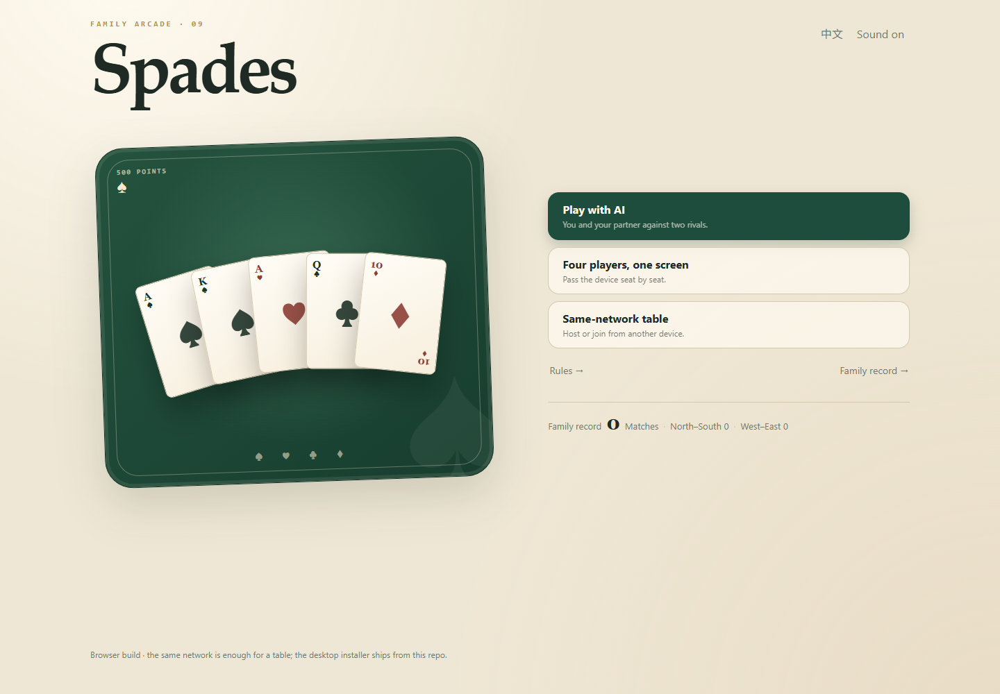

## A turn in five seconds

| Deal | Bid | Play | Score |
| --- | --- | --- | --- |
| 52 cards, 13 each. Partners sit across. | Each seat bids 1–13, or nil for zero tricks. | Follow suit. Spades are trump and cannot be led until broken. | Make your contract; every 10 bags costs 100. First partnership to 500 wins. |

## What is inside

- **A real, tested engine.** Pure TypeScript in `src/game/spades.ts`, with 43 unit
  tests: deal order, bidding, blind-nil eligibility, follow-suit, spades-broken, trick
  resolution, nil, bags, match rotation, per-seat privacy and scoring arithmetic.
  The engine has no DOM, network, clock or `Math.random`; shuffles take an injected RNG.
- **Four AI levels.** Companion bids gently and protects a child’s table; Easy makes
  mistakes; Normal estimates bids and covers its partner; Hard counts played cards and
  runs a deterministic trick simulation over sampled unseen hands. No level peeks at
  another hand. See [`docs/rules.md`](docs/rules.md).
- **Three ways to play.** Solo with three AI partners/rivals, four players passing one
  device, or a LAN room for up to four devices (host plus three guests). Empty LAN seats
  are filled by AI, so two phones are enough for a mixed table.
- **Privacy as a rule.** A hot-seat bidder must reveal their own hand; every play turn has
  a pass-the-device cover. In LAN play the host sends each device only that seat’s view:
  own hand, public bids, tricks and scores. There is no spectator view.
- **Nil and blind nil.** Nil pays ±100. Blind nil must be declared before looking and
  pays ±200. The UI offers the blind decision behind a cover; once a seat has looked, a
  blind nil is rejected by the engine.
- **Bags and a 500-point match.** Overtricks become bags. Every ten bags costs 100 and
  resets ten bags. The deal rotates, the dealer’s left bids first and leads first, and the
  first partnership to 500 wins.
- **Small comforts.** Undo, a hint with a reason, autosave/resume, a local family record,
  sound toggle, reduced-motion support, keyboard path (keys 1–9, U, H, Esc), complete
  Chinese/English screens and a mobile layout.
- **Private by default.** No cloud, accounts, ads, tracking or remote fonts.

## Screenshots

| Home | Table settings |
| --- | --- |
|  | 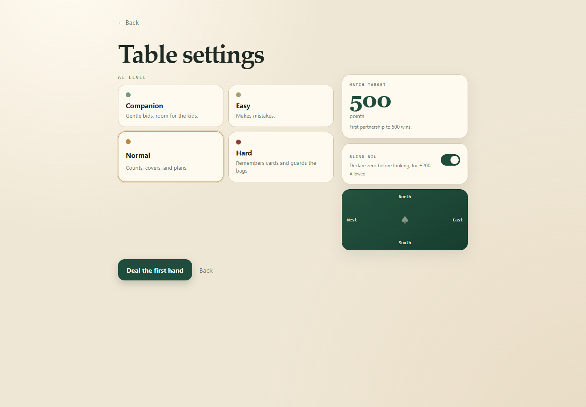 |

| Bidding | A trick |
| --- | --- |
| 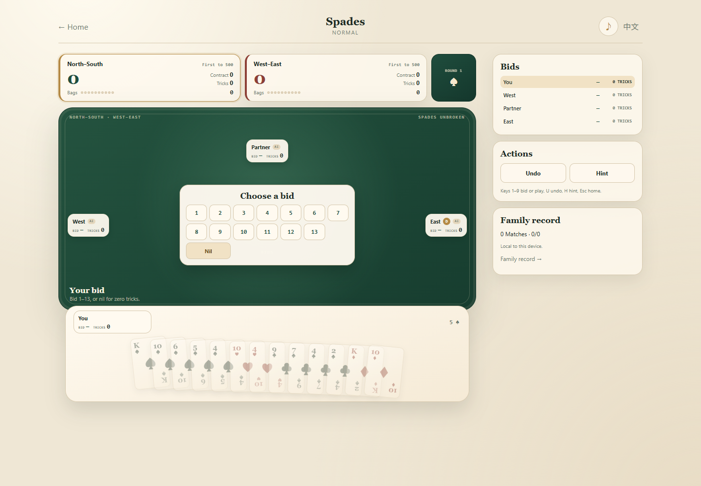 | 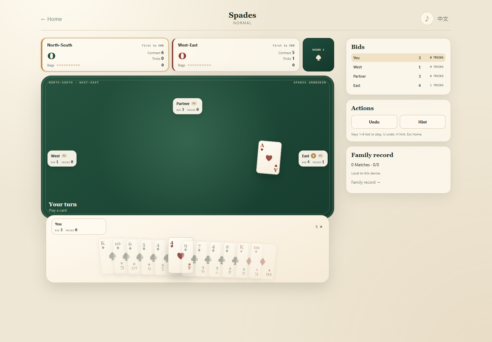 |

| Hint with a reason | Round summary |
| --- | --- |
| 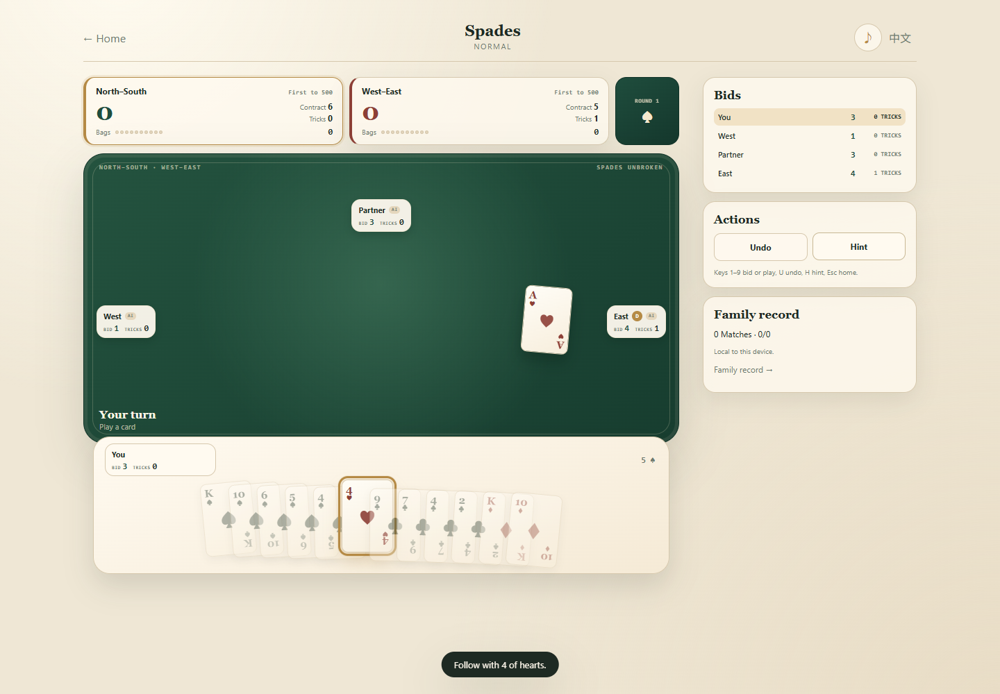 | 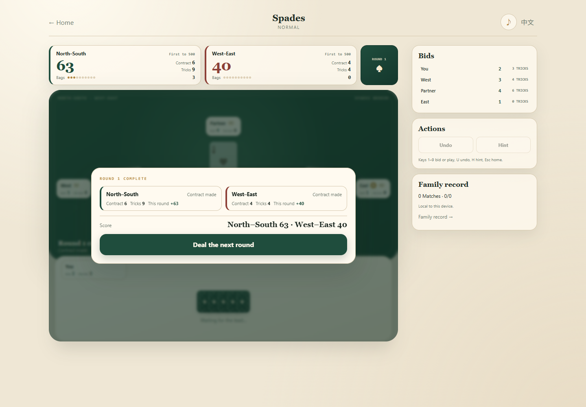 |

| Match end | Family record |
| --- | --- |
| 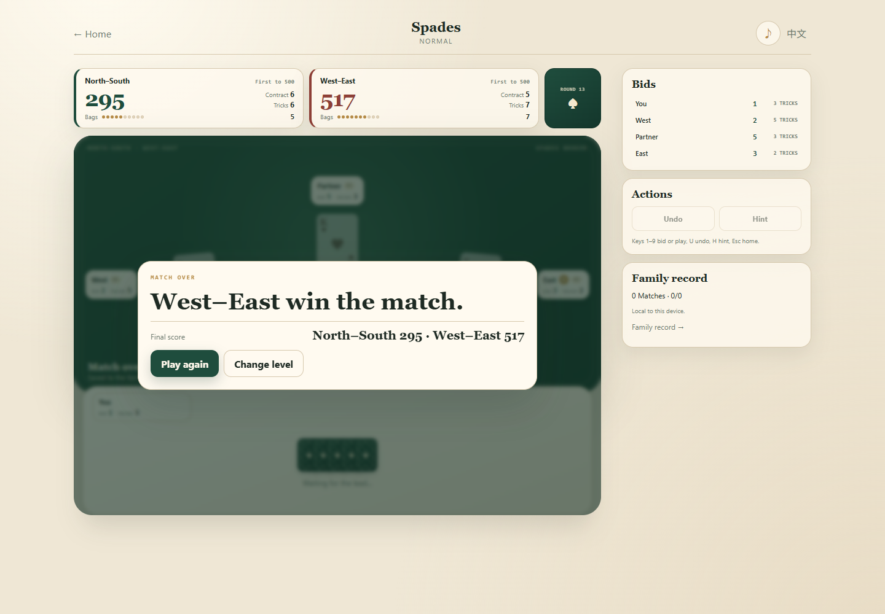 | 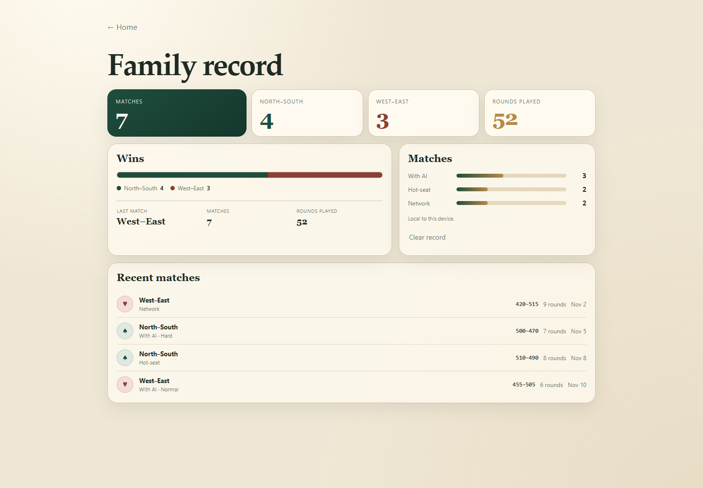 |

| Rules | LAN lobby |
| --- | --- |
| 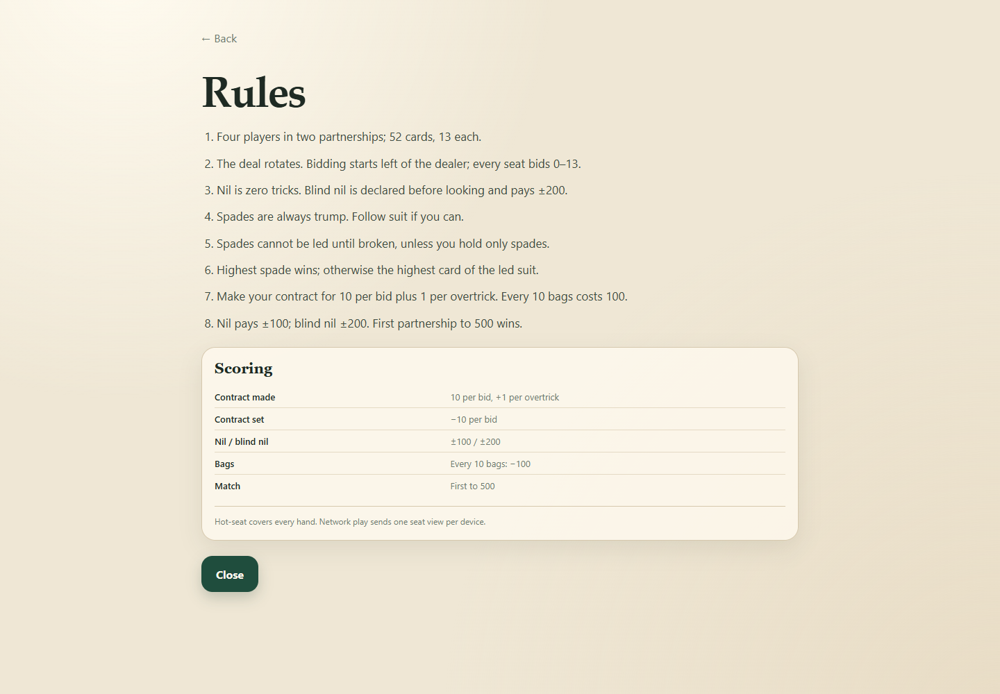 | 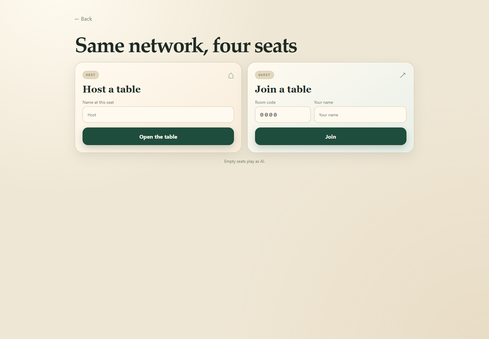 |

| Phone home | Phone table |
| --- | --- |
| 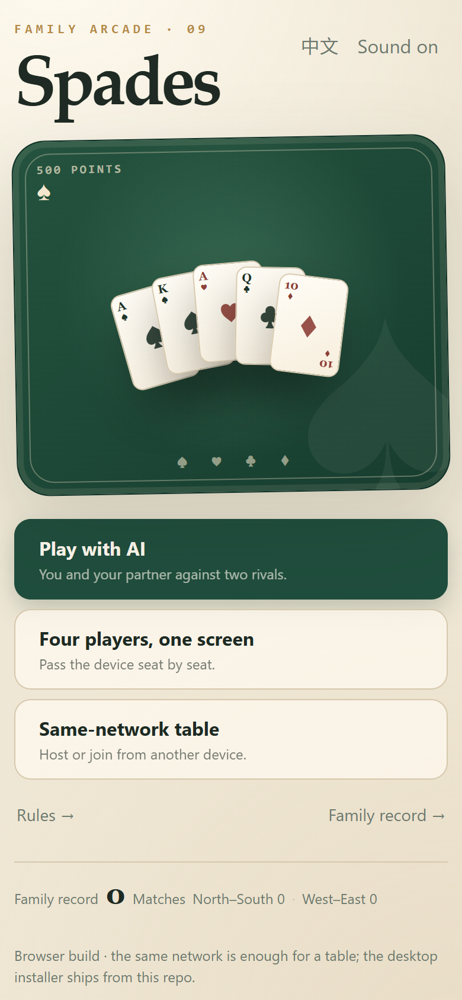 | 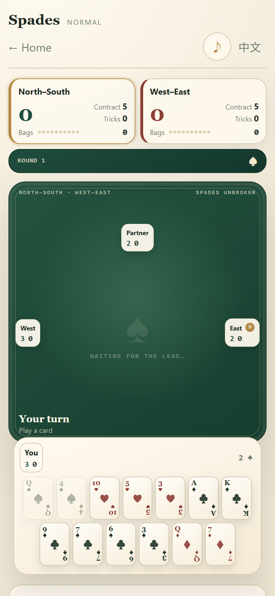 |

All screenshots come from the running app at 1440×1000 (phone 390×844 @2×).
The round and match-end screens are generated from deterministic, valid engine fixtures
used by the screenshot script.

## Play locally

```bash
npm install
npm run dev        # http://localhost:5209
npm run check      # tsc + 43 tests + production build
npm run e2e        # real Chrome, dev server required
npm run lan:e2e    # four browsers against a relay after a build
npm run shots      # regenerate the EN/ZH screenshot sets
```

## LAN night

```bash
npm run build
npm run lan        # relay on :8080, serves dist/
# open the host page, then Same-network table -> Open the table
# guests scan the QR or open the invite URL on the same network
```

The host owns the authoritative match. Guests receive one seat view per device and can
send only `reveal`, `bid` or `play` intents for their own seat. The host re-checks turn,
card ownership, follow-suit and spades-broken before applying anything. Guests can reload
and rejoin with the same token; a disconnected seat is taken over by AI until the guest
returns. Undo and hints pause in network play so nobody gains an information advantage.

The desktop build starts the same relay internally. The browser build can use
`npm run lan`; a QR opened on `localhost` will not reach a phone, so use the host
machine’s network address or the desktop app.

## Build the Windows installer

```bash
npm install
npx tauri build --bundles nsis
# src-tauri/target/release/bundle/nsis/Spades_0.1.0_x64-setup.exe
```

The installer is per-game and lightweight; WebView2 uses the standard bootstrapper.
An unsigned family build may show a Windows SmartScreen warning.

## Known limitations

- Four players and a fixed 500-point match in the UI. The engine accepts any target, but
  there is no quick-match selector yet.
- LAN is IPv4 on the same subnet, up to four devices. There is no online matchmaking,
  spectator mode or cloud record.
- A LAN match is recorded on the host device only. The guest device keeps its own local
  record and never receives another seat’s hand.
- The AI is honest but heuristic. Hard counts cards and samples unseen hands; it is not a
  tournament solver and will sometimes misplay.
- AI seats always look before declaring nil, so blind nil is a human-only option.
- The longest edge case is a tie at or above 500; the match continues until one side leads
  after a scored round.
- Browser QR invites can say `localhost`; use the desktop build or the host LAN address
  for a phone.
- The round and match-end screenshots use valid deterministic fixtures; live play is
  verified by the e2e and LAN tests.

See [`docs/limitations.md`](docs/limitations.md) and the full rule audit in
[`docs/rules.md`](docs/rules.md).

## Credits

Original code, card art, copy and sound for Family Arcade. Spades is a public-domain card
game; this implementation and its visual design are original. MIT. See
[`NOTICE.md`](NOTICE.md).
