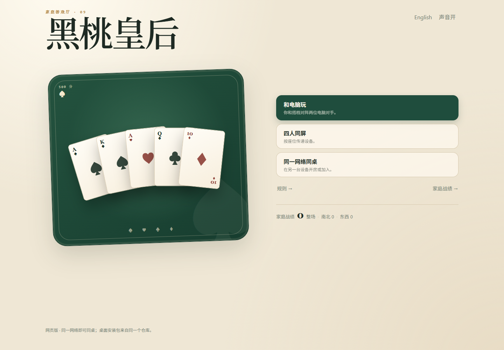
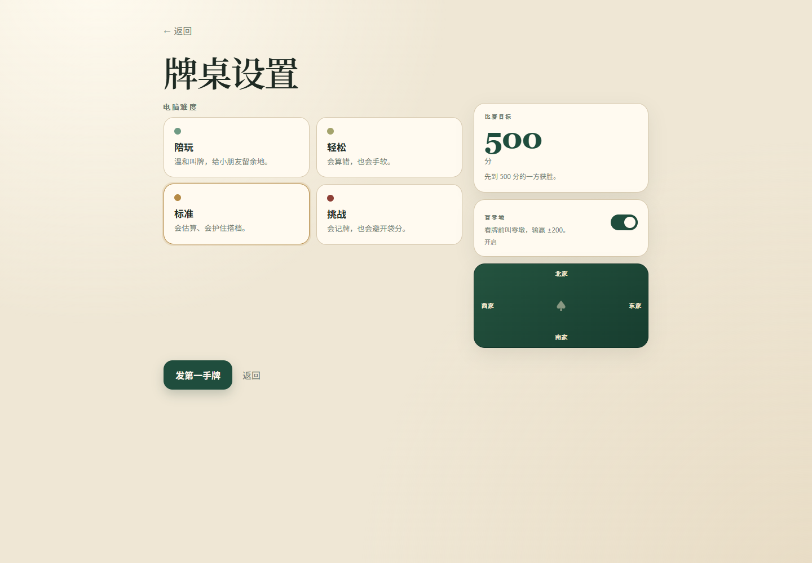
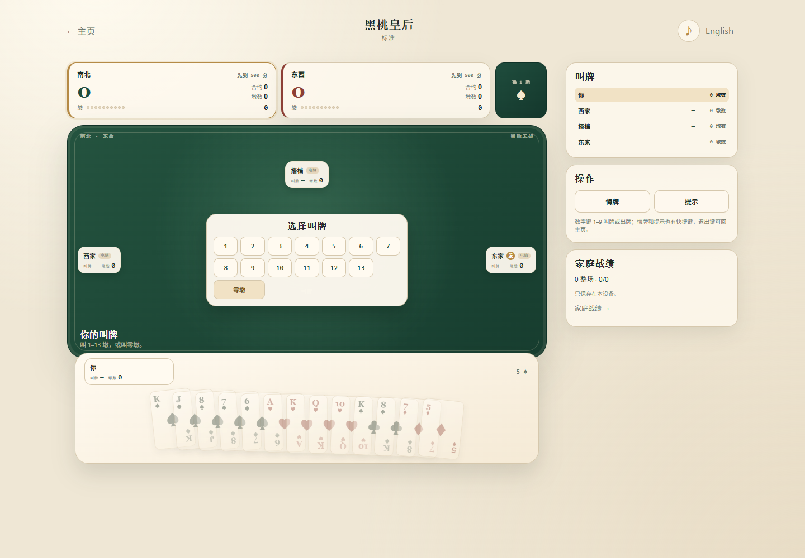
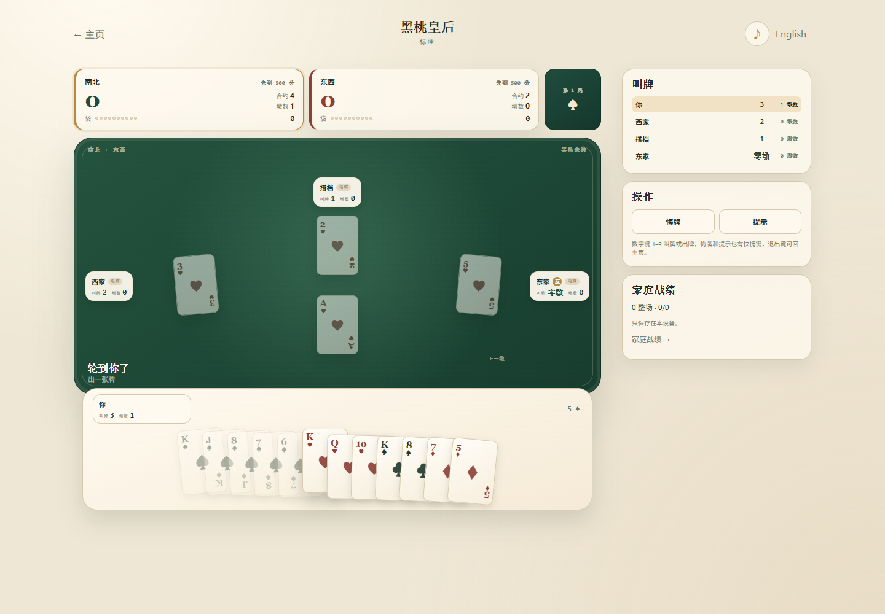
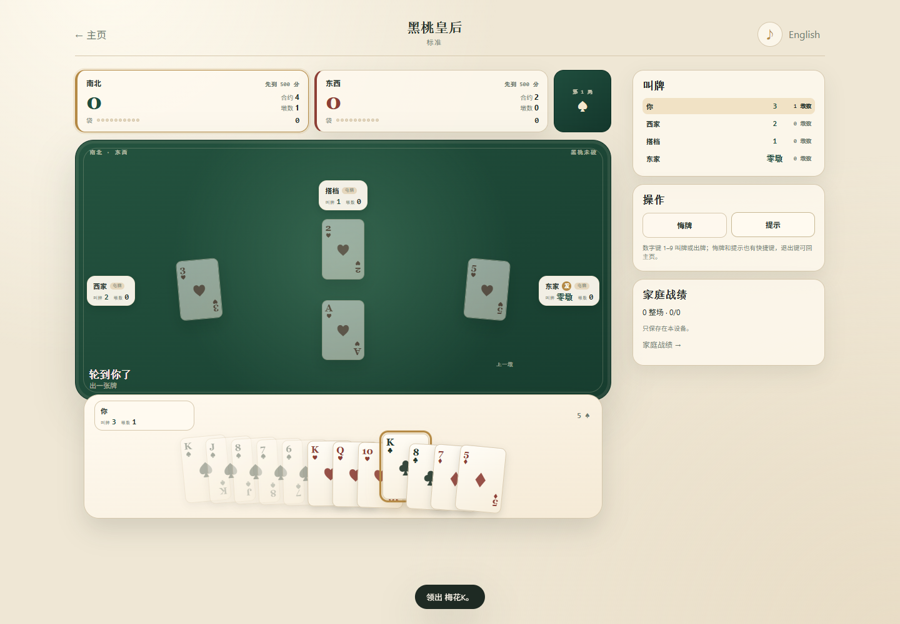
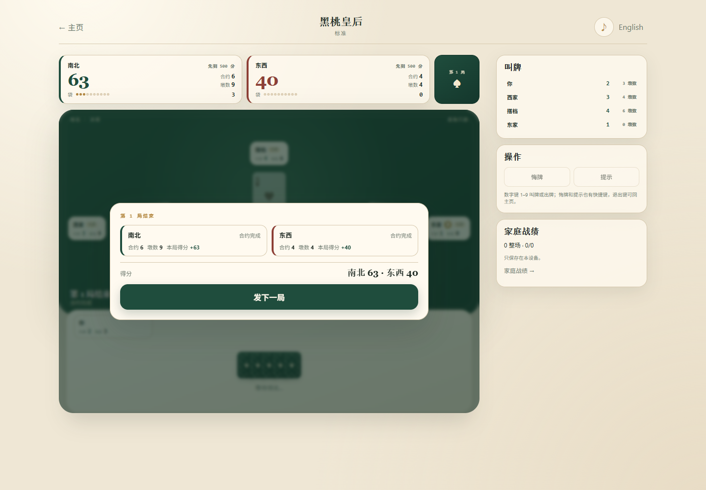
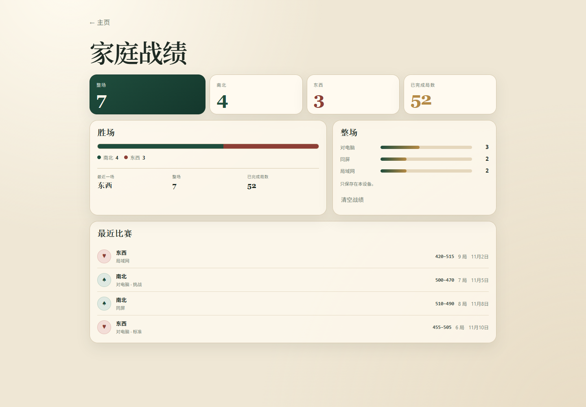
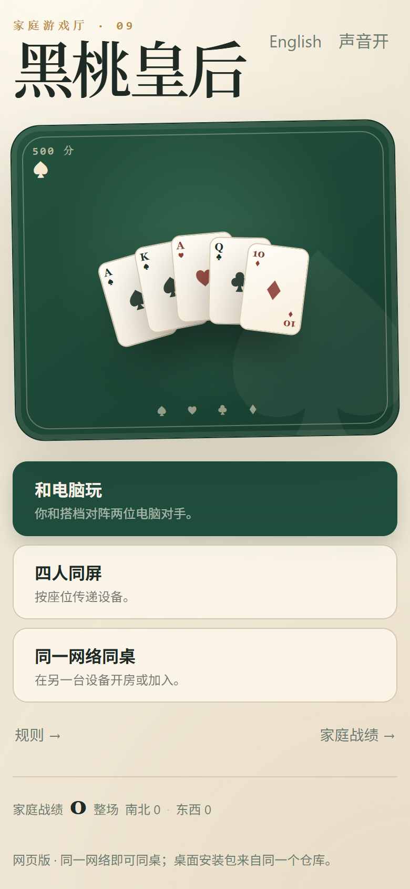
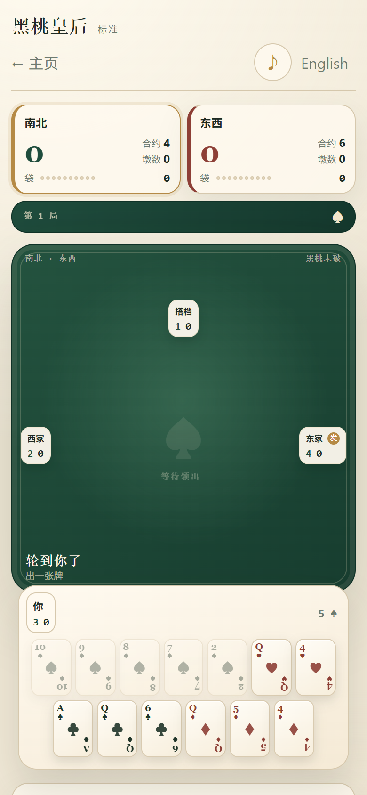

# 黑桃皇后

[English](README.md) · **简体中文**

> **四个座位，两对搭档，一副牌。**

给家庭牌桌的四人搭档黑桃：真实的 52 张牌引擎、零墩与盲零墩、袋分、五百分整场、四档电脑、四人同屏，以及每台设备只看自己座位的局域网牌桌。没有账号、广告、遥测或远程素材。



## 五秒看懂一墩

| 发牌 | 叫牌 | 出牌 | 计分 |
| --- | --- | --- | --- |
| 52 张牌，每人 13 张，搭档相对而坐。 | 每家叫 1–13 墩，或叫零墩。 | 能跟花色必须跟。黑桃是王牌，未破不能先出。 | 完成合约得分；每 10 袋扣 100。先到 500 分的一方获胜。 |

## 内容

- **真实、经过测试的引擎。** 纯 TypeScript，位于 `src/game/spades.ts`，包含 43 个单元测试：发牌顺序、叫牌、盲零资格、跟花色、黑桃破牌、赢墩判定、零墩、袋分、换局、按座位隐私和计分。引擎不依赖页面、网络、时钟或 `Math.random`，洗牌使用注入的随机源。
- **四档电脑。** 陪玩温和叫牌，给小朋友留余地；轻松会犯错；标准会估算并替搭档兜底；挑战会记已出的牌，并在抽样未知手牌后做确定性的整墩推演。四档都不会偷看别人的牌。详见 [`docs/rules.md`](docs/rules.md)。
- **三种玩法。** 和三位电脑同桌、四人同屏轮换，或开一桌最多四台设备的局域网牌局（主机加三位访客）。空座位由电脑补齐，两部手机也能凑一桌。
- **隐私是规则。** 同屏叫牌时必须由本人揭开自己的手牌；每次出牌都有传递设备的遮罩。局域网中，主机只向每台设备发送该座位的视图：自己的手牌、公开叫牌、墩数和比分。没有观战视角。
- **零墩与盲零墩。** 零墩输赢 ±100；盲零墩必须在看牌前叫，输赢 ±200。界面把盲叫放在遮罩后；只要看过牌，引擎就会拒绝盲零。
- **袋分与五百分整场。** 超墩进袋；每十袋扣 100 分并清掉十袋。发牌人轮换，发牌人左手先叫先出；先到 500 分的一方获胜。
- **小贴心。** 悔牌、带理由的提示、自动保存与继续、家庭战绩、声音开关、减少动态效果、键盘路径（数字键、悔牌与提示快捷键、退出键）、完整中英文界面和手机布局。
- **默认私密。** 无云端、账号、广告、追踪或远程字体。

## 截图

| 主页 | 牌桌设置 |
| --- | --- |
|  |  |

| 叫牌 | 一墩 |
| --- | --- |
|  |  |

| 带理由的提示 | 本局结算 |
| --- | --- |
|  |  |

| 整场结束 | 家庭战绩 |
| --- | --- |
|  |  |

| 规则 | 局域网大厅 |
| --- | --- |
|  |  |

| 手机主页 | 手机牌桌 |
| --- | --- |
|  |  |

全部截图来自运行中的应用，桌面 1440×1000，手机 390×844 @2×。本局结算和整场结束截图使用截图脚本内的确定性有效引擎状态。

## 本地运行

```bash
npm install
npm run dev        # http://localhost:5209
npm run check      # TypeScript + 43 个测试 + 生产构建
npm run e2e        # 需要开发服务器，使用真实 Chrome
npm run lan:e2e    # 构建后启动中继，四个浏览器同桌
npm run shots      # 重新生成中英文截图
```

## 局域网牌局

```bash
npm run build
npm run lan        # 中继在 :8080，同时提供 dist/
# 打开主机页面，进入“同一网络同桌”→“开一桌”
# 访客在同一网络扫描二维码或打开邀请链接
```

主机保存权威牌局。每台访客设备只收到自己的座位视图，只能发送自己座位的 `reveal`、`bid` 或 `play` 意图。主机在落牌前重新检查轮次、手牌归属、跟花色和黑桃是否已破。访客可以刷新并用同一令牌重新加入；断线的座位先由电脑接管，访客回来后继续。网络对局暂停悔牌和提示，避免有人获得额外信息。

桌面安装包会在内部启动同一个中继。网页版可用 `npm run lan`；二维码若显示 `localhost`，手机无法访问，请改用主机的局域网地址或桌面版。

## 构建 Windows 安装包

```bash
npm install
npx tauri build --bundles nsis
# src-tauri/target/release/bundle/nsis/Spades_0.1.0_x64-setup.exe
```

每个游戏独立打包，体积轻量；系统浏览器组件使用标准引导安装。未签名的家庭版可能触发 Windows 安全提示。

## 已知限制

- 界面固定四人、五百分整场。引擎支持其他目标分，但还没有快速对局选项。
- 局域网仅限同一子网的 IPv4，最多四台设备。没有在线匹配、观战或云端战绩。
- 局域网整场只记在主机设备；访客设备保留自己的本地战绩，也不会收到别人的手牌。
- 电脑是有底线的启发式对手。挑战会记牌并抽样未知手牌，但不是比赛级求解器，也会失误。
- 电脑座位总是先看牌再叫，所以盲零墩是玩家选项。
- 极端情况下双方都到 500 分且同分，会继续下一局，直到有一方领先。
- 网页版二维码可能显示 `localhost`；手机请用桌面版或主机局域网地址。
- 本局结算和整场结束截图使用确定性的有效引擎状态；实时对局由端到端测试和局域网测试覆盖。

更多说明见 [`docs/limitations.md`](docs/limitations.md) 与完整规则审计 [`docs/rules.md`](docs/rules.md)。

## 致谢

Family Arcade 原创代码、牌面、文案与音效。黑桃是公有领域纸牌玩法；本实现与视觉设计为原创。MIT。见 [`NOTICE.md`](NOTICE.md)。
