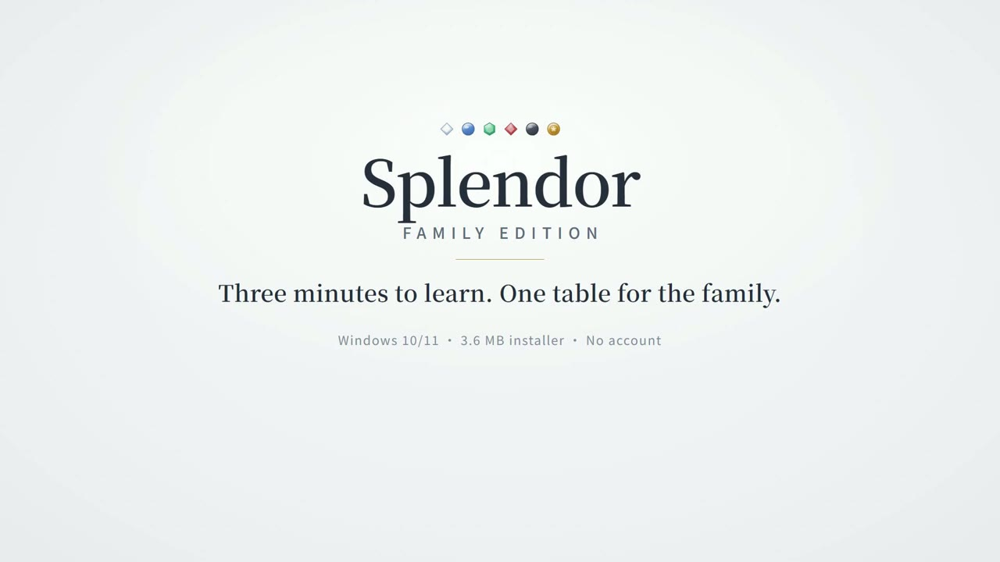
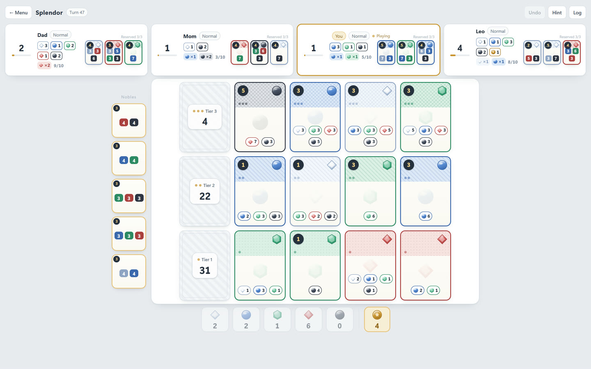
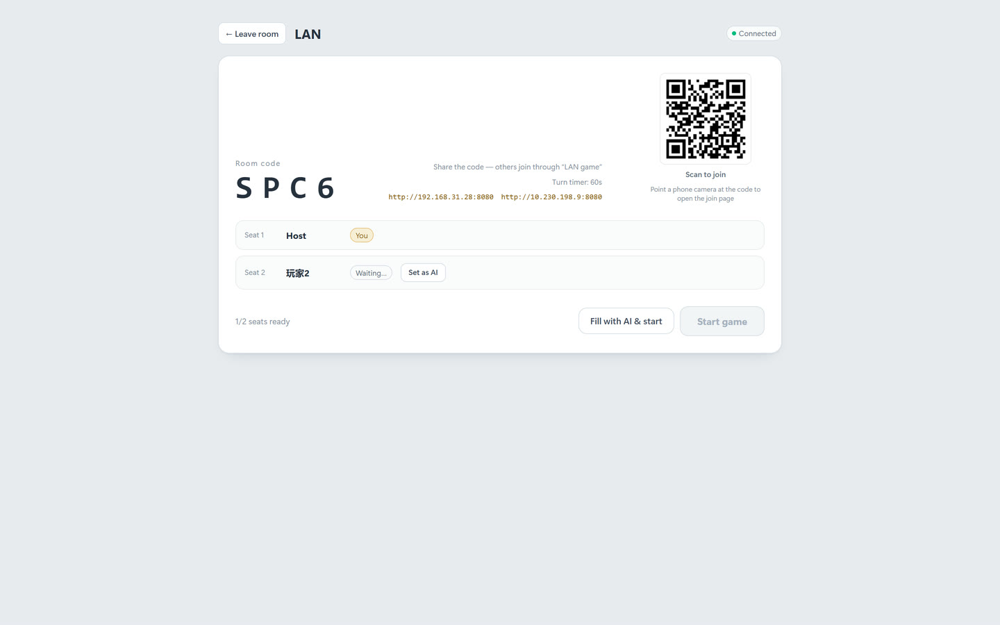
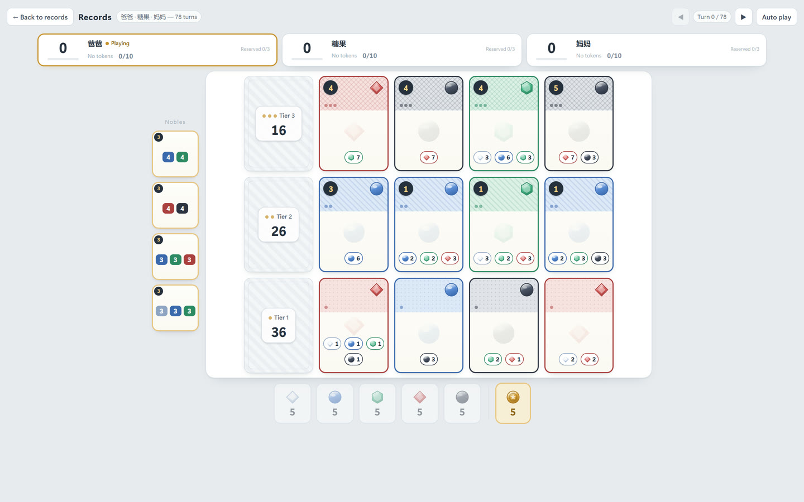
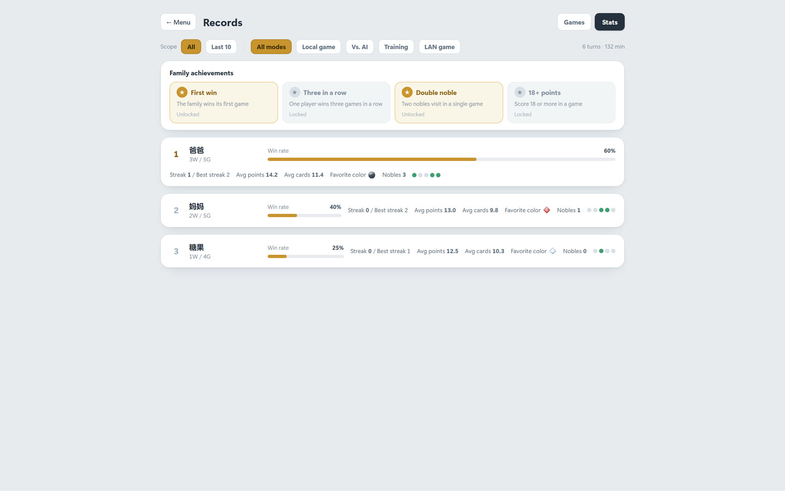
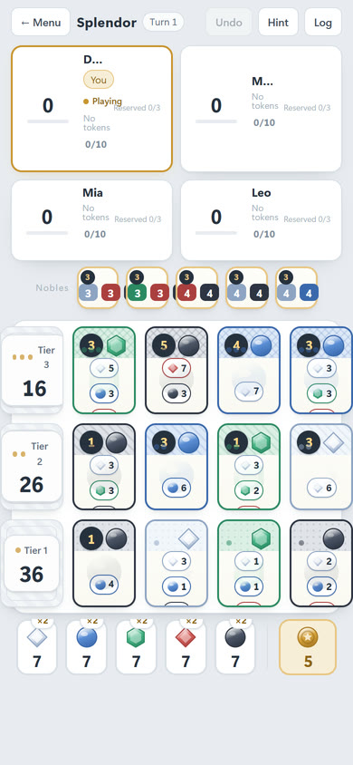

**English** · [简体中文](README.zh-CN.md)

# Splendor — Family Edition

A faithful, offline-first **Splendor** for the family table. One 3.6 MB Windows app:
hot-seat for 2–4 players, four AI personalities, and LAN play where phones join from a
browser — no accounts, no internet, no telemetry.

*54 seconds · 1080p60 · [中文版](docs/promo/splendor-promo-zh.mp4) · [storyboard & accuracy checks](video/)*

## A turn, in five seconds

| Take gems | Buy a card | Reach 15 |
| --- | --- | --- |
| Three different colours, or two of one. | A permanent discount — and points. | Finish the round; highest score wins. |

## What's inside

- **Official rules, checked** — 90 development cards (40/30/20), 10 nobles, the 10-token
  hand limit, gold as a wild, noble visits, the final round and tie-breaks. Transcribed
  from public sources, cross-checked against the physical cards and covered by tests
  ([card data report](data/card-data-report.md)).
- **Four ways to play** — local hot-seat, four AI personalities (Companion never targets
  kids), solo training with hints and undo, and LAN play with reconnect, auto-play and
  spectating.
- **A table that reads** — every action plays in two phases, animations default to
  **Slower**, and you can undo, autosave, replay a finished game and check family stats.
- **Phones just join** — scan the QR code, type the 4-letter room code, or pick the room
  from **Nearby rooms** on another PC (UDP discovery). Nothing to install on the phone.
- **Small and private** — Tauri v2 with the system WebView2, so the installer is ≈3.6 MB;
  bilingual UI, no account, no telemetry, no cloud.

## Screenshots

| A real game | LAN lobby with QR |
| --- | --- |
|  |  |

| Replay a finished game | Family stats |
| --- | --- |
|  |  |

## Get the app

[**Download for Windows**](https://github.com/YiheHuang/Splendor/releases/latest) ·
3.6 MB · per-user install, no admin.

1. Run the installer.
2. If Windows shows “Unknown publisher”, choose **More info → Run anyway**.

The app is Windows 10/11 (x64) and uses the system WebView2 runtime — that is where the
small installer comes from. It starts a LAN server on launch (port 8080, falling back to
8081–8085); updates are sha256-verified and Ed25519-signed, and roll back automatically
if a build fails to start. Details: [updates](docs/updates.md).

## LAN night

| On a phone | How the room works |
| --- | --- |
|  | One machine hosts; everyone else joins in seconds:  • **Phones** scan the QR code in the lobby — it already carries the address and the room code. • **Other PCs** with the app pick the room from **Nearby rooms** (UDP discovery). • **Anyone else** uses the copied address + 4-letter code.  Rooms are saved, players can reconnect, a dropped player is played by the AI caretaker, and a fifth phone can watch. [Known limitations](docs/limitations.md). |

## The promo

A **54-second, 1080p60** film in two cuts, built with Remotion in [`video/`](video/).
The board, cards, payments and noble visit come from the real engine; every claim is
checked in [`video/FACTS.md`](video/FACTS.md). Watch:
[English](docs/promo/splendor-promo-en.mp4) · [中文](docs/promo/splendor-promo-zh.mp4) ·
subtitles: [EN](docs/promo/splendor-promo-en.srt) · [中文](docs/promo/splendor-promo-zh.srt).

## Notes

- Windows 10/11 x64; WebView2 is present on Windows 11 and most Windows 10 machines.
- The installer is unsigned, so SmartScreen may ask for **More info → Run anyway**.
- LAN updates use plain HTTP on the home network; payloads are sha256-verified and the
  manifest is Ed25519-signed, so a tampered file is rejected.
- The LAN host is authoritative: closing the host app ends the session (rooms are saved
  and players rejoin once the host is back).
- **Nearby rooms** needs the app allowed through the Windows firewall on private
  networks. If that is blocked, the QR code and room code still work.

## More

[Rules & data](data/card-data-report.md) · [Migration from the Electron shell](docs/migration.md) ·
[Development & checks](docs/development.md) · [Performance](docs/perf.md) ·
[Music credits](docs/music-credits.md) · [Licensing](NOTICE.md)

## License

- Code: [MIT](LICENSE).
- *Splendor* is a trademark of Space Cowboys / Asmodee. This project is unaffiliated and
  intended solely for private family play.
