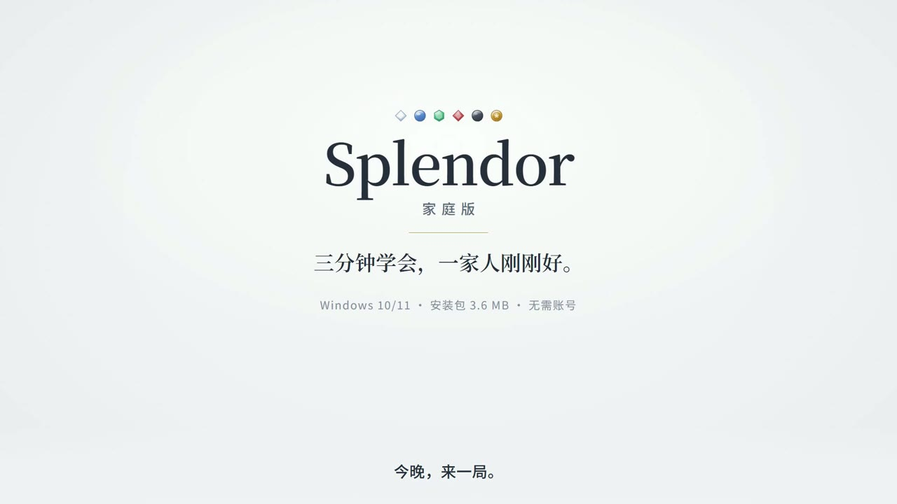
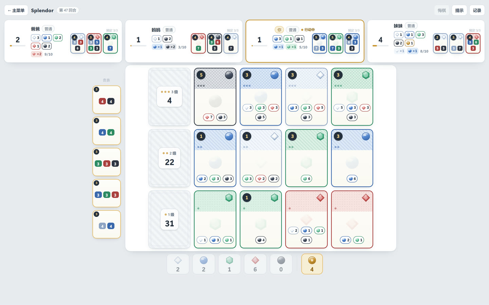
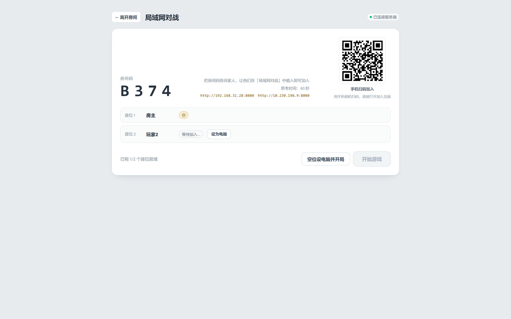
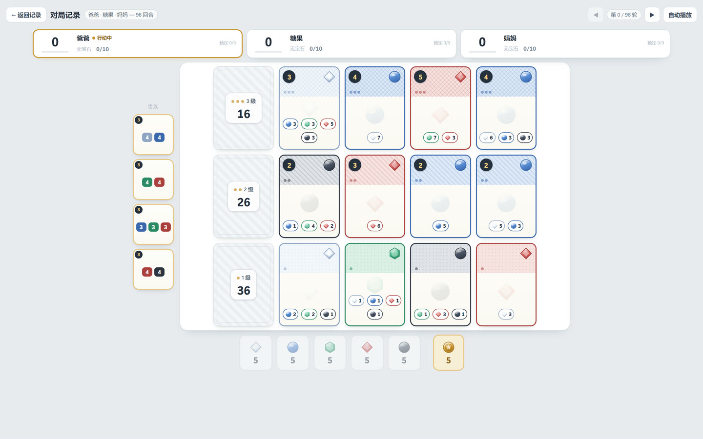
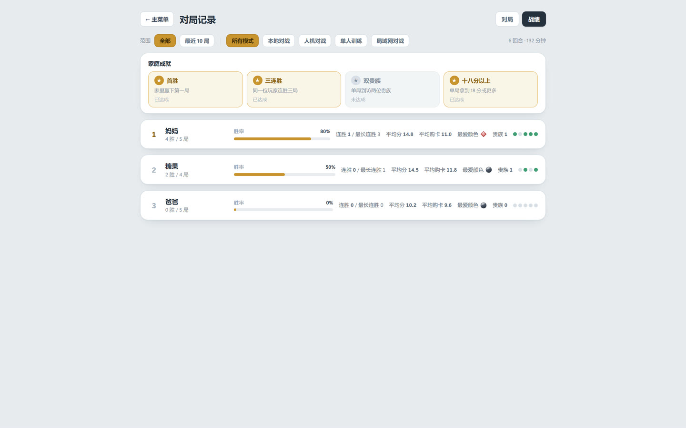
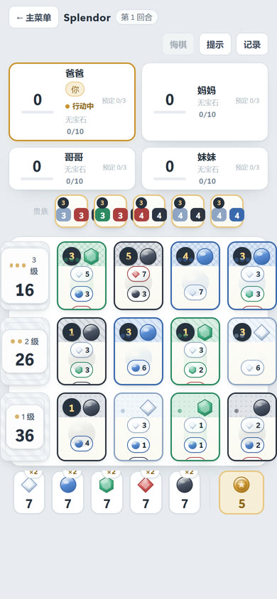

[English](README.md) · **简体中文**

# Splendor · 家庭版

为家庭牌桌做的 **Splendor**：规则完整、离线优先。一个 **3.6 MB** 的 Windows 程序：
2–4 人同屏热座、四档 AI、局域网联机（手机浏览器扫码即入，手机端无需安装）——
不用账号、不联外网、没有遥测。

*54 秒 · 1080p60 · [English cut](docs/promo/splendor-promo-en.mp4) · [分镜与准确性核对](video/)*

## 一回合，五秒看懂

| 拿宝石 | 买卡 | 到 15 分 |
| --- | --- | --- |
| 三色各一，或同色两枚。 | 永久折扣，也带来分数。 | 打完最后一轮，分高者胜。 |

## 里面有什么

- **官方规则，逐条核对** — 90 张发展卡（40/30/20）、10 位贵族、10 枚手牌上限、
  金币万能、贵族到访、最后一轮与平局判定；数据对照五个来源和实体卡逐张核对，
  并由测试覆盖（[卡牌数据报告](data/card-data-report.md)）。
- **四种玩法** — 本地热座、四档 AI（陪玩档不针对小朋友）、单人训练（提示 + 悔棋）、
  局域网对战（断线重连、掉线托管、观战）。
- **看得懂的牌桌** — 每个动作分两段动画，动画默认「更慢」；可以悔棋、自动保存、
  复盘一局、查看家庭战绩。
- **手机扫码就坐** — 大厅二维码 / 4 位房间码 / 另一台电脑的「附近的房间」
  （UDP 发现），手机端零安装。
- **小而私密** — Tauri v2 + 系统 WebView2，安装包约 3.6 MB；中英双语、无账号、
  无遥测、无云端。

## 截图

| 一局真实的牌局 | 局域网大厅与二维码 |
| --- | --- |
|  |  |

| 复盘已结束的对局 | 家庭战绩 |
| --- | --- |
|  |  |

## 下载

[**下载 Windows 版**](https://github.com/YiheHuang/Splendor/releases/latest) ·
3.6 MB · 当前用户安装，无需管理员。

1. 运行安装包。
2. 如果 Windows 提示「未知发布者」，点 **更多信息 → 仍要运行**。

程序面向 Windows 10/11（x64），使用系统自带的 WebView2 运行时——这也是安装包这么小的
原因。启动时会同时开一个局域网服务器（8080 端口，失败时依次尝试 8081–8085）；
更新包经 sha256 校验、清单经 Ed25519 签名，新版本启动失败会自动回滚。详见
[更新说明](docs/updates.md)。

## 局域网之夜

| 手机上 | 怎么加入 |
| --- | --- |
|  | 一台机器开房，其他人几秒内入座：  • **手机**扫大厅里的二维码——链接里已经带好地址和房间码。 • **装了程序的电脑**直接在「附近的房间」里选（UDP 发现）。 • **其他设备**用复制好的地址 + 4 位房间码加入。  房间会保存，掉线可以重连，掉线玩家由 AI 托管，第五台手机可以只看不打。详见[已知限制](docs/limitations.md)。 |

## 宣传片

**54 秒、1080p60**，中英两版，Remotion 工程在 [`video/`](video/)。牌桌、卡牌、支付和
贵族到访都来自真实引擎；每一条画面声明都在
[`video/FACTS.md`](video/FACTS.md) 中自动核对。观看：
[中文](docs/promo/splendor-promo-zh.mp4) · [English](docs/promo/splendor-promo-en.mp4) ·
字幕：[中文](docs/promo/splendor-promo-zh.srt) · [EN](docs/promo/splendor-promo-en.srt)。

## 说明

- Windows 10/11 x64；Windows 11 和大多数 Windows 10 已自带 WebView2。
- 安装包未做代码签名，SmartScreen 可能提示「未知发布者」。
- 局域网更新走家庭网络内的 HTTP；载荷经 sha256 校验、清单经 Ed25519 签名，
  被篡改的文件会被拒绝。
- 局域网以房主机器为准：关闭房主程序会结束本次联机（房间会保存，房主回来后
  玩家可用原令牌重连）。
- 「附近的房间」需要允许程序通过 Windows 防火墙的**专用网络**；被拦截时二维码和
  房间码仍然可用。

## 更多

[规则与数据](data/card-data-report.md) · [从 Electron 旧版迁移](docs/migration.md) ·
[开发与自检](docs/development.md) · [性能](docs/perf.md) ·
[音乐来源](docs/music-credits.md) · [许可](NOTICE.md)

## 许可

- 代码：[MIT](LICENSE)。
- *Splendor* 是 Space Cowboys / Asmodee 的商标。本项目与官方无关，仅供家庭内部游玩。
