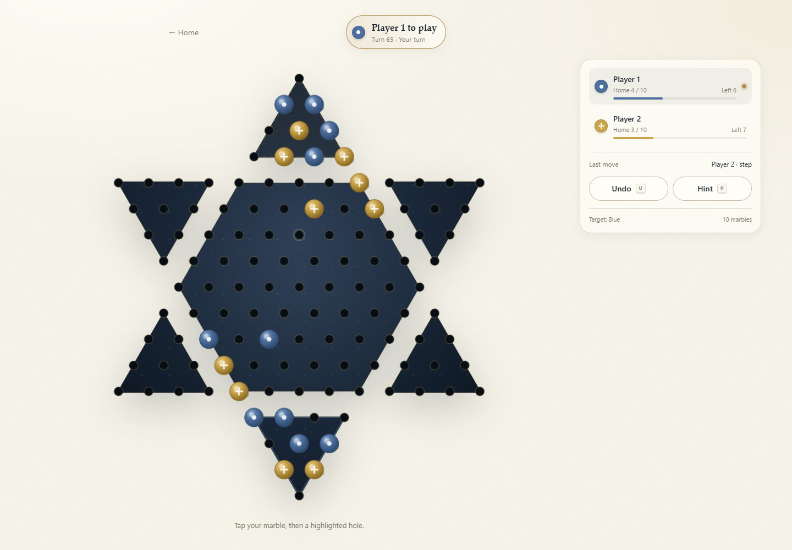
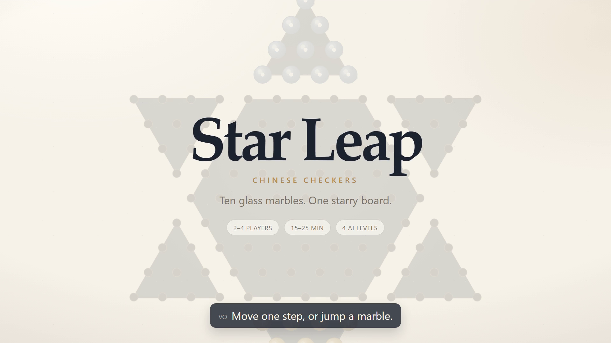
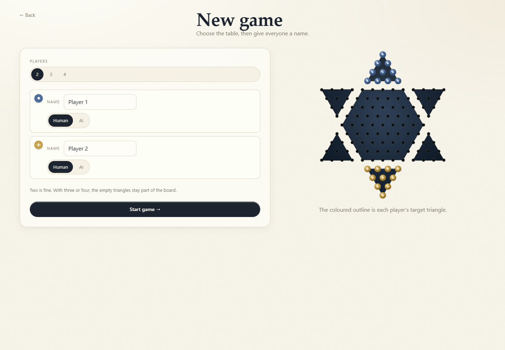
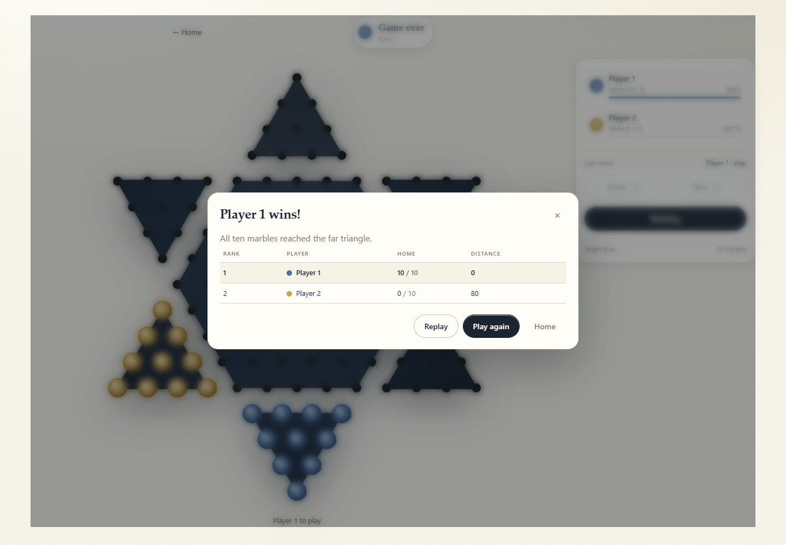
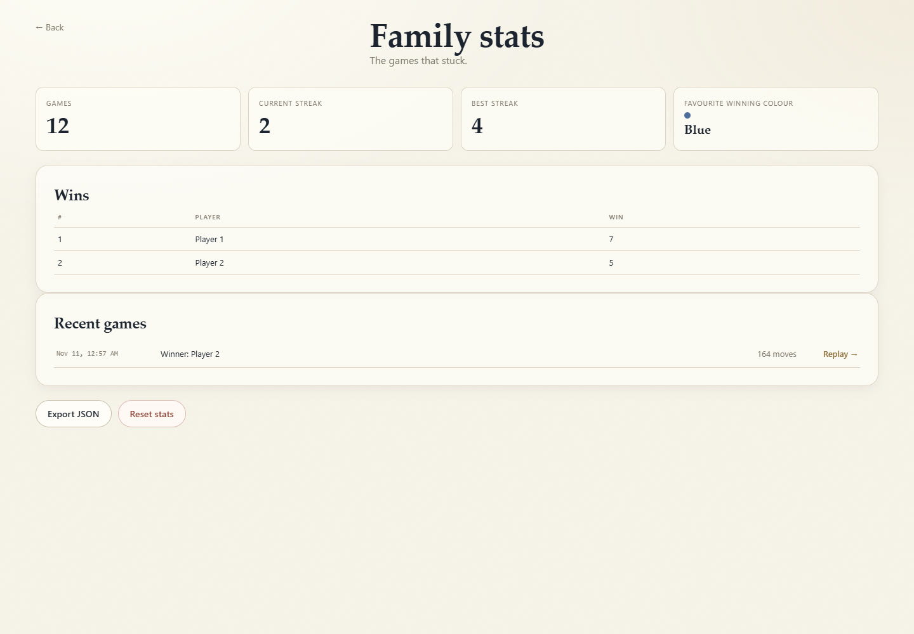
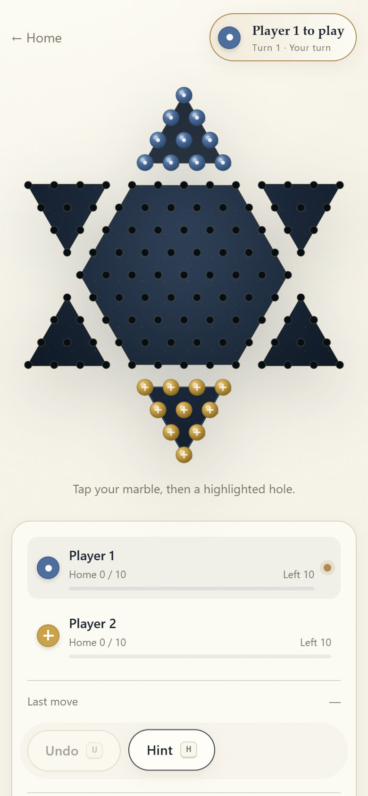
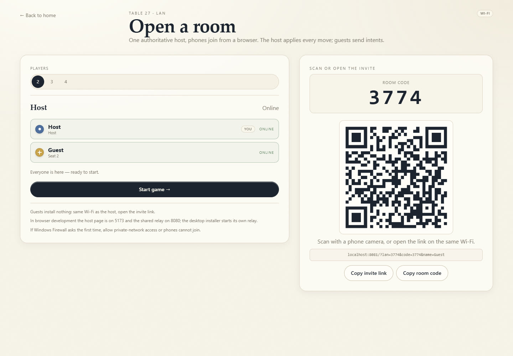
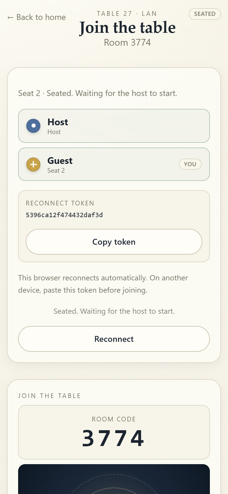

**English** · [简体中文](README.zh-CN.md)

# Star Leap · 星跃

Ten glass marbles. One starry board. A small, offline **Chinese Checkers** for family
game night: 2–4 players, four AI levels, hot-seat, LAN rooms where phones join from a
browser, hints, undo, replay, autosave and a Windows installer.



[](docs/promo/star-leap-promo-en.mp4)

*48 seconds · 1080p60 · [中文版](docs/promo/star-leap-promo-zh.mp4) · [storyboard & accuracy checks](video/)*

## A turn, in five seconds

| Step | Jump | Reach home |
| --- | --- | --- |
| Move one marble to an adjacent empty hole. | Or hop over one marble into the empty hole beyond. Chain them. | Fill the opposite triangle with all ten marbles. |

## What's inside

- **Rules, checked** — 121 holes, six 10-hole triangles, ten marbles each, five rules;
  every rule has a test and an audit row ([rules & data](docs/rules.md)).
- **Four AI levels** — **Companion** never targets kids, **Easy** makes mistakes,
  **Normal** has a plan, **Hard** looks a step ahead and defends. Hints explain themselves.
- **A table that reads** — every colour has a shape mark (dot / plus / ring / slash);
  keyboard play, reduced motion, and everything still works with the sound off.
- **A memory** — autosave after every move, **Continue last game**, replay, family stats
  and JSON export. Data stays in the browser.
- **LAN night** — the host creates a room, shows a 4-digit code and a QR invite, and
  stays authoritative. Guests install nothing: they open the link on a phone, take a
  seat and send move intents. The lobby shows who is online, and each guest gets a
  reconnect token.
- **Small and private** — no account, no telemetry, no internet. The desktop shell and
  LAN relay are included; the installer is built centrally with Tauri.

## Screenshots

| A real game | New game |
| --- | --- |
|  |  |

| Choose a marble | Game over |
| --- | --- |
|  |  |

| Family stats | On a phone |
| --- | --- |
|  |  |

| LAN host: code + QR | Guest on a phone: seat + reconnect token |
| --- | --- |
|  |  |

## Play it

You need Node.js 22+ for the browser build.

```bash
npm install
npm run dev        # http://localhost:5173
```

Production build:

```bash
npm run build
npm run preview
```

### LAN night

The host can be the **desktop app** (the Tauri shell starts the shared relay
itself) or a **browser dev host**. For the browser path, use two terminals:

```bash
npm run build
npm run lan        # serves dist + the WebSocket relay on :8080

# second terminal
npm run dev -- --host   # host page on :5173, reachable on your LAN
```

1. On the host computer, open the **LAN IP** form of the dev URL, for example
   `http://192.168.1.20:5173`, then choose **LAN play**. (Opening `localhost`
   makes a QR code that only that computer can follow.)
2. Set 2, 3 or 4 players. The host is seat 1; every other seat needs a guest.
3. On a phone, scan the QR code or open the invite link. The guest page is the
   production build served by the relay on `:8080`; nothing is installed.
4. When all guest seats show **Online**, the host starts. The host applies every
   move and sends each guest their own seat view; guests only send move intents.
5. If a phone drops, open the same invite again in the same browser. Its
   reconnect token restores the same seat. The token is shown in the guest lobby
   for moving to another device.

The relay listens on all interfaces. If Windows Firewall asks the first time,
allow **private network** access; otherwise phones cannot reach `:8080`. Browser
hosting is local-network only: do not expose port 8080 to the internet. If 8080
is already taken, run `LAN_PORT=8081 npm run lan` (PowerShell:
`$env:LAN_PORT="8081"; npm run lan`) and start the host with
`VITE_LAN_PORT=8081`.

### Windows installer

The Tauri 2 shell is in [`src-tauri/`](src-tauri/), with an NSIS current-user
installer, Simplified Chinese + English, and `downloadBootstrapper` for WebView2.
Build it on a machine with the Rust toolchain:

```bash
npm install
npm run tauri build
# -> src-tauri/target/release/bundle/nsis/
```

The installer is built centrally with the rest of Family Arcade and was **not** run in
this pass; `npm run check` covers the web build and `npx tsc --noEmit` covers the
shared TS surface. The desktop shell uses the same `@family-arcade/lan` protocol and the
Rust `family-arcade-lan-host` relay as the browser dev path.

## How to play

The rules, in five lines:

1. Ten marbles each, starting in your own triangle.
2. **Step:** move one marble to an adjacent empty hole.
3. **Jump:** hop over one adjacent marble into the empty hole beyond.
4. **Chain:** keep jumping if you can; a marble that reaches the far triangle stays there.
5. **Win:** fill the opposite triangle with all ten marbles.

If no marble can move, you pass. If no marble reaches home for 80 turns, or the game
reaches 300 moves, it settles by progress: most marbles home, then shortest distance.

### Controls

| Action | How |
| --- | --- |
| Select / move | **Click** or **tap** your marble, then a highlighted hole. |
| Chain jump | Highlighted holes are all reachable; the path is drawn dashed. |
| Confirm | **Click** the highlighted hole. |
| Cancel | `Esc`, or tap the selected marble again. |
| Hint | `H`, or the **Hint** button. |
| Undo | `U`, or the **Undo** button. |
| Pass | `P`, only when no marble can move. |
| Sound | `M` cycles on / low / off. |
| Keyboard only | `Tab` to a marble, `Enter`, arrow keys, `Enter`. |

Good to know: dimmed holes are not legal; the last move keeps a small ring; a hint
shows the recommended path and a one-line reason. Nothing is timed — think as long as
you like.

## After the game

Every finished game is kept (the last ten, with the full move history). Step through it
move by move. The **Stats** screen tracks games, wins, current/best streak and the
favourite winning colour, and exports the history as JSON.

Unfinished games are saved after every move, so **Continue last game** appears on the
home screen after a reload or crash.

## The promo

A **48-second, 1080p60** film in two cuts, built with Remotion in [`video/`](video/).
The board, marbles, home counts and 64-move game come from the real engine; every claim
is checked in [`video/FACTS.md`](video/FACTS.md).

```bash
cd video
npm install
python -m pip install edge-tts   # only for re-generating narration
npm run gen        # engine data + voice + SRT
npm run facts      # accuracy gate
npm run render     # Chinese cut
npm run render:en  # English cut
npm run master     # loudness master + posters -> ../docs/promo (needs ffmpeg)
# or: npm run release
```

## Development

```bash
npm install
npm run dev          # Vite dev server
npm run build        # typecheck + production build
npm test             # engine / AI / simulation tests
npm run check        # typecheck + tests + build
node scripts/e2e.mjs # with `npm run dev` running: solo, hot-seat, undo, win, history, mobile
npm run e2e:lan      # with dev + `npm run lan`: real host/guest, moves, reconnect, wrong code
node scripts/shots.mjs # with `npm run dev` running: regenerate docs/screenshots/{en,zh}
npm run calibrate    # 200 self-play games per AI match-up -> docs/ai-calibration.md
```

### Architecture

```
src/
  game/        pure rules: 121-hole star, legal moves, chain jumps, scoring, replay
  ai/          four levels (heuristics + beam search) in a Web Worker
  ui/          SVG board, screens, LAN lobby, dialogs; no game rules
  net.ts       Tauri / browser relay detection, invite URL, reconnect token
  i18n.ts      Chinese + English strings
  storage.ts   autosave, stats, settings
  sound.ts     Web Audio synth (no audio files)
tests/         board, engine, AI, full-game simulation
video/         Remotion promo, two cuts, FACTS gate
docs/          screenshots, rules audit, limitations, promo outputs
```

The engine exists exactly once (TypeScript) and runs in the app, the AI worker and the
video. It has no DOM, no network, no clock and no bare `Math.random`; a seeded RNG is
injected where needed.

## Status & roadmap

[Release notes v0.2.0](docs/release-notes-v0.2.0.md) · [v0.1.0](docs/release-notes-v0.1.0.md) · [AI calibration](docs/ai-calibration.md)

- **v0.1** — solo + hot-seat, four AI levels, hints/undo, autosave/resume, replay,
  stats, bilingual UI, responsive phone layout, 48-second promo.
- **v0.2** — authoritative LAN host + browser guests, QR lobby, seat status, reconnect
  token, the Tauri/NSIS shell, and a 200-game-per-match-up AI calibration report.
- **v0.3** — family playtest pass, optional 6-player party mode, AI caretaker for a
  dropped LAN seat.

## Known limitations

- LAN hosting in a browser needs the `npm run lan` relay (the desktop app starts its
  own). Hosts and guests must be on the same local network; there is no internet play,
  NAT traversal, matchmaking or cloud account.
- All selected guest seats must be online before the host starts. There is no AI
  caretaker, spectator mode or host migration yet; if the host closes the room, the
  game ends. Undo and hints are disabled in LAN games.
- Reconnect works with the same browser token. Clearing site data loses the token and
  therefore the old seat.
- The Windows installer is pre-created and built centrally; this pass did not run
  `cargo`/`tauri build`. Browser and Tauri use the same `@family-arcade/lan` wire protocol.
- AI calibration is now a real **200 games per match-up** sample, but it is still
  self-play with short per-move caps. Hard vs Normal is defensive and often capped;
  see [`docs/ai-calibration.md`](docs/ai-calibration.md) for the honest table.
- 2–4 players; the optional 6-player party mode is not implemented.
- Saves, stats and settings live in this browser's `localStorage` (LAN games are not
  autosaved on the guest).
- Chinese Checkers is a traditional public-domain game; this is an independent,
  non-commercial family project.

## Credits

- Rules: traditional Chinese Checkers, implemented from public descriptions; the
  five-line summary and the house rule (“a marble that reaches home stays”) are
  documented in [`docs/rules.md`](docs/rules.md).
- Art, icons and UI: drawn in code; no third-party art.
- Sound: synthesized in the browser with Web Audio.
- Promo score/SFX: from the Blokus family project (same author), generated by its
  scripts; narration by Microsoft Edge TTS.
- Source: MIT. “Star Leap / 星跃” is an original working name; Chinese Checkers has no
  single owner. Third-party notices: [`NOTICE.md`](NOTICE.md).

## License

- Code: [MIT](LICENSE).
- Docs and screenshots: CC BY 4.0 unless noted.
- No third-party game art, card text or trademarked product name is included.
