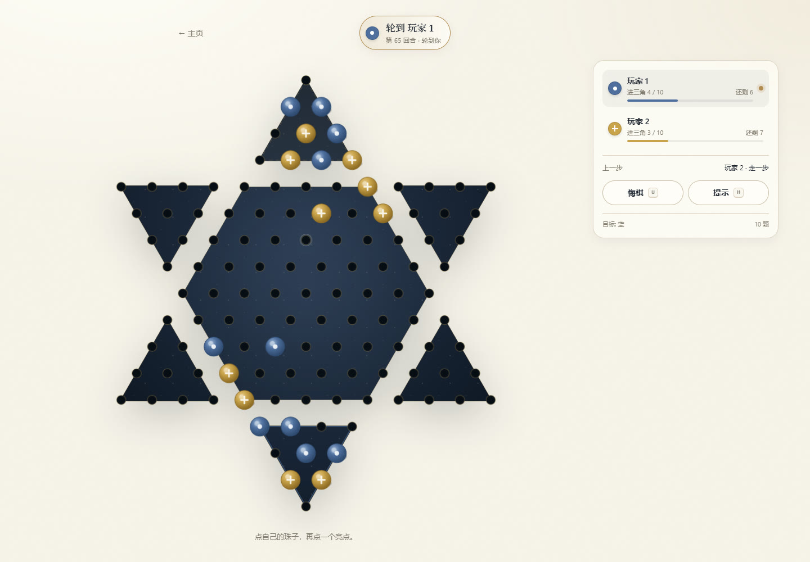
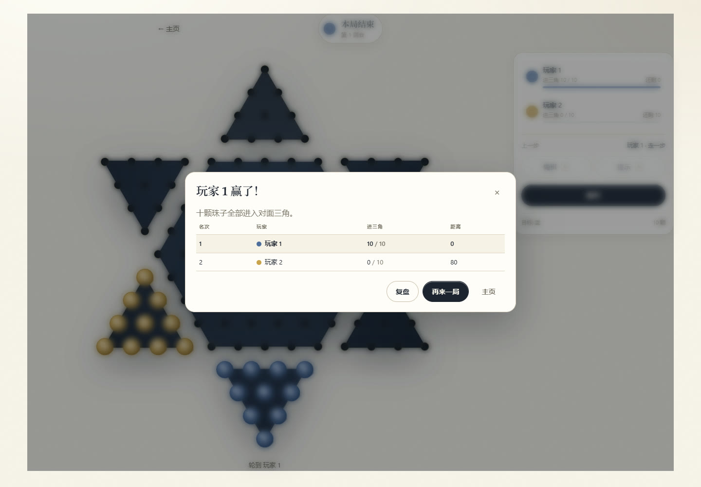
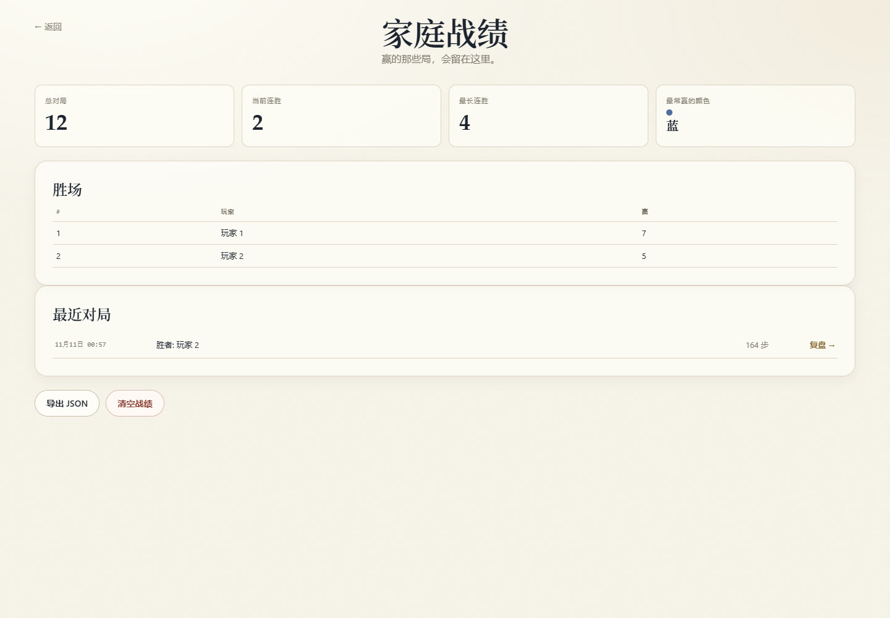
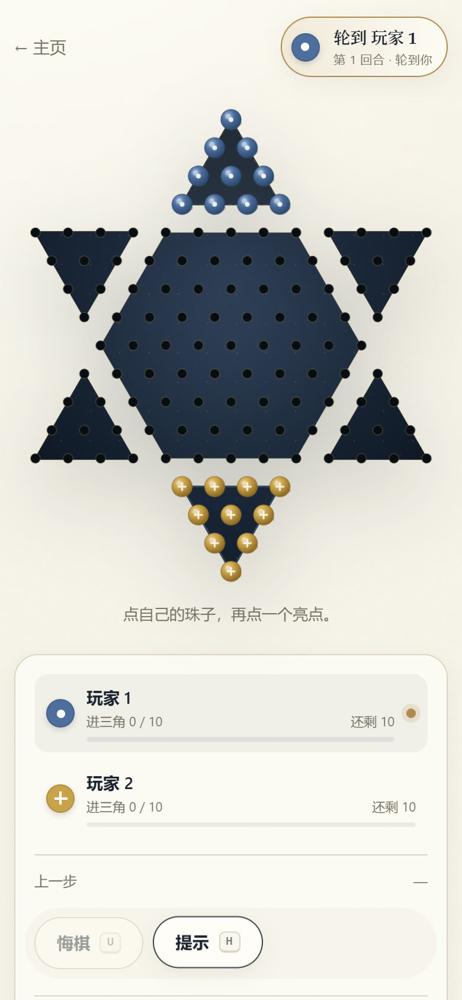
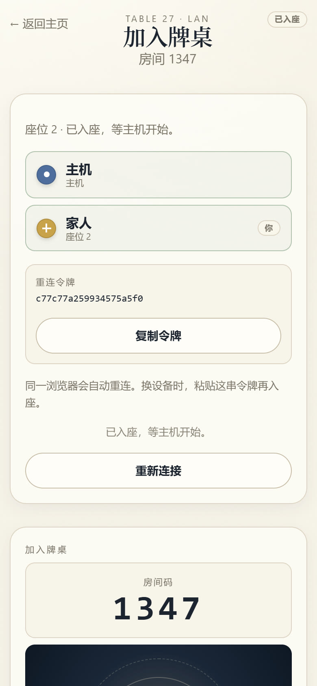

[English](README.md) · **简体中文**

# 星跃 · Star Leap

十颗玻璃珠，跨过一片星空。一个为家庭游戏夜做的小巧、离线的**中国跳棋**：2–4 人、四档 AI、本地热座、手机扫码加入的局域网房间、提示、悔棋、复盘、自动保存和 Windows 安装包。



[](docs/promo/star-leap-promo-zh.mp4)

*48 秒 · 1080p60 · [English cut](docs/promo/star-leap-promo-en.mp4) · [分镜与准确性核对](video/)*

## 一回合，五秒看懂

| 走一步 | 跳过一颗 | 送回家 |
| --- | --- | --- |
| 把一颗珠子走到相邻的空位。 | 或跳过相邻的一颗珠子，落到后面的空位；可以连跳。 | 十颗珠子全部进入对面三角。 |

## 里面有什么

- **规则，逐条核对** — 121 个孔位、6 个 10 孔三角、每人 10 颗珠子、五句话规则；每条规则都有测试和审计记录（[规则与数据](docs/rules.md)）。
- **四档 AI** — **陪玩**不针对小朋友，**轻松**会犯错，**标准**有基本计划，**挑战**会往前看一步并防守；提示会说人话。
- **看得懂的桌子** — 每种颜色都有形状标记（点 / 十字 / 环 / 斜杠）；键盘可玩、减少动效、静音也能玩。
- **一局之后的记忆** — 每步自动保存、**继续上局**、复盘、家庭战绩、JSON 导出。数据只留在这个浏览器里。
- **局域网同桌** — 主机开房，显示 4 位房间码和二维码邀请，并始终掌握权威状态；访客不用安装，手机打开链接就能入座、发送走子意图。大厅显示座位在线状态，每位访客都有重连令牌。
- **小而私密** — 无账号、无遥测、不联外网。桌面壳和局域网中转已经包含；安装包统一用 Tauri 构建。

## 截图

| 一局真实的棋 | 新的一局 |
| --- | --- |
|  |  |

| 选中一颗珠子 | 对局结束 |
| --- | --- |
|  |  |

| 家庭战绩 | 手机上 |
| --- | --- |
|  |  |

| 局域网主机：房间码 + 二维码 | 手机访客：座位 + 重连令牌 |
| --- | --- |
|  |  |

## 怎么玩

浏览器版需要 Node.js 22+：

```bash
npm install
npm run dev        # http://localhost:5173
```

生产构建：

```bash
npm run build
npm run preview
```

### 局域网同桌

主机可以用**桌面版**（Tauri 壳会自己启动共享中转），也可以用**浏览器开发页**。浏览器路径开两个终端：

```bash
npm run build
npm run lan        # 在 :8080 提供 dist 和 WebSocket 中转

# 另一个终端
npm run dev -- --host   # 主机页在 :5173，局域网可访问
```

1. 在主机电脑上用**局域网 IP** 打开开发页，例如 `http://192.168.1.20:5173`，再点「局域网」。用 `localhost` 打开会生成只有本机能访问的二维码。
2. 选 2、3 或 4 人。主机是 1 号座；其他每个座位都需要一位访客。
3. 手机扫二维码或打开邀请链接。访客页是中转在 `:8080` 提供的生产构建，不用安装。
4. 所有访客座位显示「在线」后，主机开始。主机执行每一步，并把每个座位的视图发给对应访客；访客只发送走子意图。
5. 手机掉线时，在同一浏览器重新打开邀请即可。重连令牌会恢复原座位；访客大厅也会显示这串令牌，方便换设备。

中转监听所有网卡。Windows 第一次询问防火墙时，请允许**专用网络**，否则手机连不上 `:8080`。浏览器主机只适合局域网，不要把 8080 暴露到公网。如果 8080 已被占用，可用 `LAN_PORT=8081 npm run lan`（PowerShell：`$env:LAN_PORT="8081"; npm run lan`），并以 `VITE_LAN_PORT=8081` 启动主机页。

### Windows 安装包

Tauri 2 壳在 [`src-tauri/`](src-tauri/)，配置为 NSIS 当前用户安装、简体中文 + English、WebView2 `downloadBootstrapper`。在装有 Rust 工具链的机器上构建：

```bash
npm install
npm run tauri build
# -> src-tauri/target/release/bundle/nsis/
```

安装包由 Family Arcade 统一构建；这一轮**没有**运行 `cargo`/`tauri build`。`npm run check` 覆盖网页构建，`npx tsc --noEmit` 覆盖共享 TS 面。桌面壳与浏览器开发路径使用同一套 `@family-arcade/lan` 协议和 Rust `family-arcade-lan-host` 中转。

## 规则

五句话：

1. 每人十颗珠子，从自己的三角出发。
2. **走一步**：把一颗珠子走到相邻的空位。
3. **跳过一颗**：跳过相邻的一颗珠子，落到后面的空位。
4. **连跳**：能跳就继续跳；进入对面三角的珠子会留在里面。
5. **获胜**：十颗珠子全部进入对面的三角。

没有珠子能走时跳过。连续 80 回合没有珠子进三角，或达到 300 步上限，就按进度结算：先进三角的多，再比距离短。

### 操作

| 操作 | 方式 |
| --- | --- |
| 选中 / 移动 | **点击**或**触摸**自己的珠子，再点一个亮点。 |
| 连跳 | 亮着的点都能去；路径用虚线标出。 |
| 确认 | **点击**亮点。 |
| 取消 | `Esc`，或再点一次选中的珠子。 |
| 提示 | `H`，或「提示」按钮。 |
| 悔棋 | `U`，或「悔棋」按钮。 |
| 跳过 | `P`，只在没有珠子能走时。 |
| 音效 | `M` 在开 / 低 / 关之间切换。 |
| 纯键盘 | `Tab` 选珠，`Enter` 选中，方向键移动，`Enter` 确认。 |

小贴士：变暗的孔不能走；上一步会留一个小环；提示会画出推荐路径并给一句理由。没有倒计时，慢慢想。

## 一局之后

每局结束都会保存（最近十局，含完整走法），可以逐步回放。**战绩**页记录对局数、胜场、当前/最长连胜和最常赢的颜色，还能把记录导出成 JSON。

没下完的对局每一步都会自动保存；刷新或崩溃后，主页会出现**继续上局**。

## 宣传片

**48 秒、1080p60**，中英两版，Remotion 工程在 [`video/`](video/)。棋盘、珠子、进三角数和 64 手对局都来自真实引擎；每条画面声明都在 [`video/FACTS.md`](video/FACTS.md) 里自动核对。

```bash
cd video
npm install
python -m pip install edge-tts   # 只在重新生成旁白时需要
npm run gen        # 引擎数据 + 旁白 + 字幕
npm run facts      # 准确性门禁
npm run render     # 中文版
npm run render:en  # 英文版
npm run master     # 响度母带 + 海报 -> ../docs/promo（需要 ffmpeg）
# 或：npm run release
```

## 开发

```bash
npm install
npm run dev          # Vite 开发服务器
npm run build        # typecheck + 生产构建
npm test             # 引擎 / AI / 模拟对局
npm run check        # typecheck + 测试 + 构建
node scripts/e2e.mjs # 先运行 `npm run dev`：单人、热座、悔棋、胜利、历史、手机
npm run e2e:lan      # 先运行 dev + `npm run lan`：真实主客机、走子、重连、错误房间码
node scripts/shots.mjs # 先运行 `npm run dev`：重新生成 docs/screenshots/{en,zh}
npm run calibrate    # 每对 AI 200 局自对弈 -> docs/ai-calibration.md
```

### 架构

```
src/
  game/        纯规则：121 孔星盘、合法走法、连跳、计分、回放
  ai/          四档 AI（启发式 + beam search），运行在 Web Worker
  ui/          SVG 星盘、界面、局域网大厅、对话框；不含规则
  net.ts       Tauri / 浏览器中转检测、邀请链接、重连令牌
  i18n.ts      中英文案
  storage.ts   自动保存、战绩、设置
  sound.ts     Web Audio 合成（无音频文件）
tests/         棋盘、引擎、AI、完整对局模拟
video/         Remotion 宣传片，中英两版，FACTS 门禁
docs/          截图、规则审计、已知限制、宣传片输出
```

引擎只有一份（TypeScript），同时跑在应用、AI Worker 和宣传片里。它不依赖 DOM、网络、时钟和裸 `Math.random`；需要随机时注入 seeded RNG。

## 状态与路线

[发布说明 v0.2.0](docs/release-notes-v0.2.0.md) · [v0.1.0](docs/release-notes-v0.1.0.md) · [AI 校准](docs/ai-calibration.md)

- **v0.1** — 单人 + 热座、四档 AI、提示/悔棋、自动保存/继续、复盘、战绩、中英双语、手机布局、48 秒宣传片。
- **v0.2** — 权威局域网主机 + 浏览器访客、二维码大厅、座位状态、重连令牌、Tauri/NSIS 壳，以及每对 AI 200 局的校准报告。
- **v0.3** — 家庭试玩、可选的 6 人派对模式、掉线座位的 AI 托管。

## 已知限制

- 浏览器主机需要 `npm run lan` 中转（桌面版会自己启动）。主机和访客必须在同一个局域网；没有公网联机、NAT 穿透、匹配或云账号。
- 主机开始前，所选访客座位都必须在线。目前没有 AI 托管、观战或主机迁移；主机关房，对局就结束。局域网对局不能悔棋或使用提示。
- 同一浏览器可用令牌重连；清除站点数据会丢失令牌，也就失去原座位。
- Windows 安装包已预置，由主项目统一构建；这一轮没有运行 `cargo`/`tauri build`。浏览器和 Tauri 使用同一套 `@family-arcade/lan` 协议。
- AI 校准现在是真实的**每对 200 局**样本，但仍是短时限自对弈。挑战 vs 标准偏防守、经常触及 300 步上限；诚实表格见 [`docs/ai-calibration.md`](docs/ai-calibration.md)。
- 2–4 人；可选的 6 人派对模式尚未实现。
- 存档、战绩和设置保存在当前浏览器的 `localStorage`（局域网对局不会在访客端自动保存）。
- 中国跳棋是传统公版游戏；本项目是独立的非商业家庭项目。

## 致谢

- 规则：传统中国跳棋，按公开规则描述实现；五句话总结和「进三角后不再出来」的家庭规则写在 [`docs/rules.md`](docs/rules.md)。
- 图形、图标、界面：代码绘制，不使用第三方素材。
- 音效：浏览器 Web Audio 合成。
- 宣传片音乐/音效：来自 Blokus 家庭项目（同一作者），由其脚本生成；旁白使用 Microsoft Edge TTS。
- 源码：MIT。「星跃 / Star Leap」是原创工作名；中国跳棋没有单一权利人。第三方声明见 [`NOTICE.md`](NOTICE.md)。

## 许可

- 代码：[MIT](LICENSE)。
- 文档与截图：除非另注，CC BY 4.0。
- 不包含第三方游戏美术、卡牌文字或商标化产品名。
