# Sweet Carousel · 甜点转盘

**English** | [中文](README.zh-CN.md)

> **Pick one, pass it on.** A 15-minute dessert draft for 2–5 players.

A family card game about choosing one dessert, passing the rest, and building sets across three rounds. Solo against four AI levels, 2–5 player hot-seat with a privacy cover, or a real LAN host/guest table. Full Chinese/English, no account, no ads, no internet dependency.

**v0.1 · 2–5 players · 15 min · ages 7+ · LAN · Tauri shell · offline after load**

[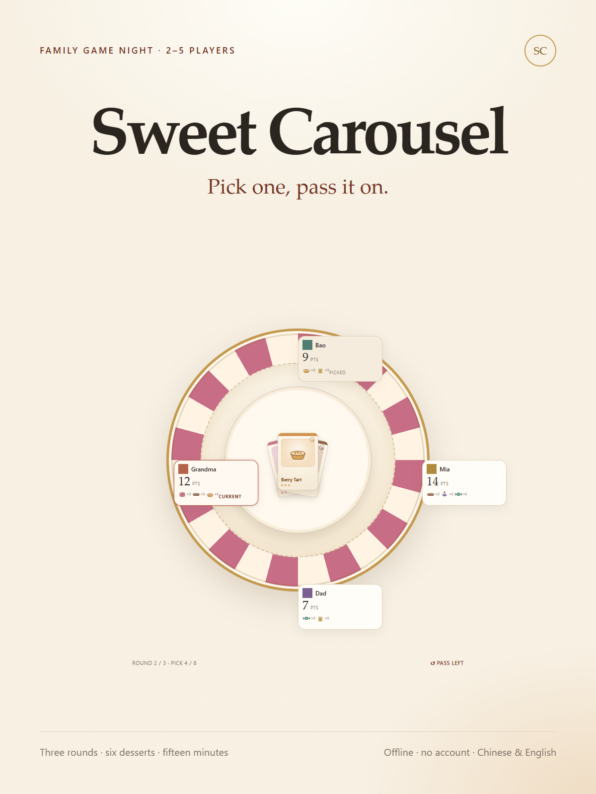](docs/promo/sweet-carousel-promo-en.mp4)

*48.5 seconds · 1920×1080 · 60 fps · [中文版](docs/promo/sweet-carousel-promo-zh.mp4) · [storyboard & checks](video/SCRIPT.md)*

[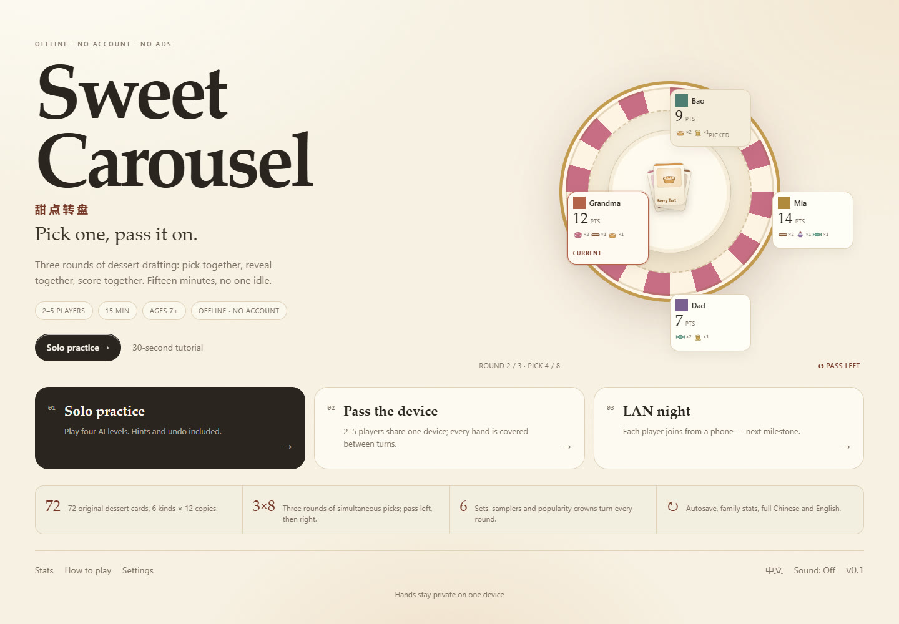](docs/screenshots/en/home.jpg)

## Five-second rules

| Each pick | How to score | How it ends |
| --- | --- | --- |
| Everyone picks 1 card from an 8-card hand at the same time, then reveals. | Pairs 2, triples 6, four-of-a-kind 12; a three-dessert sampler 5; leftovers 1 each. | Pass the rest left (round 1), right (2), left (3). After 3 rounds, highest total wins. |

## What is inside

- **A real, checkable game.** 72 original cards, 6 desserts × 12 copies; every rule has a test and an audit row in [`docs/rules.md`](docs/rules.md). `npm run data:verify` checks the deck.
- **Three complete ways to play.** Solo against Companion / Easy / Normal / Hard AI; 2–5 player hot-seat with a privacy cover; or a real LAN host/guest table with a room code, QR invite, seat status and reconnect. The LAN relay is the shared `@family-arcade/lan` host-authoritative path; guests receive only their own filtered view.
- **Privacy by construction.** The engine's `view()` removes other hands and pending picks; the hot-seat cover replaces the game surface, and every LAN `view` is sent per seat. There is no “hidden with CSS” hand. See [`docs/rules.md`](docs/rules.md) §4.
- **A table that remembers.** Autosave/resume, local family stats, JSON export, a round-by-round review, and a full score breakdown.
- **Small and private.** No accounts, no telemetry, no CDN, no external images or fonts. Sound is synthesised and **off by default**; the game is fully playable muted.

## Screenshots

All from the running app, 1440 × 1000, system Chrome via Playwright. More in [`docs/screenshots/README.md`](docs/screenshots/README.md).

| A real mid-game | Selected card |
| --- | --- |
| 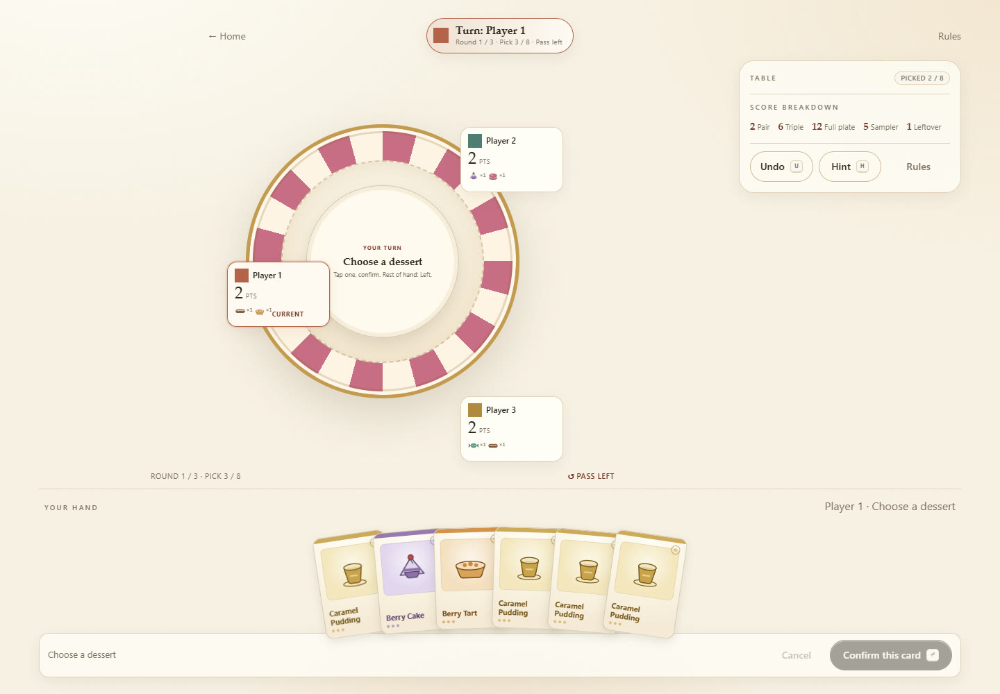 | 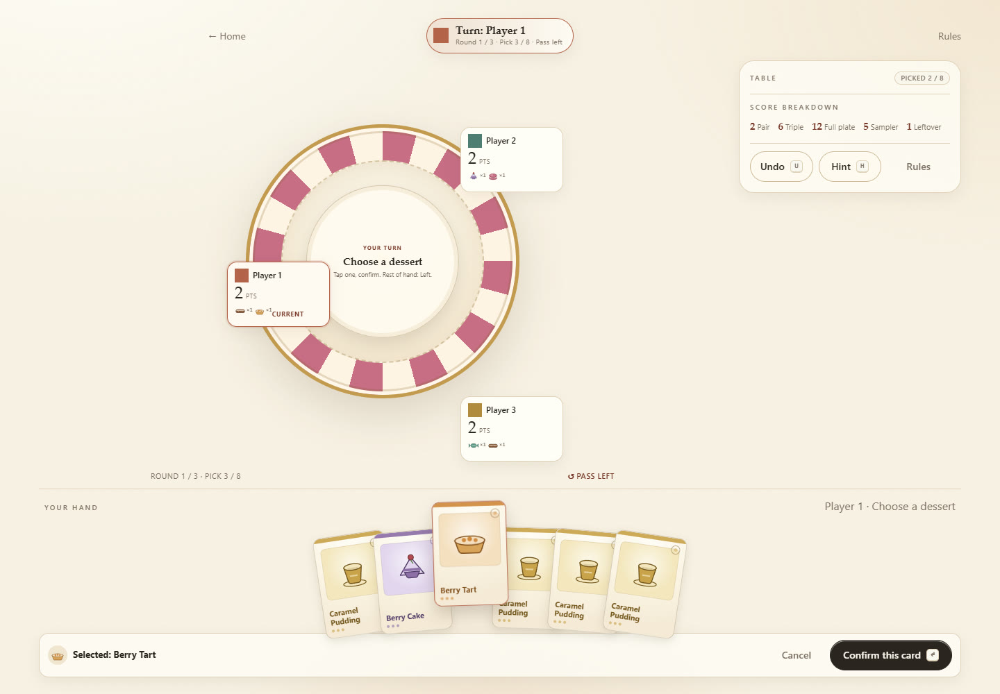 |

| LAN host lobby | LAN guest lobby |
| --- | --- |
| 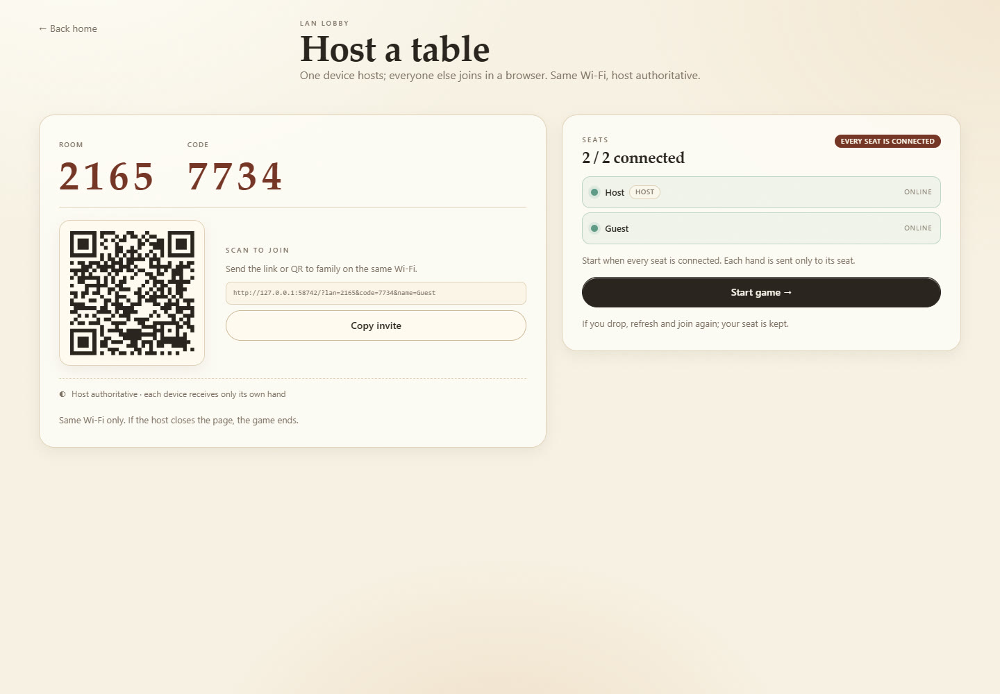 | 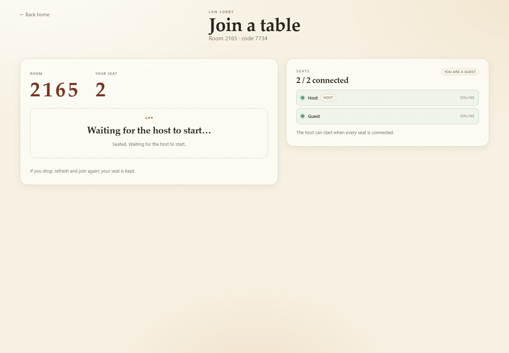 |

| LAN game (host) | LAN game (guest) |
| --- | --- |
| 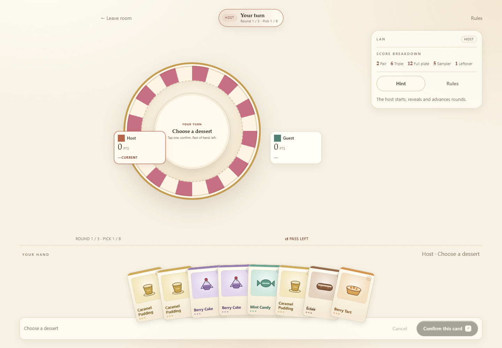 | 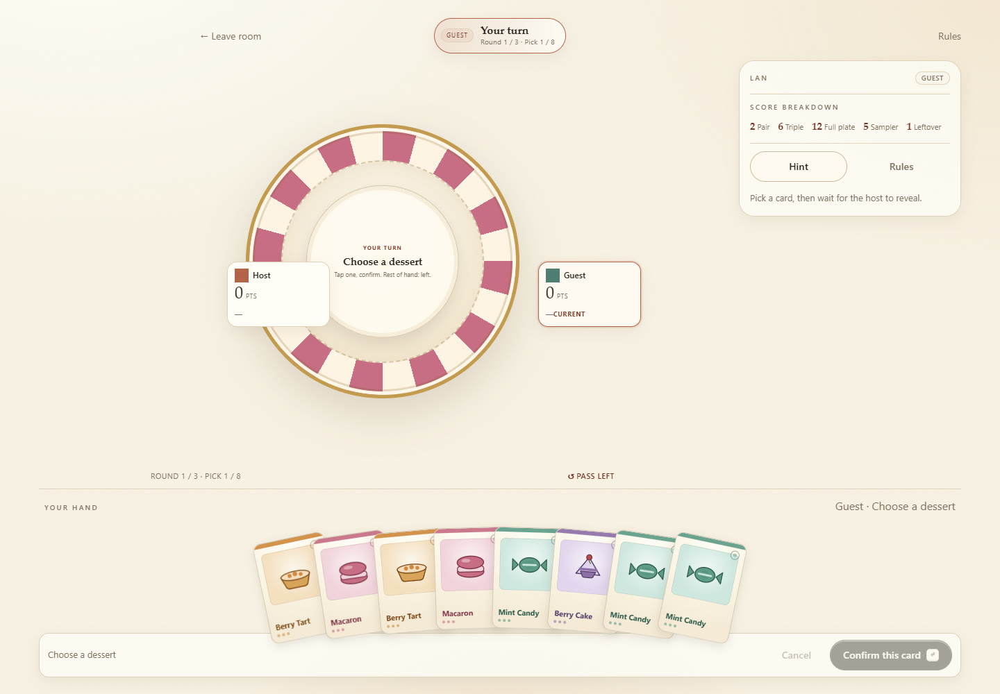 |

| Final ranking | Rules and scoring table |
| --- | --- |
| 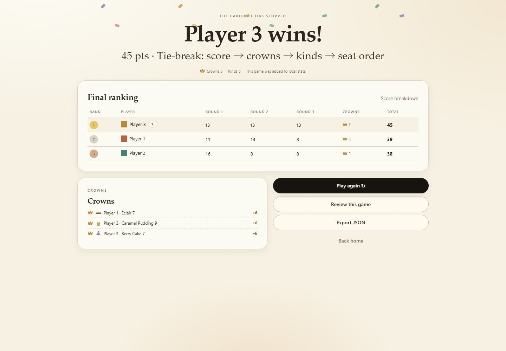 | 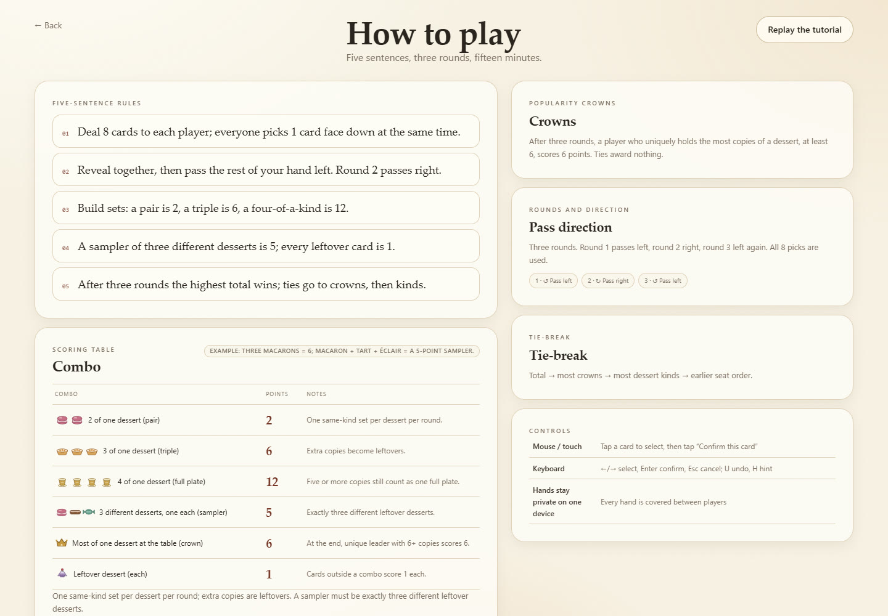 |

| Setup | Local stats |
| --- | --- |
| 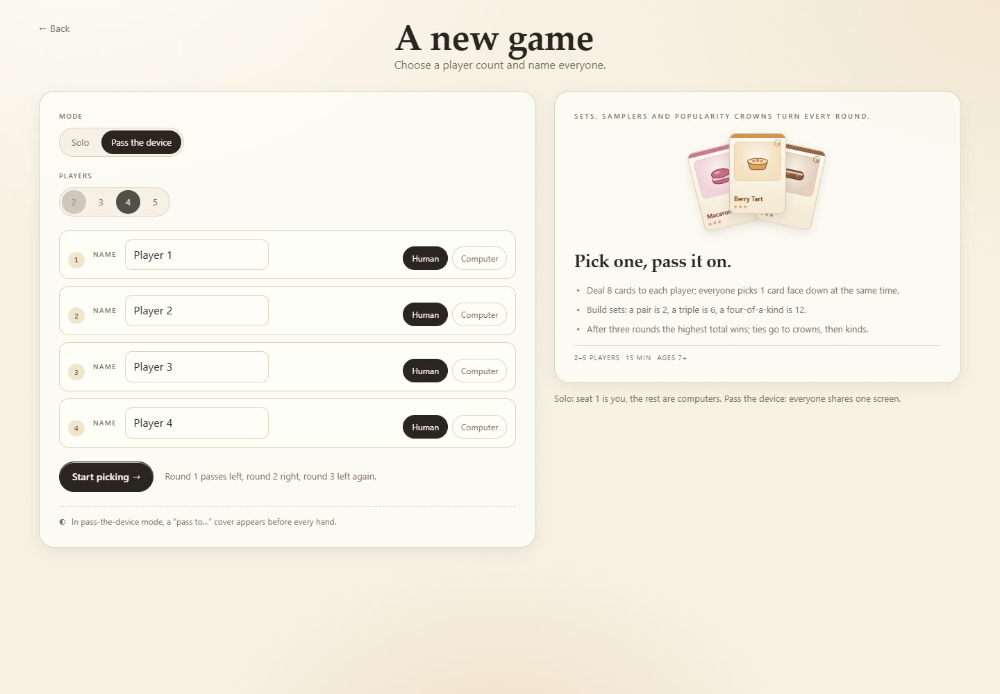 | 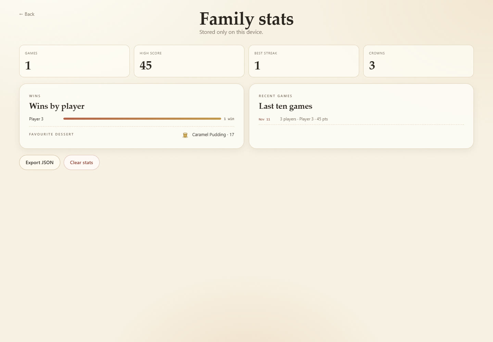 |

| Settings | Mobile portrait |
| --- | --- |
| 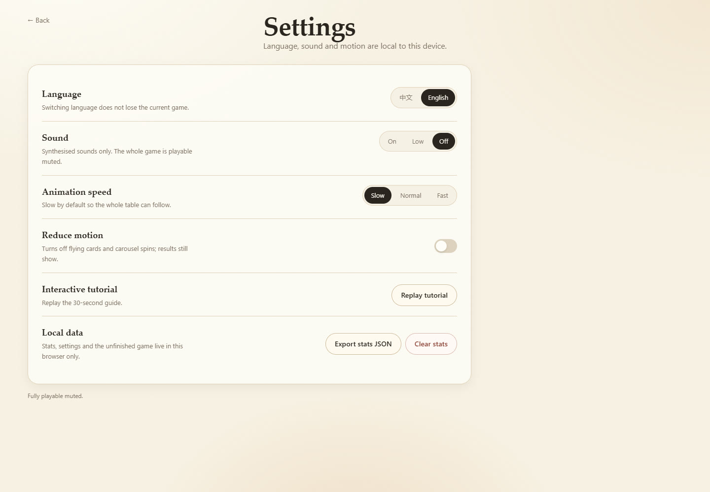 | 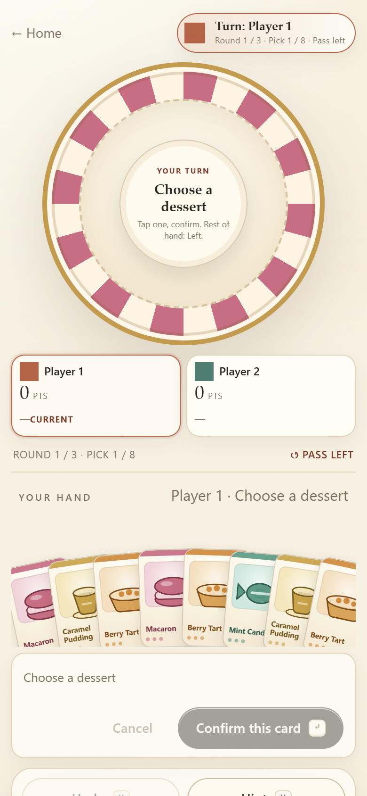 |

## Run it

This is a **Vite web app plus a Tauri v2 shell**. The web build runs from `npm run dev` or any static host; the Tauri shell is configured for a per-user NSIS installer built centrally (not built in this pass). The built web assets are about **418 KB JS + 52 KB CSS** (≈136 KB gzipped) and use only local files.

```bash
npm install
npm run dev          # http://127.0.0.1:5175
npm run build        # typecheck + production build to dist/
npm run preview      # serve dist/
npm run tauri dev    # desktop dev shell
npm run tauri build  # NSIS installer; run in the central release job, not in this pass
```

Open the URL, choose **Solo practice**, **Pass the device**, or **LAN table**. On first visit a 30-second tutorial appears; `?tutorial=0` disables it for screenshots. `?lang=zh` / `?lang=en` forces a language; `?seed=...` fixes the deal; `?lanPort=8095` tells a browser host which relay port to use.

### LAN night

The LAN table is **host authoritative**: the host validates every pick and sends each guest only `view(state, guestSeat)`, never the full hands. The shared relay is `@family-arcade/lan`; the Tauri shell starts its own relay through `lan_start`.

```bash
npm run build
npm run lan                 # browser relay + dist on :8080
# If :8080 is taken, use the relay directly:
node ../../tools/lan-server.mjs --dist dist --port 8095
# Then open the host page with ?lanPort=8095
```

1. Host opens **LAN table → Host a table**, picks 2–5 seats and creates a room.
2. Guests scan the QR or open the invite link on the **same Wi-Fi**, enter a name and join.
3. The host starts when every seat is connected. Host controls reveal and next round; guests only pick from their own hand.
4. If a guest drops, refresh the invite URL and join again; the seat token is kept.
5. The host’s final result is recorded in local family stats; guest devices show the result but do not write the host’s record.

**LAN limits:** same Wi-Fi only; the host page/app must stay open; no spectator mode, no UDP room discovery and no AI takeover in this version. The invite uses the host page’s hostname — if you open the host on `localhost`, phones cannot reach it; open the host through the machine’s LAN IP or use the Tauri app’s relay URL. `PROTOCOL_VERSION` is owned by the shared `@family-arcade/lan` relay; this app does not invent a second protocol.

## How to play

1. Deal 8 cards to each player; everyone picks 1 card face down at the same time.
2. Reveal together, then pass the rest of your hand left. Round 2 passes right; round 3 passes left again.
3. Build sets: a pair is 2, a triple is 6, a four-of-a-kind is 12. A dessert type scores at most one set per round; extra copies are leftovers.
4. A sampler is **exactly three different leftover desserts**, one card each, worth 5. Every other leftover card is 1.
5. After three rounds the highest total wins. Ties go to most popularity crowns, then most dessert kinds, then earlier seat order.

**Popularity crowns.** At the very end, for each dessert the unique player with the most copies earns 6 points if they have at least **6** copies. A tie awards nothing. Crowns are the first tie-break, so they matter.

### Controls

| Action | Mouse / touch | Keyboard |
| --- | --- | --- |
| Uncover a hand | Tap “I am … — show my hand” | Tab to the button, Enter |
| Select a card | Tap a card | ←/→ to move the selection |
| Confirm | Tap “Confirm this card” | Tab to the button, Enter (or Enter when a card is selected and focus is not on a button) |
| Cancel selection | Tap “Cancel” or the selected card again | Esc |
| Undo | Undo button | U |
| Hint | Hint button | H |
| Advance after reveal | “Pass left/right” | Tab + Enter |
| LAN guest pick | Same card → confirm; the host resolves it | Same keyboard path |
| LAN host advance | “Reveal and pass” / “Next round” | Tab + Enter |

**Why can't I pick that?** The engine returns a stable code and the UI translates it: you already picked (`already-picked`), the card is not in your hand (`card-not-in-hand`), it is the wrong phase (`wrong-phase`), the seat is invalid (`bad-seat`), or the game is over (`game-over`). The full list is in [`docs/rules.md`](docs/rules.md).

## After a game

- **Autosave/resume.** The current state is written after every move. Reload the page and the home screen offers **Continue last game**.
- **Local stats.** Games, high score, best streak, crowns, wins by player and favourite dessert live in `localStorage` on this device. The LAN **host** writes the table result locally; guests do not. Clear stats in Settings.
- **Export.** The end screen exports the game records and scores; Settings and Stats export the local stats JSON. No device fingerprint, no account.
- **Review.** The end screen opens a round-by-round recap with every pick and score breakdown. It is not a move-by-move animated replay yet.

## Video and poster

The root Family Arcade studio reads [`video.json`](video.json): eight EN/ZH narration lines, facts, accent and the three screenshot names. A previously rendered 48.5 s promo remains in `docs/promo/`, with SRTs and posters; the app does not build a second Remotion project in this pass.

[](docs/promo/sweet-carousel-promo-en.mp4)

- **Manifest:** [`video.json`](video.json), used by the root studio.
- **Existing cuts:** [English MP4](docs/promo/sweet-carousel-promo-en.mp4) · [中文 MP4](docs/promo/sweet-carousel-promo-zh.mp4). Both **48.5 s, 1920×1080, 60 fps, H.264/AAC, yuv420p**, under 10 MB.
- **Subtitles:** [EN SRT](docs/promo/sweet-carousel-promo-en.srt) · [中文 SRT](docs/promo/sweet-carousel-promo-zh.srt). Also burned in.
- **Posters:** [`docs/promo/sweet-carousel-poster-en.png`](docs/promo/sweet-carousel-poster-en.png) / [`-zh.png`](docs/promo/sweet-carousel-poster-zh.png), 1200×1600, rendered from the app.
- **Audio:** original synth music bed + nine Edge TTS lines per language; mastered to **−14.1 LUFS** with true peak **−1.0 / −1.5 dBTP**.
- **Honesty:** the old cut predates LAN; `video.json` now includes “Hot-seat + LAN”. The promo does not claim a packaged installer.

## Development

```bash
npm install
npm run check        # data:verify + tsc + vitest + build
npm run data:verify  # 72 cards, 12 per dessert, ids 0..71
npm test             # engine, scoring, AI and 120-game simulation
npm run e2e          # real Chrome: solo, hot-seat, LAN host/guest + reconnect, mobile
npm run screenshots  # real Chrome screenshots (dev server on :5175)
npm run ai:calibrate # 200 default / published 400-game matchup table
npm run lan          # browser relay + dist on :8080
npm run tauri build  # NSIS installer; central release job
```

- **Engine contract:** `setup / view / legal / apply / score / result / serialize / deserialize / invariants`, plus `replay`. `apply` never mutates its input and returns `{ ok, state, events }` or `{ ok:false, reason, params }`.
- **Determinism:** seeded `mulberry32` deals; all AI tie-breaks use injected RNG. Save format is versioned (`version: 1`).
- **AI:** four levels, Web Worker, 80 ms deadline. Hard samples hidden-hand rollouts without reading engine state; the worker only receives a `GameView`.
- **LAN:** host authoritative via `@family-arcade/lan`. Guests send intents, never full state; the host sends `view(state, seat)` per seat. Browser dev relay is `tools/lan-server.mjs`; the Tauri shell starts `family-arcade-lan-host`.
- **Data:** `data/cards.json` is versioned with source and count. `scripts/verify-data.mjs` is the gate.
- **Shared code:** only `@family-arcade/lan` is imported; game rules, AI and UI remain in this app.

### Architecture

```
src/game/        pure engine: types, data, scoring, engine, RNG
src/ai/          evaluator, sampled-hand rollout, worker + client
src/ui/          React screens, card faces, carousel, privacy cover, LAN screens
src/net.ts       Tauri/browser relay detection, invite URL, WS URL
src/i18n.ts      complete zh/en dictionaries
src/storage.ts   settings, autosave, local stats, export
src-tauri/       Tauri v2 shell + shared LAN host commands
data/cards.json  72 original cards + metadata
tests/           engine, scoring, 120-game simulation, AI
scripts/         data verify, AI calibration, E2E, screenshots
docs/            rules audit, limitations, decisions, LAN screenshots
video.json       root-studio promo manifest; docs/promo keeps the old cut
```

The LAN wire protocol and host election are owned by the shared `@family-arcade/lan` package; this app has no separate protocol version.

## License and notices

MIT for code and original assets; see [`LICENSE`](LICENSE). **Sweet Carousel is an original, non-commercial family project**, not affiliated with or endorsed by any publisher. It uses no third-party card text, art, board layout or publisher names. Mechanics are inspired by public pick-and-pass conventions; all expression here is original. See [`NOTICE.md`](NOTICE.md).

Known gaps are documented honestly in [`docs/limitations.md`](docs/limitations.md): no spectator/AI takeover, no public internet, installer built centrally, physical-phone testing pending, and no move-by-move animated replay.
