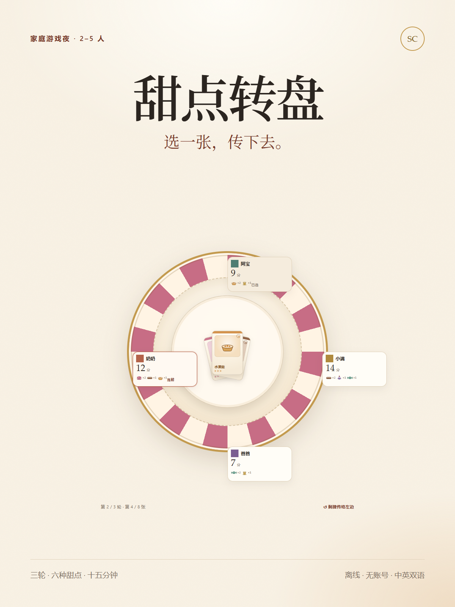
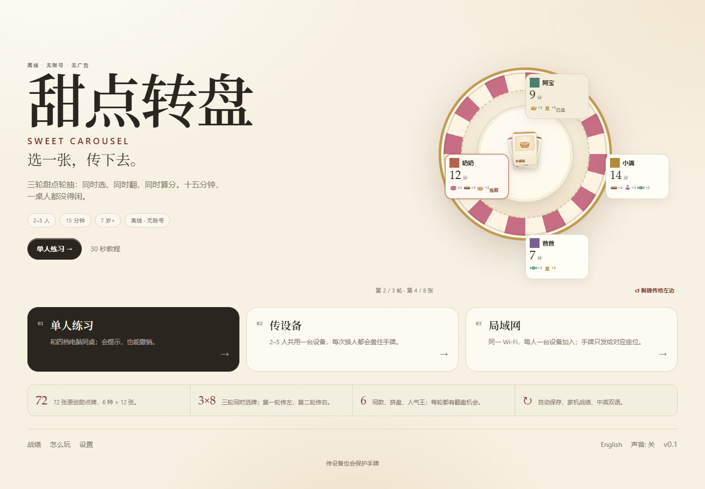
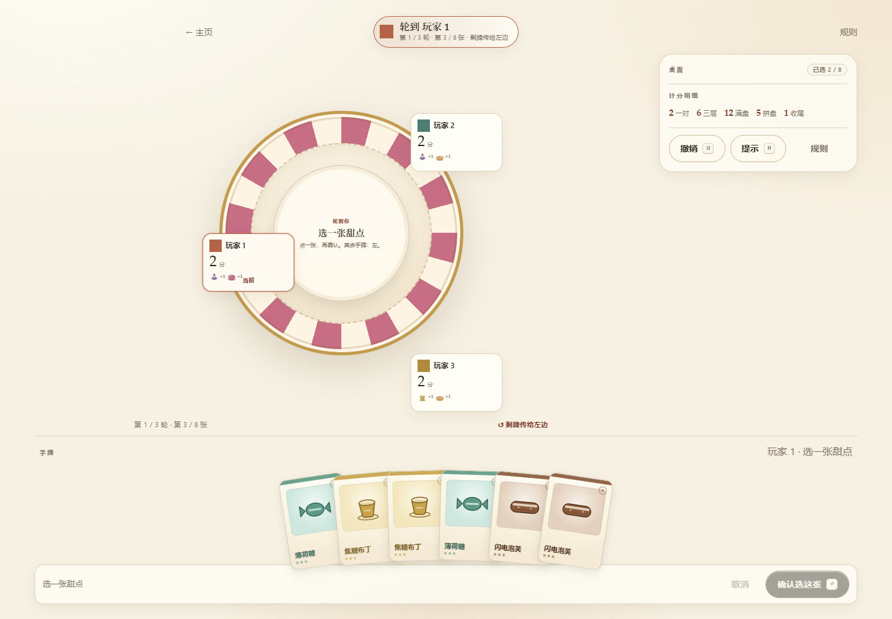
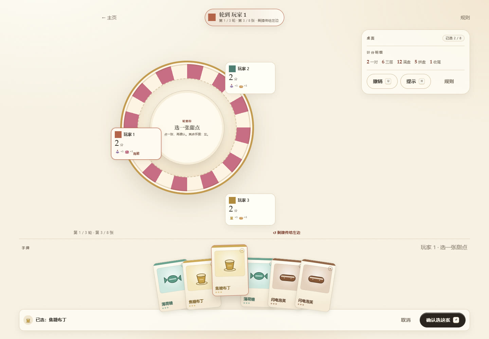
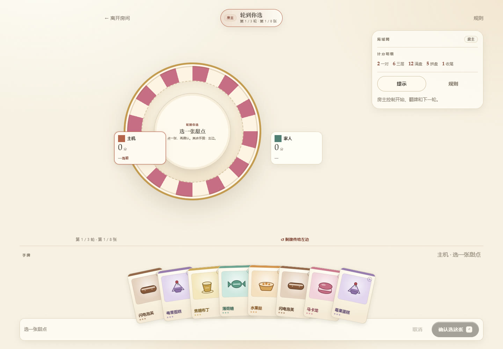
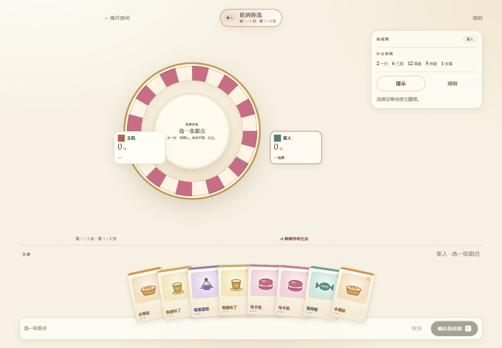
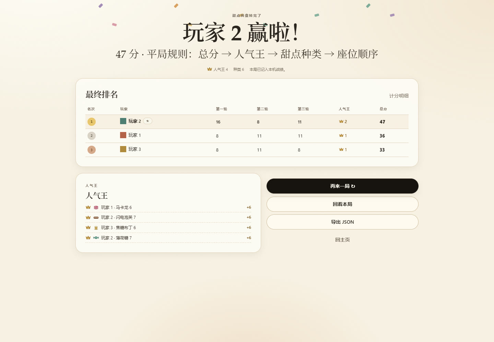
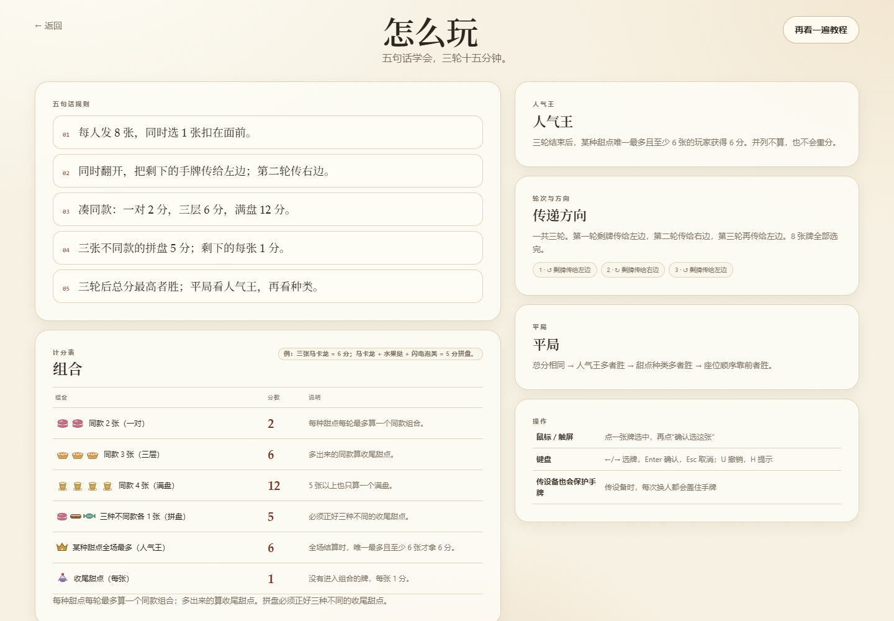
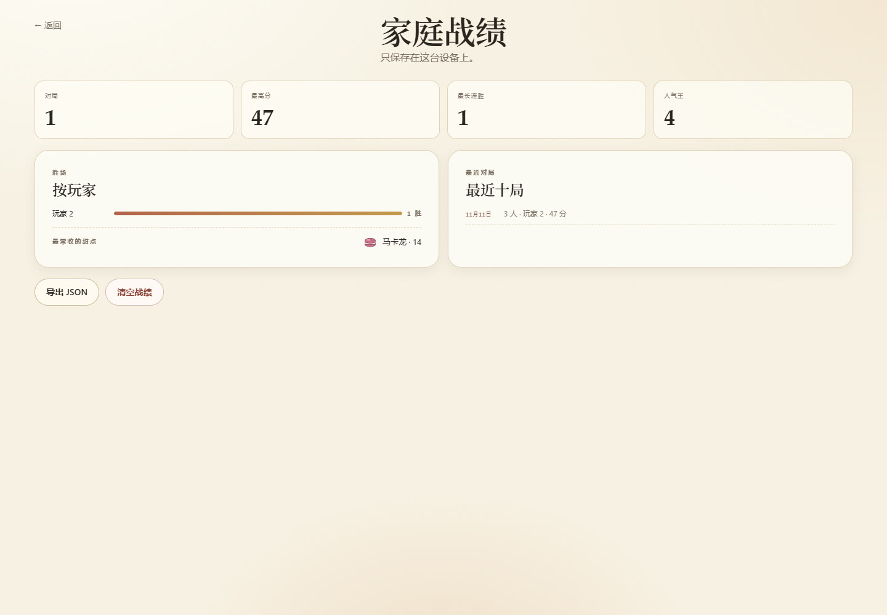
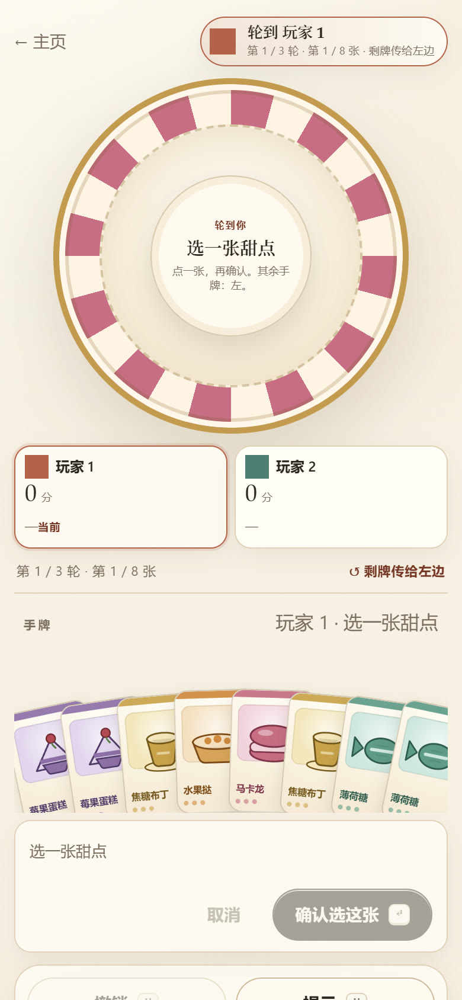

# 甜点转盘 · Sweet Carousel

[English](README.md) | **中文**

> **选一张，传下去。** 一个 2–5 人、十五分钟的甜点轮抽。

一款家庭卡牌游戏：每人同时选一张甜点，把剩下的手牌传给下家，三轮后比组合分。支持一台设备传着玩、单人对抗四档 AI、真实局域网房主/客人牌桌；完整中英双语，无账号、无广告、不依赖公网。

**v0.1 · 2–5 人 · 15 分钟 · 7 岁+ · 局域网 · Tauri 桌面壳 · 加载后离线**

[](docs/promo/sweet-carousel-promo-zh.mp4)

*48.5 秒 · 1920×1080 · 60fps · [English cut](docs/promo/sweet-carousel-promo-en.mp4) · [分镜与核对](video/SCRIPT.md)*

[](docs/screenshots/zh/home.jpg)

## 五秒规则

| 每次选牌 | 怎么得分 | 怎么结束 |
| --- | --- | --- |
| 每人 8 张手牌，同时选 1 张，再同时翻开。 | 一对 2 分，三层 6 分，满盘 12 分；三款拼盘 5 分；收尾每张 1 分。 | 剩牌第一轮传左、第二轮传右、第三轮传左。三轮后总分最高者胜。 |

## 里面有什么

- **一份能核对的规则。** 72 张原创牌，6 种甜点 × 12 张；每条规则都有测试和审计行，见 [`docs/rules.md`](docs/rules.md)。`npm run data:verify` 检查牌库。
- **三种完整玩法。** 单人对抗陪玩 / 轻松 / 标准 / 挑战四档 AI；2–5 人传设备（带隐私遮罩）；真实局域网房主/客人牌桌，含房间号、二维码、座位状态和重连。LAN 走共享 `@family-arcade/lan` 房主权威通道，客人只收到自己座位的过滤视图。
- **隐私做在数据层。** 引擎 `view()` 直接删掉别人的手牌和未翻开的选牌；传设备时遮罩替换整个游戏界面；LAN 每个座位只收到自己的 `view`。见 [`docs/rules.md`](docs/rules.md) 第 4 节。
- **桌子会记事。** 自动保存/继续、本机家庭战绩、JSON 导出、逐轮回看和完整计分明细。
- **小而私密。** 无账号、无遥测、无 CDN、无外部图片和字体。声音是合成的，默认关闭；静音也能完整游玩。

## 截图

全部来自真实运行的应用，1440 × 1000，Playwright + 系统 Chrome。更多见 [`docs/screenshots/README.md`](docs/screenshots/README.md)。

| 真实对局 | 选中一张 |
| --- | --- |
|  |  |

| 局域网房主大厅 | 局域网客人大厅 |
| --- | --- |
|  |  |

| 局域网对局（房主） | 局域网对局（客人） |
| --- | --- |
|  |  |

| 最终排名 | 规则与计分表 |
| --- | --- |
|  |  |

| 开局设置 | 本机战绩 |
| --- | --- |
|  |  |

| 设置 | 手机竖屏 |
| --- | --- |
|  |  |

## 怎么运行

v0.1 是 **Vite 网页应用 + Tauri v2 桌面壳**。网页可直接跑；Tauri 壳配置为按用户安装的 NSIS 安装包，由中央发布流程统一构建，本轮不构建安装包。网页构建产物约 **418 KB JS + 52 KB CSS**（gzip 后约 136 KB），全部本地文件。

```bash
npm install
npm run dev          # http://127.0.0.1:5175
npm run build        # 类型检查 + 生产构建到 dist/
npm run preview      # 预览 dist/
npm run tauri dev    # 桌面开发壳
npm run tauri build  # NSIS 安装包；交给中央发布流程，本轮不跑
```

打开地址，选 **单人练习**、**传设备** 或 **局域网**。首次打开有 30 秒互动教程；截图时可用 `?tutorial=0` 关闭。`?lang=zh` / `?lang=en` 强制语言，`?seed=...` 固定发牌，`?lanPort=8095` 让浏览器房主使用指定中继端口。

### 局域网之夜

LAN 是**房主权威**：房主验证每一次选牌，只给每位客人发送 `view(state, 客人座位)`，从不发送完整手牌。共享中继是 `@family-arcade/lan`；Tauri 壳通过 `lan_start` 启动自己的中继。

```bash
npm run build
npm run lan                 # 浏览器中继 + dist，默认 :8080
# 如果 :8080 被占用，可直接指定端口：
node ../../tools/lan-server.mjs --dist dist --port 8095
# 然后用 ?lanPort=8095 打开房主页
```

1. 房主打开 **局域网 → 开一桌**，选 2–5 个座位并创建房间。
2. 客人在**同一 Wi-Fi** 下扫码或打开邀请链接，填名字加入。
3. 所有座位连接后房主开始。房主控制翻牌和下一轮；客人只能从自己的手牌里选。
4. 客人掉线后刷新邀请链接重新加入，座位会保留。
5. 房主的最终结果记入本机家庭战绩；客人设备只显示结果，不写房主的记录。

**局域网限制：** 仅同一 Wi-Fi；房主页/桌面应用必须保持打开；本版无观战、无 UDP 房间发现、无 AI 托管。邀请链接使用房主页面的主机名——若房主用 `localhost` 打开，手机访问不到；请用局域网 IP 或 Tauri 应用的中继地址。`PROTOCOL_VERSION` 由共享 `@family-arcade/lan` 中继负责，本应用不另造协议。

## 怎么玩

1. 每人发 8 张，同时选 1 张扣在面前。
2. 同时翻开，把剩下的手牌传给左边；第二轮传右，第三轮再传左。
3. 凑同款：一对 2 分，三层 6 分，满盘 12 分。每种甜点每轮最多算一个同款组合，多出来的算收尾。
4. 拼盘必须**正好三种不同的收尾甜点**，各 1 张，5 分；其余收尾牌每张 1 分。
5. 三轮后总分最高者胜。平局先比人气王数量，再比甜点种类，最后比座位顺序。

**人气王。** 全场结算时，某种甜点唯一最多、且至少 **6 张** 的玩家得 6 分；并列不算。人气王是第一个平局判据，所以值得抢。

### 操作

| 操作 | 鼠标 / 触屏 | 键盘 |
| --- | --- | --- |
| 揭开手牌 | 点“我是……开始选牌” | Tab 到按钮，Enter |
| 选一张 | 点一张牌 | ←/→ 移动选择 |
| 确认 | 点“确认选这张” | Tab 到按钮，Enter（或选中牌且焦点不在按钮上时按 Enter） |
| 取消选择 | 点“取消”或再点选中的牌 | Esc |
| 撤销 | 撤销按钮 | U |
| 提示 | 提示按钮 | H |
| 翻牌后传牌 | “剩牌传给左/右” | Tab + Enter |
| LAN 客人选牌 | 选牌 → 确认；由房主结算 | 同样的键盘路径 |
| LAN 房主推进 | “翻牌并传牌” / “下一轮” | Tab + Enter |

**为什么不能选？** 引擎返回稳定错误码，界面翻成人话：已经选过（`already-picked`）、这张牌不在你手里（`card-not-in-hand`）、现在不是选牌阶段（`wrong-phase`）、座位不存在（`bad-seat`）、本局已结束（`game-over`）。完整列表见 [`docs/rules.md`](docs/rules.md)。

## 一局之后

- **自动保存/继续。** 每步后保存；刷新后主页出现“继续上局”。
- **本机战绩。** 对局数、最高分、最长连胜、人气王、按玩家胜场、最常收的甜点，都只存在这台设备的 `localStorage`。LAN **房主**会记录该桌结果，客人不写。设置页可清空。
- **导出。** 结束页导出本局记录和比分；战绩/设置页导出本机 JSON。不含设备指纹、不需要账号。
- **回看。** 结束页可按轮查看每一张选牌和计分明细。目前不是逐步动画复盘。

## 宣传片与海报

根 Family Arcade studio 读取 [`video.json`](video.json)：八句中英旁白、事实、强调色和三张截图名。`docs/promo/` 保留了之前渲染的 48.5 秒成片、SRT 和海报；本轮不在 app 里另建 Remotion 工程。

[](docs/promo/sweet-carousel-promo-zh.mp4)

- **Manifest：** [`video.json`](video.json)，由根 studio 渲染。
- **现有成片：** [中文 MP4](docs/promo/sweet-carousel-promo-zh.mp4) · [English MP4](docs/promo/sweet-carousel-promo-en.mp4)。两版都是 **48.5 秒、1920×1080、60fps、H.264/AAC、yuv420p**，小于 10 MB。
- **字幕：** [中文 SRT](docs/promo/sweet-carousel-promo-zh.srt) · [English SRT](docs/promo/sweet-carousel-promo-en.srt)。画面内也烧录字幕。
- **海报：** [`docs/promo/sweet-carousel-poster-zh.png`](docs/promo/sweet-carousel-poster-zh.png) / [`-en.png`](docs/promo/sweet-carousel-poster-en.png)，1200×1600，由应用本身渲染。
- **声音：** 原创合成音乐床 + 每语言九句 Edge TTS 旁白；母带 **−14.1 LUFS**，真峰值 **−1.0 / −1.5 dBTP**。
- **诚实：** 旧成片早于 LAN；`video.json` 已加入“同屏 + 局域网”。视频不声称已有安装包。

## 开发

```bash
npm install
npm run check        # data:verify + tsc + vitest + build
npm run data:verify  # 72 张、每种 12 张、id 0..71
npm test             # 引擎、计分、AI、120 局模拟
npm run e2e          # 真实 Chrome：单人、传设备、LAN 房主/客人 + 重连、手机
npm run screenshots  # 真实 Chrome 截图（开发服务器在 :5175）
npm run ai:calibrate # 默认 200 局；发布表用 400 局
npm run lan          # 浏览器中继 + dist，默认 :8080
npm run tauri build  # NSIS 安装包；中央发布流程
```

- **引擎契约：** `setup / view / legal / apply / score / result / serialize / deserialize / invariants`，另有 `replay`。`apply` 不修改传入状态，返回 `{ ok, state, events }` 或 `{ ok:false, reason, params }`。
- **确定性：** 发牌用注入的 `mulberry32`；AI 的随机 tie-break 也走注入 RNG；存档带 `version: 1`。
- **AI：** 四档、Web Worker、80ms 预算。挑战档只拿到 `GameView`，用公开信息采样隐藏手牌做短 rollout，不读引擎内部状态。
- **LAN：** 共享 `@family-arcade/lan`，房主权威。客人只发 intent，房主验证并只向每个座位发送过滤后的 `view`。浏览器开发中继是 `tools/lan-server.mjs`；Tauri 壳启动 `family-arcade-lan-host`。
- **数据：** `data/cards.json` 带版本、来源、数量；`scripts/verify-data.mjs` 是门禁。
- **共享代码：** 只 import `@family-arcade/lan`；规则、AI 和界面都在本 app。

### 架构

```
src/game/        纯引擎：类型、数据、计分、状态机、RNG
src/ai/          评估、采样 rollout、Worker + 客户端
src/ui/          React 页面、牌面、转盘、隐私遮罩、LAN 页面
src/net.ts       Tauri/浏览器中继检测、邀请 URL、WS URL
src/i18n.ts      完整中英文字典
src/storage.ts   设置、自动保存、本机战绩、导出
data/cards.json  72 张原创牌 + 元数据
tests/           引擎、计分、120 局模拟、AI
scripts/         数据校验、AI 校准、E2E、截图
docs/            规则审计、限制、决策、LAN 截图
video.json       根 studio 的 manifest；docs/promo 保留旧成片
```

LAN 线协议和房主选举由共享 `@family-arcade/lan` 负责；本 app 没有额外协议版本号。

## 许可与声明

代码与原创资产采用 MIT，见 [`LICENSE`](LICENSE)。**《甜点转盘》是一个原创、非商业的家庭项目**，不隶属于任何出版商，也未获其背书。没有使用第三方卡牌文字、美术、版图或出版商名称。机制借鉴公版轮抽惯例，所有表达均为原创。详见 [`NOTICE.md`](NOTICE.md)。

已知缺口诚实写在 [`docs/limitations.md`](docs/limitations.md)：无观战/AI 托管、无公网、安装包由中央构建、真机测试、完整复盘和校准范围。
